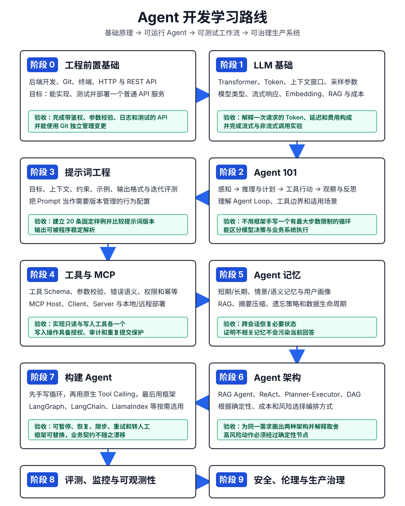
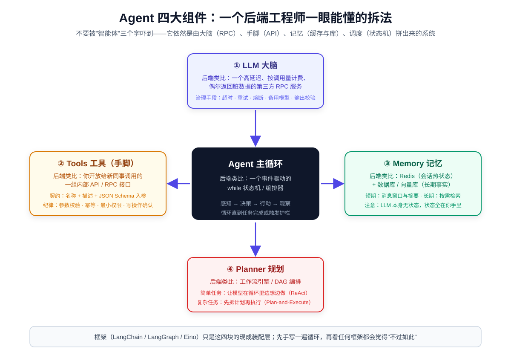
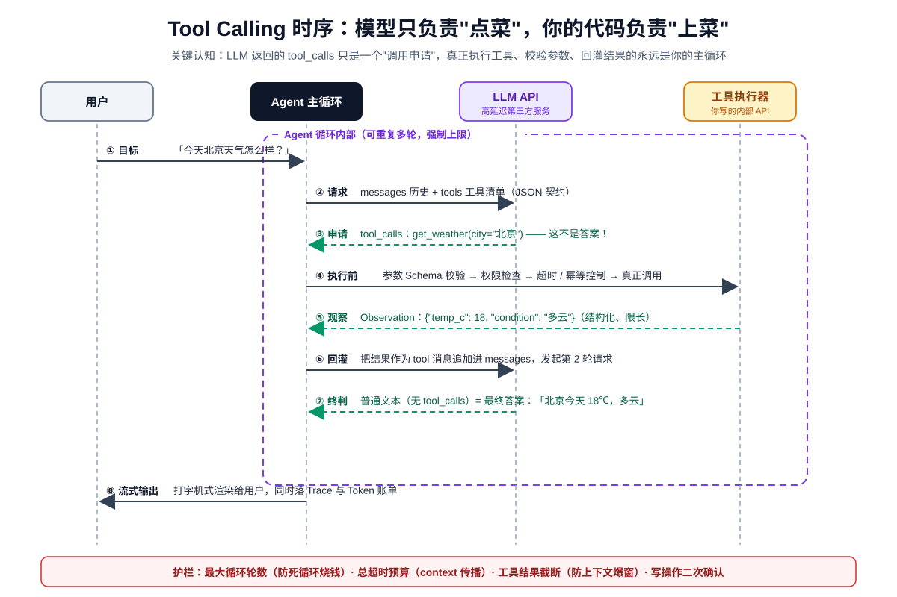
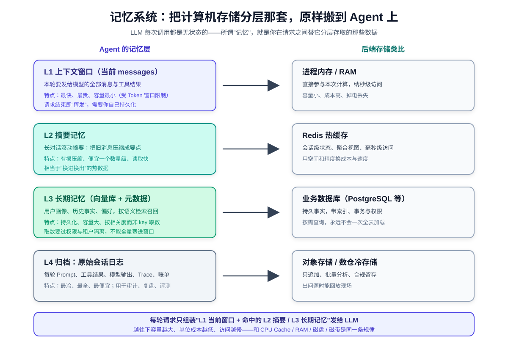
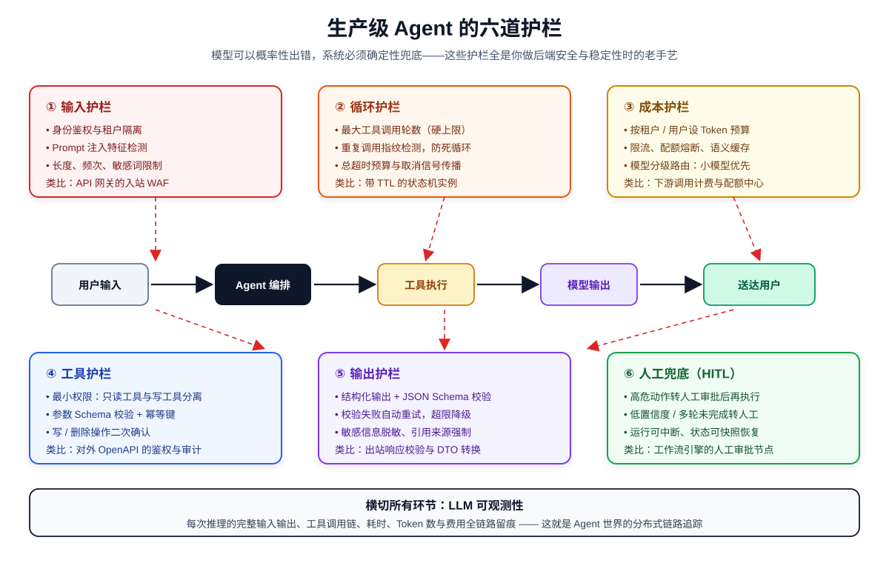

# Agent 开发学习路线

> 参考 [roadmap.sh AI Agents Roadmap](https://roadmap.sh/ai-agents)，结合后端工程师的能力迁移路径，整理为一条可执行、可验收、面向生产环境的学习路线。  
> 路线基准日期：2026-11-09。roadmap.sh 会持续更新，学习时应以原站最新节点为准。[cite:1][cite:2]

## 一、先看结论

学习 Agent 开发，不应从背框架 API 开始，而应按下面的依赖关系推进：

1. 先具备普通后端开发、Git、终端和 REST API 基础。
2. 再理解 LLM 的能力边界、Token、上下文窗口、采样和成本。
3. 手写一个最小 Agent Loop，弄清模型、工具、状态和业务系统之间的责任。
4. 依次补上 Prompt、Tool Calling、MCP、Memory、RAG 和编排。
5. 最后用评测、可观测性、安全护栏、人工审批和故障恢复把它变成生产系统。



整条路线的核心不是“让模型更自主”，而是逐步建立以下能力：

| 能力层 | 要解决的问题 | 最终产出 |
|---|---|---|
| 模型层 | 模型能理解什么、会在哪里失控 | 可解释的模型参数与成本配置 |
| Agent 层 | 如何形成感知、决策、行动、观察闭环 | 有限步数、可中断的 Agent Loop |
| 工具层 | 如何安全访问真实业务能力 | 参数校验、授权、幂等、审计完备的工具 |
| 状态层 | 如何跨步骤、跨会话、跨进程恢复 | 显式 AgentState 与检查点 |
| 知识层 | 如何使用私有、实时、可追溯知识 | 有引用与评测集的 RAG |
| 编排层 | 如何组合确定性流程与模型决策 | 可暂停、恢复、转人工的状态图 |
| 生产层 | 如何发现错误、控制成本、限制破坏范围 | Eval、Tracing、Guardrails、HITL |

## 二、学习路线与时间安排

下面的 12 周安排适合已有 Go、Python 或其他后端经验的开发者。完全没有后端基础时，应先完成阶段 0，再进入 12 周主线。

| 周次 | 学习阶段 | 可交付成果 | 通过标准 |
|---|---|---|---|
| 第 0 周 | 工程前置基础自检 | 一个普通 REST API | 有鉴权、校验、日志、数据库和测试 |
| 第 1 周 | LLM 基础 | 模型调用实验仓库 | 能解释 Token、上下文、采样、流式和费用 |
| 第 2 周 | Agent 101 | 手写最小 Agent Loop | 可调用工具、限制步数、处理工具错误 |
| 第 3 周 | Prompt Engineering | Prompt 版本与固定评测集 | 20 条样例可自动回归 |
| 第 4 周 | Tool Calling | 两个生产级工具 | Schema、授权、幂等、超时、审计完整 |
| 第 5 周 | MCP | 一个 MCP Server 和 Client | 本地与远程模式至少跑通一种 |
| 第 6 周 | Memory | 短期状态与长期记忆原型 | 能恢复会话，也能删除和过期 |
| 第 7 周 | RAG | 带引用的知识库问答 | 检索与回答分别评测 |
| 第 8 周 | Agent 架构 | ReAct 与 Planner-Executor 对照实现 | 能解释为什么选择某种编排 |
| 第 9 周 | 框架化构建 | LangGraph 工作流 | 支持 checkpoint、HITL 和断点续跑 |
| 第 10 周 | 评测与可观测性 | Eval 数据集与 Trace 面板 | 每次改动可比较质量、成本和延迟 |
| 第 11 周 | 安全与红队 | 攻击用例集和安全护栏 | 越权、注入、敏感数据场景被阻止 |
| 第 12 周 | 综合项目 | 企业级工单 Agent | 异常可发现、阻止、恢复并转人工 |

---

## 三、阶段 0：工程前置基础

roadmap.sh 把以下三项放在 Agent 路线入口，它们不是可跳过的“传统知识”，而是 Agent 可靠执行的基础。[cite:1]

### 3.1 必学内容

#### 基础后端开发（Basic Backend Development）

- 语言基础：优先 Python，同时保留 Go 作为高并发接入层能力。
- HTTP 服务、路由、中间件、配置、日志和异常处理。
- 关系型数据库、事务、缓存、消息队列和后台任务。
- 身份认证、权限校验、参数校验和审计日志。
- 单元测试、集成测试、容器化和基本部署。

#### Git 与终端（Git and Terminal Usage）

- 分支、提交、合并、冲突处理和回滚。
- 环境变量、管道、重定向、进程和网络诊断。
- 使用 `curl`、`jq`、`rg`、`git`、`docker` 排查问题。

#### REST API 知识（REST API Knowledge）

- URI、HTTP Method、状态码、Header 和 JSON Schema。
- 超时、重试、幂等、分页、限流和版本管理。
- 服务端必须重新校验 Agent 提交的全部参数与权限。

### 3.2 动手任务

实现一个“工单 API”：

- `POST /tickets`：创建工单。
- `GET /tickets/{id}`：查询工单。
- `POST /tickets/{id}/close`：关闭工单。
- 写操作要求 JWT 鉴权、参数校验和幂等键。
- 对重复请求、非法状态转换和越权访问编写测试。

### 3.3 验收标准

- [ ] 能独立实现并测试一个普通业务 API。
- [ ] 知道重试为什么可能造成重复写入。
- [ ] 能区分认证（Authentication）与授权（Authorization）。
- [ ] 能用日志和 Trace ID 定位一次失败请求。

---

## 四、阶段 1：LLM 基础

这一阶段的目标不是训练模型，而是理解模型作为外部服务时的输入、输出、成本和不确定性。

### 4.1 Transformer 与大语言模型

需要掌握到“能够指导工程决策”的程度：

- Transformer 的注意力机制解决了什么问题。
- Token 是模型处理文本的基本计量单位，不等同于汉字或单词。
- 上下文窗口限制一次请求能携带的历史、文档和工具定义总量。
- 模型输出是条件概率采样结果，不是确定性函数返回值。
- 推理模型（Reasoning Model）与标准生成模型的延迟、成本和适用任务不同。

### 4.2 模型家族与许可证

| 类型 | 英文 | 优点 | 代价 | 适用场景 |
|---|---|---|---|---|
| 开放权重模型 | Open-weight Model | 可私有化、可定制、数据控制强 | 部署、扩缩容和评测成本高 | 强合规、离线、本地推理 |
| 闭源托管模型 | Closed-weight Model | 上手快、能力更新快、运维少 | 数据边界、供应商依赖和调用成本 | 快速验证、通用高难任务 |

选择模型时至少比较：任务成功率、结构化输出稳定性、工具调用能力、上下文长度、首 Token 延迟、完整响应延迟、吞吐、单价、数据保留策略和区域合规。

### 4.3 模型机制（Model Mechanics）

| 参数/概念 | 中文解释 | 工程影响 |
|---|---|---|
| 分词（Tokenization） | 文本被切分成模型可处理的单位 | 决定上下文占用和计费 |
| 上下文窗口（Context Window） | 单次推理可接收的 Token 上限 | 历史、文档、工具 Schema 会争抢预算 |
| 温度（Temperature） | 调整采样随机性 | 业务工具选择通常应偏低 |
| 核采样（Top-p） | 只在累计概率达到阈值的候选中采样 | 通常不要同时激进调整温度和 Top-p |
| 频率惩罚（Frequency Penalty） | 抑制高频重复词 | 适合减少机械重复 |
| 存在惩罚（Presence Penalty） | 鼓励引入未出现过的内容 | 事实型任务不宜过高 |
| 停止条件（Stopping Criteria） | 命中特定条件时终止生成 | 防止无界输出 |
| 最大长度（Max Length） | 限制输出 Token 数 | 控制成本和最坏延迟 |

### 4.4 必须理解的边界

- 流式响应（Streaming）改善首屏体验，但不减少总生成量。
- Fine-tuning 主要调整行为与模式，不应被当作实时知识库。
- Embedding 把内容映射为向量，向量相近只代表语义相关，不代表事实正确。
- RAG 解决外部知识接入与溯源问题，但检索错误仍会导致回答错误。
- 模型价格不仅看输入输出单价，还要看缓存、重试、工具循环次数和失败率。

### 4.5 动手任务

用同一组 30 条问题测试两个模型：

- 比较非流式与流式调用。
- 固定输入，分别修改 Temperature、Top-p 和最大输出长度。
- 记录输入 Token、输出 Token、首 Token 延迟、总延迟和费用。
- 分别测试普通问答、结构化 JSON、工具选择和长文档问答。

### 4.6 验收标准

- [ ] 能说明为什么同一 Prompt 会得到不同答案。
- [ ] 能为任务选择模型，而不是只看榜单总分。
- [ ] 能估算一次 Agent 任务的最坏 Token 与费用。
- [ ] 知道何时用 Prompt、RAG、Fine-tuning 或普通代码。

---

## 五、阶段 2：Agent 101

### 5.1 什么是 AI Agent

AI Agent 是一个围绕目标持续执行“接收信息、决定下一步、调用外部能力、观察结果、更新状态”的系统。LLM 只是决策组件，真正的 Agent 还包括工具、状态、循环控制、权限和错误处理。



### 5.2 Agent Loop

roadmap.sh 将基本闭环拆为四步：[cite:1]

1. **感知/用户输入（Perception / User Input）**：读取用户目标、环境状态和历史。
2. **推理与计划（Reason and Plan）**：判断是否能直接回答、调用哪个工具或如何拆解任务。
3. **行动/工具调用（Acting / Tool Invocation）**：生成结构化参数，由应用程序执行工具。
4. **观察与反思（Observation & Reflection）**：读取工具结果，判断继续、修正、结束或转人工。

```text
用户目标
  ↓
读取状态与可用工具
  ↓
模型决定下一步
  ├─ 直接回答 → 结束
  ├─ 请求工具 → 校验 → 执行 → 写回观察结果 ─┐
  └─ 请求人工 → 暂停并等待审批                │
                                                └─ 回到模型
```

每个循环都必须有：

- 最大步数（Max Steps）。
- 总超时（Deadline）。
- Token 与费用预算。
- 可取消信号。
- 工具白名单与权限上下文。
- 明确的完成、失败、暂停和转人工状态。

### 5.3 适合与不适合的场景

适合：个人助理、代码生成、数据分析、网页采集、游戏 NPC、工单分类和知识问答。

不适合直接自治：

- 输入输出不能数字化或无法验证。
- 错误不可回滚。
- 涉及大额支付、医疗诊断、信贷审批等高风险最终决策。
- 没有明确权限边界和人工兜底。

### 5.4 动手任务与验收

先阅读并运行 [[从零搭建高并发企业级Agent系统教程]] 的“第二章 手写完整 Agent Loop”。

- [ ] Agent 能直接回答，也能发出工具调用。
- [ ] 工具异常不会使循环无限重试。
- [ ] 达到最大步数后以明确状态终止。
- [ ] 日志能按时间线说明每一步“为何执行、输入什么、结果如何”。

---

## 六、阶段 3：提示词工程

### 6.1 Prompt 的基本结构

一个可维护的生产 Prompt 通常包含：

1. **角色与目标**：系统负责什么，不负责什么。
2. **上下文**：业务背景、用户身份、当前状态和允许使用的信息。
3. **约束**：禁止事项、权限边界、截止条件和失败策略。
4. **工具规则**：何时调用、参数要求、哪些动作必须审批。
5. **输出契约**：JSON Schema、字段含义、语言和长度。
6. **示例**：覆盖正常、边界、拒绝和转人工场景。

### 6.2 roadmap.sh 的写好 Prompt 清单

- 明确具体地描述目标（Be specific in what you want）。
- 提供必要的附加上下文（Provide additional context）。
- 使用准确的技术术语（Use relevant technical terms）。
- 提供输入输出示例（Use examples in your prompt）。
- 迭代并测试 Prompt（Iterate and test your prompts）。
- 指定长度、格式和其他约束（Specify length, format, etc.）。

### 6.3 工程化要求

- Prompt 纳入 Git 版本管理。
- Prompt 与模型版本、参数和工具集合一起记录。
- 每次修改都运行固定 Eval 数据集。
- 不把密钥、数据库凭证或不可撤销权限放进 Prompt。
- 外部文档是“不可信数据”，不能覆盖系统级指令。

### 6.4 验收标准

- [ ] 至少有 20 条固定测试样例。
- [ ] 输出结构能被 JSON Schema 或 Pydantic 稳定校验。
- [ ] 对缺失信息会询问或拒绝，不擅自补全关键参数。
- [ ] Prompt 修改前后有成功率、格式正确率、成本和延迟对比。

---

## 七、阶段 4：工具、动作与 MCP

### 7.1 什么是工具

工具（Tool）是应用程序允许模型请求使用的一项能力。模型只产生“调用意图和参数”，真正执行发生在应用侧。官方 Function Calling 流程包括：把工具定义发给模型、接收工具调用、应用执行代码、回传工具结果、模型生成最终响应或继续调用。[cite:3]



### 7.2 工具定义

roadmap.sh 要求工具定义至少包含：

| 字段 | 英文 | 要求 |
|---|---|---|
| 名称与描述 | Name and Description | 名称稳定；说明何时使用、何时不要使用 |
| 输入输出 Schema | Input / Output Schema | 类型、必填项、枚举、范围和格式明确 |
| 错误处理 | Error Handling | 区分可重试、不可重试、权限不足和业务冲突 |
| 使用示例 | Usage Examples | 覆盖正常与边界调用 |

生产级工具还应加入：

- 鉴权与授权。
- 幂等键和去重。
- 超时、重试、熔断和限流。
- 输入校验与输出净化。
- 审计日志与 Trace ID。
- 高风险操作的人类确认。

常见工具包括：Web Search、代码执行/REPL、数据库查询、API 请求、Email/Slack/SMS 和文件系统访问。风险从“只读查询”到“外部写入/代码执行”逐步升高，权限也必须逐级收紧。

### 7.3 Model Context Protocol

MCP 是连接 AI 应用与外部数据源、工具和工作流的开放标准。它把集成拆为 Host、Client 和 Server，使工具提供方与 Agent 应用可以独立演进。[cite:4]

| 组件 | 中文名称 | 职责 |
|---|---|---|
| MCP Host | MCP 宿主 | 承载 AI 应用，管理用户交互、权限与多个 Client |
| MCP Client | MCP 客户端 | 与一个 Server 建立连接并调用其能力 |
| MCP Server | MCP 服务端 | 暴露工具、资源或提示模板 |

学习顺序：

1. 先实现普通本地函数工具。
2. 再把工具封装为 MCP Server。
3. 编写或配置 MCP Client。
4. 理解本地桌面（Local Desktop）与远程/云（Remote / Cloud）部署的认证差异。
5. 为远程 MCP 增加传输安全、身份映射、权限收敛和审计。

### 7.4 验收标准

- [ ] 一个只读工具和一个写入工具均有严格 Schema。
- [ ] 非法参数在进入业务逻辑前被拒绝。
- [ ] 同一写请求重复提交不会产生重复副作用。
- [ ] 能解释 MCP Host、Client、Server 的边界。
- [ ] 能证明模型无法绕过后端权限校验。

---

## 八、阶段 5：Agent Memory

### 8.1 先区分上下文与记忆

- **上下文（Context）**：当前模型调用实际携带的内容。
- **状态（State）**：工作流继续执行所需的结构化数据。
- **记忆（Memory）**：跨步骤或跨会话保留、检索和使用的信息。
- **检查点（Checkpoint）**：某一执行时刻的可恢复状态快照。



### 8.2 记忆类型

| 类型 | 英文 | 示例 | 常见存储 |
|---|---|---|---|
| 短期记忆 | Short-term Memory | 当前对话、当前任务状态 | Prompt、Redis、Checkpoint |
| 长期记忆 | Long-term Memory | 用户偏好、历史事实、长期知识 | PostgreSQL、向量库、对象存储 |
| 情景记忆 | Episodic Memory | 某次任务发生了什么 | 事件日志、执行轨迹 |
| 语义记忆 | Semantic Memory | 稳定事实和概念 | 知识库、关系库、向量索引 |

### 8.3 维护记忆

roadmap.sh 列出的主要手段包括：

- RAG 与向量数据库。
- 用户画像存储。
- 摘要与压缩。
- 遗忘与老化策略。

生产系统还必须回答：

- 谁写入了这条记忆？
- 这条记忆的来源和可信度是什么？
- 何时过期、何时重新验证？
- 用户能否查看、更正和删除？
- 是否包含 PII 或受监管数据？
- 被检索到后，是否应该进入当前任务上下文？

### 8.4 验收标准

- [ ] 重启 Worker 后可以从检查点继续。
- [ ] 用户 A 的记忆不会泄露给用户 B。
- [ ] 记忆有来源、时间、作用域、版本和过期策略。
- [ ] 能用对抗性测试证明旧记忆不会覆盖当前明确指令。

---

## 九、阶段 6：RAG 与 Agent 架构

### 9.1 RAG 基础

先完成 [[RAG]] 和 [[RAG系统的详细工作流程]]，理解：

- 文档加载、清洗、切分和元数据。
- Embedding 与向量索引。
- Query 改写、召回、过滤和重排。
- 上下文组装、引用与回答生成。
- 检索质量和回答质量必须分开评测。

### 9.2 常见 Agent 架构

| 架构 | 核心思想 | 适用场景 | 主要风险 |
|---|---|---|---|
| RAG Agent | 把检索作为可选工具 | 多知识源、需要自主决定是否检索 | 漏检索、错误检索、引用不一致 |
| ReAct | 推理与行动交替 | 探索性任务、工具反馈会改变下一步 | 循环过长、成本不可控 |
| Chain of Thought | 用中间推理帮助复杂任务 | 数学、规划、分解 | 不应依赖暴露隐藏推理作为审计证据 |
| Planner-Executor | 先计划，再逐步执行 | 多步骤且需要跟踪进度 | 计划过时、执行偏离 |
| DAG Agent | 用有向无环图表达依赖 | 步骤和依赖相对确定、可并行 | 动态性较弱 |
| Tree of Thought | 探索多个候选分支再选择 | 搜索空间大、答案可评价 | Token 和延迟成本高 |

### 9.3 架构选择原则

优先使用最简单且可验证的方案：

1. 普通代码能解决，就不用 Agent。
2. 固定步骤能解决，就用 Workflow/DAG。
3. 只有下一步必须依赖模型判断时，才引入 Agent Loop。
4. 只有单 Agent 的上下文、权限或专业边界确实不可管理时，才考虑 Multi-Agent。
5. 高风险动作应落到确定性节点，并由后端做最终校验。

### 9.4 验收标准

- [ ] 能为同一需求画出 ReAct 和 Planner-Executor 两种方案。
- [ ] 能解释每种方案的成本、延迟、可测试性与恢复语义。
- [ ] 关键业务状态不是只保存在聊天消息里。
- [ ] 能从任意持久化节点恢复，而不会重复执行已完成副作用。

---

## 十、阶段 7：构建 Agent

### 10.1 手写实现

先从零实现以下部分：

- 直接调用 LLM API。
- 定义并注册工具。
- 解析模型输出。
- 执行工具并回传结果。
- 实现 Agent Loop。
- 加入错误分类、重试、最大步数和限时。

手写阶段的价值是建立正确心智模型。没有这一层，框架报错时很难判断问题属于模型、Schema、状态、工具还是编排。

### 10.2 原生 Function Calling

学习至少一种模型提供商的原生工具调用协议，同时理解不同提供商在消息格式、并行工具调用、严格 Schema、流式事件和推理状态上的差异。

roadmap.sh 列出的方向包括：

- OpenAI Functions Calling。
- OpenAI Assistant API。
- Gemini Function Calling。
- Anthropic Tool Use。

业务代码不应直接散落提供商特有结构。建议定义内部统一契约：

```text
ModelRequest
ModelResponse
ToolDefinition
ToolCall
ToolResult
AgentState
RunStatus
```

### 10.3 使用框架

roadmap.sh 列出了 LangChain、LlamaIndex、Haystack、AutoGen、CrewAI 和 Smol Depot。实际工程中还应重点掌握 LangGraph：它提供持久状态、长运行工作流、流式过程和 Human-in-the-Loop，适合构建可控、可恢复的 Agent。[cite:5]

| 框架 | 主要定位 | 何时考虑 |
|---|---|---|
| LangGraph | 有状态图编排与恢复 | 长流程、审批、暂停恢复、复杂状态 |
| LangChain | 模型、工具与链式组件生态 | 快速组合通用 LLM 能力 |
| LlamaIndex | 数据接入与 RAG | 知识密集型 Agent |
| Haystack | 检索与 Pipeline | 搜索、问答、可组合数据流 |
| AutoGen / CrewAI | 多 Agent 协作 | 角色边界确实清晰的协作任务 |

不要同时学习所有框架。建议顺序是：手写 Loop → 原生 Tool Calling → LangGraph → 根据项目需要补其他框架。

### 10.4 验收标准

- [ ] Agent 支持暂停、继续、取消和超时。
- [ ] 每次状态转换都有版本号或并发控制。
- [ ] 重试不会重复执行外部副作用。
- [ ] 框架可以替换，工具契约和领域逻辑仍可复用。

---

## 十一、阶段 8：评测、调试与可观测性

### 11.1 评测指标

不要只评“最终答案看起来不错”。至少跟踪：

| 指标 | 英文 | 说明 |
|---|---|---|
| 任务成功率 | Task Success Rate | 是否完成用户真实目标 |
| 工具选择正确率 | Tool Selection Accuracy | 是否选对工具 |
| 参数正确率 | Argument Accuracy | 工具参数是否完整、合法、符合事实 |
| 轨迹有效率 | Trajectory Efficiency | 是否存在无意义循环和多余工具调用 |
| 引用忠实度 | Faithfulness | 回答是否得到检索证据支持 |
| 安全拒绝率 | Safe Refusal Rate | 高风险或越权请求是否正确拒绝 |
| 人工接管率 | Human Escalation Rate | 转人工是否发生在正确边界 |
| 延迟 | Latency | 首 Token、模型、工具和端到端耗时 |
| 单任务成本 | Cost per Task | 模型、检索、工具和重试总成本 |

### 11.2 测试层级

1. **工具单元测试**：不调用模型，验证 Schema、权限、幂等和错误语义。
2. **流程集成测试**：使用 Fake Model 固定输出，验证状态转换和恢复。
3. **模型评测**：固定数据集，比较模型和 Prompt 版本。
4. **Human-in-the-Loop Evaluation**：人工标注难例、风险和体验问题。
5. **红队测试**：主动测试注入、越权、敏感信息和资源耗尽。

### 11.3 调试与监控

结构化日志与 Trace 至少记录：

- `run_id`、`thread_id`、`user_id`、`tenant_id`。
- 模型、Prompt 版本、工具集合版本。
- 每一步状态、耗时、Token、费用和错误类型。
- 工具名称、经过脱敏的参数摘要、结果摘要。
- 重试原因、暂停原因、审批人和最终状态。

可选工具包括 LangSmith、DeepEval、Ragas、Helicone、LangFuse 和 OpenLLMetry。工具只是载体，关键是统一 Trace 语义和可比较的 Eval 数据集。

### 11.4 验收标准

- [ ] 任意失败任务都能按 `run_id` 还原时间线。
- [ ] Prompt 或模型升级前后有自动对比报告。
- [ ] 测试包含超时、空结果、重复调用、越权和并发冲突。
- [ ] 线上指标能区分模型慢、工具慢、队列慢和客户端断开。

---

## 十二、阶段 9：安全、伦理与生产治理

roadmap.sh 将 Prompt Injection、工具沙箱、数据隐私、偏见与红队测试放在路线终点；在真实项目里，这些要求应从第一个工具开始贯穿全程。OWASP 明确列出了提示词注入、不安全输出处理、敏感信息泄露、插件设计不安全和过度代理权等风险。[cite:6] NIST AI RMF 则强调在设计、开发、使用和评估全过程管理可信性风险。[cite:7]



### 12.1 五类核心风险

#### Prompt Injection / Jailbreak

- 把用户输入、网页、邮件、RAG 文档都视为不可信数据。
- 系统指令与外部内容分层，不允许外部文本重定义权限。
- 工具调用前重新做策略判断，不依赖模型说“这是安全的”。

#### 工具沙箱与权限（Tool Sandboxing / Permissioning）

- 最小权限、默认拒绝、工具白名单。
- 文件系统限制根目录，网络限制目标域名。
- 代码执行使用隔离容器、CPU/内存/时间配额。
- 写操作需要幂等键；高风险操作需要审批。

#### 数据隐私与 PII 脱敏

- Prompt、日志、Trace 和 Eval 数据都可能包含敏感信息。
- 传给模型前脱敏，日志落盘前再次脱敏。
- 明确数据保留、删除、跨境和供应商训练策略。

#### 偏见与有害内容

- 定义禁止自动决策的高风险领域。
- 按用户群体评估错误率差异。
- 对拒绝、申诉和人工复核保留通道。

#### 安全与红队测试

- 构造直接注入、间接注入、编码绕过和多轮诱导。
- 测试越权读写、跨租户泄露、工具参数污染。
- 测试无限循环、超长输入、并发洪峰和成本耗尽。

### 12.2 生产准入清单

- [ ] 模型没有数据库直连和核心系统永久凭证。
- [ ] 后端保留最终业务校验与授权。
- [ ] 所有写工具可审计、可去重，必要时可补偿。
- [ ] Agent 有步数、时间、Token、费用和并发预算。
- [ ] 高风险动作可以暂停并等待人工审批。
- [ ] 检查点恢复不会重复执行副作用。
- [ ] 敏感数据在 Prompt、日志、Trace 中均受保护。
- [ ] 红队用例进入持续回归。
- [ ] 降级方案不依赖模型仍可工作。

---

## 十三、三个递进实战项目

### 项目一：只读知识库 Agent

**目标**：回答内部文档问题，并返回引用来源。

必须包含：

- 文档加载、切分、Embedding、检索和重排。
- RAG 作为显式工具。
- 无证据时拒绝回答。
- 检索 Recall 与回答 Faithfulness 评测。

重点验证：RAG、工具调用、引用和离线 Eval。

### 项目二：带审批的工单 Agent

**目标**：查询工单、补充信息、分类、建议处理方案，并在审批后执行关闭或转派。

必须包含：

- 显式 AgentState。
- 只读与写入工具分级。
- JWT 身份、租户隔离、权限校验。
- Human-in-the-Loop。
- 幂等、检查点和断点恢复。

重点验证：工具安全、状态机、审批和副作用一致性。

### 项目三：高并发企业级 Agent 平台

**目标**：实现 Go 接入层与 Python Agent Worker 分离的异步系统。

推荐架构：

- Go + Gin/Hertz：API、SSE、鉴权、限流和连接管理。
- Kafka：任务队列、异步解耦和削峰。
- Python + LangGraph：状态图、工具编排、RAG 和 HITL。
- Redis：会话路由、事件流和短期状态。
- PostgreSQL + pgvector：业务数据、检查点和向量索引。
- OpenTelemetry：日志、指标和链路追踪。

直接进入 [[从零搭建高并发企业级Agent系统教程]]，并参考 [[Go-Python后端工程师转Agent开发实战教程]] 完成能力迁移。

重点验证：高并发、恢复、可观测性、成本、安全和灰度发布。

---

## 十四、学习方法与避坑

### 14.1 推荐方法

- 每学一个概念，都实现一个最小可运行例子。
- 先用 Fake Model 锁定确定性流程，再接真实模型。
- 先做只读工具，再做有副作用的写工具。
- 先单 Agent，再评估是否真的需要 Multi-Agent。
- 先建立 Eval，再修改 Prompt、模型或框架。
- 每个阶段都保留失败样例，持续扩充对抗性测试集。

### 14.2 常见误区

| 误区 | 为什么有问题 | 正确做法 |
|---|---|---|
| 一开始就学多个框架 | 容易只会拼 API，不懂状态和循环 | 先手写 Loop，再选一个框架 |
| 把 Prompt 当业务规则 | 模型输出不具备确定性和强制性 | 规则、权限和事务留在后端 |
| Agent 直连数据库 | 无法收敛权限和审计副作用 | 只通过受控工具/API 访问 |
| 只测试最终文本 | 无法定位工具、检索或轨迹错误 | 分层评测模型、工具、检索和流程 |
| 用长上下文代替记忆设计 | 成本高、污染严重、不可治理 | 显式状态、摘要、检索和过期 |
| 盲目使用 Multi-Agent | 增加通信、成本和调试难度 | 先证明单 Agent 无法满足边界 |
| 上线后再补安全 | 工具权限和数据流已难以重构 | 从第一个工具开始最小权限 |

---

## 十五、中英文术语对照表

| 中文名称 | English Term | 含义 |
|---|---|---|
| 人工智能智能体 | AI Agent | 围绕目标感知、决策、行动并观察结果的系统 |
| 智能体循环 | Agent Loop | 感知、计划、行动、观察的重复执行闭环 |
| 大语言模型 | Large Language Model, LLM | Agent 中常用的语言理解和决策组件 |
| 分词 | Tokenization | 把文本转换为模型处理单位 |
| 上下文窗口 | Context Window | 单次模型调用可处理的 Token 容量 |
| 提示词工程 | Prompt Engineering | 设计、约束、测试和迭代模型输入 |
| 工具调用 | Tool Calling / Function Calling | 模型请求应用执行外部能力的机制 |
| 工具定义 | Tool Definition | 工具名称、描述、输入输出和错误契约 |
| 模型上下文协议 | Model Context Protocol, MCP | AI 应用连接外部工具和数据的开放标准 |
| 检索增强生成 | Retrieval-Augmented Generation, RAG | 检索外部知识并辅助模型生成 |
| 嵌入 | Embedding | 把内容映射为向量表示 |
| 向量检索 | Vector Search | 按向量相似度召回内容 |
| 短期记忆 | Short-term Memory | 当前任务或会话使用的临时信息 |
| 长期记忆 | Long-term Memory | 跨会话保留的信息 |
| 情景记忆 | Episodic Memory | 对具体经历或执行事件的记录 |
| 语义记忆 | Semantic Memory | 对事实、概念和关系的记录 |
| 智能体状态 | Agent State | 驱动工作流继续执行的结构化状态 |
| 检查点 | Checkpoint | 可用于恢复执行的状态快照 |
| 思考与行动 | ReAct, Reason + Act | 推理、调用工具、观察结果交替进行的架构 |
| 计划器-执行器 | Planner-Executor | 先生成计划，再按步骤执行的架构 |
| 有向无环图 | Directed Acyclic Graph, DAG | 用节点和无环依赖表达工作流 |
| 人在回路 | Human-in-the-Loop, HITL | 在关键节点由人审批、纠正或接管 |
| 护栏 | Guardrails | 限制输入、输出、工具和行为的控制机制 |
| 提示词注入 | Prompt Injection | 用恶意输入改变模型原有指令和边界 |
| 越狱 | Jailbreak | 诱导模型绕过安全约束 |
| 可观测性 | Observability | 通过日志、指标和追踪理解系统行为 |
| 分布式追踪 | Distributed Tracing | 关联一次任务跨服务、模型和工具的执行路径 |
| 评测 | Evaluation, Eval | 用数据集和指标衡量系统质量 |
| 幂等 | Idempotency | 相同请求执行多次与执行一次效果一致 |
| 红队测试 | Red Team Testing | 主动模拟攻击和滥用以发现风险 |

---

## 十六、继续阅读

- [[Agent开发核心知识点]]
- [[Go-Python后端工程师转Agent开发实战教程]]
- [[从零搭建高并发企业级Agent系统教程]]
- [[RAG]]
- [[RAG系统的详细工作流程]]
- [高性能 Agent 服务架构设计与实现](../高性能服务设计与实现/高性能%20Agent%20服务架构设计与实现.md)

## Sources

<a id="cite-1"></a>[cite:1] roadmap.sh, [AI Agents Roadmap](https://roadmap.sh/ai-agents).

<a id="cite-2"></a>[cite:2] roadmap.sh, [developer-roadmap: AI Agents source content](https://github.com/kamranahmedse/developer-roadmap/tree/master/roadmaps/ai-agents).

<a id="cite-3"></a>[cite:3] OpenAI, [Function calling](https://platform.openai.com/docs/guides/function-calling).

<a id="cite-4"></a>[cite:4] Model Context Protocol, [What is MCP?](https://modelcontextprotocol.io/docs/getting-started/intro).

<a id="cite-5"></a>[cite:5] LangChain, [Why use LangGraph?](https://langchain-ai.github.io/langgraph/concepts/why-langgraph/).

<a id="cite-6"></a>[cite:6] OWASP, [Top 10 for Large Language Model Applications](https://owasp.org/www-project-top-10-for-large-language-model-applications/).

<a id="cite-7"></a>[cite:7] NIST, [AI Risk Management Framework](https://www.nist.gov/itl/ai-risk-management-framework).
