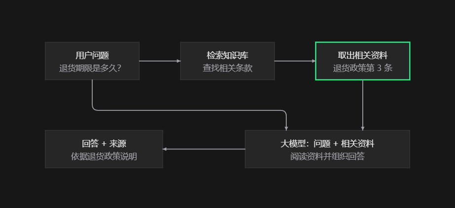

## 什么是 RAG？

**RAG（Retrieval-Augmented Generation，检索增强生成）是一种让大模型先查资料，再根据资料回答问题的技术。** 可以把它理解成 AI 的“开卷考试”。

例如，你问企业客服：“购买后多少天可以退货？”

1. **检索**：系统从企业知识库中找到相关退货政策。
2. **增强**：把你的问题和找到的政策一起提供给大模型。
3. **生成**：大模型根据政策组织答案，也可以附上来源供你核对。

大模型本身未必知道企业最新的内部规定，RAG 能让它使用外部资料，例如产品手册、公司文档、数据库和个人笔记。

实际系统通常会提前把文档切成小段，建立检索索引。用户提问时，通过关键词检索、向量检索或两者结合，找出最相关的片段。**向量检索**可以理解为“按意思找资料”，所以问题和文档用词不同，也可能匹配到。

RAG 与微调的区别在于：**RAG 在回答时提供资料，通常不修改模型参数；微调通过训练修改模型参数。** 更新知识时，RAG 通常只需要更新资料和索引。

它常用于企业知识库问答、智能客服和个人笔记助手。它能减少编造，但不能保证答案正确：资料过时、检索遗漏或模型理解错误，都会影响结果。
