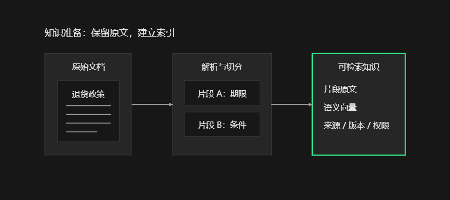
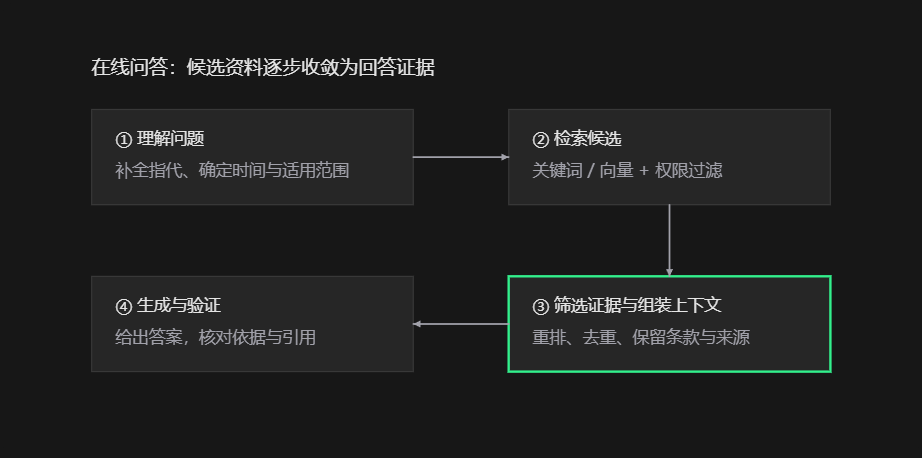

**RAG 系统的核心工作是：把外部知识整理成可检索的资料，在用户提问时找出相关证据，再让大模型根据证据回答。**

完整流程通常分成两条链路：

- **知识准备链路**：接入资料、解析清洗、切分文档、生成向量、建立索引。它在首次建库和资料更新时执行。

- **在线问答链路**：理解问题、检索资料、筛选证据、组装上下文、生成答案、验证与返回。它在每次提问时执行。


下面以一个假设的电商客服场景贯穿说明：知识库规定“普通商品签收后 7 天内可申请无理由退货，但定制商品除外”。用户问：“我 5 天前收到的定制杯子，不喜欢了能退吗？”

**一、接入资料：确定系统能依据哪些知识回答**

资料可以来自 PDF、Word、Markdown、网页、企业知识库或数据库。

系统不仅要拿到正文，还要保存与判断答案有关的信息：

| 信息         | 用途              |
| ---------- | --------------- |
| 文档标题、来源链接  | 展示引用，方便核对       |
| 文档编号、片段编号  | 定位证据、更新和去重      |
| 版本、生效时间    | 判断规则是否适用于当前问题   |
| 产品、地区、业务分类 | 限定检索范围          |
| 租户、访问权限    | 保证用户只能检索获准访问的资料 |

例如，国内退货政策与海外退货政策不能混用，旧版本中的“15 天”也不能覆盖新版本中的“7 天”。

对于订单状态、实时库存等频繁变化的数据，系统往往直接查询业务接口或数据库；不必把所有动态数据都预先转成文档向量。

**二、解析与清洗：让资料变成准确、可处理的内容**

这一步将不同格式的文件转换成结构清晰的文本。

典型处理包括：

- 提取 PDF、Word、网页中的正文。
- 对扫描件进行 OCR，识别图片中的文字。
- 去除重复页眉、页脚、导航菜单和无关内容。
- 保留标题层级、列表、表格、代码块和页码。
- 识别重复文档与历史版本。

这里的重点是**保留知识之间的关系**。

例如，表格中的“定制商品”和“不适用无理由退货”必须保持在同一行。如果解析后只留下零散文字，后面即使检索到了这些文字，也可能理解错误。

**三、文档切分：把长文档拆成可检索的片段**

一份退货政策可能有几十页，而问题只需要其中两三条。系统通常将文档拆成多个文本片段，称为 **Chunk**。

切分存在一个取舍：

| 切分情况          | 可能产生的问题                |
| ------------- | ---------------------- |
| 片段过小          | 条件、例外和上下文被拆散           |
| 片段过大          | 无关内容多，检索不够精确，占用更多模型上下文 |
| 按标题、段落和业务语义切分 | 通常更容易保留完整规则            |

常见策略包括固定长度切分、按段落递归切分、按标题切分，以及语义切分。相邻片段也可以保留少量重叠，降低边界处的信息丢失。

例如，这两句话最好保持在同一片段中：

> 普通商品签收后 7 天内可申请无理由退货。定制商品不适用此规定。

如果必须拆开，就需要保留章节关联，或在检索命中后补回相邻段落。

一种常用方案是**小片段用于检索，较大的父级段落用于回答**：先精准找到相关句子，再把完整条款提供给模型。

**四、生成向量：让系统能够按“意思”检索**

如果采用向量检索，就需要使用嵌入模型，也就是 **Embedding 模型**，将文本片段转换成一组数字。

这组数字称为向量，用来表示文本的语义特征。

例如：

> “买的东西不喜欢，可以退吗？”

与：

> “无理由退货适用条件”

两句话的字面用词不同，但语义相关。合适的嵌入模型可以让它们在向量空间中比较接近。

这里要区分两个模型的职责：

| 模型   | 主要职责             |
| ---- | ---------------- |
| 嵌入模型 | 把问题和资料表示成可比较的向量  |
| 生成模型 | 阅读问题与资料，组织自然语言答案 |

两者可以来自不同模型系列。问题向量和文档向量需要使用兼容的编码方式；更换嵌入模型时，通常需要重新生成文档向量和相关索引。

**向量是检索表示，不是可直接还原原文的文件。** 系统仍需保存原始片段，供后续模型阅读和引用。

**五、建立索引：让资料能够快速被找到**

系统通常保存三类内容：**原文、向量、元数据**。

为了支持不同检索方式，还可能建立：

- **关键词索引**：擅长查找订单号、产品型号、专有名词和精确术语。
- **向量索引**：擅长查找语义相关、措辞不同的内容。
- **元数据索引**：用于按产品、地区、版本、权限等条件过滤。

向量检索通常采用近似最近邻算法，在大量片段中快速找到与问题向量接近的候选项。它在速度和召回效果之间做取舍。

这些数据可以存在一个支持多种索引的系统中，也可以由搜索引擎、向量数据库和文档存储共同承担。

至此，知识库具备了回答问题所需的检索能力。**RAG 并不要求所有系统都使用向量数据库；关键词搜索、数据库查询等也可以为生成提供资料。**

**六、理解用户问题：明确究竟要查什么**

用户提问后，系统首先识别问题中的意图、实体、约束和对话背景。

对于示例问题：

> “我 5 天前收到的定制杯子，不喜欢了能退吗？”

需要识别出：

| 要素      | 内容            |
| ------- | ------------- |
| 商品类型    | 定制杯子          |
| 签收时间    | 5 天前          |
| 退货原因    | 不喜欢，属于无理由退货诉求 |
| 需要查询的规则 | 退货期限与定制商品例外   |

在多轮对话中，还要补全指代。例如用户先问“定制杯子能退吗”，随后问“如果有质量问题呢”，检索问题应该包含“定制杯子质量问题退货”，不能只检索孤立的“质量问题”。

复杂问题可能会被拆成多个子问题分别检索。但改写不能擅自添加事实，商品类型、时间和否定条件尤其需要保留。问题含糊且会影响结论时，系统可以先澄清。

**七、检索候选资料：先尽量找到可能有用的证据**

这一阶段常称为**召回**。目标是让支持答案的重要资料进入候选集合。

常见检索方式如下：

| 方式           | 优势            | 局限                |
| ------------ | ------------- | ----------------- |
| 关键词检索，如 BM25 | 精确词、型号、编号匹配较好 | 容易遗漏不同措辞的表达       |
| 向量检索         | 能识别语义相近的内容    | 对精确数字、否定、细微条件未必敏感 |
| 混合检索         | 结合字面匹配与语义匹配   | 需要融合和调优结果         |

在示例中，系统既要找“7 天退货期限”，也要找“定制商品除外”。**只召回一般规则而漏掉例外，答案就可能错误。**

混合检索可以通过排名融合等方式合并结果。不同检索器的分数含义和尺度不同，不能默认直接相加。

权限约束必须在检索链路中落实，确保未授权资料不会进入模型上下文。适用地区、产品和生效版本也应参与筛选。

**八、重排序：从“相关资料”中选出“能回答问题的资料”**

第一轮检索通常优先考虑速度，因此会带回一些只是主题相关的片段。

重排序，也就是 **Rerank**，进一步判断每个片段对当前问题的帮助程度。常用的重排模型会同时阅读问题和候选片段，评估两者的关系。

例如，候选资料可能包括：

- 普通商品 7 天无理由退货规则。
- 定制商品不适用无理由退货的条款。
- 商品保养说明。
- 物流配送时间说明。

对当前问题，定制商品例外应得到更高优先级。

作为示意，系统可以先召回 30 个片段，再选出 5 个作为上下文；具体数量应通过实际问题集评估，不能当成固定标准。

**召回解决“关键证据有没有找到”，重排解决“找到后有没有优先选中”。** 关键证据如果根本没进入候选集合，重排无法补救。

**九、组装上下文：把证据整理成模型可用的输入**

系统会对入选资料去重、补充必要上下文、整理来源，并控制总长度。

提供给生成模型的内容通常包括：

```text
回答要求：
根据提供的资料回答；证据不足时说明不足；
标注支持结论的资料编号。

用户问题：
我 5 天前收到的定制杯子，不喜欢了能退吗？

资料 [1]：
普通商品签收后 7 天内可申请无理由退货。

资料 [2]：
定制商品不适用无理由退货规定。

来源：
退货政策，当前生效版本，相关章节。
```

上下文并不是越长越好。大量重复或无关资料会增加成本，也可能干扰模型判断。需要同时考虑问题、对话历史、证据和输出所占的上下文空间。

如果证据存在冲突，应结合版本、生效时间、适用范围和来源权威性处理；无法解决的冲突应明确呈现。

检索到的文档还应被当作**待分析的数据**。文档中的“忽略前面的要求”等文字不能被当作系统指令执行。

**十、生成答案：将规则应用到用户的具体情况**

生成模型阅读问题和证据，得出针对当前情境的回答。

示例答案可以是：

> 根据退货政策，定制商品不适用无理由退货。因此，虽然你签收仅 5 天，以“不喜欢”为由申请无理由退货不符合该政策。\[2]

模型需要完成的工作包括：提取规则、识别条件、处理例外、将规则应用到用户事实，以及用清晰语言表达结论。

如果资料没有说明定制商品发生质量问题时如何处理，就不能据此补出一套质量问题退货规则。

**十一、验证与返回：检查结论是否有证据支持**

生成完成后，可以检查：

- 关键结论是否受到检索资料支持。
- 数字、日期、商品类型是否准确。
- 是否遗漏例外条件。
- 引用编号和来源是否真实、可定位。
- 引用的内容是否实际支持对应结论。

有来源链接不等于答案正确：模型可能引用了真实文档，却误解了其中的条款。

证据不足时，系统可以扩大检索范围、换一种查询方式、查询业务接口，或明确告知无法确认。部分系统会流式输出答案；如果验证在输出后才进行，未经验证的文字可能已经被用户看到，因此验证时机需要结合业务要求设计。

**十二、更新与评估：持续检查整条链路的效果**

资料变化后，系统需要更新原文、片段和索引，并处理被删除或失效的旧内容。缓存也需要随着知识版本和权限变化而失效，避免继续返回旧答案。

评估应分阶段进行：

| 评估对象   | 要回答的问题             |
| ------ | ------------------ |
| 解析与切分  | 条款、表格、例外条件是否保留完整？  |
| 检索     | 支持正确答案的证据是否进入候选集合？ |
| 重排与上下文 | 关键证据是否最终交给了模型？     |
| 生成     | 答案是否正确、完整，并忠于证据？   |
| 引用     | 来源是否支持对应结论？        |
| 系统性能   | 各阶段耗时和调用成本是否可接受？   |

定位错误时，可以依次检查：知识库是否包含答案、解析是否正确、检索是否命中、上下文是否保留完整证据、模型是否正确应用规则。

**基础 RAG 可以很简单：建立检索能力，找到相关片段，再调用大模型回答。** 问题改写、混合检索、重排序、多次检索和自动验证都是按业务需要加入的能力。系统的可靠性取决于整条证据链，而不仅是最后使用了哪个大模型。
