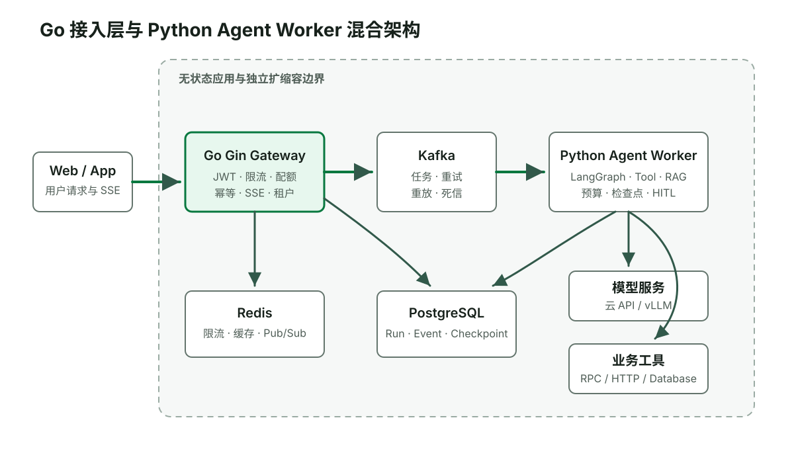
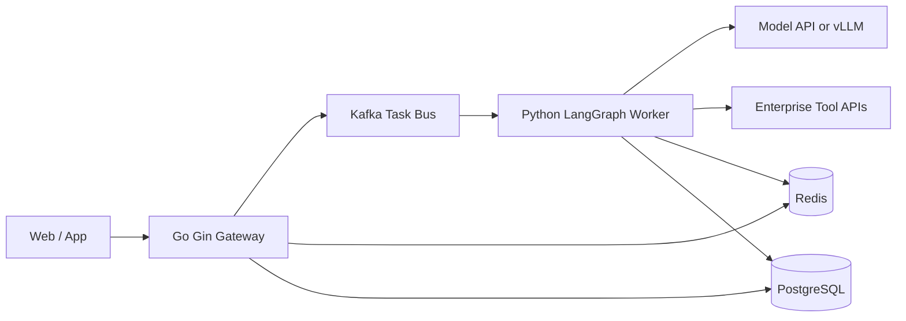
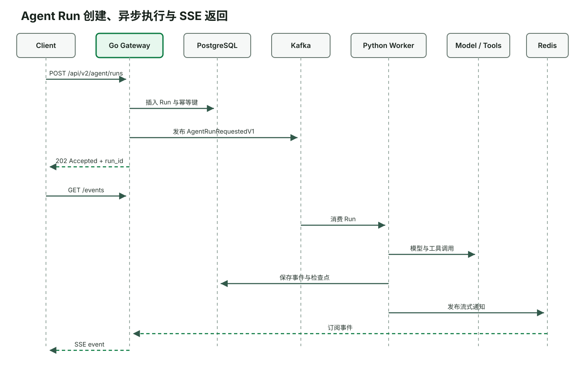
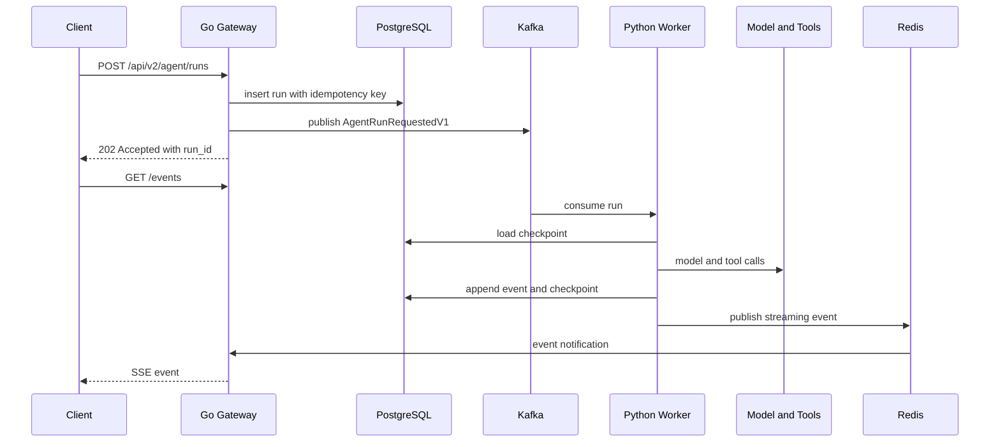
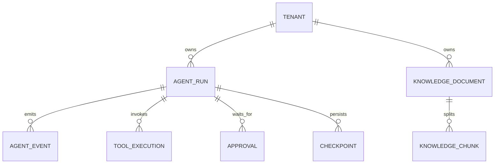
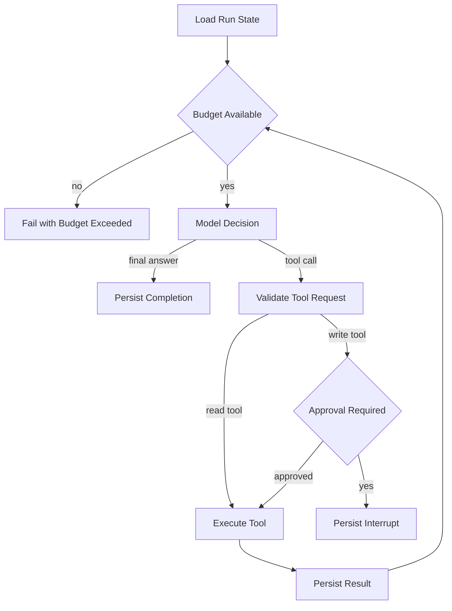

# 企业级 Agent 混合架构课程设计

## 文档定位

| 维度 | 结论 |
| --- | --- |
| 文档类型 | 渐进式实战教程的课程与技术设计文档 |
| 系统阶段 | 从零手写 Python Agent Worker，随后扩展为 Go + Python 混合架构 |
| 主要读者 | Go/Python 后端工程师、架构师、测试工程师、SRE |
| 复杂度 | 重量级：跨语言、异步执行、状态持久化、AI 评测与高并发接入 |
| 上游输入 | 用户确认的课程设计、现有 Agent 教程与项目工程规范 |

本文定义单篇渐进式教程的学习顺序、最终系统边界和验收依据。教程正文是唯一主交付物；代码只作为读者跟随章节逐步写出的练习结果，不单独交付一个需要自行反向理解的成品项目。

## 目标与范围

课程从一个只依赖 Python 标准库的 Agent Worker 开始。学习者先看见模型如何申请工具、Worker 如何校验和执行工具、结果如何回灌、循环如何退出，再逐章加入真实模型、状态、RAG、人工审批、Go 接入层、Kafka、Redis 和 PostgreSQL。最终练习结果是一个可本地运行、可测试、可压测的企业工单 Agent。[Data-backed]

设计目标如下：

1. 学习者能够从 Fake Model 和 Tool Calling 协议开始，逐步构建完整混合系统。[Data-backed]
2. Go 网关和 Python Worker 可以独立扩缩容，长连接数量不直接占用 Agent 执行槽位。[Expert judgment]
3. 模型输出、工具参数与外部文本均按不可信输入处理。[Research-backed]
4. 写操作由确定性后端完成权限、幂等和业务规则校验。[Expert judgment]
5. 任务能够暂停审批、进程重启后恢复，并保留审计证据。[Data-backed]
6. 每次变更能够通过单元测试、契约测试、集成测试、离线评测和压力测试验证。[Data-backed]

本期不包含模型训练、模型微调、多地域容灾和完整 Kubernetes 运维平台。Kubernetes 仅作为部署扩展章说明水平扩容边界。[Data-backed]

容量数字只作为课程验收目标，不代表生产容量承诺。`1000` 个并发 SSE 连接用于验证连接层和执行层已经解耦；实际生产容量必须通过目标机器和目标模型重新压测。[Hypothesis]

## 术语

| 中文名称 | 英文术语 | 在本项目中的含义 |
| --- | --- | --- |
| 智能体运行 | Agent Run | 从接收用户目标到产生最终结果的一次持久化执行 |
| 工具 | Tool | Agent 可以申请调用的受控业务能力 |
| 检查点 | Checkpoint | 状态图在某一步完成后的持久化状态 |
| 人工介入 | Human-in-the-Loop, HITL | 高风险动作执行前暂停并等待授权 |
| 流式事件 | Streaming Event | 通过 Redis 和 SSE 传递的增量状态或文本 |
| 执行预算 | Execution Budget | 最大轮数、总时长、Token 和工具调用次数限制 |
| 离线评测 | Offline Evaluation | 使用固定数据集衡量答案、工具选择和轨迹质量 |

## 学习路径与最终架构

课程不会在第一章要求学习者同时理解 Go、Kafka、Redis 和 PostgreSQL。每一层只在上一层已经能运行、能解释、能测试之后引入。[Data-backed]

```text
Python 函数调用
  → Fake Model 驱动的 Agent Loop
  → OpenAI 兼容真实模型
  → 工具注册、参数校验、预算与日志
  → 状态持久化、RAG、LangGraph、人工审批
  → Go API 与 SSE
  → Kafka、Redis、PostgreSQL
  → 可观测性、评测、安全与压测
```

下面的架构图描述课程完成后的系统形态，不是第一章的环境前置条件。

系统采用无状态接入层、异步任务总线和有状态执行层。Go 网关不运行 Agent Loop；Python Worker 不直接维持用户长连接。两者通过持久化任务和流式事件契约协作。[Expert judgment]



图 1：Go 接入层负责连接和流量治理，Python Worker 负责 Agent 状态图，模型推理与业务工具保持独立。



Go 网关验证 JWT、租户、配额和幂等键，然后创建运行记录并投递任务。Worker 消费任务、加载检查点、执行状态图并发布增量事件。网关订阅事件后通过 SSE 转发给客户端。PostgreSQL 是运行状态和审计事实的持久化来源，Redis 只保存短期缓存、限流计数和实时 Pub/Sub 数据。[Expert judgment]

### 技术选择

| 组件 | 选择 | 原因 |
| --- | --- | --- |
| 接入层 | Go + Gin | 与当前 Go 后端经验一致，适合大量 SSE 连接、鉴权和限流。[Expert judgment] |
| Agent 编排 | Python + LangGraph | Python AI 生态完整，LangGraph 提供显式状态、检查点和中断恢复。[Research-backed] |
| 任务总线 | Kafka | 支持消费组、顺序控制、重放和死信主题，适合独立扩缩容 Worker。[Expert judgment] |
| 实时事件 | Redis Pub/Sub | 事件只用于在线转发，丢失时可从 PostgreSQL 事件表补读。[Expert judgment] |
| 持久化 | PostgreSQL + pgvector | 同时承载关系数据、审计、检查点和课程规模的向量检索，减少基础设施数量。[Expert judgment] |
| 模型访问 | OpenAI 兼容协议 | 课程代码可在多个模型网关和 vLLM 之间切换。[Research-backed] |
| 可观测性 | OpenTelemetry | 统一 Go、Python、Kafka、模型和工具调用的 Trace 上下文。[Research-backed] |

## 模块边界

| 模块 | 单一职责 | 输入 | 输出 | 明确不负责 |
| --- | --- | --- | --- | --- |
| Go Gateway | 管理外部请求和流式连接 | HTTP、JWT、SSE 连接 | 运行资源、流式事件、统一错误 | Agent 推理、RAG、业务写入 |
| Run Service | 管理 Agent Run 生命周期 | 创建、取消、审批命令 | 运行状态和领域事件 | 调用模型 |
| Kafka Adapter | 可靠发布和消费任务 | 领域任务或事件 | Kafka Record | 业务决策 |
| Agent Worker | 执行 LangGraph 状态图 | `AgentRunRequestedV1` | 状态、工具申请、最终答案 | 信任模型输出或绕过工具权限 |
| Tool Gateway | 校验并执行工具 | 工具名称、参数、调用身份 | 结构化工具结果 | 自主选择下一工具 |
| RAG Service | 返回带权限过滤的证据 | 查询、租户、主体权限 | 文档片段和引用 | 生成最终答案 |
| State Store | 保存运行事实和检查点 | 状态更新、事件、审计记录 | 可恢复状态 | 实时推送 |
| Evaluation Runner | 回放固定数据集并评分 | 版本、数据集、配置 | 质量、延迟、成本报告 | 生产流量处理 |

模块依赖方向固定为：接入层依赖契约和端口，适配器依赖外部基础设施，领域模块不反向依赖 Gin、Kafka 或模型 SDK。[Expert judgment]

## 核心运行流程



图 2：HTTP 请求只负责创建运行；真正的 Agent 执行在 Worker 中完成，结果通过事件流返回。



### 执行状态

```text
PENDING
  -> RUNNING
  -> WAITING_APPROVAL
  -> RUNNING
  -> SUCCEEDED

RUNNING -> FAILED
RUNNING -> CANCELLED
WAITING_APPROVAL -> REJECTED
```

状态更新使用数据库条件更新，只有允许的前置状态才能进入下一状态。重复 Kafka 消息先读取运行状态和消息去重记录，已处理消息直接确认，不重复执行副作用。[Expert judgment]

## HTTP 接口

所有接口使用 `/api/v2/` 前缀，响应错误遵循统一错误模型。[Data-backed]

### 接口目录

| 编号 | 方法与路径 | 用途 | 权限 |
| --- | --- | --- | --- |
| API-01 | `POST /api/v2/agent/runs` | 创建 Agent Run | `agent:run:create` |
| API-02 | `GET /api/v2/agent/runs/{run_id}` | 查询运行状态 | 运行所属租户成员 |
| API-03 | `GET /api/v2/agent/runs/{run_id}/events` | 建立 SSE 事件流 | 运行所属租户成员 |
| API-04 | `POST /api/v2/agent/runs/{run_id}/approvals` | 批准或拒绝高风险动作 | `agent:run:approve` |
| API-05 | `POST /api/v2/agent/runs/{run_id}/cancel` | 请求取消运行 | `agent:run:cancel` |

### API-01 创建运行

| 字段 | 约束 |
| --- | --- |
| 请求头 | `Authorization: Bearer <JWT>`；`Idempotency-Key` 必填，长度 16 至 128 |
| 请求体 | `input`：字符串，1 至 10000 字符；`conversation_id`：UUID，可选；`metadata`：对象，可选 |
| 成功响应 | `202 Accepted`；`{ "run_id": "uuid", "status": "PENDING", "events_url": "..." }` |
| 错误 | `400 INVALID_ARGUMENT`、`401 UNAUTHORIZED`、`403 FORBIDDEN`、`409 IDEMPOTENCY_CONFLICT`、`429 QUOTA_EXCEEDED` |
| 幂等 | `(tenant_id, idempotency_key)` 唯一；相同请求返回原 `run_id`，不同请求返回冲突 |

### API-03 SSE 事件流

| 字段 | 约束 |
| --- | --- |
| 请求 | `Last-Event-ID` 可选，用于断线续传 |
| 响应类型 | `text/event-stream` |
| 事件 | `run.status`、`model.delta`、`tool.started`、`tool.completed`、`approval.required`、`run.completed`、`run.failed` |
| 保活 | 网关周期发送注释帧；具体间隔由部署环境确认 |
| 恢复 | 先从 PostgreSQL 补读 `Last-Event-ID` 后事件，再订阅 Redis 实时事件 |
| 错误 | 运行不存在返回 `404 RUN_NOT_FOUND`；跨租户访问返回 `404`，避免泄露资源存在性 |

### API-04 审批

请求体：

```json
{
  "decision": "APPROVE",
  "approval_version": 3,
  "comment": "verified by operator"
}
```

`approval_version` 使用乐观锁防止重复审批。只有审批范围与当前待执行工具完全匹配时，Worker 才能恢复。[Expert judgment]

## 异步契约

### AgentRunRequestedV1

```json
{
  "event_id": "uuid",
  "event_type": "AgentRunRequestedV1",
  "occurred_at": "RFC3339 timestamp",
  "trace_id": "W3C trace id",
  "tenant_id": "uuid",
  "run_id": "uuid",
  "input_ref": "database reference",
  "attempt": 1
}
```

消息不携带完整 Prompt、文档正文或敏感工具结果，只携带定位持久化数据所需的引用。[Expert judgment]

### AgentEventV1

```json
{
  "event_id": 125,
  "run_id": "uuid",
  "sequence": 9,
  "type": "tool.completed",
  "occurred_at": "RFC3339 timestamp",
  "payload": {},
  "visibility": "USER"
}
```

同一 `run_id` 的 `sequence` 单调递增。Redis 消息只用于通知；完整事件先落 PostgreSQL，再发布 Redis，客户端才能在断线后补读。[Expert judgment]

## 数据设计



| 表 | 关键字段 | 完整性规则 |
| --- | --- | --- |
| `agent_runs` | `id`、`tenant_id`、`status`、`input_hash`、`idempotency_key`、`version` | `(tenant_id, idempotency_key)` 唯一 |
| `agent_events` | `run_id`、`sequence`、`type`、`payload`、`visibility` | `(run_id, sequence)` 唯一 |
| `tool_executions` | `tool_call_id`、`run_id`、`tool_name`、`arguments_hash`、`status`、`result_ref` | `tool_call_id` 唯一 |
| `approvals` | `run_id`、`version`、`decision`、`scope_hash`、`reviewer_id` | `(run_id, version)` 唯一 |
| `agent_checkpoints` | `run_id`、`checkpoint_id`、`state`、`created_at` | 每次状态图提交后追加 |
| `knowledge_documents` | `tenant_id`、`source_uri`、`acl`、`content_hash` | 同租户内容哈希去重 |
| `knowledge_chunks` | `document_id`、`ordinal`、`content`、`embedding`、`metadata` | `(document_id, ordinal)` 唯一 |

所有查询必须显式携带 `tenant_id`。课程同时演示应用层租户过滤和 PostgreSQL Row Level Security，测试跨租户读取必须返回空结果。[Expert judgment]

## Agent 状态图



Agent State 至少包含 `run_id`、`tenant_id`、消息摘要、剩余预算、已执行工具指纹、当前审批、最后事件序号和错误上下文。原始 JWT 不进入检查点；Worker 使用短期服务凭证并根据持久化授权上下文重新鉴权。[Expert judgment]

## 工具安全

工具按风险分为三类：

| 风险 | 示例 | 执行要求 |
| --- | --- | --- |
| 只读 | 查询工单、搜索知识库 | 参数校验、租户过滤、超时 |
| 可逆写入 | 创建工单、添加评论 | 权限、幂等键、审计、补偿动作 |
| 高风险写入 | 关闭工单、修改权限 | 权限、作用域审批、二次校验、审计 |

模型提供的工具名和参数必须经过白名单、Pydantic 或 `go-playground/validator` Schema、权限和业务规则校验。SQL 只使用参数化查询。工具结果进入模型上下文前删除敏感字段并限制长度。[Data-backed]

## 故障处理

| 故障 | 处理策略 | 是否重试 |
| --- | --- | --- |
| 模型网络超时 | 指数退避并使用抖动；超过运行预算后失败或降级 | 仅瞬时错误 |
| 模型格式错误 | 将结构化校验错误反馈模型一次；再次失败则终止 | 最多一次纠正 |
| Kafka 重复消息 | `event_id` 去重和运行状态检查 | 不重复副作用 |
| Worker 崩溃 | 新 Worker 从最后检查点恢复 | 自动 |
| 工具超时 | 记录未知结果；查询幂等状态后再决定是否重试 | 依工具语义 |
| Redis 不可用 | 事件继续落库；SSE 降级为数据库轮询或重连 | 后台恢复 |
| PostgreSQL 不可用 | 停止接收新 Run；现有 Worker 不执行新副作用 | 熔断 |
| 审批过期 | Run 转为 `FAILED` 或 `CANCELLED`，不执行工具 | 不重试 |
| 超出 Token 或轮数 | 输出结构化预算错误并保存轨迹 | 不重试 |

重试边界属于调用方：模型调用由 Worker 重试，业务工具由 Tool Gateway 根据工具策略重试，Kafka 消费由消费者和死信主题管理。禁止多层同时重试同一个调用。[Expert judgment]

## 可观测性

每个 Run 建立一条端到端 Trace，Go 网关把 W3C Trace Context 写入 Kafka Header，Python Worker 恢复上下文。[Research-backed]

日志字段采用结构化格式：

| 中文名称 | 字段 |
| --- | --- |
| 租户标识 | `tenant_id` |
| 运行标识 | `run_id` |
| 链路标识 | `trace_id` |
| 工具调用标识 | `tool_call_id` |
| 模型名称 | `model` |
| 输入 Token | `input_tokens` |
| 输出 Token | `output_tokens` |
| 估算成本 | `estimated_cost` |
| 执行阶段 | `phase` |
| 持续时间 | `duration_ms` |

Prompt、JWT、原始文档和完整工具结果默认不写普通日志。调试采样必须经过脱敏并设置短保留期。[Expert judgment]

核心指标包括创建 Run 的 HTTP 延迟、SSE 活跃连接、Kafka Lag、运行排队时间、每阶段耗时、模型首 Token 延迟、工具失败率、恢复次数、审批等待时间、每 Run Token 和成本、评测通过率。

## 测试设计

| 测试层 | 验证对象 | 代表场景 |
| --- | --- | --- |
| Go 单元测试 | 鉴权、限流、幂等、SSE 补读 | 相同键相同请求、相同键不同请求 |
| Python 单元测试 | 状态转移、预算、工具校验 | 重复工具、未知工具、超轮数 |
| 契约测试 | HTTP、Kafka、SSE Schema | Go 生产消息能被 Python 解析 |
| 集成测试 | PostgreSQL、Redis、Kafka | 创建 Run 到最终事件 |
| Agent 评测 | 答案、引用、工具选择、轨迹 | 正确工具、禁止工具、拒答 |
| 安全测试 | 越权、注入、敏感信息 | 跨租户、间接提示词注入 |
| 故障注入 | 崩溃、超时、断连、重复消息 | Worker 在工具前后被终止 |
| 压力测试 | 连接并发和任务吞吐 | 1000 SSE 连接与受控 Worker 槽位 |

测试日志按用户、Go 网关、Kafka、Python Worker、模型、工具和数据库分别展示时间线。跳过的步骤必须记录跳过原因；参数表使用“中文名称（english_field）”表头。[Data-backed]

## 课程组织

教程采用四个阶段、十二章。读者始终在教程正文的指引下修改同一组练习文件，每章先获得一个可观察的结果，再解释新增抽象。

| 阶段与章 | 可运行结果 | 验收证据 |
| --- | --- | --- |
| 阶段一·第 1 章 | Python 环境、领域消息与 Fake Model | 不联网完成一次模型响应 |
| 阶段一·第 2 章 | 裸 Python Agent Loop | 工具申请、执行、回灌和退出的逐轮日志 |
| 阶段一·第 3 章 | OpenAI 兼容真实模型适配器 | Fake Model 与真实模型使用同一 Worker |
| 阶段一·第 4 章 | 工具注册、Pydantic 校验、执行预算 | 未知工具、坏参数、重复调用和超轮数测试 |
| 阶段二·第 5 章 | 会话状态与检查点 | 进程重启后从检查点恢复 |
| 阶段二·第 6 章 | RAG 与证据引用 | 召回、引用和租户隔离评测 |
| 阶段二·第 7 章 | LangGraph 与人工审批 | 中断、拒绝和恢复测试 |
| 阶段三·第 8 章 | Go `/api/v2/` Run API | 鉴权、幂等和统一响应测试 |
| 阶段三·第 9 章 | Go SSE 流式接入 | 事件顺序与断线续传测试 |
| 阶段三·第 10 章 | Kafka、Redis、PostgreSQL | 重复投递、事件补读和死信测试 |
| 阶段四·第 11 章 | 可观测性、安全和离线评测 | Trace、成本、注入、越权和回归报告 |
| 阶段四·第 12 章 | 压测、故障注入和部署 | 连接并发、任务吞吐和恢复报告 |

每章包含环境前置条件、业务背景、原理图、完整文件内容、执行命令、预期输出、正常时间线、对抗场景、测试、故障排查和完成标准。代码只在教程章节中出现，本设计文档不下沉到逐行实现。

## 教程交付

```text
计算机科学/Agent 开发/
├── 从零搭建高并发企业级Agent系统教程.md
├── images/
│   └── enterprise-agent-tutorial-*.svg
└── README.md
```

教程内每个代码块都给出目标路径和完整内容，不使用省略号代替关键实现。作者在临时目录按正文顺序重建练习文件并执行命令，验证文档可复现；这些临时验证文件不作为独立项目交付。依赖外部模型密钥的章节保留 Fake Model 路径，使核心测试不依赖网络。[Expert judgment]

## 实施顺序

1. 先写教程的 Python 环境、领域消息和 Fake Model。
2. 在教程中逐步完成裸 Agent Loop、日志和确定性单元测试。
3. 接入真实兼容模型，再加入工具注册、参数校验和执行预算。
4. 加入状态、RAG、LangGraph、检查点和人工审批。
5. 在 Worker 边界稳定后实现 Go Run API、统一响应和 SSE。
6. 接入 PostgreSQL、Redis 和 Kafka，并验证重复投递与恢复。
7. 接入 Trace、指标、离线评测、安全护栏和成本统计。
8. 执行集成、故障注入和压力测试，并把实测结果写回对应章节。

## 设计风险

| 风险 | 影响 | 处理 |
| --- | --- | --- |
| 教程基础设施过多 | 初学者在看到 Agent Loop 前被环境阻塞 | 前四章只使用 Python；外部基础设施从第十章引入 |
| 双语言契约漂移 | 运行时解析失败 | JSON Schema 作为单一来源并运行契约测试 |
| 模型供应商差异 | Tool Calling 行为不同 | 使用兼容协议适配层和 Fake Model |
| Agent 测试不稳定 | 回归结果无法比较 | 分离确定性单测、轨迹评测和真实模型抽样评测 |
| 高并发目标误导 | 把连接数等同于任务吞吐 | 分开测 SSE 连接、队列吞吐和模型并发 |
| 教程与代码不同步 | 学习者无法复现 | 在临时目录按教程顺序重建并执行所有代码块 |
