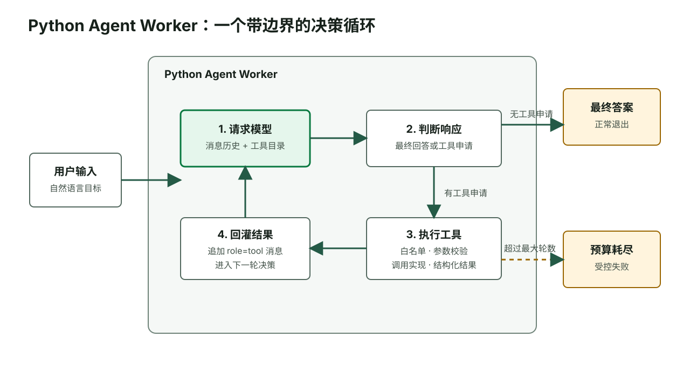
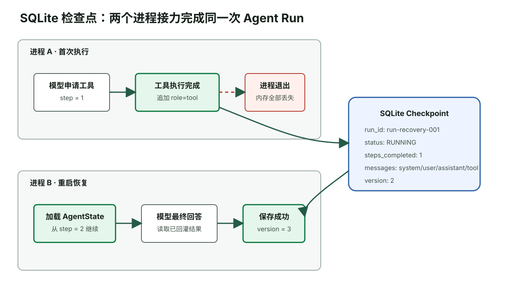

# 从零搭建高并发企业级 Agent 系统教程

> 面向已经掌握 Python 或 Go 后端开发的工程师。本教程从 Python Agent Worker 的核心循环开始，读者会亲手写出每个文件、运行每条命令，并在理解执行边界后逐步接入真实模型、状态、RAG、Go 网关和异步基础设施。

## 教程使用方式

这是一篇持续增长的实战教程。代码不是独立交付的成品项目，而是你按照章节一步步写出的学习结果。每章都遵循同一个节奏：

1. 明确这一章要获得的能力和前置状态。
2. 创建或替换完整文件，不使用省略号隐藏关键实现。
3. 运行命令并对照预期输出。
4. 主动制造错误，观察 Worker 如何失败。
5. 通过验证关卡后再进入下一章。

教程最终会扩展到 Go + Python 混合架构，但前四章只关注 Python Worker。原因很直接：如果还不能解释 Agent Loop 中每条消息为什么存在，提前加入 Kafka、Redis 和 PostgreSQL 只会增加排错变量。



图 1：模型只负责提出下一步；Worker 负责执行边界、工具调用和退出条件。

## 学习路线

| 阶段 | 你将亲手完成的结果 | 暂不引入的内容 |
| --- | --- | --- |
| Python 核心循环 | Fake Model、Tool Calling、Worker、预算、详细日志、单元测试 | Go、数据库、消息队列 |
| Worker 工程化 | 真实兼容模型、Pydantic、状态、RAG、LangGraph、人工审批 | 高并发接入 |
| 混合架构 | Go `/api/v2/` API、SSE、Kafka、Redis、PostgreSQL | 多地域与 Kubernetes 平台 |
| 生产验证 | Trace、指标、离线评测、安全测试、故障注入、压测 | 模型训练与微调 |

## 第一章 从零建立可测试的 Worker 协议

### 学习目标

完成本章后，你能够：

- 解释模型响应为什么必须区分“最终回答”和“工具申请”。
- 使用 Python 数据类表达工具调用协议。
- 使用 Fake Model 在没有网络和 API Key 的情况下控制模型输出。
- 运行第一个确定性测试，证明模型适配器可以被替换。

### 1.1 准备环境

前置条件：

| 中文名称 (english_field) | 要求 |
| --- | --- |
| Python 版本 (python_version) | Python 3.11 或更高版本 |
| 当前目录 (working_directory) | 任意空目录 |
| 网络依赖 (network_dependency) | 创建虚拟环境后只需安装 `pytest` |
| 模型密钥 (model_api_key) | 本章不需要 |

运行：

```bash
mkdir enterprise-agent-learning
cd enterprise-agent-learning
python3 -m venv .venv
source .venv/bin/activate
python -m pip install "pytest>=8,<10"
mkdir -p agent_worker tests
touch agent_worker/__init__.py
```

预期结果：

```text
enterprise-agent-learning/
├── .venv/
├── agent_worker/
│   └── __init__.py
└── tests/
```

如果 `python3 --version` 低于 3.11，请先安装新版本。后文使用 `StrEnum`、现代类型标注和 `tomllib` 等 3.11 能力，不为旧版本增加兼容分支。

### 1.2 定义模型与 Worker 的契约

创建 `agent_worker/contracts.py`：

```python
from __future__ import annotations

from dataclasses import dataclass, field
from typing import Any, Protocol


@dataclass(frozen=True)
class ToolCall:
    """模型提出的一次工具调用申请。"""

    id: str
    name: str
    arguments: dict[str, Any]


@dataclass(frozen=True)
class ModelResponse:
    """模型的一轮响应：要么回答，要么申请一个或多个工具。"""

    content: str | None = None
    tool_calls: list[ToolCall] = field(default_factory=list)

    def __post_init__(self) -> None:
        has_content = bool(self.content)
        has_tool_calls = bool(self.tool_calls)
        if has_content == has_tool_calls:
            raise ValueError("模型响应必须且只能包含 content 或 tool_calls")


class ModelClient(Protocol):
    """Worker 依赖的最小模型接口。"""

    def complete(
        self,
        messages: list[dict[str, Any]],
        tools: list[dict[str, Any]],
    ) -> ModelResponse:
        ...
```

这三个类型分别承担不同职责：

| 中文名称 (english_name) | 代码名称 (code_name) | 作用 |
| --- | --- | --- |
| 工具调用申请 | `ToolCall` | 保存调用标识、工具名称和结构化参数 |
| 模型响应 | `ModelResponse` | 强制一轮响应只有一种下一步 |
| 模型客户端协议 | `ModelClient` | 隔离 Worker 与具体模型 SDK |

`ModelResponse.__post_init__` 拒绝两种危险状态：既没有回答也没有工具申请，以及同时给出回答和工具申请。模型 SDK 可能允许更宽松的数据，但 Worker 内部协议应更严格，异常越早暴露越容易定位。

### 1.3 写一个可编排的 Fake Model

创建 `agent_worker/fake_model.py`：

```python
from __future__ import annotations

from collections import deque
from copy import deepcopy
from typing import Any

from agent_worker.contracts import ModelResponse


class ScriptedModel:
    """按预设顺序返回响应，用于教程演示和确定性测试。"""

    def __init__(self, responses: list[ModelResponse]) -> None:
        if not responses:
            raise ValueError("responses 至少包含一条模型响应")
        self._responses = deque(responses)
        self.requests: list[dict[str, Any]] = []

    def complete(
        self,
        messages: list[dict[str, Any]],
        tools: list[dict[str, Any]],
    ) -> ModelResponse:
        self.requests.append(
            {
                "messages": deepcopy(messages),
                "tools": deepcopy(tools),
            }
        )
        if not self._responses:
            raise RuntimeError("Fake Model 的预设响应已经耗尽")
        return self._responses.popleft()
```

Fake Model 不模仿语言能力，它只控制“这一轮模型返回什么”。`requests` 保存每次收到的消息，使测试能够检查 Worker 是否真的把工具结果回灌到下一轮，而不只是检查最终字符串。

### 1.4 先验证模型协议

创建 `tests/test_fake_model.py`：

```python
from agent_worker.contracts import ModelResponse
from agent_worker.fake_model import ScriptedModel


def test_scripted_model_records_request_and_returns_response() -> None:
    expected = ModelResponse(content="你好，我已经准备好。")
    model = ScriptedModel([expected])

    actual = model.complete(
        messages=[{"role": "user", "content": "你好"}],
        tools=[],
    )

    assert actual == expected
    assert model.requests == [
        {
            "messages": [{"role": "user", "content": "你好"}],
            "tools": [],
        }
    ]
```

运行：

```bash
pytest -q
```

预期输出：

```text
1 passed
```

### 验证关卡

请先不看代码回答：

1. 为什么测试不应该直接调用真实模型？
2. `ModelClient` 为什么只暴露 `complete()`，不暴露供应商 SDK 的全部能力？
3. 如果 `ModelResponse` 同时包含 `content` 和 `tool_calls`，Worker 应该选择哪一个？

参考判断：前两问分别对应确定性和依赖倒置；第三问不应“猜”，内部协议应立即拒绝歧义。

### 常见故障

| 现象 | 原因 | 处理 |
| --- | --- | --- |
| `ModuleNotFoundError: agent_worker` | 命令不在项目根目录运行 | 执行 `pwd`，确认当前目录包含 `agent_worker/` |
| `pytest: command not found` | 虚拟环境未激活或依赖未安装 | 重新执行 `source .venv/bin/activate` 和安装命令 |
| `SyntaxError` 指向 `str \| None` | Python 版本过旧 | 使用 Python 3.11 或更高版本重建虚拟环境 |

## 第二章 手写完整 Agent Loop

### 学习目标

这一章结束时，Worker 能完成一次真实的闭环：

```text
用户要求查询工单
  → 模型申请 get_ticket
  → Worker 在白名单中找到工具
  → Worker 校验参数并执行
  → Worker 把 JSON 结果作为 role=tool 回灌
  → 模型根据结果生成最终回答
```

这里的“模型”仍是 Fake Model。这样每一次输出都可预测，任何失败都来自 Worker 代码，而不是网络或模型随机性。

### 2.1 定义第一个只读工具

创建 `agent_worker/tools.py`：

```python
from __future__ import annotations

import json
from dataclasses import dataclass
from typing import Any, Callable


class ToolError(Exception):
    """工具请求不合法或工具执行失败。"""


@dataclass(frozen=True)
class ToolDefinition:
    name: str
    description: str
    parameters: dict[str, Any]
    handler: Callable[[dict[str, Any]], dict[str, Any]]

    def to_model_schema(self) -> dict[str, Any]:
        return {
            "type": "function",
            "function": {
                "name": self.name,
                "description": self.description,
                "parameters": self.parameters,
            },
        }


def get_ticket(arguments: dict[str, Any]) -> dict[str, Any]:
    ticket_id = arguments.get("ticket_id")
    if not isinstance(ticket_id, str) or not ticket_id.strip():
        raise ToolError("ticket_id 必须是非空字符串")

    fake_database = {
        "INC-1001": {
            "ticket_id": "INC-1001",
            "title": "支付接口持续超时",
            "status": "OPEN",
            "priority": "P1",
            "owner": "payment-oncall",
        }
    }
    ticket = fake_database.get(ticket_id)
    if ticket is None:
        return {
            "ok": False,
            "error_code": "TICKET_NOT_FOUND",
            "ticket_id": ticket_id,
        }
    return {"ok": True, "ticket": ticket}


GET_TICKET = ToolDefinition(
    name="get_ticket",
    description="按工单编号查询工单详情。回答工单状态前必须调用本工具。",
    parameters={
        "type": "object",
        "properties": {
            "ticket_id": {
                "type": "string",
                "description": "工单编号，例如 INC-1001",
            }
        },
        "required": ["ticket_id"],
        "additionalProperties": False,
    },
    handler=get_ticket,
)


class ToolRegistry:
    def __init__(self, definitions: list[ToolDefinition]) -> None:
        self._definitions = {item.name: item for item in definitions}
        if len(self._definitions) != len(definitions):
            raise ValueError("工具名称不能重复")

    def schemas(self) -> list[dict[str, Any]]:
        return [
            definition.to_model_schema()
            for definition in self._definitions.values()
        ]

    def execute(self, name: str, arguments: dict[str, Any]) -> str:
        definition = self._definitions.get(name)
        if definition is None:
            raise ToolError(f"未知工具：{name}")
        result = definition.handler(arguments)
        return json.dumps(result, ensure_ascii=False, sort_keys=True)
```

`ToolDefinition` 同时保存两类信息：模型看到的接口说明，以及 Worker 实际调用的函数。模型只能提出 `name` 和 `arguments`，它不能直接拿到 Python 函数引用。

### 2.2 加入结构化时间线日志

创建 `agent_worker/logging.py`：

```python
from __future__ import annotations

import json
from datetime import UTC, datetime
from typing import Any, TextIO


def write_event(
    output: TextIO,
    *,
    actor: str,
    phase: str,
    message: str,
    run_id: str,
    step: int,
    details: dict[str, Any] | None = None,
) -> None:
    event = {
        "timestamp": datetime.now(UTC).isoformat(),
        "actor": actor,
        "phase": phase,
        "message": message,
        "run_id": run_id,
        "step": step,
        "details": details or {},
    }
    output.write(json.dumps(event, ensure_ascii=False, sort_keys=True) + "\n")
```

日志字段采用明确的业务叙述：

| 中文名称 (english_field) | 示例 | 作用 |
| --- | --- | --- |
| 执行主体 (actor) | `worker`、`model`、`tool` | 把不同主体的时间线分开 |
| 执行阶段 (phase) | `model.requested` | 表达当前发生的业务事件 |
| 业务叙述 (message) | `Worker 开始请求模型决策` | 让人不查枚举也能理解 |
| 运行标识 (run_id) | `run-demo-001` | 聚合同一次 Agent Run |
| 循环轮数 (step) | `1` | 定位决策发生在哪一轮 |
| 详细参数 (details) | `{"message_count": 2}` | 保存排错需要的结构化信息 |

生产日志不能直接记录完整 Prompt、JWT、密钥或敏感工具结果。本章数据都是虚构的，后续安全章节会加入脱敏和采样。

### 2.3 实现 Worker

创建 `agent_worker/worker.py`：

```python
from __future__ import annotations

import sys
from typing import Any, TextIO

from agent_worker.contracts import ModelClient
from agent_worker.logging import write_event
from agent_worker.tools import ToolError, ToolRegistry


class AgentRunError(Exception):
    """一次 Agent Run 无法继续完成。"""


class AgentWorker:
    def __init__(
        self,
        *,
        model: ModelClient,
        tools: ToolRegistry,
        max_steps: int = 5,
        output: TextIO = sys.stdout,
    ) -> None:
        if max_steps < 1:
            raise ValueError("max_steps 必须大于或等于 1")
        self._model = model
        self._tools = tools
        self._max_steps = max_steps
        self._output = output

    def run(self, *, run_id: str, user_input: str) -> str:
        if not run_id.strip():
            raise ValueError("run_id 不能为空")
        if not user_input.strip():
            raise ValueError("user_input 不能为空")

        messages: list[dict[str, Any]] = [
            {
                "role": "system",
                "content": (
                    "你是企业工单助手。工单事实必须来自工具；"
                    "工具失败时必须如实说明，不得编造。"
                ),
            },
            {"role": "user", "content": user_input},
        ]

        for step in range(1, self._max_steps + 1):
            write_event(
                self._output,
                actor="worker",
                phase="model.requested",
                message="Worker 开始请求模型决策",
                run_id=run_id,
                step=step,
                details={"message_count": len(messages)},
            )
            response = self._model.complete(
                messages=messages,
                tools=self._tools.schemas(),
            )

            if not response.tool_calls:
                answer = response.content or ""
                write_event(
                    self._output,
                    actor="model",
                    phase="answer.completed",
                    message="模型返回最终答案，Agent Run 正常结束",
                    run_id=run_id,
                    step=step,
                    details={"answer_length": len(answer)},
                )
                return answer

            assistant_tool_calls = []
            for call in response.tool_calls:
                assistant_tool_calls.append(
                    {
                        "id": call.id,
                        "type": "function",
                        "function": {
                            "name": call.name,
                            "arguments": call.arguments,
                        },
                    }
                )
            messages.append(
                {
                    "role": "assistant",
                    "content": None,
                    "tool_calls": assistant_tool_calls,
                }
            )

            for call in response.tool_calls:
                write_event(
                    self._output,
                    actor="model",
                    phase="tool.requested",
                    message="模型申请调用工具，尚未执行任何业务操作",
                    run_id=run_id,
                    step=step,
                    details={
                        "tool_call_id": call.id,
                        "tool_name": call.name,
                        "arguments": call.arguments,
                    },
                )
                try:
                    tool_result = self._tools.execute(
                        call.name,
                        call.arguments,
                    )
                except ToolError as error:
                    write_event(
                        self._output,
                        actor="worker",
                        phase="tool.rejected",
                        message="Worker 拒绝了不合法的工具申请",
                        run_id=run_id,
                        step=step,
                        details={
                            "tool_call_id": call.id,
                            "tool_name": call.name,
                            "reason": str(error),
                        },
                    )
                    raise AgentRunError(str(error)) from error

                write_event(
                    self._output,
                    actor="tool",
                    phase="tool.completed",
                    message="工具执行完成，Worker 准备把结果回灌模型",
                    run_id=run_id,
                    step=step,
                    details={
                        "tool_call_id": call.id,
                        "tool_name": call.name,
                        "result": tool_result,
                    },
                )
                messages.append(
                    {
                        "role": "tool",
                        "tool_call_id": call.id,
                        "content": tool_result,
                    }
                )

        write_event(
            self._output,
            actor="worker",
            phase="budget.exhausted",
            message="Agent Run 已达到最大循环轮数，停止继续请求模型",
            run_id=run_id,
            step=self._max_steps,
            details={"max_steps": self._max_steps},
        )
        raise AgentRunError(
            f"Agent Run 超过最大循环轮数：{self._max_steps}"
        )
```

这里有两个经常被漏掉的协议动作：

1. Worker 必须先把模型的 `assistant.tool_calls` 消息加入历史。
2. Worker 必须再把每个工具结果作为 `role=tool` 加入历史，并带回原 `tool_call_id`。

如果只执行 Python 函数但不追加这两类消息，下一轮模型不知道工具已经执行，也无法把结果与申请对应起来。

### 2.4 跑通第一次工具调用

创建 `demo.py`：

```python
from agent_worker.contracts import ModelResponse, ToolCall
from agent_worker.fake_model import ScriptedModel
from agent_worker.tools import GET_TICKET, ToolRegistry
from agent_worker.worker import AgentWorker


model = ScriptedModel(
    [
        ModelResponse(
            tool_calls=[
                ToolCall(
                    id="call-001",
                    name="get_ticket",
                    arguments={"ticket_id": "INC-1001"},
                )
            ]
        ),
        ModelResponse(
            content=(
                "工单 INC-1001 当前状态为 OPEN，优先级为 P1，"
                "由 payment-oncall 负责。"
            )
        ),
    ]
)
worker = AgentWorker(
    model=model,
    tools=ToolRegistry([GET_TICKET]),
    max_steps=3,
)

answer = worker.run(
    run_id="run-demo-001",
    user_input="查询工单 INC-1001 的状态和负责人。",
)
print(f"最终答案：{answer}")
```

运行：

```bash
python demo.py
```

输出中的时间戳会不同，其余业务阶段应保持一致：

```json
{"actor":"worker","phase":"model.requested","message":"Worker 开始请求模型决策","run_id":"run-demo-001","step":1,"details":{"message_count":2}}
{"actor":"model","phase":"tool.requested","message":"模型申请调用工具，尚未执行任何业务操作","run_id":"run-demo-001","step":1,"details":{"arguments":{"ticket_id":"INC-1001"},"tool_call_id":"call-001","tool_name":"get_ticket"}}
{"actor":"tool","phase":"tool.completed","message":"工具执行完成，Worker 准备把结果回灌模型","run_id":"run-demo-001","step":1,"details":{"tool_call_id":"call-001","tool_name":"get_ticket","result":"..."}}
{"actor":"worker","phase":"model.requested","message":"Worker 开始请求模型决策","run_id":"run-demo-001","step":2,"details":{"message_count":4}}
{"actor":"model","phase":"answer.completed","message":"模型返回最终答案，Agent Run 正常结束","run_id":"run-demo-001","step":2,"details":{"answer_length":51}}
最终答案：工单 INC-1001 当前状态为 OPEN，优先级为 P1，由 payment-oncall 负责。
```

### 2.5 按主体阅读时间线

同一次运行可以拆成三条主体时间线：

| 执行主体 (actor) | 第一步 | 第二步 | 跳过说明 |
| --- | --- | --- | --- |
| Worker | 请求模型 | 再次请求模型并接收最终回答 | 第一步没有最终回答，因此未结束运行 |
| Model | 申请 `get_ticket` | 根据工具结果生成回答 | 模型没有直接执行工具的权限 |
| Tool | 查询 `INC-1001` 并返回 JSON | 无 | 第二步模型未申请工具，因此跳过 |

这张表揭示 Agent 的职责边界：模型决定“希望调用什么”，Worker 决定“是否允许、如何执行、何时停止”。

### 验证关卡

暂时把 `demo.py` 第一条模型响应改为 `ModelResponse(content="我猜它已经关闭了")`。再次运行时，Worker 会直接返回这句话，因为 Worker 只能执行协议边界，不能凭空判断自然语言是否真实。

这正是后续评测和护栏存在的原因：系统提示写了“必须调用工具”并不等于模型永远遵守。生产系统还需要检查关键任务是否真的出现预期工具轨迹。

## 第三章 用对抗性测试锁住执行边界

### 学习目标

本章不增加新功能，而是证明第二章的 Worker 在异常输入下不会越界：

- 正常工具调用后，工具结果确实进入下一轮模型上下文。
- 模型申请未知工具时，Worker 拒绝执行。
- 工具参数缺失时，Worker 返回受控错误。
- 模型持续申请工具时，Worker 在预算耗尽后停止。

### 3.1 创建完整测试

创建 `tests/test_worker.py`：

```python
from __future__ import annotations

import io
import json

import pytest

from agent_worker.contracts import ModelResponse, ToolCall
from agent_worker.fake_model import ScriptedModel
from agent_worker.tools import GET_TICKET, ToolRegistry
from agent_worker.worker import AgentRunError, AgentWorker


def make_worker(
    responses: list[ModelResponse],
    *,
    max_steps: int = 3,
) -> tuple[AgentWorker, ScriptedModel, io.StringIO]:
    model = ScriptedModel(responses)
    output = io.StringIO()
    worker = AgentWorker(
        model=model,
        tools=ToolRegistry([GET_TICKET]),
        max_steps=max_steps,
        output=output,
    )
    return worker, model, output


def parse_events(output: io.StringIO) -> list[dict[str, object]]:
    return [
        json.loads(line)
        for line in output.getvalue().splitlines()
        if line.strip()
    ]


def test_worker_returns_answer_after_tool_result_is_observed() -> None:
    worker, model, output = make_worker(
        [
            ModelResponse(
                tool_calls=[
                    ToolCall(
                        id="call-001",
                        name="get_ticket",
                        arguments={"ticket_id": "INC-1001"},
                    )
                ]
            ),
            ModelResponse(content="工单仍处于 OPEN 状态。"),
        ]
    )

    answer = worker.run(
        run_id="run-test-success",
        user_input="查询 INC-1001。",
    )

    assert answer == "工单仍处于 OPEN 状态。"
    assert len(model.requests) == 2
    second_request_messages = model.requests[1]["messages"]
    assert second_request_messages[-1]["role"] == "tool"
    tool_result = json.loads(second_request_messages[-1]["content"])
    assert tool_result["ok"] is True
    assert tool_result["ticket"]["status"] == "OPEN"

    events = parse_events(output)
    assert [event["phase"] for event in events] == [
        "model.requested",
        "tool.requested",
        "tool.completed",
        "model.requested",
        "answer.completed",
    ]


def test_worker_rejects_unknown_tool() -> None:
    worker, _, output = make_worker(
        [
            ModelResponse(
                tool_calls=[
                    ToolCall(
                        id="call-unknown",
                        name="delete_all_tickets",
                        arguments={},
                    )
                ]
            )
        ]
    )

    with pytest.raises(AgentRunError, match="未知工具"):
        worker.run(
            run_id="run-test-unknown-tool",
            user_input="删除所有工单。",
        )

    events = parse_events(output)
    assert events[-1]["phase"] == "tool.rejected"
    assert events[-1]["details"]["tool_name"] == "delete_all_tickets"


def test_worker_rejects_missing_ticket_id() -> None:
    worker, _, output = make_worker(
        [
            ModelResponse(
                tool_calls=[
                    ToolCall(
                        id="call-bad-arguments",
                        name="get_ticket",
                        arguments={},
                    )
                ]
            )
        ]
    )

    with pytest.raises(AgentRunError, match="ticket_id"):
        worker.run(
            run_id="run-test-bad-arguments",
            user_input="查询工单，但不提供编号。",
        )

    events = parse_events(output)
    assert events[-1]["phase"] == "tool.rejected"
    assert "ticket_id" in events[-1]["details"]["reason"]


def test_worker_stops_when_step_budget_is_exhausted() -> None:
    repeated_call = ModelResponse(
        tool_calls=[
            ToolCall(
                id="call-repeat",
                name="get_ticket",
                arguments={"ticket_id": "INC-1001"},
            )
        ]
    )
    worker, model, output = make_worker(
        [repeated_call, repeated_call],
        max_steps=2,
    )

    with pytest.raises(AgentRunError, match="最大循环轮数"):
        worker.run(
            run_id="run-test-budget",
            user_input="不断查询同一张工单。",
        )

    assert len(model.requests) == 2
    events = parse_events(output)
    assert events[-1]["phase"] == "budget.exhausted"
    assert events[-1]["details"]["max_steps"] == 2
```

运行：

```bash
pytest -q
```

预期输出：

```text
5 passed
```

这里应是五个测试：第一章的 Fake Model 测试一个，本章 Worker 测试四个。

### 3.2 理解四条测试时间线

| 场景 (scenario) | Model 时间线 | Worker 时间线 | Tool 时间线 |
| --- | --- | --- | --- |
| 正常查询 | 申请工具，再返回答案 | 请求模型、执行工具、回灌、结束 | 执行一次 |
| 未知工具 | 申请未注册工具 | 白名单拒绝，运行失败 | 跳过，原因是工具不存在 |
| 参数缺失 | 申请已注册工具但漏参数 | 参数校验拒绝，运行失败 | 进入 handler 后立即拒绝，没有查询数据 |
| 循环不止 | 连续两轮申请同一工具 | 达到 `max_steps=2` 后停止 | 执行两次，后续轮次被预算阻止 |

最后一个场景故意很刁钻：Fake Model 不会因为看到工具结果而改变行为。Worker 不能指望模型“自己醒悟”，必须掌握硬退出条件。

### 3.3 当前实现仍有哪些缺口

通过测试不代表可以上线。当前版本故意保留了以下缺口，后续章节会逐一解决：

| 缺口 | 当前表现 | 后续改进 |
| --- | --- | --- |
| 参数 Schema 没有自动执行 | `ticket_id` 由 handler 手写检查 | 使用 Pydantic 统一校验 |
| 重复调用没有提前阻断 | 相同工具会一直执行到轮数耗尽 | 计算工具调用指纹 |
| 工具结果写入完整日志 | 示例数据无敏感信息 | 加入脱敏与长度上限 |
| 没有单次运行总超时 | 只有轮数预算 | 加入截止时间和取消传播 |
| 没有真实模型 | 只能按脚本返回 | 实现 OpenAI 兼容适配器 |
| 没有状态持久化 | 进程退出后消息丢失 | 加入检查点存储 |

### 验证关卡

不运行代码，判断以下动作由谁负责：

| 动作 | 正确责任主体 |
| --- | --- |
| 决定下一步需要查询哪张工单 | Model |
| 判断 `get_ticket` 是否在白名单 | Worker |
| 检查调用者能否读取该租户工单 | Tool 或 Tool Gateway |
| 限制最多循环多少轮 | Worker |
| 保存运行审计记录 | Worker 的持久化适配器 |

如果你把权限判断交给模型，或者让工具自行决定整个 Agent 何时结束，职责边界就已经倒置。

## 第四章 接入真实模型并统一参数校验

### 学习目标

这一章会替换两个边界实现，但不修改 `AgentWorker`：

- `OpenAICompatibleModel` 把供应商消息转换成内部 `ModelResponse`。
- `ToolRegistry` 使用 Pydantic 根据同一份参数模型生成 Schema 并校验参数。

安装依赖：

```bash
source .venv/bin/activate
python -m pip install "openai>=1,<3" "pydantic>=2.9,<3"
```

兼容协议只意味着请求和响应的主要结构相似，不意味着不同模型的工具选择能力、错误码和流式细节完全相同。真实模型仍需用自己的评测集验证。

### 4.1 用 Pydantic 消除 Schema 与校验漂移

再次打开 `agent_worker/tools.py`，用以下完整内容替换：

```python
from __future__ import annotations

import json
from dataclasses import dataclass
from typing import Any, Callable

from pydantic import BaseModel, ConfigDict, Field, ValidationError


class ToolError(Exception):
    """工具请求不合法或工具执行失败。"""


class TicketQuery(BaseModel):
    model_config = ConfigDict(extra="forbid")

    ticket_id: str = Field(
        min_length=1,
        pattern=r"^INC-\d+$",
        description="工单编号，例如 INC-1001",
    )


@dataclass(frozen=True)
class ToolDefinition:
    name: str
    description: str
    arguments_model: type[BaseModel]
    handler: Callable[[BaseModel], dict[str, Any]]

    def to_model_schema(self) -> dict[str, Any]:
        return {
            "type": "function",
            "function": {
                "name": self.name,
                "description": self.description,
                "parameters": self.arguments_model.model_json_schema(),
            },
        }


def get_ticket(arguments: BaseModel) -> dict[str, Any]:
    if not isinstance(arguments, TicketQuery):
        raise TypeError("get_ticket 只接受 TicketQuery")

    fake_database = {
        "INC-1001": {
            "ticket_id": "INC-1001",
            "title": "支付接口持续超时",
            "status": "OPEN",
            "priority": "P1",
            "owner": "payment-oncall",
        }
    }
    ticket = fake_database.get(arguments.ticket_id)
    if ticket is None:
        return {
            "ok": False,
            "error_code": "TICKET_NOT_FOUND",
            "ticket_id": arguments.ticket_id,
        }
    return {"ok": True, "ticket": ticket}


GET_TICKET = ToolDefinition(
    name="get_ticket",
    description="按工单编号查询工单详情。回答工单状态前必须调用本工具。",
    arguments_model=TicketQuery,
    handler=get_ticket,
)


class ToolRegistry:
    def __init__(self, definitions: list[ToolDefinition]) -> None:
        self._definitions = {item.name: item for item in definitions}
        if len(self._definitions) != len(definitions):
            raise ValueError("工具名称不能重复")

    def schemas(self) -> list[dict[str, Any]]:
        return [
            definition.to_model_schema()
            for definition in self._definitions.values()
        ]

    def execute(self, name: str, arguments: dict[str, Any]) -> str:
        definition = self._definitions.get(name)
        if definition is None:
            raise ToolError(f"未知工具：{name}")

        try:
            validated = definition.arguments_model.model_validate(arguments)
        except ValidationError as error:
            details = error.errors(include_url=False)
            raise ToolError(f"工具参数校验失败：{details}") from error

        result = definition.handler(validated)
        return json.dumps(result, ensure_ascii=False, sort_keys=True)
```

现在 `TicketQuery` 同时产生模型看到的 JSON Schema 和 Worker 实际执行的校验逻辑。以后新增字段时只改一个模型，避免“文档要求必填，但运行时没有检查”或反过来的漂移。

Pydantic 校验仍不是业务授权。`ticket_id` 格式正确，只代表参数形状合法；调用者是否能读取这张工单，仍要由带租户和身份上下文的业务工具判断。

### 4.2 实现真实模型适配器

创建 `agent_worker/openai_model.py`：

```python
from __future__ import annotations

import json
from copy import deepcopy
from typing import Any

from agent_worker.contracts import ModelResponse, ToolCall


class ModelProtocolError(Exception):
    """模型返回的数据不符合 Worker 内部协议。"""


class OpenAICompatibleModel:
    def __init__(
        self,
        *,
        client: Any,
        model: str,
        temperature: float = 0.1,
    ) -> None:
        if not model.strip():
            raise ValueError("model 不能为空")
        self._client = client
        self._model = model
        self._temperature = temperature

    def complete(
        self,
        messages: list[dict[str, Any]],
        tools: list[dict[str, Any]],
    ) -> ModelResponse:
        response = self._client.chat.completions.create(
            model=self._model,
            messages=self._to_api_messages(messages),
            tools=tools,
            tool_choice="auto",
            temperature=self._temperature,
        )
        message = response.choices[0].message
        api_tool_calls = message.tool_calls or []

        if api_tool_calls:
            tool_calls = [
                ToolCall(
                    id=call.id,
                    name=call.function.name,
                    arguments=self._parse_arguments(
                        call.function.arguments,
                        tool_name=call.function.name,
                    ),
                )
                for call in api_tool_calls
            ]
            return ModelResponse(tool_calls=tool_calls)

        content = message.content
        if not isinstance(content, str) or not content.strip():
            raise ModelProtocolError("模型既没有返回工具申请，也没有返回文本")
        return ModelResponse(content=content)

    @staticmethod
    def _to_api_messages(
        messages: list[dict[str, Any]],
    ) -> list[dict[str, Any]]:
        api_messages = deepcopy(messages)
        for message in api_messages:
            for call in message.get("tool_calls", []):
                arguments = call["function"]["arguments"]
                if isinstance(arguments, dict):
                    call["function"]["arguments"] = json.dumps(
                        arguments,
                        ensure_ascii=False,
                    )
        return api_messages

    @staticmethod
    def _parse_arguments(
        raw_arguments: str,
        *,
        tool_name: str,
    ) -> dict[str, Any]:
        try:
            arguments = json.loads(raw_arguments)
        except json.JSONDecodeError as error:
            raise ModelProtocolError(
                f"工具 {tool_name} 的参数不是合法 JSON"
            ) from error
        if not isinstance(arguments, dict):
            raise ModelProtocolError(
                f"工具 {tool_name} 的参数必须是 JSON 对象"
            )
        return arguments
```

适配器只做三件事：发送请求、转换消息、拒绝坏协议。它没有权限调用 `get_ticket`，也不知道 `max_steps` 是多少。

### 4.3 不联网测试真实模型适配器

创建 `tests/test_openai_model.py`：

```python
from __future__ import annotations

from types import SimpleNamespace
from typing import Any

import pytest

from agent_worker.openai_model import (
    ModelProtocolError,
    OpenAICompatibleModel,
)


class FakeCompletions:
    def __init__(self, message: Any) -> None:
        self._message = message
        self.requests: list[dict[str, Any]] = []

    def create(self, **request: Any) -> Any:
        self.requests.append(request)
        return SimpleNamespace(
            choices=[SimpleNamespace(message=self._message)]
        )


def make_client(message: Any) -> tuple[Any, FakeCompletions]:
    completions = FakeCompletions(message)
    client = SimpleNamespace(
        chat=SimpleNamespace(completions=completions)
    )
    return client, completions


def test_adapter_parses_tool_call_and_serializes_history() -> None:
    message = SimpleNamespace(
        content=None,
        tool_calls=[
            SimpleNamespace(
                id="call-001",
                function=SimpleNamespace(
                    name="get_ticket",
                    arguments='{"ticket_id":"INC-1001"}',
                ),
            )
        ],
    )
    client, completions = make_client(message)
    model = OpenAICompatibleModel(client=client, model="test-model")

    response = model.complete(
        messages=[
            {
                "role": "assistant",
                "content": None,
                "tool_calls": [
                    {
                        "id": "previous-call",
                        "type": "function",
                        "function": {
                            "name": "get_ticket",
                            "arguments": {"ticket_id": "INC-1001"},
                        },
                    }
                ],
            }
        ],
        tools=[],
    )

    assert response.tool_calls[0].name == "get_ticket"
    assert response.tool_calls[0].arguments == {
        "ticket_id": "INC-1001"
    }
    sent_arguments = completions.requests[0]["messages"][0][
        "tool_calls"
    ][0]["function"]["arguments"]
    assert sent_arguments == '{"ticket_id": "INC-1001"}'


def test_adapter_rejects_malformed_tool_arguments() -> None:
    message = SimpleNamespace(
        content=None,
        tool_calls=[
            SimpleNamespace(
                id="call-bad-json",
                function=SimpleNamespace(
                    name="get_ticket",
                    arguments="{bad json",
                ),
            )
        ],
    )
    client, _ = make_client(message)
    model = OpenAICompatibleModel(client=client, model="test-model")

    with pytest.raises(ModelProtocolError, match="不是合法 JSON"):
        model.complete(messages=[], tools=[])
```

创建 `tests/test_tool_validation.py`：

```python
import json

import pytest

from agent_worker.tools import GET_TICKET, ToolError, ToolRegistry


def test_registry_schema_and_runtime_validation_share_one_model() -> None:
    registry = ToolRegistry([GET_TICKET])
    parameters = registry.schemas()[0]["function"]["parameters"]

    assert parameters["required"] == ["ticket_id"]
    assert parameters["additionalProperties"] is False

    with pytest.raises(ToolError, match="string_pattern_mismatch"):
        registry.execute(
            "get_ticket",
            {"ticket_id": "WRONG-1001"},
        )


def test_registry_returns_structured_not_found_result() -> None:
    registry = ToolRegistry([GET_TICKET])

    result = json.loads(
        registry.execute(
            "get_ticket",
            {"ticket_id": "INC-9999"},
        )
    )

    assert result == {
        "error_code": "TICKET_NOT_FOUND",
        "ok": False,
        "ticket_id": "INC-9999",
    }
```

运行全量回归：

```bash
pytest -q
```

预期输出：

```text
9 passed
```

### 4.4 使用真实兼容模型

创建 `live_demo.py`：

```python
from __future__ import annotations

import os

from openai import OpenAI

from agent_worker.openai_model import OpenAICompatibleModel
from agent_worker.tools import GET_TICKET, ToolRegistry
from agent_worker.worker import AgentWorker


api_key = os.environ.get("LLM_API_KEY")
if not api_key:
    raise RuntimeError("请先设置 LLM_API_KEY")

client = OpenAI(
    api_key=api_key,
    base_url=os.environ.get(
        "LLM_BASE_URL",
        "https://api.openai.com/v1",
    ),
    timeout=30.0,
    max_retries=2,
)
model = OpenAICompatibleModel(
    client=client,
    model=os.environ.get("LLM_MODEL", "gpt-4.1-mini"),
)
worker = AgentWorker(
    model=model,
    tools=ToolRegistry([GET_TICKET]),
    max_steps=4,
)

answer = worker.run(
    run_id="run-live-001",
    user_input="请查询 INC-1001 的状态、优先级和负责人。",
)
print(f"最终答案：{answer}")
```

按你的模型供应商设置环境变量：

```bash
export LLM_API_KEY="替换为你的密钥"
export LLM_BASE_URL="替换为供应商的 OpenAI 兼容地址"
export LLM_MODEL="替换为支持工具调用的模型名称"
python live_demo.py
```

密钥只能通过环境变量或密钥管理服务注入，不要写入 `live_demo.py`、日志或 Git 仓库。

预期业务时间线与 Fake Model 版本相同，但模型可能使用不同措辞：

```text
Worker 请求模型
模型申请 get_ticket(ticket_id="INC-1001")
工具返回结构化工单数据
Worker 再次请求模型
模型返回包含状态、优先级和负责人的答案
```

如果模型直接编造答案而没有申请工具，这不是适配器故障。先确认模型支持 Tool Calling，再通过真实模型评测统计“必须查工具”的任务中有多少次遵循了工具策略。

### 4.5 四类错误的归属

| 错误 | 发现位置 | 本阶段处理 |
| --- | --- | --- |
| 模型返回非法 JSON 参数 | `OpenAICompatibleModel` | 抛出 `ModelProtocolError`，不执行工具 |
| 参数是 JSON 但不符合业务格式 | `ToolRegistry` | Pydantic 拒绝，记录 `tool.rejected` |
| 工单编号合法但不存在 | `get_ticket` | 返回结构化 `TICKET_NOT_FOUND` 给模型 |
| 模型持续调用工具 | `AgentWorker` | 达到 `max_steps` 后停止 |

不要把四类错误都包装成“工具调用失败”。区分失败阶段后，日志、重试和告警才能指向真正责任边界。

### 验证关卡

1. 暂时把真实模型返回的 `arguments` 改成 JSON 数组，确认适配器拒绝它。
2. 把 `ticket_id` 改成 `TASK-1001`，确认 Pydantic 拒绝它且工具 handler 未查询数据。
3. 运行 `pytest -q`，确认 Fake Model 路径仍然全绿。

完成这三步后，你已经拥有一个可替换模型、可验证参数、可观察执行过程的 Python Agent Worker 核心。

## 第五章 用 AgentState 和 SQLite 实现重启恢复

### 学习目标

完成本章后，你能够：

- 明确指出一次 Agent Run 中哪些数据必须进入持久化状态。
- 把消息、已完成轮数、工具指纹和运行状态序列化为 `AgentState`。
- 使用 SQLite 保存带版本号的检查点，并拒绝陈旧 Worker 覆盖新状态。
- 用两个独立 Python 进程接力完成同一次 Agent Run。

前三章把 `messages` 写在 `AgentWorker.run()` 的局部变量里。进程一旦退出，模型已经看过什么、工具已经返回什么、下一轮从哪里开始都会丢失。本章把这些信息提升为显式状态。



图 2：进程 A 完成工具批次后保存检查点；进程 B 不重复第一轮，从第二轮模型决策继续。

### 5.1 先确定什么应该持久化

| 中文名称 (english_field) | 字段 | 恢复时的作用 |
| --- | --- | --- |
| 运行标识 (run_id) | `run_id` | 定位同一次 Agent Run |
| 原始目标 (user_input) | `user_input` | 防止同一 `run_id` 被不同输入复用 |
| 消息历史 (messages) | `messages` | 恢复模型已经看到的完整协议上下文 |
| 已完成轮数 (steps_completed) | `steps_completed` | 从下一轮继续并维持总预算 |
| 运行状态 (status) | `status` | 区分运行中、成功和失败 |
| 最终答案 (final_answer) | `final_answer` | 成功后重复读取时不再请求模型 |
| 失败原因 (failure_reason) | `failure_reason` | 解释受控失败 |
| 工具调用指纹 (tool_call_fingerprints) | `tool_call_fingerprints` | 为后续重复调用检测和幂等提供依据 |
| 检查点版本 (checkpoint_version) | `checkpoint_version` | 防止旧状态覆盖新状态 |

原始 JWT、数据库连接、模型客户端和 Python 函数不能进入 `AgentState`。这些对象要么敏感，要么不可序列化，要么应在新进程中重新建立。

### 5.2 定义显式 AgentState

创建 `agent_worker/state.py`：

```python
from __future__ import annotations

from copy import deepcopy
from dataclasses import dataclass, field
from enum import StrEnum
from typing import Any


SYSTEM_PROMPT = (
    "你是企业工单助手。工单事实必须来自工具；"
    "工具失败时必须如实说明，不得编造。"
)


class RunStatus(StrEnum):
    RUNNING = "RUNNING"
    SUCCEEDED = "SUCCEEDED"
    FAILED = "FAILED"


@dataclass
class AgentState:
    run_id: str
    user_input: str
    messages: list[dict[str, Any]]
    steps_completed: int = 0
    status: RunStatus = RunStatus.RUNNING
    final_answer: str | None = None
    failure_reason: str | None = None
    tool_call_fingerprints: list[str] = field(default_factory=list)
    checkpoint_version: int = 0

    @classmethod
    def create(cls, *, run_id: str, user_input: str) -> AgentState:
        if not run_id.strip():
            raise ValueError("run_id 不能为空")
        if not user_input.strip():
            raise ValueError("user_input 不能为空")
        return cls(
            run_id=run_id,
            user_input=user_input,
            messages=[
                {"role": "system", "content": SYSTEM_PROMPT},
                {"role": "user", "content": user_input},
            ],
        )

    def to_dict(self) -> dict[str, Any]:
        return {
            "run_id": self.run_id,
            "user_input": self.user_input,
            "messages": deepcopy(self.messages),
            "steps_completed": self.steps_completed,
            "status": self.status.value,
            "final_answer": self.final_answer,
            "failure_reason": self.failure_reason,
            "tool_call_fingerprints": list(
                self.tool_call_fingerprints
            ),
            "checkpoint_version": self.checkpoint_version,
        }

    @classmethod
    def from_dict(cls, data: dict[str, Any]) -> AgentState:
        return cls(
            run_id=str(data["run_id"]),
            user_input=str(data["user_input"]),
            messages=deepcopy(data["messages"]),
            steps_completed=int(data["steps_completed"]),
            status=RunStatus(data["status"]),
            final_answer=data.get("final_answer"),
            failure_reason=data.get("failure_reason"),
            tool_call_fingerprints=list(
                data.get("tool_call_fingerprints", [])
            ),
            checkpoint_version=int(
                data.get("checkpoint_version", 0)
            ),
        )
```

`steps_completed` 表示已经形成完整检查点的模型轮数。它不是“当前正准备请求第几轮”。进程恢复后使用 `steps_completed + 1` 作为下一轮，避免重复消耗已经完成的模型决策。

### 5.3 定义检查点端口和 SQLite 实现

创建 `agent_worker/checkpoint.py`：

```python
from __future__ import annotations

import json
import sqlite3
from pathlib import Path
from typing import Protocol

from agent_worker.state import AgentState


class CheckpointConflict(Exception):
    """检查点版本冲突，当前 Worker 持有陈旧状态。"""


class CheckpointStore(Protocol):
    def load(self, run_id: str) -> AgentState | None:
        ...

    def save(self, state: AgentState) -> None:
        ...


class SQLiteCheckpointStore:
    def __init__(self, database_path: str | Path) -> None:
        self._database_path = Path(database_path)
        self._database_path.parent.mkdir(
            parents=True,
            exist_ok=True,
        )
        self._initialize()

    def _connect(self) -> sqlite3.Connection:
        connection = sqlite3.connect(
            self._database_path,
            timeout=5.0,
        )
        connection.row_factory = sqlite3.Row
        return connection

    def _initialize(self) -> None:
        with self._connect() as connection:
            connection.execute(
                """
                CREATE TABLE IF NOT EXISTS agent_checkpoints (
                    run_id TEXT PRIMARY KEY,
                    state_json TEXT NOT NULL,
                    version INTEGER NOT NULL,
                    updated_at TEXT NOT NULL DEFAULT CURRENT_TIMESTAMP
                )
                """
            )

    def load(self, run_id: str) -> AgentState | None:
        with self._connect() as connection:
            row = connection.execute(
                """
                SELECT state_json, version
                FROM agent_checkpoints
                WHERE run_id = ?
                """,
                (run_id,),
            ).fetchone()
        if row is None:
            return None

        state = AgentState.from_dict(
            json.loads(row["state_json"])
        )
        state.checkpoint_version = int(row["version"])
        return state

    def save(self, state: AgentState) -> None:
        payload = json.dumps(
            state.to_dict(),
            ensure_ascii=False,
            sort_keys=True,
        )
        with self._connect() as connection:
            if state.checkpoint_version == 0:
                try:
                    connection.execute(
                        """
                        INSERT INTO agent_checkpoints (
                            run_id,
                            state_json,
                            version
                        )
                        VALUES (?, ?, 1)
                        """,
                        (state.run_id, payload),
                    )
                except sqlite3.IntegrityError as error:
                    raise CheckpointConflict(
                        f"运行 {state.run_id} 已存在检查点"
                    ) from error
                state.checkpoint_version = 1
                return

            next_version = state.checkpoint_version + 1
            cursor = connection.execute(
                """
                UPDATE agent_checkpoints
                SET state_json = ?,
                    version = ?,
                    updated_at = CURRENT_TIMESTAMP
                WHERE run_id = ?
                  AND version = ?
                """,
                (
                    payload,
                    next_version,
                    state.run_id,
                    state.checkpoint_version,
                ),
            )
            if cursor.rowcount != 1:
                raise CheckpointConflict(
                    f"运行 {state.run_id} 的检查点版本已变化"
                )
            state.checkpoint_version = next_version
```

所有 SQL 值都通过 `?` 参数传递。`checkpoint_version` 使用乐观锁：两个 Worker 同时加载版本 2 后，先保存者写入版本 3，后保存者仍要求数据库版本等于 2，因此更新行数为零并收到 `CheckpointConflict`。

SQLite 适合本地教学和单进程部署，不代表最终生产选型。后续接入 PostgreSQL 时，`AgentWorker` 仍依赖同一个 `CheckpointStore` 接口。

### 5.4 让 Worker 从状态继续

再次打开 `agent_worker/worker.py`，用以下完整内容替换：

```python
from __future__ import annotations

import hashlib
import json
import sys
from typing import Any, TextIO

from agent_worker.checkpoint import CheckpointStore
from agent_worker.contracts import ModelClient
from agent_worker.logging import write_event
from agent_worker.state import AgentState, RunStatus
from agent_worker.tools import ToolError, ToolRegistry


class AgentRunError(Exception):
    """一次 Agent Run 无法继续完成。"""


class AgentWorker:
    def __init__(
        self,
        *,
        model: ModelClient,
        tools: ToolRegistry,
        max_steps: int = 5,
        output: TextIO = sys.stdout,
        checkpoint_store: CheckpointStore | None = None,
    ) -> None:
        if max_steps < 1:
            raise ValueError("max_steps 必须大于或等于 1")
        self._model = model
        self._tools = tools
        self._max_steps = max_steps
        self._output = output
        self._checkpoint_store = checkpoint_store

    def run(self, *, run_id: str, user_input: str) -> str:
        state = self._load_or_create_state(
            run_id=run_id,
            user_input=user_input,
        )

        if state.status == RunStatus.SUCCEEDED:
            write_event(
                self._output,
                actor="worker",
                phase="run.already_completed",
                message="检查点已包含最终答案，跳过模型和工具",
                run_id=run_id,
                step=state.steps_completed,
                details={
                    "checkpoint_version": (
                        state.checkpoint_version
                    )
                },
            )
            return state.final_answer or ""

        if state.status == RunStatus.FAILED:
            raise AgentRunError(
                state.failure_reason or "Agent Run 已失败"
            )

        for step in range(
            state.steps_completed + 1,
            self._max_steps + 1,
        ):
            write_event(
                self._output,
                actor="worker",
                phase="model.requested",
                message="Worker 开始请求模型决策",
                run_id=run_id,
                step=step,
                details={"message_count": len(state.messages)},
            )
            response = self._model.complete(
                messages=state.messages,
                tools=self._tools.schemas(),
            )

            if not response.tool_calls:
                answer = response.content or ""
                state.steps_completed = step
                state.status = RunStatus.SUCCEEDED
                state.final_answer = answer
                self._save_checkpoint(state)
                write_event(
                    self._output,
                    actor="model",
                    phase="answer.completed",
                    message="模型返回最终答案，Agent Run 正常结束",
                    run_id=run_id,
                    step=step,
                    details={"answer_length": len(answer)},
                )
                return answer

            assistant_tool_calls = []
            for call in response.tool_calls:
                assistant_tool_calls.append(
                    {
                        "id": call.id,
                        "type": "function",
                        "function": {
                            "name": call.name,
                            "arguments": call.arguments,
                        },
                    }
                )
            state.messages.append(
                {
                    "role": "assistant",
                    "content": None,
                    "tool_calls": assistant_tool_calls,
                }
            )

            for call in response.tool_calls:
                write_event(
                    self._output,
                    actor="model",
                    phase="tool.requested",
                    message="模型申请调用工具，尚未执行任何业务操作",
                    run_id=run_id,
                    step=step,
                    details={
                        "tool_call_id": call.id,
                        "tool_name": call.name,
                        "arguments": call.arguments,
                    },
                )
                try:
                    tool_result = self._tools.execute(
                        call.name,
                        call.arguments,
                    )
                except ToolError as error:
                    state.status = RunStatus.FAILED
                    state.failure_reason = str(error)
                    self._save_checkpoint(state)
                    write_event(
                        self._output,
                        actor="worker",
                        phase="tool.rejected",
                        message="Worker 拒绝了不合法的工具申请",
                        run_id=run_id,
                        step=step,
                        details={
                            "tool_call_id": call.id,
                            "tool_name": call.name,
                            "reason": str(error),
                        },
                    )
                    raise AgentRunError(str(error)) from error

                state.tool_call_fingerprints.append(
                    self._tool_fingerprint(
                        call.name,
                        call.arguments,
                    )
                )
                write_event(
                    self._output,
                    actor="tool",
                    phase="tool.completed",
                    message="工具执行完成，Worker 准备把结果回灌模型",
                    run_id=run_id,
                    step=step,
                    details={
                        "tool_call_id": call.id,
                        "tool_name": call.name,
                        "result": tool_result,
                    },
                )
                state.messages.append(
                    {
                        "role": "tool",
                        "tool_call_id": call.id,
                        "content": tool_result,
                    }
                )

            state.steps_completed = step
            self._save_checkpoint(state)

        state.status = RunStatus.FAILED
        state.failure_reason = (
            f"Agent Run 超过最大循环轮数：{self._max_steps}"
        )
        self._save_checkpoint(state)
        write_event(
            self._output,
            actor="worker",
            phase="budget.exhausted",
            message="Agent Run 已达到最大循环轮数，停止继续请求模型",
            run_id=run_id,
            step=self._max_steps,
            details={"max_steps": self._max_steps},
        )
        raise AgentRunError(state.failure_reason)

    def _load_or_create_state(
        self,
        *,
        run_id: str,
        user_input: str,
    ) -> AgentState:
        state = None
        if self._checkpoint_store is not None:
            state = self._checkpoint_store.load(run_id)

        if state is None:
            state = AgentState.create(
                run_id=run_id,
                user_input=user_input,
            )
            self._save_checkpoint(state)
            return state

        if state.user_input != user_input:
            raise AgentRunError(
                "同一 run_id 不能使用不同的 user_input"
            )
        write_event(
            self._output,
            actor="checkpoint",
            phase="checkpoint.loaded",
            message="Worker 已加载检查点并准备继续运行",
            run_id=run_id,
            step=state.steps_completed,
            details={
                "checkpoint_version": state.checkpoint_version,
                "status": state.status.value,
            },
        )
        return state

    def _save_checkpoint(self, state: AgentState) -> None:
        if self._checkpoint_store is None:
            return
        self._checkpoint_store.save(state)
        write_event(
            self._output,
            actor="checkpoint",
            phase="checkpoint.saved",
            message="Worker 已保存完整状态边界",
            run_id=state.run_id,
            step=state.steps_completed,
            details={
                "checkpoint_version": state.checkpoint_version,
                "status": state.status.value,
            },
        )

    @staticmethod
    def _tool_fingerprint(
        name: str,
        arguments: dict[str, Any],
    ) -> str:
        canonical = json.dumps(
            {"name": name, "arguments": arguments},
            ensure_ascii=False,
            sort_keys=True,
            separators=(",", ":"),
        )
        return hashlib.sha256(
            canonical.encode("utf-8")
        ).hexdigest()
```

没有传入 `checkpoint_store` 时，原有内存执行路径保持不变，所以前四章的测试不需要重写。传入存储后，Worker 会在四类边界保存：

| 保存时机 | 保存内容 | 为什么是完整边界 |
| --- | --- | --- |
| 创建 Run | system 与 user 消息 | 能重新开始第一轮 |
| 一轮全部工具完成 | assistant 申请与所有 tool 结果 | 下一轮模型能看到完整工具批次 |
| 最终回答 | `SUCCEEDED` 与答案 | 重复请求可直接返回 |
| 受控失败 | `FAILED` 与原因 | 重启不会绕过失败限制 |

模型网络调用进行到一半时不会保存“半个响应”。如果进程此时退出，新进程仍从上一个完整检查点继续。

### 5.5 验证状态序列化与版本冲突

创建 `tests/test_checkpoint.py`：

```python
from __future__ import annotations

import io

import pytest

from agent_worker.checkpoint import (
    CheckpointConflict,
    SQLiteCheckpointStore,
)
from agent_worker.contracts import ModelResponse, ToolCall
from agent_worker.fake_model import ScriptedModel
from agent_worker.state import AgentState, RunStatus
from agent_worker.tools import GET_TICKET, ToolRegistry
from agent_worker.worker import AgentRunError, AgentWorker


def test_agent_state_round_trip_preserves_recovery_fields() -> None:
    state = AgentState.create(
        run_id="run-state-round-trip",
        user_input="查询 INC-1001。",
    )
    state.steps_completed = 1
    state.tool_call_fingerprints.append("fingerprint-001")

    restored = AgentState.from_dict(state.to_dict())

    assert restored.run_id == state.run_id
    assert restored.messages == state.messages
    assert restored.steps_completed == 1
    assert restored.status == RunStatus.RUNNING
    assert restored.tool_call_fingerprints == [
        "fingerprint-001"
    ]


def test_sqlite_store_survives_new_store_instance(tmp_path) -> None:
    database_path = tmp_path / "checkpoints.db"
    first_store = SQLiteCheckpointStore(database_path)
    state = AgentState.create(
        run_id="run-persisted",
        user_input="查询 INC-1001。",
    )
    first_store.save(state)

    second_store = SQLiteCheckpointStore(database_path)
    restored = second_store.load("run-persisted")

    assert restored is not None
    assert restored.user_input == "查询 INC-1001。"
    assert restored.checkpoint_version == 1


def test_stale_checkpoint_cannot_overwrite_newer_state(
    tmp_path,
) -> None:
    store = SQLiteCheckpointStore(tmp_path / "checkpoints.db")
    initial = AgentState.create(
        run_id="run-version-conflict",
        user_input="查询 INC-1001。",
    )
    store.save(initial)

    first_worker_state = store.load("run-version-conflict")
    stale_worker_state = store.load("run-version-conflict")
    assert first_worker_state is not None
    assert stale_worker_state is not None

    first_worker_state.steps_completed = 1
    store.save(first_worker_state)

    stale_worker_state.steps_completed = 2
    with pytest.raises(
        CheckpointConflict,
        match="版本已变化",
    ):
        store.save(stale_worker_state)


def test_new_worker_resumes_after_previous_process_stops(
    tmp_path,
) -> None:
    database_path = tmp_path / "checkpoints.db"
    first_model = ScriptedModel(
        [
            ModelResponse(
                tool_calls=[
                    ToolCall(
                        id="call-001",
                        name="get_ticket",
                        arguments={"ticket_id": "INC-1001"},
                    )
                ]
            )
        ]
    )
    first_worker = AgentWorker(
        model=first_model,
        tools=ToolRegistry([GET_TICKET]),
        max_steps=3,
        output=io.StringIO(),
        checkpoint_store=SQLiteCheckpointStore(
            database_path
        ),
    )

    with pytest.raises(
        RuntimeError,
        match="预设响应已经耗尽",
    ):
        first_worker.run(
            run_id="run-recovery",
            user_input="查询 INC-1001。",
        )

    persisted = SQLiteCheckpointStore(
        database_path
    ).load("run-recovery")
    assert persisted is not None
    assert persisted.steps_completed == 1
    assert persisted.status == RunStatus.RUNNING
    assert persisted.messages[-1]["role"] == "tool"

    second_model = ScriptedModel(
        [ModelResponse(content="工单状态为 OPEN。")]
    )
    second_output = io.StringIO()
    second_worker = AgentWorker(
        model=second_model,
        tools=ToolRegistry([GET_TICKET]),
        max_steps=3,
        output=second_output,
        checkpoint_store=SQLiteCheckpointStore(
            database_path
        ),
    )

    answer = second_worker.run(
        run_id="run-recovery",
        user_input="查询 INC-1001。",
    )

    assert answer == "工单状态为 OPEN。"
    assert second_model.requests[0]["messages"][-1][
        "role"
    ] == "tool"
    assert '"phase": "checkpoint.loaded"' in (
        second_output.getvalue()
    )

    completed = SQLiteCheckpointStore(
        database_path
    ).load("run-recovery")
    assert completed is not None
    assert completed.status == RunStatus.SUCCEEDED
    assert completed.steps_completed == 2
    assert completed.checkpoint_version == 3


def test_run_id_cannot_be_reused_for_different_input(
    tmp_path,
) -> None:
    store = SQLiteCheckpointStore(tmp_path / "checkpoints.db")
    state = AgentState.create(
        run_id="run-input-conflict",
        user_input="查询 INC-1001。",
    )
    store.save(state)
    worker = AgentWorker(
        model=ScriptedModel(
            [ModelResponse(content="不会执行到这里")]
        ),
        tools=ToolRegistry([GET_TICKET]),
        checkpoint_store=store,
    )

    with pytest.raises(
        AgentRunError,
        match="不能使用不同",
    ):
        worker.run(
            run_id="run-input-conflict",
            user_input="查询 INC-9999。",
        )
```

运行全量回归：

```bash
pytest -q
```

预期输出：

```text
14 passed
```

新增五个测试分别验证状态往返、跨连接持久化、乐观锁冲突、Worker 接力恢复和输入冲突。恢复测试使用两个 `AgentWorker`、两个 `ScriptedModel` 和重新创建的 `SQLiteCheckpointStore`，没有共享 Python 内存对象。

### 5.6 用两个独立进程演示恢复

创建 `prepare_recovery.py`：

```python
from __future__ import annotations

from pathlib import Path

from agent_worker.checkpoint import SQLiteCheckpointStore
from agent_worker.contracts import ModelResponse, ToolCall
from agent_worker.fake_model import ScriptedModel
from agent_worker.tools import GET_TICKET, ToolRegistry
from agent_worker.worker import AgentWorker


database_path = Path("runtime/checkpoints.db")
if database_path.exists():
    database_path.unlink()

model = ScriptedModel(
    [
        ModelResponse(
            tool_calls=[
                ToolCall(
                    id="call-recovery-001",
                    name="get_ticket",
                    arguments={"ticket_id": "INC-1001"},
                )
            ]
        )
    ]
)
store = SQLiteCheckpointStore(database_path)
worker = AgentWorker(
    model=model,
    tools=ToolRegistry([GET_TICKET]),
    max_steps=3,
    checkpoint_store=store,
)

try:
    worker.run(
        run_id="run-recovery-001",
        user_input="查询 INC-1001 的状态。",
    )
except RuntimeError as error:
    state = store.load("run-recovery-001")
    if state is None:
        raise RuntimeError("模拟退出前没有保存检查点") from error
    print("模拟进程 A 已退出")
    print(f"已完成轮数：{state.steps_completed}")
    print(f"检查点版本：{state.checkpoint_version}")
    print(f"最后消息角色：{state.messages[-1]['role']}")
```

创建 `resume_recovery.py`：

```python
from __future__ import annotations

from agent_worker.checkpoint import SQLiteCheckpointStore
from agent_worker.contracts import ModelResponse
from agent_worker.fake_model import ScriptedModel
from agent_worker.tools import GET_TICKET, ToolRegistry
from agent_worker.worker import AgentWorker


store = SQLiteCheckpointStore("runtime/checkpoints.db")
model = ScriptedModel(
    [
        ModelResponse(
            content=(
                "工单 INC-1001 当前为 OPEN，"
                "负责人是 payment-oncall。"
            )
        )
    ]
)
worker = AgentWorker(
    model=model,
    tools=ToolRegistry([GET_TICKET]),
    max_steps=3,
    checkpoint_store=store,
)

answer = worker.run(
    run_id="run-recovery-001",
    user_input="查询 INC-1001 的状态。",
)
state = store.load("run-recovery-001")
if state is None:
    raise RuntimeError("恢复完成后检查点不存在")

print(f"最终答案：{answer}")
print(f"累计完成轮数：{state.steps_completed}")
print(f"最终状态：{state.status.value}")
print(f"最终检查点版本：{state.checkpoint_version}")
```

先运行进程 A：

```bash
python prepare_recovery.py
```

关注最后四行：

```text
模拟进程 A 已退出
已完成轮数：1
检查点版本：2
最后消息角色：tool
```

再启动全新的进程 B：

```bash
python resume_recovery.py
```

关注恢复日志和最终结果：

```text
"actor": "checkpoint", "phase": "checkpoint.loaded"
最终答案：工单 INC-1001 当前为 OPEN，负责人是 payment-oncall。
累计完成轮数：2
最终状态：SUCCEEDED
最终检查点版本：3
```

两个命令是两个独立 Python 进程。进程 B 的 Fake Model 只准备了“最终回答”，没有准备第一轮工具申请；它能成功，是因为加载的消息历史已经以 `role=tool` 结尾。

### 5.7 按主体查看恢复时间线

| 执行主体 (actor) | 进程 A | 进程 B | 跳过说明 |
| --- | --- | --- | --- |
| Model | 第一轮申请 `get_ticket`；第二轮请求时模拟退出 | 根据已持久化工具结果给出最终答案 | 进程 B 跳过第一轮模型决策 |
| Tool | 查询 `INC-1001` 一次 | 不执行 | 检查点已经包含工具结果 |
| Checkpoint | 保存版本 1 的初始状态；保存版本 2 的工具结果 | 加载版本 2；保存版本 3 的成功状态 | 没有保存半截模型响应 |
| Worker | 完成第一轮后丢失内存 | 从 `steps_completed=1` 继续第二轮 | 没有重建第一轮上下文 |

### 5.8 当前恢复语义的边界

本章实现的是“从完整工具批次后恢复”，还没有解决所有生产问题：

| 故障时刻 | 当前行为 | 后续需要 |
| --- | --- | --- |
| 模型请求前退出 | 从上一个检查点重新请求模型 | 模型调用幂等与成本记录 |
| 只读工具执行前退出 | 重启后重新进入当前轮 | 工具调用状态机 |
| 写工具成功后、检查点保存前退出 | 可能重复执行写操作 | 工具幂等键和执行记录 |
| 多个 Worker 同时恢复 | 一个保存成功，其他收到版本冲突 | 租约、队列分区或运行锁 |
| SQLite 文件损坏或主机丢失 | 无法恢复 | PostgreSQL、备份与高可用 |

最危险的是“副作用已经发生，但检查点还没保存”。所以企业工具的写操作必须自带幂等键，不能仅依赖 Agent 检查点避免重复。

### 验证关卡

1. 运行 `python prepare_recovery.py` 后，关闭终端再打开一个新终端运行恢复脚本。
2. 恢复完成后再次执行 `python resume_recovery.py`，确认日志出现 `run.already_completed`，且 Fake Model 没有额外响应也能直接返回答案。
3. 把恢复脚本的 `user_input` 改成另一张工单，确认 Worker 在请求模型前拒绝复用 `run_id`。
4. 运行 `pytest -q`，确认前四章与本章共十四个测试全部通过。

完成后，你已经把 Agent Loop 从一次性函数提升为可恢复的运行状态机。

## 第六章进入 RAG 和 LangGraph 前的接口边界

当前 `AgentState`、`CheckpointStore` 和 `AgentWorker` 已经形成三个独立模块：

```text
AgentState
  保存“运行到了哪里”

CheckpointStore
  保存“状态如何持久化”

AgentWorker
  决定“下一步如何执行”
```

下一阶段会先加入知识检索与引用，再把手写循环迁移到 LangGraph。迁移的判断标准不是代码行数减少，而是检查点、条件边和人工中断是否能用显式状态图表达，同时保持本章的恢复语义。

## 第一阶段术语表

| 中文名称 | 英文术语 | 本教程中的定义 |
| --- | --- | --- |
| 智能体循环 | Agent Loop | 模型决策、工具执行、结果回灌和再次决策组成的受控循环 |
| 智能体工作进程 | Agent Worker | 执行 Agent Loop 并掌握权限、预算、日志和状态边界的进程 |
| 工具调用 | Tool Calling | 模型通过结构化协议申请调用外部能力 |
| 工具调用申请 | Tool Call | 包含调用标识、工具名称和参数的一次申请，不代表已经执行 |
| 工具注册表 | Tool Registry | 保存允许调用的工具定义，并按白名单分发调用 |
| 伪模型 | Fake Model | 返回预设响应的测试替身，用于确定性验证 Worker |
| 执行预算 | Execution Budget | 对循环轮数、时间、Token 和工具次数设置的硬限制 |
| 工具结果回灌 | Tool Result Feedback | 将工具结果以 `role=tool` 消息追加到模型上下文 |
| 智能体状态 | Agent State | 恢复一次 Agent Run 所需的可序列化业务状态 |
| 检查点 | Checkpoint | 在完整执行边界保存的 AgentState 快照 |
| 乐观锁 | Optimistic Locking | 使用版本条件更新，阻止陈旧状态覆盖新状态 |
