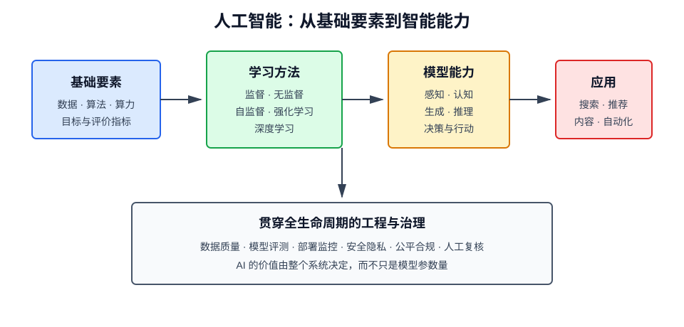

# 什么是 AI

## 1. 一句话理解

人工智能（Artificial Intelligence，AI）是让计算机完成通常需要人类智能才能完成的任务的一组理论、方法与工程技术，例如感知环境、理解语言、学习规律、推理决策和生成内容。

AI 不是某一种算法，也不等于机器人。它是一个覆盖算法、数据、算力、工程系统和应用场景的技术领域。

## 2. AI、机器学习与深度学习的关系

三者是包含关系，而不是并列关系：

- **人工智能**：目标层，研究如何让机器表现出智能。
- **机器学习（Machine Learning，ML）**：实现 AI 的主要路径，让模型从数据中学习规律。
- **深度学习（Deep Learning，DL）**：机器学习的一个分支，使用多层神经网络自动学习复杂特征。
- **生成式 AI（Generative AI）**：侧重生成文本、图像、音频、视频或代码，通常建立在深度学习和基础模型之上。

传统规则系统也属于 AI。例如专家系统可以通过大量 `if-then` 规则诊断设备故障，但它并没有从数据中训练参数。

## 3. AI 系统如何工作

一个典型的数据驱动 AI 系统包含以下环节：

1. **定义任务**：明确输入、输出、约束与评价指标。
2. **收集数据**：获取具有代表性且合法合规的数据。
3. **表示数据**：将文本、图像等信息转换为模型可处理的数值。
4. **训练模型**：通过优化算法调整参数，使预测误差逐步降低。
5. **评估模型**：在未参与训练的数据上检查泛化能力。
6. **部署推理**：将模型接入真实业务，处理新输入。
7. **监控迭代**：持续发现数据漂移、性能衰退和安全问题。

可以把监督学习抽象为寻找参数 \(\theta\)，使模型 \(f_\theta\) 在训练数据上的损失最小：

$$
\theta^*=\arg\min_\theta \frac{1}{N}\sum_{i=1}^{N}
\mathcal{L}\left(f_\theta(x_i),y_i\right)
$$

其中：

- \(x_i\) 是第 \(i\) 个输入样本；
- \(y_i\) 是真实答案；
- \(f_\theta(x_i)\) 是模型预测；
- \(\mathcal{L}\) 是衡量预测误差的损失函数；
- \(\theta^*\) 是训练后得到的参数。

训练的本质是学习参数，推理的本质是使用已学习的参数计算结果。

## 4. 主要学习范式

### 4.1 监督学习

训练数据同时包含输入与标签，模型学习二者之间的映射关系。

典型任务：

- 分类：垃圾邮件识别、疾病诊断；
- 回归：房价预测、需求预测；
- 序列标注：命名实体识别。

### 4.2 无监督学习

数据没有人工标签，模型自行发现结构或分布。

典型任务：

- 聚类：用户分群；
- 降维：高维数据可视化；
- 异常检测：识别偏离正常分布的样本。

### 4.3 自监督学习

从原始数据中自动构造监督信号。例如语言模型通过“预测下一个词元”学习语言规律，不需要人工逐句标注。现代基础模型的大规模预训练主要依赖这种范式。

### 4.4 强化学习

智能体在环境中采取动作，通过奖励信号学习策略。目标是最大化长期累计回报：

$$
J(\pi)=\mathbb{E}_{\pi}\left[\sum_{t=0}^{\infty}\gamma^t r_t\right]
$$

其中 \(\pi\) 是策略，\(r_t\) 是第 \(t\) 步奖励，\(\gamma\) 是折扣因子。

## 5. AI 的能力层次

### 5.1 感知

将现实世界信号转换为结构化信息，例如图像识别、语音识别、目标检测。

### 5.2 认知

对信息进行理解、检索、推理和规划，例如问答、搜索排序、代码分析。

### 5.3 决策与行动

根据目标选择动作并影响环境，例如推荐系统、自动驾驶和智能体工具调用。

### 5.4 生成

根据条件生成新的内容，例如文本续写、图像生成、语音合成和视频生成。

当前 AI 在特定任务上可以超过普通人，但这不意味着它具备完整的人类理解、意识或通用常识。

## 6. 判别式 AI 与生成式 AI

| 对比项 | 判别式 AI | 生成式 AI |
| --- | --- | --- |
| 核心问题 | 输入属于什么类别或对应什么结果 | 数据可能是如何产生的 |
| 学习目标 | 常建模 \(P(y\mid x)\) | 常建模 \(P(x)\) 或 \(P(x\mid c)\) |
| 输出 | 标签、分数、数值 | 文本、图片、音频、代码 |
| 示例 | 欺诈检测、图像分类 | ChatGPT、文生图、代码生成 |
| 典型风险 | 偏差、误判 | 幻觉、版权、内容安全 |

两者并非互斥。一个生成式应用通常还会使用分类模型执行安全审核、意图识别和结果排序。

## 7. AI 的核心工程要素

### 7.1 数据

数据决定模型能看到什么。数据量很重要，但代表性、准确性、时效性、授权范围和标注质量同样重要。

### 7.2 算法与模型

模型规定信息如何表示和计算，算法规定参数如何学习。相同数据使用不同模型，效果、成本和可解释性可能完全不同。

### 7.3 算力

训练大模型通常依赖 GPU、TPU 等加速设备。推理则需要在延迟、吞吐量、显存占用和成本之间权衡。

### 7.4 工程系统

生产级 AI 还需要数据管道、特征平台、模型服务、缓存、监控、评测、权限控制和回滚机制。模型只是系统的一部分。

## 8. 常见应用

| 领域 | 典型应用 | 关键要求 |
| --- | --- | --- |
| 搜索与推荐 | 召回、排序、个性化推荐 | 实时性、反馈闭环 |
| 金融 | 风控、反欺诈、投研辅助 | 可解释、审计、合规 |
| 医疗 | 影像辅助诊断、病历结构化 | 高准确率、隐私、医生复核 |
| 制造 | 质检、预测性维护 | 稳定性、边缘部署 |
| 软件工程 | 代码补全、测试生成、故障分析 | 仓库上下文、结果验证 |
| 内容产业 | 文案、图片、音视频生成 | 版权、事实性、风格控制 |

## 9. 如何评价一个 AI 系统

不能只看单一准确率，应结合业务目标评价：

- **效果**：准确率、精确率、召回率、F1、AUC、生成质量；
- **鲁棒性**：面对噪声、分布变化和恶意输入是否稳定；
- **效率**：训练成本、推理延迟、吞吐量和资源利用率；
- **公平性**：不同人群上的错误率是否存在系统性差异；
- **可解释性**：能否说明依据、来源和不确定性；
- **安全与合规**：隐私、版权、访问控制、内容安全；
- **业务价值**：是否真正降低成本、提高质量或创造收入。

离线指标优秀不等于线上有效。真实系统还需要 A/B 测试、人工评审和长期监控。

## 10. 局限与风险

### 10.1 数据偏差

模型会学习训练数据中的偏见、遗漏和历史问题，且可能在自动化后放大这些问题。

### 10.2 泛化边界

模型擅长处理与训练分布相近的输入，遇到罕见场景、环境变化或对抗样本时可能失效。

### 10.3 不可解释与不确定性

复杂模型的输出依据难以完全解释，而且高置信度不一定代表正确。

### 10.4 隐私与知识产权

训练、检索和日志数据可能包含个人信息、商业秘密或受版权保护的内容。

### 10.5 自动化责任

医疗、金融、司法等高风险决策不能把责任简单转移给模型，应保留人工复核、审计记录和故障降级。

## 11. 常见误区

### AI 等于机器学习吗？

不等于。机器学习是实现 AI 的主流方法，但规则系统、搜索、规划等同样属于 AI。

### 模型越大越好吗？

不一定。大模型通常能力更强，但成本、延迟和部署难度也更高。任务明确、数据稳定时，小模型可能更合适。

### 准确率高就能上线吗？

不能。还要验证长尾场景、安全性、公平性、可解释性和业务收益。

### AI 会真正“理解”吗？

“理解”缺少统一的可操作定义。模型能表现出强大的语言和推理能力，但不能据此直接推断其拥有与人相同的意识和体验。

## 12. 与相关概念的关系

- [什么是大模型](什么是大模型.md)：关注参数规模、预训练和基础模型。
- [什么是语言大模型](什么是语言大模型.md)：关注文本理解与生成模型。
- [什么是 AIGC](什么是AIGC.md)：关注 AI 生成内容及其生产流程。
- [什么是 RAG](什么是RAG.md)：通过外部知识检索增强生成。
- [什么是 Agent](什么是Agent.md)：让模型围绕目标进行规划和工具调用。

## 13. 总结

AI 是一套让机器表现出感知、学习、推理、生成和决策能力的技术体系。理解 AI 时，应同时看到模型能力与工程约束：数据决定边界，算法提供能力，算力支撑执行，评测和治理保障系统可用。真正有价值的 AI 系统并非单纯追求模型规模，而是在明确场景中持续、可靠、合规地解决问题。
