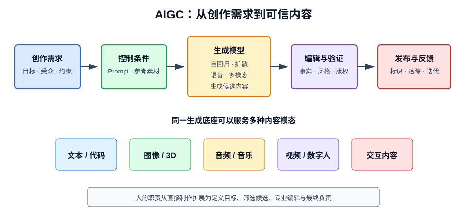

# 什么是 AIGC

## 1. 定义

AIGC（AI-Generated Content，人工智能生成内容）是利用生成式 AI 自动或辅助生产文本、图像、音频、视频、代码和 3D 内容的技术与生产方式。

AIGC 强调的是内容生产应用，不是某一种模型。它背后可能使用语言模型、扩散模型、生成对抗网络、语音模型或多模态模型。

## 2. 与相关概念的区别

| 概念 | 关注重点 |
| --- | --- |
| AI | 让机器具备感知、学习、推理和决策能力 |
| 生成式 AI | 能够生成新样本的模型与技术 |
| AIGC | 使用生成式 AI 生产内容的场景和流程 |
| LLM | 以语言理解和生成为核心的大模型 |
| Agent | 围绕目标规划并调用工具的系统 |

AIGC 产品可以由 Agent 驱动，例如自动完成“调研、写稿、配图、审核、发布”的内容工作流。

## 3. AIGC 如何生成内容

生成模型学习训练数据的概率分布，再根据输入条件生成新样本：

$$
x\sim p_\theta(x\mid c)
$$

其中 \(c\) 可以是文本提示、参考图片、语音、结构草图或其他控制条件。

生成不是从训练集中简单复制一条内容，而是根据模型学习到的规律组合输出；但在特定条件下仍可能复现训练数据片段，因此不能忽视版权和隐私风险。

## 4. 主要技术路线

### 4.1 自回归模型

按顺序预测下一个单位：

$$
P(x)=\prod_{t=1}^{T}P(x_t\mid x_{<t})
$$

文本、代码以及部分图像和音频生成常使用这种方式。

### 4.2 扩散模型

训练时逐步向数据加入噪声，并学习逆向去噪过程；生成时从随机噪声开始，经过多步去噪得到图像、音频或视频。

简化的前向加噪过程为：

$$
x_t=\sqrt{\bar{\alpha}_t}x_0+
\sqrt{1-\bar{\alpha}_t}\epsilon
$$

模型学习预测噪声 \(\epsilon\) 或原始样本，从而恢复内容。

### 4.3 GAN

生成器负责生成样本，判别器负责区分真实与生成样本，二者对抗训练。GAN 曾广泛用于图像生成，但训练稳定性和可控性较难处理。

### 4.4 多模态模型

将文本、图像、音频和视频映射到可关联的表示空间，实现图文理解、文生图、看图问答和视频生成。

## 5. 主要内容形态

### 5.1 文本

文章草稿、摘要、翻译、营销文案、剧本、客服回复和结构化报告。

### 5.2 图像

概念设计、广告素材、插画、商品图、图像修复和风格转换。

### 5.3 音频

语音合成、声音克隆、音乐生成、降噪和多语言配音。

### 5.4 视频

文生视频、图生视频、数字人、镜头补帧和后期制作。

### 5.5 代码

代码补全、测试生成、重构建议、文档和脚本生成。代码也属于具有语法和语义约束的内容。

### 5.6 3D 与交互内容

三维资产、材质、动画、游戏关卡和虚拟场景，通常需要与传统 DCC、游戏引擎和人工编辑结合。

## 6. Prompt 与控制条件

Prompt 是对生成目标的描述。高质量 Prompt 通常包含：

- 任务：要生成什么；
- 背景：为谁、在什么情境下使用；
- 内容约束：必须包含或排除什么；
- 风格：语气、视觉风格或代码规范；
- 格式：长度、结构、输出 Schema；
- 示例：理想输入输出；
- 验收标准：如何判断结果可用。

图像和视频生成还可使用参考图、遮罩、姿态、深度图、边缘图等控制信号。Prompt 能提高可控性，但不能替代事实验证与版权审核。

## 7. 典型生产工作流

1. 明确目标受众、渠道和验收标准；
2. 检索并整理可信资料；
3. 生成人工可编辑的初稿；
4. 检查事实、逻辑、品牌与版权；
5. 使用工具进行改写、配图、配音或剪辑；
6. 由人类审批高风险内容；
7. 发布并收集效果反馈；
8. 将有效模板和失败案例纳入评测。

专业 AIGC 的价值通常不是“一键完成”，而是缩短草稿、变体和重复劳动的周期。

## 8. AIGC 与传统内容生产

| 对比项 | 传统生产 | AIGC 辅助生产 |
| --- | --- | --- |
| 初稿速度 | 较慢 | 快 |
| 变体成本 | 较高 | 低 |
| 个性化规模 | 有限 | 可批量生成 |
| 稳定事实性 | 依赖创作者 | 必须额外校验 |
| 原创判断 | 责任链较清晰 | 数据与生成边界复杂 |
| 人的角色 | 直接创作 | 定义目标、筛选、编辑、审核 |

AIGC 更适合扩展人的生产能力，而不是取消专业判断。

## 9. 质量评价

不同模态需要不同指标。

### 9.1 通用维度

- 与需求和 Prompt 的一致性；
- 事实准确性；
- 结构完整性与可读性；
- 风格和品牌一致性；
- 原创性与版权风险；
- 安全性与偏见；
- 生成延迟和成本。

### 9.2 自动指标的局限

BLEU、ROUGE、FID、CLIP Score 等指标能衡量部分特征，但未必与人类偏好或业务效果完全一致。生产评测通常结合自动指标、模型评审、专家审核和线上数据。

## 10. 主要风险

### 10.1 幻觉与错误信息

语言模型可能编造事实、引用和数据。新闻、教育、医疗和金融内容必须基于可靠来源进行核验。

### 10.2 版权与授权

需关注训练数据来源、输入素材授权、输出相似性、人物肖像、商标和使用地区。模型可用不代表生成内容可任意商用。

### 10.3 隐私泄露

不要将客户资料、未公开代码和个人敏感信息直接发送给授权范围不明的模型服务。

### 10.4 深度伪造

声音克隆和人脸生成可能被用于欺诈。应取得授权、添加显著标识，并采用水印、溯源和内容鉴伪措施。

### 10.5 同质化与偏见

批量依赖同类模型容易产生相似风格，并重复训练数据中的文化和群体偏见。

## 11. 内容治理

生产级 AIGC 应建立：

- 数据来源和授权清单；
- 敏感信息输入规则；
- 生成内容标识规范；
- 高风险主题人工审批；
- 事实与引用核验流程；
- 模型、Prompt 和素材版本记录；
- 发布后的投诉、撤回和修订机制；
- 针对越狱、仿冒和违规内容的红队测试。

技术过滤不能替代责任主体和业务制度。

## 12. 适合与不适合的场景

适合：

- 创意发散与初稿；
- 大量格式相似的内容变体；
- 摘要、翻译和语气改写；
- 内部知识辅助和低风险素材；
- 人工能够快速验证的代码与设计方案。

不适合直接自动发布：

- 要求零事实错误的新闻和公告；
- 高风险医疗、法律、投资建议；
- 未经授权的声音、肖像和风格模仿；
- 无法解释来源的专业结论。

## 13. 落地建议

1. 从耗时高、风险低、易验证的环节开始；
2. 先定义质量基线，再选择模型；
3. 对事实型内容引入 RAG 与引用；
4. 对结构稳定任务使用模板和 Schema；
5. 对高价值产物保留人工编辑与审批；
6. 记录采用率、修改率、错误率、成本和周期；
7. 对模型升级执行固定评测集回归。

若生成初稿很快，但人工返工和审核成本更高，项目并没有创造真实价值。

## 14. 发展方向

- 原生多模态理解与生成；
- 更长、更一致的视频和 3D 内容；
- 细粒度可控编辑；
- 个性化但隐私友好的生成；
- 内容凭证、水印和来源追踪；
- Agent 驱动的端到端创作工作流；
- 小模型和端侧生成降低延迟与成本。

## 15. 总结

AIGC 是生成式 AI 在内容生产领域的应用范式。它显著降低了初稿和内容变体的边际成本，但事实性、版权、隐私与责任问题不会因自动化而消失。成熟的 AIGC 系统应把模型放进可检索、可编辑、可审核、可追溯的生产流程中。
