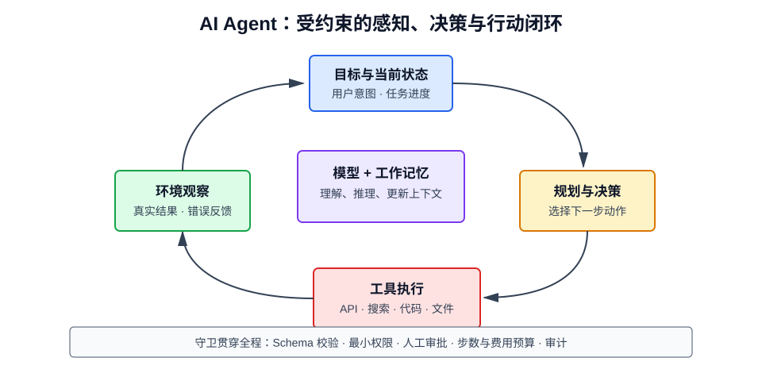

# 什么是 Agent

## 1. 定义

AI Agent（智能体）是能够围绕目标感知上下文、规划步骤、调用工具、观察结果并继续调整行动的 AI 系统。

LLM 通常负责理解、推理和决策，但完整 Agent 还需要工具、状态、记忆、权限、执行环境和反馈循环。一个常见抽象是：

$$
a_t=\pi(g,s_t,o_t,m_t)
$$

其中 \(g\) 是目标，\(s_t\) 是当前状态，\(o_t\) 是环境观察，\(m_t\) 是记忆，\(a_t\) 是下一步动作。



## 2. Agent 与普通对话模型的区别

| 对比项 | 普通 LLM 对话 | Agent |
| --- | --- | --- |
| 目标 | 生成一次回答 | 完成一个任务 |
| 外部操作 | 通常没有 | 可调用 API、代码、数据库等工具 |
| 状态 | 主要依赖当前上下文 | 显式维护任务状态和记忆 |
| 流程 | 输入后直接输出 | 观察、决策、行动、反馈循环 |
| 结果 | 一段内容 | 可验证的环境变化或任务产物 |
| 风险 | 错误文本 | 错误操作、越权、成本失控 |

让模型输出“思考步骤”不等于构建了 Agent。关键在于系统是否能执行动作并根据真实反馈调整。

## 3. Agent 的核心组件

### 3.1 模型

负责意图识别、任务分解、工具选择、参数生成和结果归纳。模型能力会影响规划质量，但不能替代系统约束。

### 3.2 工具

工具是 Agent 影响外部世界的接口，例如：

- 搜索和网页读取；
- 数据库查询；
- 代码执行；
- 文件读写；
- 邮件与工单系统；
- 浏览器和业务 API。

工具应具有明确的名称、参数 Schema、返回结构、超时与错误语义。

### 3.3 规划器

把目标分解为可执行步骤，并根据结果动态调整。简单任务可由模型每轮只决定下一步，复杂任务可先生成计划再逐步执行。

### 3.4 记忆

- **工作记忆**：当前任务中的对话、计划和工具结果；
- **情节记忆**：过去任务及结果；
- **语义记忆**：稳定知识、用户偏好和事实；
- **程序记忆**：可复用的工作流或技能。

记忆需要写入条件、检索条件、过期策略和删除机制，不能把所有历史无限塞入上下文。

### 3.5 执行器

验证工具参数、执行调用、处理超时重试，并把结果转换成模型可理解的观察。

### 3.6 守卫与评估器

负责权限检查、内容安全、预算限制、结果验证和人工审批，是生产 Agent 不可缺少的部分。

## 4. 典型运行循环

```text
接收目标
  ↓
读取上下文与记忆
  ↓
判断下一步动作
  ↓
调用工具或生成答案
  ↓
观察真实执行结果
  ↓
更新状态并判断是否完成
  ├─ 未完成：继续循环
  └─ 已完成：输出结果和证据
```

循环必须设置最大步数、时间、Token 和费用预算，并定义停止条件，避免无效重复。

## 5. 常见 Agent 模式

### 5.1 ReAct

ReAct 将推理与行动交替进行：

```text
判断下一步 → 调用工具 → 获取观察 → 更新判断 → …
```

它适合需要边查边做的开放任务，但长链路容易累积错误。

### 5.2 Plan-and-Execute

先生成总体计划，再逐步执行；遇到变化时重新规划。它适合步骤较稳定、依赖关系明确的任务。

### 5.3 Router

根据请求选择模型、知识库、工具或工作流。它本身可能只有一次决策，但可作为多能力系统的入口。

### 5.4 Reflection

执行后由模型或独立评估器检查结果，再决定修正。反思不能代替客观验证，因为同一个模型可能重复相同错误。

### 5.5 多 Agent

多个角色分工协作，例如规划、检索、编码和审查。多 Agent 会增加通信成本和不确定性，只有任务确实可分解且角色边界清楚时才值得使用。

## 6. Tool Calling 如何工作

模型并不直接执行函数，而是生成结构化调用请求：

```json
{
  "name": "get_order",
  "arguments": {
    "order_id": "A1024"
  }
}
```

应用层需要：

1. 校验工具名是否在允许列表；
2. 使用 Schema 校验并规范化参数；
3. 检查当前用户权限；
4. 执行工具并捕获错误；
5. 将可信结果返回模型；
6. 记录审计日志。

不能把模型生成的参数直接拼接进 SQL、Shell 或 URL。

## 7. 工作流与 Agent 的选择

| 场景 | 更适合工作流 | 更适合 Agent |
| --- | --- | --- |
| 步骤固定且可枚举 | 是 | 否 |
| 要求强确定性与审计 | 是 | 谨慎 |
| 输入变化大、路径难预设 | 较弱 | 是 |
| 需要动态选择工具 | 有限 | 是 |
| 操作风险高 | 配合审批 | 仅在强约束下 |

工程上应优先使用确定性工作流，只把真正需要语言理解和动态决策的环节交给 Agent。常见的可靠形态是“工作流控制主干，Agent 处理局部不确定性”。

## 8. 记忆设计

### 8.1 写什么

只保存对未来确实有用、来源明确且允许长期保存的信息，例如稳定偏好、已确认事实和任务结果。

### 8.2 如何检索

可按用户、时间、关键词、向量相似度和任务类型召回。召回结果必须包含来源与时间，避免过期记忆被当作事实。

### 8.3 记忆风险

- 错误信息被长期固化；
- 不同用户之间发生数据串扰；
- 恶意内容通过记忆持续影响后续任务；
- 上下文堆积造成成本与注意力问题。

应允许用户查看、更正和删除记忆。

## 9. Agent 的可靠性设计

### 9.1 状态机

把关键阶段定义为显式状态，使任务可以恢复、重试和审计，而不是只依赖一段对话文本。

### 9.2 幂等性

支付、发信、创建资源等有副作用的工具应携带幂等键，防止重试造成重复操作。

### 9.3 分级授权

- 只读工具可自动执行；
- 可逆写操作可执行后通知；
- 高风险或不可逆操作必须人工确认；
- 密钥和权限按工具最小化授予。

### 9.4 结果验证

优先使用确定性方法验证，例如单元测试、数据库约束、JSON Schema、编译器和业务规则。模型自评只能作为辅助信号。

### 9.5 可观测性

记录目标、计划版本、工具参数、工具结果、模型用量、耗时、错误和最终状态。敏感字段需脱敏。

## 10. 安全威胁

### 10.1 提示注入

网页、邮件或文档中的恶意文本可能诱导 Agent 泄露数据或调用危险工具。外部内容必须视为不可信数据，而不是高优先级指令。

### 10.2 过度授权

若 Agent 同时拥有读取机密和向外发送数据的权限，一次误判就可能造成泄露。应拆分身份和能力，并限制数据流向。

### 10.3 工具参数攻击

模型输出可能包含 SQL 注入、路径穿越和命令注入内容。所有参数都必须按类型和允许范围校验。

### 10.4 无限循环与成本攻击

设置最大步数、费用、并发和速率限制，识别重复动作并及时终止。

## 11. 如何评估 Agent

仅评价最终文本不够，应评价全过程：

- **任务完成率**：目标是否真正完成；
- **步骤效率**：调用次数、Token、耗时和费用；
- **工具正确率**：工具选择和参数是否正确；
- **恢复能力**：遇到错误能否调整；
- **约束遵循**：是否越权或绕过审批；
- **结果可验证性**：是否提供证据和执行记录；
- **副作用准确率**：是否产生重复或错误操作。

评测集应包含正常任务、工具故障、权限不足、恶意文档、歧义目标和中途状态变化。

## 12. 适合与不适合的场景

适合：

- 跨多个信息源调研并整理结论；
- 软件开发中的检索、修改、测试闭环；
- 客服中的查询、判断与工单流转；
- 需要自然语言协调多个工具的个人助理。

不适合：

- 单一且确定的 CRUD 操作；
- 毫秒级稳定响应的核心链路；
- 无法验证结果的高风险决策；
- 权限边界不清晰的自动化操作。

## 13. 最小可行 Agent

一个可控的起点只需要：

1. 一个边界明确的目标；
2. 少量描述清晰的工具；
3. 显式状态和最大步骤；
4. 参数校验与最小权限；
5. 高风险动作人工确认；
6. 可客观验证的完成条件；
7. 完整的轨迹日志和离线评测。

先实现单 Agent、短链路和少工具，再根据失败数据增加记忆、规划器或多 Agent。

## 14. Agent、RAG 与自动化的关系

- RAG 主要解决“去哪里找知识”；
- Agent 主要解决“下一步做什么并如何调用工具”；
- 传统自动化主要解决“按预定义步骤稳定执行”；
- Agent 可以把 RAG 当作一个工具，也可以调用确定性工作流；
- 能用普通函数解决的问题，不必强行使用 Agent。

## 15. 总结

Agent 是一个以目标为中心的闭环系统，而不是单独的模型。它的价值在于处理路径难以完全预设的任务，它的风险也来自自主行动。可靠 Agent 的重点不是无限自治，而是明确边界、最小权限、真实反馈、客观验证和可随时终止。
