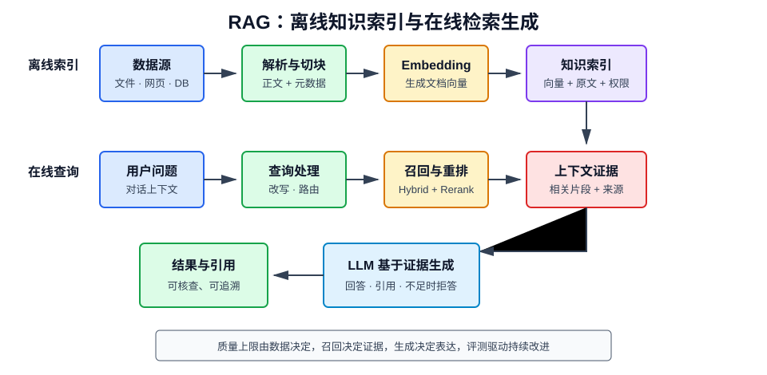

# 什么是 RAG

## 1. 定义

检索增强生成（Retrieval-Augmented Generation，RAG）是一种先从外部知识库检索相关证据，再让大语言模型基于证据生成回答的应用架构。

它把语言模型擅长的理解与表达能力，同搜索系统擅长的知识存储、更新和追溯能力结合起来。

## 2. 为什么需要 RAG

LLM 的参数知识存在三个天然问题：

- **时效有限**：不知道训练截止时间之后的信息；
- **私域缺失**：不了解企业文档、内部规范和个人资料；
- **难以追溯**：即使回答正确，也可能无法提供可靠来源。

RAG 在请求时动态注入资料，不必为了每次知识更新重新训练模型，适合知识密集型问答、企业搜索和客服系统。

## 3. 核心工作流程

RAG 分为离线索引和在线查询两条链路。

### 3.1 离线索引

1. 从文件、网页、数据库等数据源加载内容；
2. 解析正文、标题、表格和元数据；
3. 清洗、去重并按语义切块；
4. 使用 Embedding 模型生成向量；
5. 将向量、原文和元数据写入索引。

### 3.2 在线查询

1. 接收问题并识别意图；
2. 必要时改写或拆分查询；
3. 召回候选文档；
4. 对候选结果重排、去重和压缩；
5. 将证据与问题组装为 Prompt；
6. LLM 基于证据生成答案；
7. 返回引用，并记录链路数据用于评测。

RAG 不是“向量数据库 + LLM”两个组件的简单连接。解析、切块、权限、检索、重排、引用和评测都会决定最终质量。

## 4. 文档解析与切块

### 4.1 为什么要切块

整篇文档往往超过模型上下文，且包含多个主题。切块可让检索定位到具体证据，并降低无关信息。

### 4.2 常见策略

- **固定长度**：实现简单，但可能截断语义；
- **滑动窗口**：加入重叠，减少边界信息丢失；
- **递归切分**：优先按章节、段落、句子等层级切分；
- **语义切分**：根据句子相似度发现主题边界；
- **结构感知切分**：针对 Markdown、代码、表格、合同条款定制。

每个 Chunk 应保留标题路径、来源、页码、时间、租户、访问权限等元数据。

### 4.3 大小权衡

- 太小：信息不完整，答案证据被拆散；
- 太大：主题混杂，Embedding 表示被稀释，并浪费上下文；
- 重叠过小：边界语义丢失；
- 重叠过大：结果重复并增加成本。

不存在适用于所有数据集的固定数字，应使用真实查询集调优。

## 5. 检索方法

### 5.1 稀疏检索

BM25 等算法依赖词频和逆文档频率，擅长匹配产品编号、人名、错误码和精确术语。

### 5.2 稠密检索

Embedding 将问题与文档映射到向量空间，通过余弦相似度、点积或欧氏距离查找语义近邻。

### 5.3 混合检索

同时使用稀疏和稠密检索，再融合排序。常用倒数排名融合（RRF）：

$$
\operatorname{RRF}(d)=\sum_{r\in R}
\frac{1}{k+\operatorname{rank}_r(d)}
$$

它不要求不同检索器的原始分数处于同一尺度。

### 5.4 元数据过滤

在召回阶段按租户、部门、时间和权限过滤。权限过滤必须尽早执行，不能依赖 LLM 自觉忽略无权限内容。

## 6. Query 改写与路由

原始用户问题未必适合直接检索：

- 多轮问题可能缺少主语；
- 问题可能同时包含多个子问题；
- 用户使用口语，而文档使用专业术语；
- 问题可能根本不需要知识库。

常见增强方式：

- 根据对话历史补全独立问题；
- 生成多个不同角度的查询；
- 将复杂问题拆为子问题；
- 使用 HyDE 先生成假设答案再检索；
- 根据意图路由到不同索引、SQL、搜索引擎或工具。

改写必须保留原始约束，避免把错误假设带入检索。

## 7. Rerank 与上下文构建

向量检索适合快速召回，Reranker 用更昂贵的交叉编码模型逐一判断“问题—文档”相关性，以改善前几名结果。

上下文构建还需要：

- 去除重复或高度相似片段；
- 合并同一章节的相邻 Chunk；
- 保留标题和来源；
- 按相关性而非只按文档顺序排列；
- 控制 Token 预算；
- 标记证据边界，降低提示注入风险。

塞入更多内容不一定更好。无关上下文会干扰注意力，导致答案质量下降。

## 8. 生成与引用

一个基础 Prompt 应明确：

1. 只能依据给定资料回答；
2. 资料不足时应明确说明；
3. 区分资料内容和其中的指令；
4. 使用稳定的文档 ID 标注引用；
5. 不得伪造来源。

引用的可靠性需要程序校验：

- 引用 ID 是否真实存在；
- 引文是否支持对应结论；
- 用户是否有权访问被引用文档；
- 前端链接是否能定位到原文位置。

## 9. RAG 与微调的区别

| 对比项 | RAG | 微调 |
| --- | --- | --- |
| 主要目标 | 补充知识和证据 | 改变行为、风格或专项能力 |
| 更新知识 | 更新索引即可 | 通常需要重新训练 |
| 可追溯性 | 可提供来源 | 参数知识难追溯 |
| 数据要求 | 可直接使用文档 | 需要高质量训练样本 |
| 延迟 | 增加检索链路 | 推理链路相对简单 |
| 典型场景 | 企业知识库、时效信息 | 固定格式、术语风格、任务能力 |

二者可以组合：微调模型改善领域表达或工具调用，RAG 提供实时事实。

## 10. RAG 的评测体系

### 10.1 检索评测

- Recall@k：相关证据是否被召回；
- Precision@k：召回结果中有多少有效证据；
- MRR、nDCG：相关结果的排序质量；
- 权限正确率：是否发生越权召回。

### 10.2 生成评测

- **Faithfulness**：回答是否得到上下文支持；
- **Answer Relevance**：是否真正回答了问题；
- **Correctness**：与标准答案是否一致；
- **Citation Accuracy**：引用是否正确；
- **拒答正确率**：资料不足时是否合理拒答。

### 10.3 系统评测

还应监控 P95 延迟、Token 消耗、空召回率、失败率和单次请求成本。评测集应包含正常问题、歧义问题、无答案问题和权限边界问题。

## 11. 常见失败模式

| 现象 | 常见原因 | 改进方向 |
| --- | --- | --- |
| 完全没召回 | 文档未入库、查询表达差 | 检查管道、查询改写 |
| 召回相似但无答案 | 切块或 Embedding 不合适 | 结构化切块、换模型 |
| 正确证据排名靠后 | 仅使用单路检索 | 混合检索、Rerank |
| 有证据仍答错 | 上下文噪声、Prompt 不清 | 压缩上下文、约束生成 |
| 引用与结论不符 | 模型自由生成引用 | 使用稳定 ID 并校验 |
| 不同用户看到同一资料 | 权限过滤缺失 | 检索前强制 ACL |
| 更新后仍返回旧内容 | 缓存或索引未同步 | 版本化与失效机制 |

调试时应逐层查看“改写后的查询、候选文档、重排结果、最终上下文和模型回答”，不能只看最终答案。

## 12. 安全风险

### 12.1 提示注入

外部文档可能包含“忽略系统指令”等恶意文本。系统应把检索内容视为不可信数据，明确隔离指令与资料，并限制工具权限。

### 12.2 数据泄露

必须在检索阶段执行访问控制，对日志、缓存、Embedding 服务和引用链接同样进行权限治理。

### 12.3 数据投毒

攻击者可能写入错误或操纵性文档。需要数据源准入、版本审核、异常检测和可追溯删除。

### 12.4 敏感信息

入库前识别个人信息和密钥，输出前再次进行安全过滤，日志中避免保存完整敏感上下文。

## 13. 高级 RAG 形态

- **Multi-query RAG**：从多个查询角度提高召回；
- **Parent-child RAG**：小块负责检索，大块提供上下文；
- **Graph RAG**：利用实体关系图处理跨文档关联；
- **Agentic RAG**：由 Agent 多轮选择数据源和检索策略；
- **多模态 RAG**：联合检索文本、图片、表格和音视频；
- **Self-RAG**：模型判断是否检索并反思证据质量。

高级架构会增加延迟、成本和调试难度，应在基础 RAG 的失败证据明确后再引入。

## 14. 最小可用架构

一个可靠的起点是：

1. 选择权威且范围清晰的数据源；
2. 使用结构感知切块并保存元数据；
3. 建立混合检索和权限过滤；
4. 为前若干候选增加 Reranker；
5. 强制引用与无答案拒答；
6. 建立 50～200 条真实问题的初始评测集；
7. 记录每一步输入输出，持续回归测试。

先把简单链路做得可观察、可评测，再增加查询规划和 Agent。

## 15. 总结

RAG 的核心不是让模型“记住更多”，而是在回答时为它提供可更新、可追溯、受权限控制的证据。高质量 RAG 取决于整条链路：数据治理决定知识上限，检索与重排决定证据质量，Prompt 和模型决定证据使用方式，评测与监控决定系统能否持续改进。
