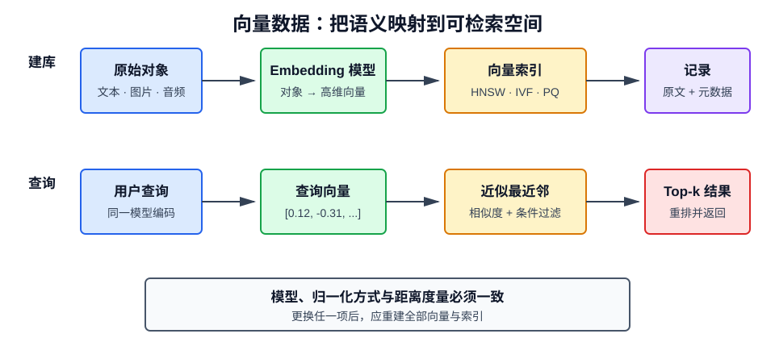

# 什么是向量数据

## 1. 定义

向量数据是用一组有序数值表示对象的数据形式：

$$
\mathbf{x}=[x_1,x_2,\ldots,x_d]\in\mathbb{R}^d
$$

在 AI 中，文本、图片、音频、用户和商品等非结构化对象通常先由 Embedding 模型转换为高维向量，再进行语义检索、聚类、推荐和异常检测。

向量本身不是语义。它是模型在训练目标约束下学习到的数值表示，只有与生成它的模型、距离度量和应用语境配套时才有意义。



## 2. 从对象到 Embedding

Embedding（嵌入）是将离散或复杂对象映射到连续向量空间的过程：

$$
f:\mathcal{X}\rightarrow\mathbb{R}^d
$$

其中 \(f\) 是 Embedding 模型。理想情况下，语义相近的对象在向量空间中距离较近，语义无关的对象距离较远。

例如：

```text
"如何重置登录密码" ─┐
                    ├─ 在向量空间中相近
"忘记密码怎么办"   ─┘

"北京今天的天气" ─── 与上面两个向量较远
```

这种表示能发现关键词不同但含义相近的内容，是语义搜索区别于关键词搜索的关键。

## 3. 向量的三个关键属性

### 3.1 维度

维度 \(d\) 表示向量包含多少个数值。高维通常具有更强的表示容量，但会增加存储、计算和索引成本。维度并非越高越好，应由模型设计和实际评测决定。

### 3.2 方向

方向常用于表达语义模式。余弦相似度主要比较方向，因此对向量长度不敏感。

### 3.3 模长

向量的 L2 范数为：

$$
\|\mathbf{x}\|_2=\sqrt{\sum_{i=1}^{d}x_i^2}
$$

部分模型的模长也携带信息。若先做归一化，则所有向量模长都变为 1。

## 4. 常用相似度与距离

### 4.1 余弦相似度

$$
\cos(\mathbf{x},\mathbf{y})
=\frac{\mathbf{x}\cdot\mathbf{y}}
{\|\mathbf{x}\|_2\|\mathbf{y}\|_2}
$$

值越大表示方向越接近。它适合更关注方向而非绝对长度的文本语义检索。

有些系统使用余弦距离：

$$
d_{\cos}=1-\cos(\mathbf{x},\mathbf{y})
$$

因此必须确认接口返回的是“相似度”还是“距离”，两者排序方向相反。

### 4.2 欧氏距离

$$
d_2(\mathbf{x},\mathbf{y})
=\sqrt{\sum_{i=1}^{d}(x_i-y_i)^2}
$$

距离越小越相似。它同时受方向和模长影响。

### 4.3 点积

$$
s(\mathbf{x},\mathbf{y})=\mathbf{x}^\top\mathbf{y}
$$

值越大通常越相似。若两个向量均已归一化，则点积等于余弦相似度。

### 4.4 如何选择

优先遵循 Embedding 模型文档和训练时使用的目标函数，不能随意更换。模型、归一化方式和距离度量共同构成检索语义。

> 更换 Embedding 模型、向量维度、归一化策略或距离度量后，应重建向量集合和索引，不能混用旧向量。

## 5. 向量数据库存储什么

一条典型记录包含：

```json
{
  "id": "doc-42#chunk-3",
  "vector": [0.012, -0.331, 0.087],
  "document": "向量数据库用于高维近邻检索……",
  "metadata": {
    "source": "vector-database.md",
    "section": "索引原理",
    "tenant_id": "team-a"
  }
}
```

- `id`：稳定且唯一的标识；
- `vector`：用于相似度检索；
- `document`：原文或可回溯的内容；
- `metadata`：来源、权限、时间、类别等过滤信息。

生产系统不能只保存向量，否则很难追溯来源、更新内容和执行权限过滤。

## 6. 为什么需要近似最近邻

若有 \(N\) 个 \(d\) 维向量，暴力搜索一次查询需比较全部向量，时间复杂度约为 \(O(Nd)\)。数据量达到百万或十亿级后成本过高。

近似最近邻（Approximate Nearest Neighbor，ANN）通过牺牲少量召回率换取显著速度提升。

### 6.1 HNSW

Hierarchical Navigable Small World 将向量组织为多层图：

- 上层连接稀疏，负责快速跳转；
- 下层连接密集，负责局部精细搜索；
- 查询从高层逐步下降，逼近最近邻。

优点是查询快、召回率高；缺点是索引占用内存较多，构建参数需要调优。

### 6.2 IVF

Inverted File Index 先通过聚类将向量分桶。查询时只搜索与查询向量最接近的若干桶，减少候选数量。

### 6.3 PQ

Product Quantization 将向量拆分为多个子向量并量化编码，以较小精度损失显著压缩存储，常与 IVF 组合。

## 7. 高维空间的特殊问题

### 7.1 维度灾难

维度升高后，空间体积快速增长，数据变得稀疏，最近点和最远点的距离差异可能缩小，传统索引和直觉都会失效。

### 7.2 Hubness

某些向量会异常频繁地成为其他向量的近邻，形成“枢纽点”，影响检索多样性与准确性。

### 7.3 向量不可直接解释

单个维度通常没有清晰的人类含义，不能简单说“第 37 维代表金融”。应通过下游任务、近邻样本和消融实验理解表示效果。

## 8. 文本向量化的工程流程

1. 清洗文档并保留来源、权限等元数据；
2. 按语义边界切分为 Chunk；
3. 使用同一个 Embedding 模型批量编码；
4. 采用与模型匹配的归一化和距离度量；
5. 将向量、原文和元数据写入数据库；
6. 查询时用同一模型编码问题；
7. 执行元数据过滤和近邻搜索；
8. 对候选结果重排并返回原文。

切块过大，会混合多个主题；切块过小，则语义不完整。应结合文档结构、模型窗口和检索评测确定大小及重叠范围。

## 9. 向量检索不等于语义完全理解

向量检索容易受到以下因素影响：

- Embedding 模型领域不匹配；
- 查询过短或存在歧义；
- 文档切块破坏上下文；
- 否定、数字、时间和专有名词区分不足；
- 相似内容很多但真正答案只在少数文档中；
- 权限过滤在检索后执行，导致安全问题。

因此生产系统常使用混合检索：

$$
\operatorname{score}
=\alpha\cdot\operatorname{dense}
+(1-\alpha)\cdot\operatorname{sparse}
$$

稠密向量负责语义召回，BM25 等稀疏检索负责精确关键词匹配，再使用 Reranker 精排。

## 10. 如何评估检索质量

给定查询集合及人工标注的相关文档，可使用：

- **Recall@k**：前 \(k\) 个结果覆盖了多少相关文档；
- **Precision@k**：前 \(k\) 个结果中有多少真正相关；
- **MRR**：第一个相关结果排名的倒数均值；
- **nDCG**：考虑相关程度和排序位置；
- **延迟与吞吐**：系统性能指标；
- **索引大小**：存储和内存成本。

RAG 场景还要做端到端评测，因为“检索到相关文档”不一定意味着生成模型正确使用了它。

## 11. 数据更新与治理

- 使用稳定 ID 支持幂等写入和删除；
- 文档变化后只重算受影响的 Chunk；
- 保存模型名称、版本、维度和距离度量；
- 建立索引版本，支持蓝绿切换与回滚；
- 在检索前执行租户和权限过滤；
- 删除原文时同步删除向量及缓存；
- 监控分布漂移、空结果率和低分结果比例。

Embedding 模型升级应创建新集合、全量重算、对比评测后再切换。

## 12. 向量数据的常见应用

- RAG 知识检索；
- 语义搜索与相似问推荐；
- 商品、内容和用户召回；
- 图片搜图、文字搜图；
- 聚类与主题发现；
- 重复内容检测；
- 异常检测与风控；
- 长期记忆召回。

## 13. 常见误区

### 相似度 0.8 一定算相关吗？

不一定。分数范围与模型、数据分布和度量有关，应通过标注数据确定阈值。

### 不同模型的同维向量可以混用吗？

不可以。即使维度相同，坐标空间的语义也不同。

### 向量数据库会理解文档吗？

数据库负责存储和近邻检索，语义来自 Embedding 模型，最终答案还依赖切块、检索、重排和生成。

## 14. 总结

向量数据把复杂对象映射到可计算的连续空间，使系统能够按语义而非仅按字面进行搜索。一个可靠的向量检索系统需要同时设计 Embedding、切块、距离度量、ANN 索引、元数据过滤、重排和评测。任何模型或度量变化都可能改变整个空间，因此版本管理与重建索引是基础工程要求。
