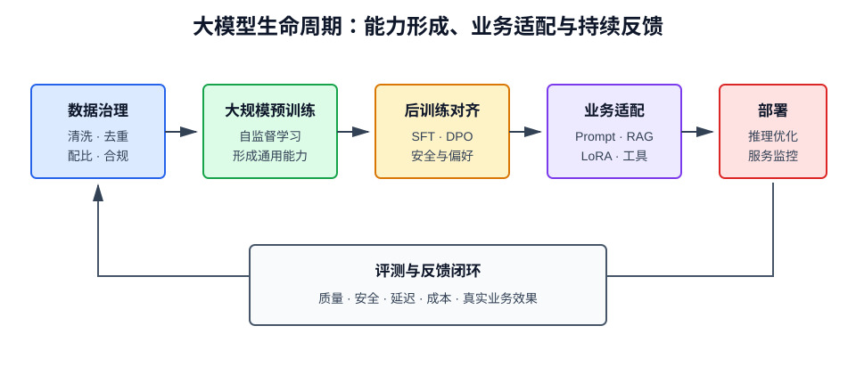

# 什么是大模型

## 1. 定义

大模型（Large Model）通常指参数规模大、训练数据广、计算量高，并能通过预训练适配多种下游任务的机器学习模型。它不只包括语言模型，还包括视觉、语音、多模态和科学计算模型。

“大”没有固定参数门槛。它是相对于同时期模型和任务而言的综合概念，至少包含：

- 参数规模大；
- 训练数据覆盖广；
- 训练计算量高；
- 能力具有较强通用性；
- 开发方式从“每个任务单独训练”转向“预训练后适配”。

## 2. 从专用模型到基础模型

传统机器学习常为每个任务分别收集标注数据、训练模型。大模型先在海量通用数据上进行预训练，再通过提示、微调或外部知识适配多个任务。

| 模式 | 数据 | 模型 | 适配新任务 |
| --- | --- | --- | --- |
| 专用模型 | 面向单一任务 | 一任务一模型 | 重新训练 |
| 基础模型 | 大规模通用数据 | 一个底座支持多任务 | 提示、微调、RAG |

能够作为多个下游系统底座的大模型，也常被称为**基础模型（Foundation Model）**。

## 3. 大模型的基本原理

### 3.1 参数化函数

模型可以看作参数为 \(\theta\) 的函数：

$$
\hat{y}=f_\theta(x)
$$

参数数量增加意味着模型拥有更高的表示容量，但能力并不只取决于参数量，还取决于数据质量、模型结构、训练目标和计算预算。

### 3.2 表征学习

大模型会将原始信息转换为多层表示。浅层可能识别局部模式，深层逐步组合出语义、对象关系和任务结构。预训练让这些通用表示能够被不同任务复用。

### 3.3 预训练目标

不同模态使用不同的自监督任务：

- 文本：预测下一个词元或恢复被遮蔽文本；
- 图像：恢复图像块、图文对齐或去噪；
- 语音：预测音频片段或进行语音文本对齐；
- 多模态：学习文本、图像、音频和视频之间的对应关系。

## 4. 为什么规模会带来能力提升

当参数、数据和计算量按合理比例增长时，模型损失通常呈幂律下降，这类经验规律称为**缩放定律（Scaling Laws）**：

$$
L(N,D,C)\approx L_\infty+aN^{-\alpha}+bD^{-\beta}+cC^{-\gamma}
$$

其中 \(N\) 表示参数量，\(D\) 表示数据量，\(C\) 表示计算量。该公式表达的是趋势，而不是“参数无限增加就必然更智能”。

规模带来收益的原因包括：

- 更大的参数空间能表示更复杂的规律；
- 更多数据覆盖更多语言、领域和任务；
- 统一训练使不同知识和技能发生迁移；
- 上下文学习允许模型根据少量示例临时适配任务。

但三者必须平衡。参数很多而数据不足，会训练不充分；数据很多而模型过小，则容量成为瓶颈。

## 5. 大模型的训练阶段

### 5.1 数据治理

训练前通常需要去重、清洗、质量过滤、隐私处理、安全过滤和数据配比。高质量数据可能比盲目增加低质量数据更有效。

### 5.2 预训练

使用自监督目标学习通用能力。这个阶段消耗的算力最大，产物称为基础模型或基座模型。

### 5.3 后训练

让模型更善于遵循指令并符合人类偏好，常见方法包括：

- **监督微调（SFT）**：使用高质量指令与回答训练；
- **RLHF**：使用人类反馈训练奖励模型，再通过强化学习优化；
- **DPO**：直接利用偏好样本优化模型，流程相对简单；
- **安全对齐**：训练拒答边界、风险识别和行为规范。

### 5.4 评测与红队测试

评估知识、推理、代码、工具使用、安全和偏见，并通过对抗测试主动发现风险。

## 6. 如何适配业务

| 方法 | 改变模型参数 | 适合场景 | 主要特点 |
| --- | --- | --- | --- |
| Prompt | 否 | 快速试验、通用任务 | 成本低，稳定性有限 |
| Few-shot | 否 | 有少量示例的格式模仿 | 占用上下文 |
| RAG | 否 | 私有知识、时效信息 | 可追溯，依赖检索质量 |
| LoRA/PEFT | 少量 | 风格、格式、领域行为 | 成本较低 |
| 全量微调 | 是 | 深度改变模型能力 | 成本高，需防灾难性遗忘 |
| 持续预训练 | 是 | 注入大量领域语料 | 数据和训练要求高 |

一般应先建立评测集，再从 Prompt 和 RAG 开始；只有当问题确实来自模型行为或领域能力不足时，才考虑微调。

## 7. 推理与部署

大模型上线后的主要指标包括首词元延迟、每秒输出词元数、并发量、显存占用和单位请求成本。

常用优化方法：

- **量化**：用 INT8、INT4 等低精度表示权重；
- **蒸馏**：让小模型学习大模型的输出或中间表示；
- **剪枝**：移除贡献较低的参数或结构；
- **KV Cache**：缓存注意力计算中的键和值；
- **批处理**：合并请求提高硬件利用率；
- **推测解码**：用小模型提出候选，大模型并行验证；
- **MoE**：每次只激活部分专家参数。

优化会改变质量、速度、成本或硬件兼容性，因此必须用真实业务流量验证。

## 8. 大模型的主要类型

- **语言大模型**：处理文本和代码；
- **视觉大模型**：图像分类、检测、分割和视觉理解；
- **多模态大模型**：联合处理文本、图像、音频、视频；
- **生成模型**：生成文本、图片、音频或视频；
- **世界模型**：学习环境动态，用于预测、规划和控制；
- **科学大模型**：面向蛋白质、气象、材料等专业领域。

## 9. 涌现能力应如何理解

“涌现”常指某些能力在规模达到一定程度后明显出现，例如少样本学习和复杂指令遵循。但部分突变现象可能来自评价指标不连续：底层能力是平滑增长的，只有超过评分阈值后才被观察到。

因此不能把涌现简单解释为神秘的智能跳跃，应同时检查训练数据、提示方式、评测尺度和统计显著性。

## 10. 局限与风险

- **幻觉**：生成流畅但不真实的信息；
- **知识时效性**：参数知识停留在训练数据覆盖范围内；
- **偏见**：继承并放大数据中的偏差；
- **不可解释性**：难以完整说明内部决策过程；
- **高成本**：训练、推理和维护需要大量资源；
- **隐私与版权**：数据来源和输出内容可能带来合规问题；
- **提示注入**：连接外部数据与工具后可能被恶意指令操纵；
- **能力评测污染**：测试题出现在训练数据中会导致虚高成绩。

## 11. 选型时看什么

不要只比较参数量和排行榜，应综合判断：

1. 任务质量与中文、代码、视觉等专项能力；
2. 上下文长度及长上下文中的真实利用能力；
3. 延迟、吞吐量和总体拥有成本；
4. 是否支持私有化、量化和目标硬件；
5. 工具调用、结构化输出和 RAG 兼容性；
6. 许可证、数据合规和供应商稳定性；
7. 真实业务评测集上的效果。

## 12. 大模型、LLM 与 AIGC 的区别

- **大模型**强调模型规模、通用预训练和基础能力；
- **语言大模型（LLM）**是以语言为核心输入输出的大模型；
- **AIGC**强调由 AI 生成内容的生产方式和应用形态；
- **Agent**是在模型之上加入目标、规划、工具和反馈循环的系统；
- **RAG**是给生成模型动态补充外部知识的架构。

## 13. 总结

大模型的关键变化不是单纯把网络做大，而是形成“通用预训练底座 + 低成本任务适配”的开发范式。规模扩大可以提升能力，但数据质量、训练方法、评测体系和部署工程共同决定最终价值。业务落地时，应从需求和约束出发选择模型，而不是把参数量当作唯一标准。
