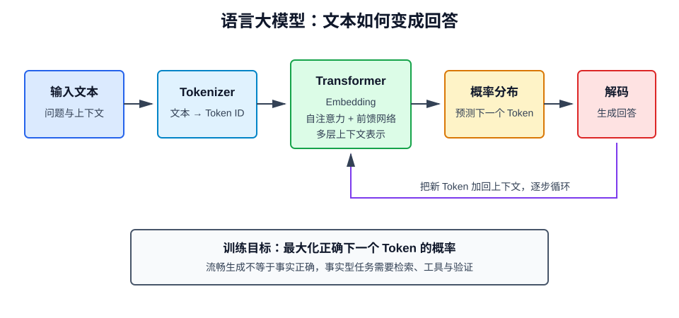

# 什么是语言大模型

## 1. 定义

语言大模型（Large Language Model，LLM）是使用大规模文本或代码语料训练、能够理解和生成自然语言的深度学习模型。其核心任务通常是根据已有上下文预测下一个词元（Token）。

LLM 输出的不是从数据库直接取出的固定答案，而是一个词元概率分布，并从中逐步选择词元形成完整响应。



## 2. 文本如何进入模型

### 2.1 Tokenization

模型不能直接处理文字，需要分词器将文本切分为词元，并映射为整数 ID。

```text
"大模型正在学习" → ["大", "模型", "正在", "学习"] → [241, 8921, 1735, 620]
```

词元不一定等于一个汉字或单词。不同模型的词表和切分规则不同，因此相同文本的 Token 数也可能不同。

### 2.2 Embedding

每个 Token ID 会被映射成高维向量：

$$
\mathbf{x}_i=E[t_i]
$$

其中 \(E\) 是嵌入矩阵，\(t_i\) 是词元 ID。模型还会注入位置信息，使其区分词元顺序。

## 3. Transformer 架构

现代 LLM 大多基于 Transformer。其关键机制是自注意力（Self-Attention），让每个位置根据内容动态关注上下文中的其他位置。

### 3.1 自注意力

输入向量经过线性变换得到查询 \(Q\)、键 \(K\) 和值 \(V\)：

$$
Q=XW_Q,\quad K=XW_K,\quad V=XW_V
$$

缩放点积注意力为：

$$
\operatorname{Attention}(Q,K,V)
=\operatorname{softmax}\left(\frac{QK^\top}{\sqrt{d_k}}\right)V
$$

- \(QK^\top\) 衡量词元之间的相关程度；
- \(\sqrt{d_k}\) 防止维度增大导致数值过大；
- `softmax` 将相关分数转换为权重；
- 加权汇总 \(V\) 得到带上下文的信息表示。

多头注意力会在多个表示子空间中并行学习不同关系，例如语法依赖、实体指代和语义关联。

### 3.2 前馈网络与残差连接

每个 Transformer 层还包含前馈网络、残差连接和归一化。多层堆叠后，模型逐步形成更抽象的上下文表示。

### 3.3 因果掩码

生成式 LLM 通常使用因果掩码，保证位置 \(i\) 只能看到它之前的词元，不能偷看未来答案。

## 4. 训练目标

自回归语言模型将文本序列概率分解为：

$$
P(x_1,\ldots,x_T)=\prod_{t=1}^{T}P(x_t\mid x_{<t})
$$

训练通常最小化交叉熵损失：

$$
\mathcal{L}=-\sum_{t=1}^{T}\log P_\theta(x_t\mid x_{<t})
$$

虽然目标只是预测下一个词元，但要降低海量文本上的预测误差，模型会学习语法、语义、事实关联、写作模式和部分推理结构。

## 5. 从基座模型到对话助手

### 5.1 预训练

模型从大规模语料中学习语言规律和通用知识。预训练模型擅长续写，但未必能稳定遵循用户指令。

### 5.2 指令微调

使用“指令—回答”样本训练，让模型学会问答、摘要、翻译、代码生成等交互模式。

### 5.3 偏好对齐

使用 RLHF、DPO 等方法，让输出更有帮助、更安全并更符合人类偏好。对齐改变的是模型行为倾向，不能保证所有回答都真实。

## 6. 模型如何生成回答

模型每次计算下一个 Token 的 logits，经温度缩放后转为概率：

$$
P_i=\frac{\exp(z_i/T)}{\sum_j\exp(z_j/T)}
$$

其中 \(T\) 为温度：

- 温度低：分布更尖锐，输出更稳定；
- 温度高：分布更平滑，输出更多样。

常见解码策略包括：

- **Greedy**：每次选择概率最大的 Token；
- **Top-k**：只在概率最高的 \(k\) 个 Token 中采样；
- **Top-p**：在累计概率达到 \(p\) 的最小候选集合中采样；
- **Beam Search**：保留多条高概率候选序列。

温度不能提高知识准确性。事实型任务通常使用较低随机性，并结合检索和验证。

## 7. 上下文窗口与模型记忆

上下文窗口是一次请求中模型可处理的 Token 总量，包括系统提示、历史对话、检索内容、用户问题和模型输出。

需要区分：

- **参数记忆**：训练后编码在权重中的统计规律，更新成本高；
- **上下文记忆**：当前请求临时提供的信息，请求结束后通常不保留；
- **外部记忆**：数据库、向量库、文件或用户画像，由应用主动读写。

窗口更长不等于所有位置都能被同样有效地利用。长文本中可能出现“中间信息遗失”、注意力稀释和成本上升。

## 8. LLM 的能力来源

- 大规模语料提供知识和语言模式；
- Transformer 支持上下文关系建模；
- 模型容量允许压缩复杂模式；
- 指令与偏好数据塑造交互行为；
- 上下文学习使模型能够从示例临时归纳任务；
- 工具、RAG 和 Agent 扩展模型在外部世界中的能力。

LLM 的推理表现来自训练规律与运行时计算的共同作用，但它并不天然具备可靠的事实数据库或严格的符号计算器。

## 9. 幻觉为什么发生

LLM 的训练目标是生成在上下文中概率较高的下一个 Token，而不是查询真实世界并证明答案。以下情况更容易产生幻觉：

- 问题涉及训练数据中罕见或冲突的知识；
- 要求提供精确数字、网址、论文或引用；
- 上下文信息不足或相互矛盾；
- 提示暗示模型必须给出答案；
- 多步推理中的早期错误被继续放大。

常用缓解方法：

1. 使用 RAG 提供权威材料；
2. 要求答案附带可核查引用；
3. 使用工具执行计算和查询；
4. 允许模型表达不确定性或拒答；
5. 对高风险输出执行规则、模型或人工复核。

缓解不等于消除。

## 10. Prompt、RAG、微调与 Agent

| 方法 | 解决的问题 | 不适合解决的问题 |
| --- | --- | --- |
| Prompt | 明确任务、格式和约束 | 注入大量新知识 |
| RAG | 私有、实时、可引用知识 | 深度改变模型行为 |
| 微调 | 固定风格、格式、领域行为 | 高频更新事实 |
| Agent | 多步骤规划和工具协作 | 无约束地替代确定性流程 |

实际系统经常组合使用这些方法。

## 11. 常见评测维度

- **知识与推理**：专业问答、数学、逻辑；
- **指令遵循**：格式、约束和多轮一致性；
- **事实性**：答案是否可由证据支持；
- **代码能力**：编译通过率、测试通过率；
- **工具调用**：参数正确率、任务完成率；
- **安全性**：越狱、隐私、偏见和有害内容；
- **性能成本**：延迟、吞吐、Token 成本。

公开榜单容易受数据污染和提示差异影响，选型必须补充私有业务评测。

## 12. 使用边界

LLM 适合草稿生成、信息归纳、自然语言交互、代码辅助和非确定性探索。不应在缺少复核时直接承担：

- 医疗诊断与用药决策；
- 法律结论和重大财务决策；
- 不可逆的生产环境操作；
- 必须精确计算或百分之百可复现的核心逻辑。

对关键流程，应采用权限最小化、输入输出校验、超时重试、审计记录和人工确认。

## 13. 常见误区

### LLM 是搜索引擎吗？

不是。搜索引擎检索已有信息，LLM 根据概率生成内容。二者可通过 RAG 组合。

### 上下文窗口就是模型记忆吗？

只是运行时工作区，不代表长期记忆。长期记忆需要外部存储和明确的读写策略。

### 模型能解释自己的内部推理吗？

模型生成的解释也是输出文本，不一定是内部计算过程的忠实记录。应验证结论，而不是把解释当作证据。

## 14. 总结

LLM 本质上是基于上下文预测 Token 的概率模型。Transformer、海量自监督数据和后训练共同塑造了它的语言、知识与指令能力。理解其概率生成机制、上下文限制和幻觉来源，才能正确使用 Prompt、RAG、微调和 Agent 构建可靠应用。
