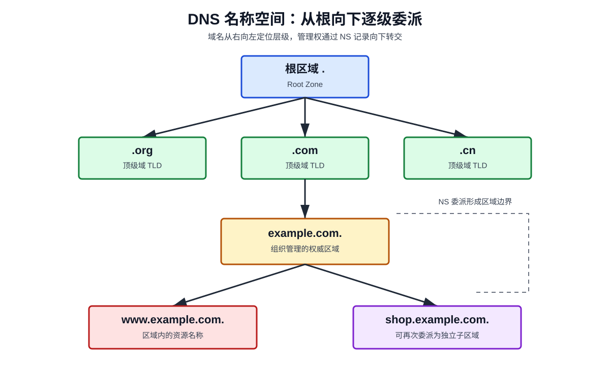
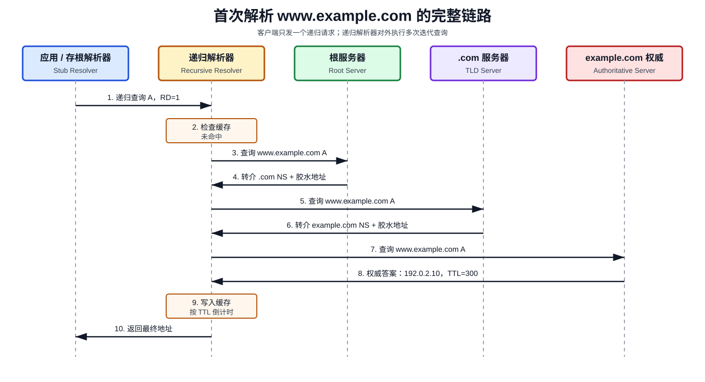
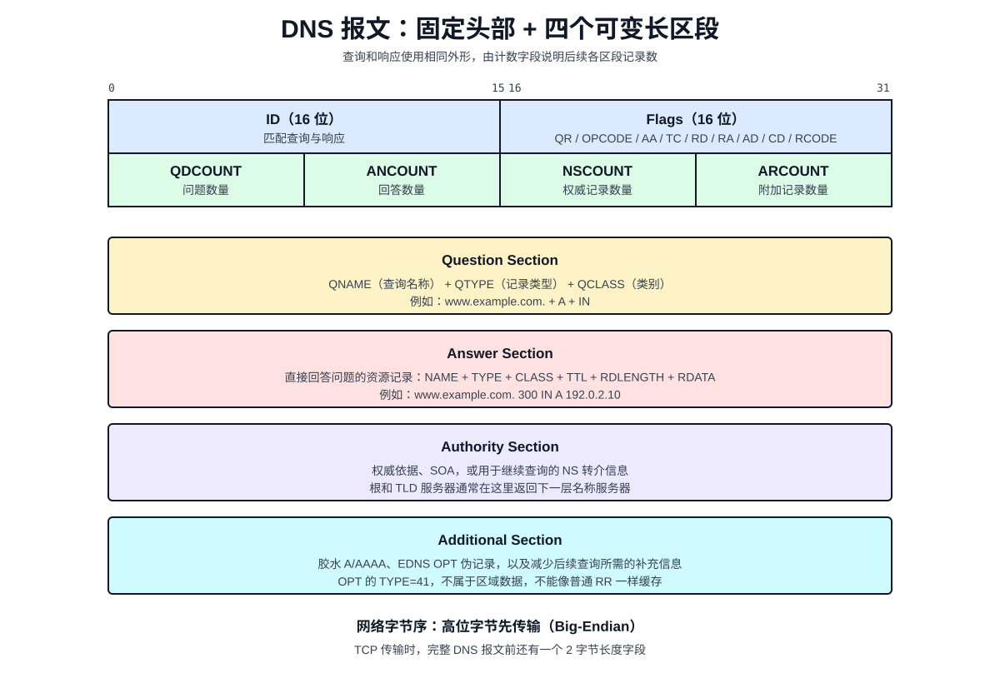
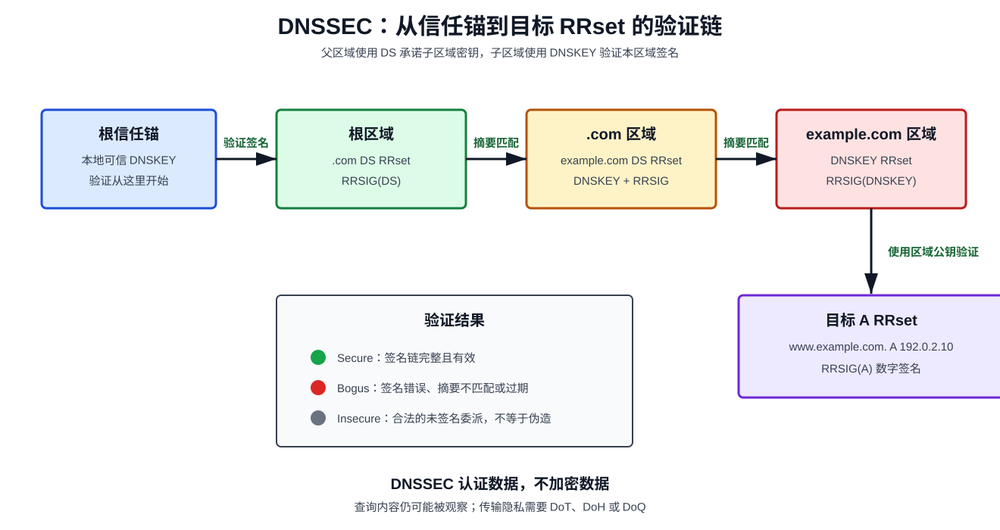

# DNS：从域名到 IP 地址的分布式解析系统

> DNS（Domain Name System，域名系统）不是一张简单的“域名与 IP 对照表”，而是一套分层命名、分布式授权、按需查询、允许缓存的全球基础设施。

## 1. 为什么需要 DNS

互联网通信最终依赖 IP 地址。例如，浏览器必须知道服务器的 IPv4 或 IPv6 地址，才能建立 TCP 或 QUIC 连接。

但 IP 地址不适合作为长期的人类标识：

- 难以记忆：`2001:db8::8a2e:370:7334` 不如 `www.example.com` 直观。
- 容易变化：迁移机房、切换 CDN 或扩缩容都可能改变 IP。
- 一对多：一个域名可以对应多个地址，实现容灾和负载均衡。
- 多种资源：邮件服务器、公钥、服务发现信息也需要统一查询。

DNS 在“稳定名称”和“可变化资源”之间增加了一层间接映射：

```text
用户记住域名 → DNS 查询资源位置 → 应用使用返回结果建立连接
```

DNS 的本质是一个**分布式、层次化、最终一致、支持缓存的键值数据库**。键由域名、记录类型和类别组成，值是资源记录集合。

## 2. DNS 的设计由来

早期 ARPANET 使用中心化的 `HOSTS.TXT` 文件保存主机名与地址。每台主机定期从网络信息中心下载完整文件。

随着主机数量增长，这种方式遇到三个问题：

1. 完整文件越来越大，分发成本快速增长。
2. 更新依赖中心机构，组织无法独立管理名称。
3. 同名冲突、版本过期和单点故障越来越严重。

1983 年，Paul Mockapetris 提出了 DNS；1987 年发布的 RFC 1034 和 RFC 1035 奠定了现代 DNS 的核心。

它用四个关键设计解决了中心化文件的问题：

| 设计 | 解决的问题 |
|---|---|
| 层次化命名 | 避免全球名称冲突 |
| 分区授权 | 每个组织管理自己的区域 |
| 分布式存储 | 避免单点和全量数据库 |
| TTL 缓存 | 减少延迟和权威服务器压力 |

## 3. 域名空间：一棵倒置的树

DNS 名称空间是一棵以根节点为起点的树。域名书写顺序从最具体的标签到最一般的标签，解析和授权则从右向左进行。



以 `www.shop.example.com.` 为例：

| 层级 | 名称 | 作用 |
|---|---|---|
| 根 | `.` | 整棵 DNS 树的起点 |
| 顶级域 | `com.` | 管理 `.com` 下一级委派 |
| 二级域 | `example.com.` | 通常由组织注册并管理 |
| 子域 | `shop.example.com.` | 可继续委派给独立团队 |
| 主机标签 | `www` | 标识具体资源名称 |

末尾的点表示根节点，因此 `www.example.com.` 是完全限定域名（Fully Qualified Domain Name，FQDN）。日常书写通常省略最后的点。

### 3.1 标签与长度限制

域名在网络中不是以带点字符串传输，而是编码为一串标签：

```text
www.example.com.
↓
3 "www" 7 "example" 3 "com" 0
```

每个标签最长 63 个八位字节。包括标签长度字节和结尾根标签在内，一个完整域名的线格式最长 255 个八位字节。

DNS 名称比较通常不区分 ASCII 字母大小写，但实现应尽量保留收到的大小写形式。

### 3.2 域（Domain）、区域（Zone）与委派（Delegation）

**域**是名称树中的一个节点及其全部后代，是逻辑概念。

**区域**是由某组权威服务器实际负责的数据范围，是管理概念。区域不一定包含域的全部后代，因为子域可以被委派出去。

例如，`example.com` 区域可以保存 `www.example.com`，但将 `shop.example.com` 委派给另一组服务器。此时父区域只保留指向子区域的 NS 记录及必要的胶水记录。

### 3.3 胶水记录为什么存在

假设 `shop.example.com` 的权威服务器是 `ns.shop.example.com`。要查询它的 IP，似乎必须先查询 `shop.example.com`，形成循环依赖。

父区域会附带该名称服务器的 A 或 AAAA 记录，这类用于打破委派循环的地址记录称为胶水记录（Glue Record）。

胶水记录是父区域提供的导航信息，并不等同于子区域自身给出的权威数据。

## 4. DNS 系统中的角色

一次看似简单的域名解析，通常涉及多个角色：

| 角色 | 英文 | 职责 |
|---|---|---|
| 应用程序 | Application | 发起名称解析需求 |
| 存根解析器 | Stub Resolver | 操作系统中的轻量客户端 |
| 递归解析器 | Recursive Resolver | 代替客户端完成完整查询并缓存结果 |
| 根名称服务器 | Root Name Server | 指向对应顶级域服务器 |
| 顶级域服务器 | TLD Name Server | 指向目标域的权威服务器 |
| 权威名称服务器 | Authoritative Name Server | 返回区域内最终权威数据 |

### 4.1 存根解析器

浏览器通常不会自己遍历根、顶级域和权威服务器。它调用操作系统的 `getaddrinfo()` 等接口，由存根解析器把请求交给已配置的递归解析器。

递归解析器可能来自家庭路由器、运营商、公司网络，或公共 DNS 服务。

### 4.2 递归解析器

递归解析器承担最重的工作：

- 检查缓存。
- 从根服务器开始追踪委派。
- 处理 CNAME 链。
- 按 TTL 缓存正向或否定结果。
- 可选地验证 DNSSEC 签名。
- 把最终答案返回给客户端。

### 4.3 权威名称服务器

权威服务器负责一个或多个区域。它直接从区域数据中回答问题，通常不替普通客户端递归查询其他区域。

响应头中的 `AA`（Authoritative Answer）标志表示答案来自当前服务器具有权威的数据。

## 5. 一次 DNS 查询到底发生了什么

下面以首次查询 `www.example.com` 的 A 记录为例。假设本地和递归解析器都没有缓存。



### 5.1 应用到存根解析器

浏览器先检查自身缓存，然后可能检查操作系统缓存和 `hosts` 文件。仍未命中时，它通过系统解析接口请求地址。

操作系统存根解析器向配置的递归解析器发送请求，并通常设置 `RD=1`，表示希望对方提供递归服务。

### 5.2 递归解析器查询根服务器

递归解析器从根提示文件（Root Hints）知道根服务器地址。它询问根服务器：

```text
www.example.com. 的 A 记录是什么？
```

根服务器通常不返回最终地址，而是返回 `.com` 顶级域的 NS 记录及可用的胶水地址。这称为**转介响应**。

### 5.3 查询顶级域服务器

递归解析器选择一个 `.com` 服务器继续询问。顶级域服务器返回 `example.com` 的权威 NS 记录及必要的胶水地址。

### 5.4 查询权威服务器

递归解析器向 `example.com` 的权威服务器询问。权威服务器返回目标 A 记录，或者返回 CNAME，再由解析器继续追踪规范名称。

### 5.5 缓存并返回客户端

递归解析器缓存沿途得到的 NS、A、AAAA、CNAME 等记录，然后把最终答案返回存根解析器。

后续相同查询若命中缓存，就不必再次遍历整条委派链。

## 6. 递归查询与迭代查询

这两个概念描述的是“收到请求的一方要负责到什么程度”。

### 6.1 递归查询（Recursive Query）

客户端要求服务器返回最终答案或明确错误。服务器不能只说“你再去问别人”。

存根解析器到递归解析器通常使用这种语义。请求头中 `RD=1` 表示希望递归；响应中的 `RA=1` 表示服务器支持递归。

### 6.2 迭代查询（Iterative Query）

服务器返回自己掌握的最佳信息。若没有最终答案，就返回更接近目标的名称服务器。

递归解析器访问根、顶级域和权威服务器时，通常采用迭代查询。

> “递归解析器”是一个服务角色，“递归查询”是一种请求语义。递归解析器在外侧接受递归请求，在内侧通常执行一系列迭代查询。

## 7. 资源记录：DNS 存储的实际数据

DNS 不是只查询 IP。它存储的是资源记录（Resource Record，RR）。

一条记录的逻辑结构如下：

```text
NAME TTL CLASS TYPE RDATA
```

例如：

```text
www.example.com. 300 IN A 192.0.2.10
```

字段含义：

| 字段 | 含义 |
|---|---|
| NAME | 记录所属的域名 |
| TTL | 可缓存秒数 |
| CLASS | 网络类别，互联网通常为 `IN` |
| TYPE | 记录类型 |
| RDATA | 与类型相关的数据 |

### 7.1 常见记录类型

| 类型 | 全称 | 作用 |
|---|---|---|
| A | Address | 域名映射到 IPv4 地址 |
| AAAA | IPv6 Address | 域名映射到 IPv6 地址 |
| CNAME | Canonical Name | 别名指向规范名称 |
| NS | Name Server | 指定区域的权威服务器 |
| MX | Mail Exchange | 指定邮件服务器及优先级 |
| TXT | Text | 保存验证、策略等文本信息 |
| SOA | Start of Authority | 描述区域主控信息和序列号 |
| PTR | Pointer | 反向解析，地址映射到名称 |
| SRV | Service | 描述服务主机、端口、权重与优先级 |
| CAA | Certification Authority Authorization | 限制可签发证书的 CA |
| HTTPS | HTTPS Service Binding | 提供 HTTPS 服务端点和连接参数 |

### 7.2 RRset：缓存和签名的基本单位

同一个 `NAME + CLASS + TYPE` 下的全部记录构成资源记录集（Resource Record Set，RRset）。

例如，一个域名有三个 A 记录，这三个地址共同组成一个 A RRset。DNSSEC 对 RRset 签名，缓存也应以 RRset 为基本单位处理。

### 7.3 CNAME 的底层语义

CNAME 表示“当前名称是另一个名称的别名”，并不直接保存 IP。

```text
www.example.com. 300 IN CNAME edge.cdn.example.net.
edge.cdn.example.net. 60 IN A 192.0.2.20
```

解析器必须继续查询目标名称。由于同一名称的 CNAME 会把整个名称重定向，它通常不能再与 A、MX 等其他普通记录共存。

### 7.4 SOA 与区域同步

SOA 记录包含主名称服务器、管理员邮箱、序列号和定时参数。

辅助权威服务器会检查序列号（Serial）。发现主服务器版本更新后，可通过 AXFR 全量传送或 IXFR 增量传送同步区域。

## 8. DNS 报文的底层结构

DNS 查询和响应使用同一种总体报文格式。固定头部为 12 字节，后面跟四个可变长区段。



### 8.1 12 字节头部

| 字段 | 位数 | 含义 |
|---|---:|---|
| ID | 16 | 标识一次事务，用于匹配响应 |
| QR | 1 | `0` 为查询，`1` 为响应 |
| OPCODE | 4 | 操作类型，普通查询为 `0` |
| AA | 1 | 是否为权威回答 |
| TC | 1 | 报文是否被截断 |
| RD | 1 | 是否期望递归 |
| RA | 1 | 服务器是否支持递归 |
| Z/AD/CD | 3 | 保留位及 DNSSEC 相关标志 |
| RCODE | 4 | 响应码 |
| QDCOUNT | 16 | Question 数量 |
| ANCOUNT | 16 | Answer 记录数量 |
| NSCOUNT | 16 | Authority 记录数量 |
| ARCOUNT | 16 | Additional 记录数量 |

常见响应码：

| RCODE | 名称 | 含义 |
|---:|---|---|
| 0 | NOERROR | 查询处理成功，答案也可能为空 |
| 1 | FORMERR | 报文格式错误 |
| 2 | SERVFAIL | 服务器无法完成解析 |
| 3 | NXDOMAIN | 查询的域名不存在 |
| 5 | REFUSED | 服务器拒绝执行 |

`NOERROR` 但没有目标类型答案称为 NODATA。它与“名称本身不存在”的 NXDOMAIN 不同。

### 8.2 四个区段

1. **Question**：包含 QNAME、QTYPE 和 QCLASS。
2. **Answer**：直接回答问题的资源记录。
3. **Authority**：权威信息或下一跳 NS。
4. **Additional**：补充地址、EDNS OPT 伪记录等。

### 8.3 名称压缩

域名在一个响应中经常重复。DNS 使用压缩指针引用报文中已出现的名称后缀，避免重复发送。

压缩指针前两位为 `11`，其余 14 位表示目标偏移量。例如 Answer 中的名称可以直接指回 Question 中的 QNAME。

解析器必须防御指针循环、越界和过深跳转，否则恶意报文可能导致死循环或内存错误。

## 9. DNS 为什么同时使用 UDP 和 TCP

传统 DNS 服务默认使用 53 端口。多数普通查询使用 UDP，因为它无需建立连接、开销小、延迟低。

但“DNS 只使用 UDP”是错误说法。RFC 7766 要求通用 DNS 实现同时支持 UDP 和 TCP。

### 9.1 何时使用 TCP

- UDP 响应被截断，响应头 `TC=1`，客户端改用 TCP 重试。
- AXFR/IXFR 区域传送。
- 实现主动选择 TCP。
- 响应较大，或网络策略要求可靠传输。

TCP 中每个 DNS 报文前增加一个 2 字节长度字段。现代实现应复用连接，并允许流水线发送多个查询，减少握手成本。

### 9.2 EDNS(0)

原始 DNS 把 UDP 报文限制为 512 字节。IPv6、多地址和 DNSSEC 签名使响应越来越大。

EDNS(0) 通过 Additional 区段中的 OPT 伪记录扩展 DNS。客户端可声明自己能接收的 UDP 负载大小，并携带额外标志和选项。

OPT 记录类型值是 `41`，它不是区域数据，不应被缓存。

更大的 UDP 报文可能发生 IP 分片，而分片容易被防火墙丢弃。因此工程上应谨慎设置 EDNS 缓冲区，并保留 TCP 回退能力。

### 9.3 DoT、DoH 与 DoQ

传统 UDP/TCP DNS 通常是明文的，路径上的设备可以观察或篡改查询。

| 协议 | 传输 | 常用端口 | 特点 |
|---|---|---:|---|
| DNS over TLS（DoT） | DNS over TLS/TCP | 853 | 专用端口，传输加密 |
| DNS over HTTPS（DoH） | DNS over HTTPS | 443 | 映射为 HTTP 请求，易穿越网络边界 |
| DNS over QUIC（DoQ） | DNS over QUIC | 853 | 加密、多路复用，减少队头阻塞 |

这些协议主要保护客户端到递归解析器的传输通道。它们不自动证明 DNS 数据由域名所有者签发，数据来源认证仍依赖 DNSSEC。

## 10. 缓存：DNS 高性能的核心

如果每次查询都访问根服务器，DNS 无法承受全球流量。缓存让解析器复用已有答案。

### 10.1 TTL 如何工作

TTL（Time to Live）由数据发布者设置，表示记录最多可缓存多少秒。

假设 A 记录 TTL 为 300 秒，递归解析器收到 300 后开始倒计时。100 秒后返回给下一个客户端时，剩余 TTL 应接近 200。

TTL 到期不代表数据一定变化，只代表缓存不能继续相信旧副本，必须重新查询。

### 10.2 TTL 的工程权衡

| TTL 设置 | 优点 | 代价 |
|---|---|---|
| 较长 | 命中率高、延迟低、权威压力小 | 变更传播慢 |
| 较短 | 切流和故障迁移更快 | 查询量与成本增加 |

计划切换地址时，可以提前一个旧 TTL 周期降低 TTL；确认缓存已普遍过期后再切换，最后恢复正常值。

### 10.3 否定缓存

NXDOMAIN 和 NODATA 也可以缓存，称为否定缓存（Negative Caching）。它能阻止无效请求持续冲击权威服务器。

否定缓存时长由区域 SOA 相关字段约束。排障时不能只清理正向 A 记录缓存，也要考虑失败结果仍在缓存。

### 10.4 多层缓存与“修改后仍未生效”

缓存可能存在于：

1. 浏览器或应用。
2. 操作系统。
3. 本地代理、路由器或容器运行时。
4. 企业或运营商递归解析器。
5. 上游转发器。

因此，“权威记录已经更新”不等于“所有客户端立即看到新值”。DNS 更接近由 TTL 控制的最终一致系统。

## 11. DNS 如何支撑负载均衡与 CDN

### 11.1 多地址轮询

一个名称可以返回多个 A 或 AAAA 记录。客户端通常按系统策略选择地址。

这种方式简单，但 DNS 本身不知道后端连接是否成功，也不能保证客户端平均分配。

### 11.2 GeoDNS 与智能解析

权威平台可根据递归解析器来源、EDNS Client Subnet、网络运营商或健康状态返回不同答案。

它能把用户引向更近的节点，但会增加缓存碎片、隐私风险和调度复杂度。

### 11.3 CDN 中的 CNAME 链

站点常把业务域名 CNAME 到 CDN 域名。CDN 再根据自身调度系统返回边缘节点地址。

DNS 决定的是“尝试连接哪个入口”，真正的 HTTP 路由、TLS 终止和内容缓存仍发生在 CDN 节点。

## 12. DNS 安全问题

### 12.1 缓存投毒

攻击者伪造响应，让递归解析器缓存错误地址。传统 UDP 缺少连接状态，若事务 ID 和源端口可预测，攻击更容易成功。

常见缓解措施包括：

- 随机化事务 ID 和源端口。
- 严格匹配问题名称、类型和来源。
- 只接受与未完成查询相关的响应。
- 启用 DNSSEC 验证。

### 12.2 DNS 劫持与污染

路径上的设备可以拦截请求、伪造答案或阻断真实响应。

DoT、DoH 和 DoQ 能保护客户端到递归解析器的传输；DNSSEC 能让验证解析器识别被修改的签名数据。两者解决的问题不同，通常需要组合使用。

### 12.3 反射与放大攻击

攻击者伪造受害者源 IP，向开放递归器发送小请求，诱导服务器把较大响应发给受害者。

防护措施包括关闭不必要的开放递归、响应速率限制、网络入口源地址验证，以及避免产生异常大的 UDP 响应。

### 12.4 随机子域攻击

攻击者持续查询大量随机且不存在的子域。由于每个名称不同，递归缓存难以命中，查询会穿透到权威服务器。

可以使用响应速率限制、Anycast 扩容、异常检测，以及 RFC 8198 定义的激进式 DNSSEC 否定缓存等措施。

## 13. DNSSEC 的底层信任链

DNSSEC（DNS Security Extensions）为 RRset 提供来源认证和完整性校验，但不加密查询内容。



核心记录：

| 类型 | 作用 |
|---|---|
| DNSKEY | 发布区域公钥 |
| RRSIG | 保存 RRset 的数字签名 |
| DS | 父区域保存的子区域公钥摘要 |
| NSEC/NSEC3 | 可验证地证明名称或记录类型不存在 |

验证过程以解析器预置的根信任锚为起点：

1. 使用根 DNSKEY 验证根区域签名。
2. 验证根区域中的 `.com` DS。
3. 用 DS 匹配 `.com` 的 DNSKEY，并验证其签名。
4. 继续验证 `example.com` 的 DS 与 DNSKEY。
5. 用 `example.com` DNSKEY 验证目标 A RRset 的 RRSIG。

若任一签名无效、摘要不匹配或签名过期，验证解析器通常返回 SERVFAIL，而不是把可疑数据交给应用。

DNSSEC 不提供机密性，不隐藏访问的域名，也不保证目标服务器本身安全。

## 14. 浏览器访问网站时，DNS 处于哪一步

一个典型 HTTPS 访问链路如下：

```text
解析 URL
→ 查询 DNS，得到候选 IP 和服务参数
→ 选择地址
→ 建立 TCP + TLS，或直接建立 QUIC
→ 校验证书与域名
→ 发送 HTTP 请求
```

DNS 只负责发现连接目标及相关参数。TLS 证书继续证明应用服务器身份，HTTP 才负责请求具体资源。

现代浏览器还可能使用 HTTPS 记录获得 HTTP/3 支持、备用端口和地址提示，从而减少连接探测延迟。

## 15. 实战：使用 dig 观察解析过程

### 15.1 查询常见记录

```bash
dig example.com A
dig example.com AAAA
dig example.com MX
dig example.com NS
dig example.com SOA
```

重点观察：

- `status`：NOERROR、NXDOMAIN 或 SERVFAIL。
- `flags`：`qr`、`rd`、`ra`、`aa`、`ad` 等。
- `ANSWER SECTION`：最终答案。
- `AUTHORITY SECTION`：权威或转介信息。
- `ADDITIONAL SECTION`：胶水地址、OPT 等。
- `Query time`：本次查询耗时。
- `SERVER`：实际响应的解析器。

### 15.2 指定服务器

```bash
dig @1.1.1.1 example.com A
dig @8.8.8.8 example.com A
dig @ns.example.com example.com A +norecurse
```

前两条用于比较不同递归解析器，第三条直接询问权威服务器并关闭递归请求。

### 15.3 追踪委派链

```bash
dig +trace example.com A
```

`+trace` 让 `dig` 自己从根开始执行迭代查询，可以观察根、顶级域和权威服务器的转介过程。

### 15.4 强制 TCP 与检查 DNSSEC

```bash
dig +tcp example.com A
dig +dnssec example.com A
dig +dnssec example.com A | grep -E 'RRSIG|flags'
```

`+dnssec` 请求服务器返回 DNSSEC 数据，但是否完成验证仍取决于解析器。响应中的 `ad` 标志表示上游验证解析器认为数据已通过认证。

### 15.5 反向解析

```bash
dig -x 192.0.2.10
```

IPv4 地址会被转换为 `in-addr.arpa` 下的 PTR 查询；IPv6 使用 `ip6.arpa`，并按十六进制半字节逆序展开。

## 16. DNS 故障排查方法

不要只执行一次 `ping` 就判断 DNS。建议按层次缩小范围。

### 16.1 第一步：确认本机配置

```bash
cat /etc/resolv.conf
scutil --dns        # macOS
resolvectl status   # 使用 systemd-resolved 的 Linux
```

确认系统实际使用的解析器、搜索域和接口配置。注意某些系统中的 `/etc/resolv.conf` 只是生成文件，不代表完整状态。

### 16.2 第二步：区分本地、递归与权威问题

```bash
dig example.com A
dig @1.1.1.1 example.com A
dig @权威服务器 example.com A +norecurse
```

判断方法：

| 现象 | 可能原因 |
|---|---|
| 默认解析失败，公共解析器成功 | 本地或网络递归器故障 |
| 多个递归器都失败，权威查询成功 | 委派、DNSSEC 或缓存问题 |
| 权威服务器返回错误 | 区域配置或权威服务问题 |
| 不同递归器答案不同 | TTL、分线路由或缓存尚未收敛 |

### 16.3 第三步：检查委派

分别比较父区域返回的 NS 与子区域 SOA/NS。常见错误包括：

- 注册商处 NS 与实际权威服务器不一致。
- 胶水地址过期。
- 新旧权威服务器区域版本不同。
- 某台权威服务器不可达。
- UDP 53 可达但 TCP 53 被防火墙阻断。

### 16.4 第四步：检查 DNSSEC

若普通结果看似存在但验证解析器返回 SERVFAIL，应检查：

- 父区域 DS 是否与子区域 DNSKEY 匹配。
- RRSIG 是否过期或尚未生效。
- 服务器时间是否正确。
- 密钥轮换是否按顺序完成。

可使用：

```bash
dig +dnssec example.com DNSKEY
dig +dnssec example.com DS
delv example.com A
```

### 16.5 第五步：检查网络和报文大小

小响应成功、大响应失败，通常与 EDNS、IP 分片、MTU 或 TCP 53 被阻断有关。

```bash
dig example.com A +noedns
dig example.com DNSKEY +dnssec
dig example.com DNSKEY +dnssec +tcp
```

若仅 `+tcp` 成功，应继续检查防火墙、负载均衡器和中间设备。

## 17. 常见误区

### 误区一：DNS 就是域名转 IP

DNS 是通用命名与资源发现系统。A/AAAA 只是记录类型的一部分。

### 误区二：一个域名只能对应一个 IP

一个 A 或 AAAA RRset 可以包含多个地址，答案还可能因位置、时间和网络策略不同。

### 误区三：修改记录后应立即全球生效

旧数据会在多层缓存中持续到剩余 TTL 到期。不同解析器的刷新时刻也不同。

### 误区四：DNS 默认优先读取 hosts 文件

名称服务顺序由操作系统配置决定。许多系统会先查本地文件，但这不是 DNS 协议本身规定的行为。

### 误区五：DoH 等于 DNSSEC

DoH 保护查询通道；DNSSEC 验证数据来源与完整性。一个解决“路上能否被看见或修改”，另一个解决“答案是否由授权方签名”。

### 误区六：DNS 只使用 UDP

完整 DNS 实现必须支持 UDP 和 TCP。大响应、区域传送和加密 DNS 都可能使用可靠或面向连接的传输。

## 18. 中英文术语对照

| 中文名称 | English | 说明 |
|---|---|---|
| 域名系统 | Domain Name System, DNS | 分布式命名与资源查询系统 |
| 完全限定域名 | Fully Qualified Domain Name, FQDN | 从当前节点到根的完整名称 |
| 资源记录 | Resource Record, RR | DNS 中的一条数据 |
| 资源记录集 | Resource Record Set, RRset | 同名、同类、同类型记录集合 |
| 存根解析器 | Stub Resolver | 客户端侧轻量解析组件 |
| 递归解析器 | Recursive Resolver | 代替客户端完成查询的服务器 |
| 权威名称服务器 | Authoritative Name Server | 对某区域拥有权威数据的服务器 |
| 顶级域 | Top-Level Domain, TLD | 根下的第一层域 |
| 区域 | Zone | 一组权威服务器管理的数据范围 |
| 区域切割 | Zone Cut | 父区域向子区域委派的边界 |
| 委派 | Delegation | 把子区域管理权交给另一组 NS |
| 胶水记录 | Glue Record | 父区域为名称服务器附带的地址 |
| 生存时间 | Time to Live, TTL | 缓存可使用数据的最长时间 |
| 否定缓存 | Negative Caching | 缓存不存在或无数据的结果 |
| 扩展 DNS | Extension Mechanisms for DNS, EDNS | 扩展报文容量、标志与选项 |
| 域名系统安全扩展 | DNS Security Extensions, DNSSEC | DNS 数据签名与验证机制 |
| 信任锚 | Trust Anchor | DNSSEC 验证链的可信起点 |
| 域名系统经 TLS | DNS over TLS, DoT | 使用 TLS 保护 DNS 传输 |
| 域名系统经 HTTPS | DNS over HTTPS, DoH | 把 DNS 映射到 HTTPS 交换 |
| 域名系统经 QUIC | DNS over QUIC, DoQ | 使用 QUIC 传输加密 DNS |

## 19. 总结

理解 DNS，关键不是记住“域名换 IP”，而是建立以下模型：

1. DNS 名称空间是一棵从根向下委派的树。
2. 区域把管理责任分散给不同组织和权威服务器。
3. 存根解析器把递归任务交给递归解析器。
4. 递归解析器通过多次迭代查询找到权威答案。
5. 资源记录是数据载体，RRset 是缓存和签名的基本单位。
6. TTL 用时效换取性能，因此 DNS 天生具有缓存和最终一致特征。
7. UDP、TCP、EDNS 共同承担传统传输；DoT、DoH、DoQ 补充传输隐私。
8. DNSSEC 建立从根信任锚到目标记录的数据认证链。

## 20. 参考资料

- [RFC 1034: Domain Names - Concepts and Facilities](https://www.rfc-editor.org/rfc/rfc1034)
- [RFC 1035: Domain Names - Implementation and Specification](https://www.rfc-editor.org/rfc/rfc1035)
- [RFC 2308: Negative Caching of DNS Queries](https://www.rfc-editor.org/rfc/rfc2308)
- [RFC 4033: DNS Security Introduction and Requirements](https://www.rfc-editor.org/rfc/rfc4033)
- [RFC 6891: Extension Mechanisms for DNS](https://www.rfc-editor.org/rfc/rfc6891)
- [RFC 7766: DNS Transport over TCP](https://www.rfc-editor.org/rfc/rfc7766)
- [RFC 7858: DNS over TLS](https://www.rfc-editor.org/rfc/rfc7858)
- [RFC 8484: DNS Queries over HTTPS](https://www.rfc-editor.org/rfc/rfc8484)
- [RFC 9250: DNS over Dedicated QUIC Connections](https://www.rfc-editor.org/rfc/rfc9250)
