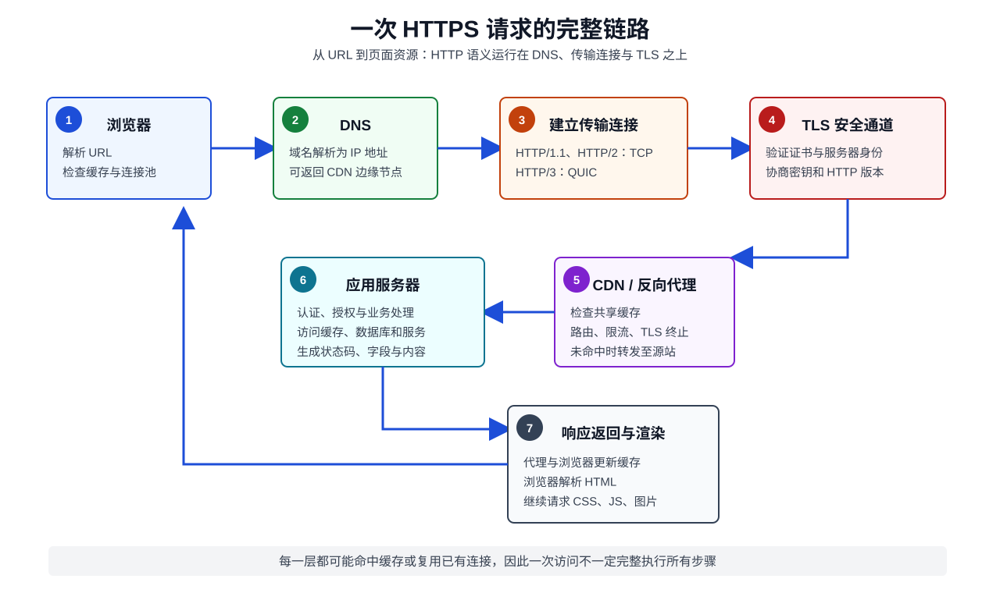
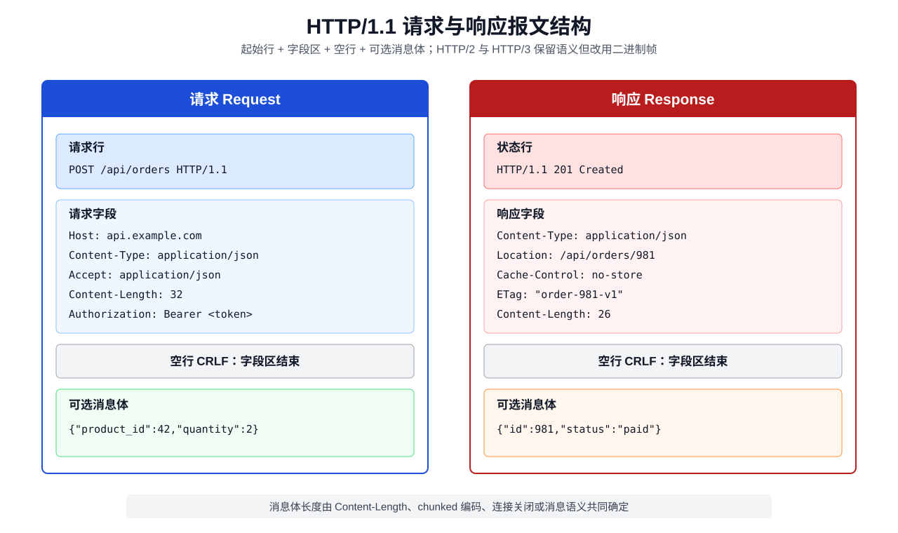
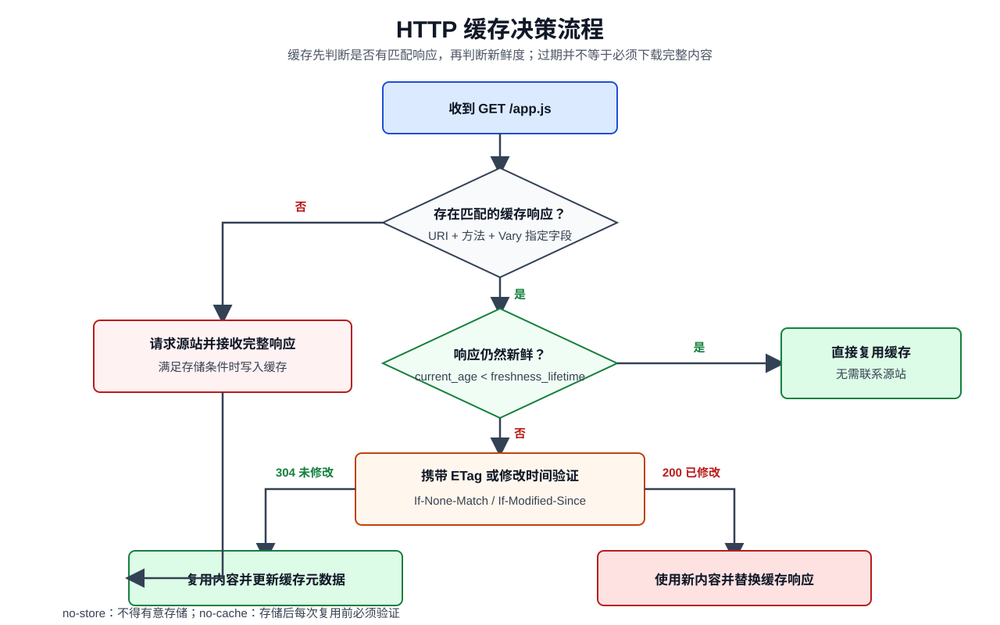
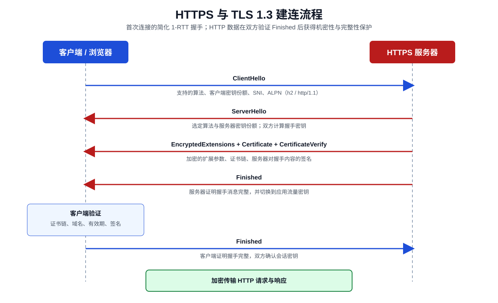
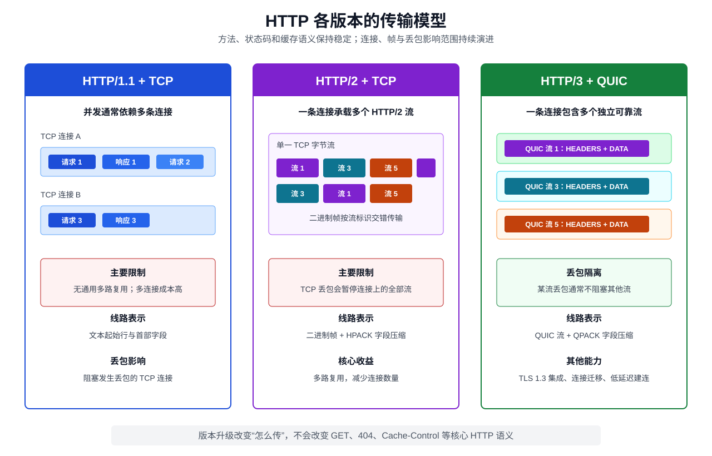

# HTTP：从一次请求到现代 Web 传输体系

> HTTP（Hypertext Transfer Protocol，超文本传输协议）不是“传输网页的 TCP 协议”，而是一组独立于具体传输方式的应用层语义：客户端用方法表达意图，服务器用状态码表达结果，双方用字段描述消息和资源表示。

## 1. 先建立整体认识

HTTP 是一种无状态、应用层、请求—响应协议族。它为分布式信息系统提供统一接口，使客户端无需了解服务端内部实现，服务端也无需了解客户端的具体用途。

一次典型的网页访问经过以下链路：



1. 浏览器解析 URL，确定协议、主机、端口和目标路径。
2. 浏览器检查本地缓存，必要时通过 DNS 获取服务器地址。
3. 客户端建立 TCP 连接，或为 HTTP/3 建立 QUIC 连接。
4. HTTPS 场景协商 TLS，验证服务器身份并建立加密通道。
5. 客户端发送 HTTP 请求，可能先经过代理、CDN、网关和负载均衡器。
6. 源站处理请求并产生 HTTP 响应。
7. 中间缓存与浏览器根据缓存字段决定是否存储响应。
8. 浏览器解析响应内容，并继续请求 CSS、JavaScript、图片等子资源。

需要分清各层的职责：

| 层次 | 典型协议 | 核心职责 |
|---|---|---|
| 应用层 | HTTP、DNS | 描述资源操作、消息语义和名称解析 |
| 安全层 | TLS | 身份认证、机密性与完整性保护 |
| 传输层 | TCP、QUIC | 端到端传输、可靠性、拥塞控制 |
| 网络层 | IP | 跨网络寻址和分组转发 |
| 链路层 | Ethernet、Wi-Fi | 相邻节点间传输帧 |

> HTTP 定义“要做什么、结果是什么”；HTTP/1.1、HTTP/2 和 HTTP/3 定义这些语义如何在线路上传输。

## 2. HTTP 为什么会出现

1989 年，Tim Berners-Lee 提出万维网。最早的 HTTP/0.9 极其简单：客户端发送一行 `GET`，服务器返回 HTML，随后关闭连接。

随着 Web 从静态文档系统发展为通用应用平台，协议逐步增加：

- 请求和响应元数据，即首部字段。
- 状态码和多种请求方法。
- 虚拟主机、缓存、内容协商和身份认证。
- 持久连接、多路复用和首部压缩。
- 加密、移动网络适应能力和更低的连接延迟。

HTTP 能长期演进的关键并不是某种报文格式，而是它稳定的抽象：

```text
客户端对“资源”表达操作意图
        ↓
服务器返回该操作的结果和资源“表示”
```

## 3. HTTP 的核心抽象

### 3.1 资源（Resource）

资源是客户端希望操作的概念目标，可以是文章、用户、订单、搜索结果，也可以是一个计算过程。资源由 URI 标识，但 URI 不是资源本身。

```text
https://api.example.com/users/42
```

这个 URI 标识“编号为 42 的用户”资源，而不是某个固定 JSON 文件。

### 3.2 表示（Representation）

表示是资源在某一时刻、某种媒体类型下的具体表达。同一资源可以有不同表示：

```text
Accept: application/json  → JSON 表示
Accept: text/html         → HTML 表示
Accept-Language: zh-CN    → 中文表示
```

`Content-Type` 描述实际返回的表示类型，`Content-Encoding` 描述该表示是否经过 gzip、br 等编码。

### 3.3 消息（Message）

HTTP 通过请求消息和响应消息交换信息。抽象消息由以下部分组成：

- 控制数据：方法、目标、状态码等。
- 字段：描述消息、表示和处理要求的名称—值对。
- 内容：可选的消息主体。
- 尾部字段：内容之后发送的可选元数据。

### 3.4 无状态（Stateless）

“无状态”表示服务器可以仅根据当前请求理解其语义，HTTP 不要求服务器记住前一次请求。

无状态不等于应用不能保存状态。登录状态、购物车和事务进度通常通过以下机制实现：

- Cookie 中的会话标识。
- `Authorization` 中的访问令牌。
- URL 或请求体中的业务标识。
- 服务端数据库、缓存或会话存储。

无状态让请求更容易被代理、缓存和负载均衡，但应用必须显式传递关联请求所需的信息。

## 4. URL 如何定位资源

以以下 URL 为例：

```text
https://www.example.com:8443/products/42?lang=zh#reviews
```

| 部分 | 示例 | 作用 |
|---|---|---|
| 方案（Scheme） | `https` | 指定访问语义和默认端口 |
| 主机（Host） | `www.example.com` | 标识网络主机 |
| 端口（Port） | `8443` | 指定服务端口；HTTPS 默认是 443 |
| 路径（Path） | `/products/42` | 标识目标资源 |
| 查询（Query） | `lang=zh` | 向资源提供附加参数 |
| 片段（Fragment） | `reviews` | 由客户端解释，不随 HTTP 请求发送 |

同源（Origin）由**方案、主机和端口**共同确定：

```text
origin = scheme + host + port
```

`https://example.com/a` 与 `https://example.com/b` 同源；与 `http://example.com/a` 或 `https://api.example.com/a` 不同源。

## 5. HTTP/1.1 报文长什么样

HTTP/1.1 使用文本形式的起始行和字段，每行以 CRLF 结束。首部区之后必须有一个空行，随后才是可选的消息体。



### 5.1 请求报文

```http
POST /api/orders?source=web HTTP/1.1
Host: api.example.com
Content-Type: application/json
Accept: application/json
Authorization: Bearer <access-token>
Content-Length: 48

{"product_id":42,"quantity":2,"currency":"CNY"}
```

请求行由三部分组成：

```text
方法 SP 请求目标 SP HTTP 版本
```

`Host` 在 HTTP/1.1 中必需，它让同一 IP 地址上的服务器区分多个虚拟主机。HTTP/2 和 HTTP/3 使用 `:authority` 伪首部表达相同信息。

### 5.2 响应报文

```http
HTTP/1.1 201 Created
Content-Type: application/json
Location: /api/orders/981
Cache-Control: no-store
Content-Length: 27

{"id":981,"status":"paid"}
```

状态行由版本、三位状态码和可选原因短语组成。客户端必须依据状态码处理响应，不能依赖原因短语。

### 5.3 消息边界如何确定

HTTP/1.1 是字节流协议，必须明确一条消息在哪里结束。常见方式有：

| 方式 | 说明 |
|---|---|
| `Content-Length` | 明确给出消息体的八位字节长度 |
| `Transfer-Encoding: chunked` | 将未知总长度的内容分块发送，以零长度块结束 |
| 连接关闭 | 某些响应以连接关闭作为消息结束标志 |
| 语义决定无消息体 | 如 `HEAD` 响应、`1xx`、`204`、`304` |

同时发送含冲突含义的 `Content-Length` 与 `Transfer-Encoding`，或让不同代理采用不同解析规则，可能导致 HTTP 请求走私（Request Smuggling）。

## 6. 请求方法：表达操作意图

| 方法 | 典型语义 | 安全 | 幂等 | 响应通常可缓存 |
|---|---|---:|---:|---:|
| `GET` | 获取资源当前表示 | 是 | 是 | 是 |
| `HEAD` | 只获取与 `GET` 相同的响应字段 | 是 | 是 | 是 |
| `POST` | 让资源按自身语义处理内容 | 否 | 否 | 需显式允许 |
| `PUT` | 用请求表示创建或替换目标资源 | 否 | 是 | 否 |
| `PATCH` | 对资源执行部分修改 | 否 | 通常否 | 否 |
| `DELETE` | 删除目标资源的关联 | 否 | 是 | 否 |
| `OPTIONS` | 查询通信选项 | 是 | 是 | 否 |
| `CONNECT` | 建立隧道 | 否 | 否 | 否 |
| `TRACE` | 执行诊断回环 | 是 | 是 | 否 |

### 6.1 安全性（Safe）

安全方法表示客户端没有请求改变服务器状态。它不表示：

- 请求一定没有任何副作用，日志和计费仍可能发生。
- 请求内容经过加密。
- 接口不存在安全漏洞。

`GET` 不应被设计为“点击即删除”。爬虫、预取器和缓存都可能自动发起安全方法。

### 6.2 幂等性（Idempotent）

幂等表示多次发送相同请求，其**预期效果**与发送一次相同。它不要求每次响应完全相同。

```text
PUT /users/42 发送同一完整表示多次 → 最终资源状态相同
DELETE /users/42 执行多次          → 资源最终都不存在
```

第二次 `DELETE` 可以返回 `404`，但它仍然是幂等的，因为目标状态没有进一步变化。

对于支付、创建订单等非幂等 `POST`，可以使用业务幂等键：

```http
Idempotency-Key: 7f30c8f4-...
```

服务器保存键与处理结果，重复请求返回已有结果而不是再次执行业务操作。

### 6.3 PUT 与 PATCH 的区别

- `PUT` 的语义是创建或替换目标资源的完整状态。
- `PATCH` 的语义是应用一组修改指令，具体格式由媒体类型决定。

不要仅因“更新”就机械地使用 `PUT`。若请求只包含部分字段，且遗漏字段不代表删除，通常更符合 `PATCH` 语义。

## 7. 状态码：服务器如何表达结果

状态码的第一位定义响应类别。客户端即使不认识某个具体状态码，也应按其类别理解。

| 类别 | 含义 | 处理重点 |
|---|---|---|
| `1xx` | 信息性响应 | 请求仍在处理中 |
| `2xx` | 成功 | 操作已被接收、理解或完成 |
| `3xx` | 重定向或缓存复用 | 需要进一步动作或使用已有表示 |
| `4xx` | 客户端错误 | 请求本身、身份或权限存在问题 |
| `5xx` | 服务端错误 | 服务器处理有效请求时失败 |

### 7.1 常用成功状态

| 状态码 | 使用场景 |
|---|---|
| `200 OK` | 通用成功，通常包含结果表示 |
| `201 Created` | 已创建资源，通常配合 `Location` |
| `202 Accepted` | 已接受异步任务，但尚未完成 |
| `204 No Content` | 成功且无需返回内容 |
| `206 Partial Content` | 成功返回范围请求的部分内容 |

### 7.2 重定向中的方法变化

| 状态码 | 永久性 | 后续请求方法 |
|---|---:|---|
| `301 Moved Permanently` | 永久 | 历史客户端可能把 `POST` 改成 `GET` |
| `302 Found` | 临时 | 历史客户端可能把 `POST` 改成 `GET` |
| `303 See Other` | 临时 | 明确改用 `GET` 或 `HEAD` |
| `307 Temporary Redirect` | 临时 | 保持原方法和请求体 |
| `308 Permanent Redirect` | 永久 | 保持原方法和请求体 |

提交表单后跳转到结果页常使用 `303`，形成 Post/Redirect/Get 模式，避免刷新页面时重复提交。

### 7.3 容易混淆的错误状态

| 状态码 | 准确含义 |
|---|---|
| `400 Bad Request` | 请求语法、消息结构或参数整体无效 |
| `401 Unauthorized` | 缺少或无法接受认证凭据，通常应带 `WWW-Authenticate` |
| `403 Forbidden` | 已理解请求，但拒绝授权执行 |
| `404 Not Found` | 找不到目标；也可用于隐藏资源是否存在 |
| `405 Method Not Allowed` | 资源存在但不支持该方法，应带 `Allow` |
| `409 Conflict` | 请求与资源当前状态冲突 |
| `412 Precondition Failed` | `If-Match` 等前置条件失败 |
| `415 Unsupported Media Type` | 请求内容类型或编码不受支持 |
| `422 Unprocessable Content` | 语法正确，但内容在语义上无法处理 |
| `429 Too Many Requests` | 触发限流，可配合 `Retry-After` |
| `500 Internal Server Error` | 未归类的服务端内部错误 |
| `502 Bad Gateway` | 网关从上游收到无效响应 |
| `503 Service Unavailable` | 服务暂不可用，可配合 `Retry-After` |
| `504 Gateway Timeout` | 网关等待上游响应超时 |

`401` 的英文历史命名容易误导：它实际表示“未认证或认证无效”；`403` 才强调“无权访问”。

## 8. 首部字段：HTTP 的可扩展元数据

字段名称不区分大小写。HTTP/2 和 HTTP/3 在线路上要求小写，但应用代码不应依赖字段名大小写。

### 8.1 常用请求字段

| 字段 | 作用 |
|---|---|
| `Host` | 指定 HTTP/1.1 目标主机和可选端口 |
| `Accept` | 声明可接受的响应媒体类型 |
| `Accept-Encoding` | 声明可接受的内容编码，如 `gzip`、`br` |
| `Accept-Language` | 声明偏好的自然语言 |
| `Authorization` | 携带认证凭据 |
| `Cookie` | 携带当前请求匹配的 Cookie |
| `If-None-Match` | 使用 ETag 执行条件请求 |
| `If-Match` | 仅当当前 ETag 匹配时执行写操作 |
| `Range` | 请求资源的部分字节范围 |
| `Origin` | 表明请求来源，参与 CORS 和 CSRF 防护 |
| `User-Agent` | 描述客户端软件 |

### 8.2 常用响应字段

| 字段 | 作用 |
|---|---|
| `Content-Type` | 描述内容媒体类型 |
| `Content-Length` | 描述内容长度 |
| `Content-Encoding` | 描述内容编码 |
| `Cache-Control` | 控制缓存存储与复用 |
| `ETag` | 提供当前表示的实体标签 |
| `Last-Modified` | 表示最后修改时间 |
| `Location` | 指向创建的资源或重定向目标 |
| `Set-Cookie` | 要求用户代理保存 Cookie |
| `Vary` | 指定缓存键还依赖哪些请求字段 |
| `WWW-Authenticate` | 提供认证质询 |
| `Content-Security-Policy` | 限制页面可加载或执行的资源 |

### 8.3 逐跳字段与端到端字段

端到端字段应转发给最终接收者；逐跳字段只对当前连接有效，代理不得直接向下一跳转发。

HTTP/1.1 的典型逐跳字段包括 `Connection`、`Keep-Alive`、`Transfer-Encoding` 和 `Upgrade`。HTTP/2 与 HTTP/3 禁止使用大多数连接专属字段。

## 9. 内容协商

客户端可用 `Accept*` 字段描述偏好，服务器选择一种表示返回：

```http
Accept: text/html, application/json;q=0.9
Accept-Language: zh-CN, en;q=0.7
Accept-Encoding: br, gzip
```

质量值（Quality Value，`q`）范围是 0 到 1，默认值为 1。值越高，优先级越高。

服务器若根据请求字段选择表示，应通过 `Vary` 告知缓存：

```http
Vary: Accept-Encoding, Accept-Language
```

否则共享缓存可能把中文 gzip 响应错误地复用于需要英文或不支持 gzip 的客户端。

## 10. 缓存：复用响应而不是重复传输

HTTP 缓存分为：

- 私有缓存（Private Cache）：只服务一个用户，例如浏览器缓存。
- 共享缓存（Shared Cache）：服务多个用户，例如 CDN 和正向代理缓存。

缓存处理的核心问题依次是：**能否存储、是否匹配、是否新鲜、过期后如何验证**。



### 10.1 强缓存

仍处于新鲜期的响应可以直接复用，无需联系源站：

```http
Cache-Control: public, max-age=3600
```

- `max-age=3600`：响应在生成后的 3600 秒内保持新鲜。
- `s-maxage=600`：仅覆盖共享缓存的新鲜期。
- `public`：明确允许共享缓存存储。
- `private`：只允许私有缓存存储。

### 10.2 协商缓存

响应过期后，缓存可带验证器向服务器确认：

```http
If-None-Match: "v42"
```

资源未改变时：

```http
HTTP/1.1 304 Not Modified
ETag: "v42"
Cache-Control: max-age=3600
```

`304` 不携带新的表示内容，缓存复用本地内容并更新相关元数据。

常用验证器：

| 验证器 | 请求字段 | 特点 |
|---|---|---|
| `ETag` | `If-None-Match` | 可精确表示版本，优先使用 |
| `Last-Modified` | `If-Modified-Since` | 时间精度有限，适合作为后备 |

### 10.3 `no-cache` 不等于不缓存

| 指令 | 准确含义 |
|---|---|
| `no-cache` | 可以存储，但每次复用前必须验证 |
| `no-store` | 不得有意存储请求或响应 |
| `must-revalidate` | 过期后必须成功验证，不能自行使用陈旧响应 |
| `immutable` | 新鲜期内内容不会改变，客户端无需主动重新验证 |

敏感响应常使用：

```http
Cache-Control: no-store
```

带内容哈希的静态资源常使用：

```http
Cache-Control: public, max-age=31536000, immutable
```

文件内容改变时生成新 URL，例如 `app.a81f3c.js`，从而安全地设置长期缓存。

### 10.4 用条件请求防止并发覆盖

ETag 不只用于读取缓存，也可实现乐观并发控制：

```http
PUT /articles/42 HTTP/1.1
If-Match: "revision-7"
```

只有资源当前仍是 `revision-7` 才更新；否则返回 `412 Precondition Failed`，防止覆盖其他客户端刚提交的版本。

## 11. Cookie 与会话

服务器通过 `Set-Cookie` 要求浏览器保存状态：

```http
Set-Cookie: session_id=abc123; Path=/; Secure; HttpOnly; SameSite=Lax
```

后续匹配请求由浏览器自动携带：

```http
Cookie: session_id=abc123
```

重要属性：

| 属性 | 作用 |
|---|---|
| `Domain` | 限定可接收 Cookie 的域范围 |
| `Path` | 限定请求路径范围，不是可靠的安全边界 |
| `Expires` / `Max-Age` | 控制持久化时间 |
| `Secure` | 仅通过安全连接发送 |
| `HttpOnly` | 禁止 JavaScript 通过 `document.cookie` 读取 |
| `SameSite` | 限制跨站请求携带，降低 CSRF 风险 |

推荐会话 Cookie：

```http
Set-Cookie: __Host-session=<opaque-id>; Path=/; Secure; HttpOnly; SameSite=Lax
```

`__Host-` 前缀要求 `Secure`、`Path=/` 且不能设置 `Domain`，能减少 Cookie 覆盖和作用域配置错误。

> Cookie 是浏览器状态管理机制，不是 HTTP 核心语义的一部分。即使使用 JWT，也必须评估令牌存放位置、XSS、CSRF、撤销和过期策略。

## 12. HTTPS：HTTP over TLS

HTTPS 表示通过经过认证和加密的安全连接访问 HTTP 资源。它提供：

- 机密性：旁路观察者难以读取 HTTP 内容。
- 完整性：传输内容被篡改时能够被检测。
- 身份认证：客户端验证服务器控制目标域名对应的证书私钥。



### 12.1 TLS 1.3 简化流程

1. 客户端发送 `ClientHello`，包含支持的算法、密钥份额、SNI 和 ALPN。
2. 服务器发送 `ServerHello` 并选定参数，双方计算会话密钥。
3. 服务器发送证书和对握手内容的签名。
4. 客户端验证证书链、域名、有效期和签名。
5. 双方发送 `Finished` 验证握手完整性，随后传输加密的 HTTP 数据。

ALPN（Application-Layer Protocol Negotiation，应用层协议协商）让双方在 TLS 握手中选择 `http/1.1`、`h2` 或 `h3` 等应用协议。

### 12.2 HTTPS 不能解决什么

HTTPS 不保证：

- 网站业务可信或内容无恶意。
- 服务端数据库和应用逻辑安全。
- 客户端不存在 XSS、恶意扩展或终端入侵。
- 域名、目标 IP、数据长度和时序等全部元数据都不可见。

## 13. HTTP/1.1、HTTP/2 与 HTTP/3

三个版本共享方法、状态码、字段和缓存语义，主要区别是如何组织消息和利用底层传输。



| 特性 | HTTP/1.1 | HTTP/2 | HTTP/3 |
|---|---|---|---|
| 底层传输 | TCP | TCP | QUIC（基于 UDP） |
| 报文形式 | 文本起始行与字段 | 二进制帧 | QUIC 流上的二进制帧 |
| 并发方式 | 多连接；流水线很少使用 | 单连接多路复用 | 单连接多路复用 |
| 字段压缩 | 无 | HPACK | QPACK |
| 丢包影响 | 阻塞该 TCP 连接 | TCP 层阻塞全部流 | 通常只阻塞受影响的流 |
| 加密要求 | 可选 | 规范允许明文，浏览器实际主要用 TLS | QUIC 集成 TLS 1.3 |
| 连接迁移 | 不支持 | 不支持 | 可通过连接 ID 支持 |

### 13.1 HTTP/1.1 的限制

HTTP/1.1 默认使用持久连接，多个请求可复用同一 TCP 连接。但没有通用的多路复用层：

- 不使用流水线时，后一请求等待前一响应。
- 流水线要求按请求顺序返回响应，存在应用层队头阻塞。
- 浏览器通常建立多个 TCP 连接实现并发，增加握手和拥塞控制成本。

### 13.2 HTTP/2 如何多路复用

HTTP/2 把消息拆成带流标识的帧。多个流的 `HEADERS`、`DATA` 帧可在同一 TCP 连接中交错传输，接收方再按流重组。

这消除了 HTTP/1.1 的应用层队头阻塞，但没有消除 TCP 队头阻塞：TCP 丢失一个分段时，后续已到达字节也必须等待重传，连接上的所有 HTTP/2 流都会暂停。

### 13.3 HTTP/3 为什么使用 QUIC

QUIC 在一个连接内提供多个独立可靠流。某个流的数据丢失通常不会阻止其他流继续交付。

QUIC 还带来：

- TLS 1.3 与传输握手结合，减少建连往返。
- 使用连接 ID 标识连接，可适应移动设备网络地址变化。
- 用户态实现便于协议快速演进。
- 对整个连接统一执行拥塞控制。

HTTP/3 并不是“不可靠的 HTTP”。UDP 只是承载容器，QUIC 自己实现可靠传输、重传、流量控制和拥塞控制。

## 14. 代理、网关与 CDN

HTTP 天然允许中间节点：

```text
用户代理 → 正向代理 → CDN/反向代理 → API 网关 → 应用服务器
```

| 组件 | 面向对象 | 典型作用 |
|---|---|---|
| 正向代理 | 代表客户端 | 访问控制、隐私、企业出口 |
| 反向代理 | 代表服务端 | TLS 终止、路由、压缩、限流 |
| CDN | 靠近用户的共享缓存 | 静态和可缓存动态内容加速 |
| API 网关 | API 调用方和后端服务 | 认证、配额、协议转换、聚合 |
| 隧道 | 不解释内部内容 | 通过 `CONNECT` 转发双向字节 |

中间节点使 HTTP 具备扩展性，也带来风险：

- 错误缓存个性化响应导致数据泄露。
- 代理间报文解析差异导致请求走私。
- 未建立可信代理链时伪造 `X-Forwarded-For`。
- 网关超时、重试与应用重试叠加，放大流量。

生产系统应明确定义哪一层负责 TLS、认证、限流、重试、缓存和超时，避免职责重叠。

## 15. CORS：浏览器的跨源读取许可

同源策略限制网页脚本读取其他源的响应。CORS（Cross-Origin Resource Sharing，跨源资源共享）允许服务器通过响应字段授予跨源读取权限。

简单请求可直接发送，并在响应中检查：

```http
Access-Control-Allow-Origin: https://app.example.com
Vary: Origin
```

使用非简单方法、非简单字段或特定内容类型时，浏览器先发送预检请求：

```http
OPTIONS /api/orders HTTP/1.1
Origin: https://app.example.com
Access-Control-Request-Method: POST
Access-Control-Request-Headers: authorization, content-type
```

服务器可响应：

```http
Access-Control-Allow-Origin: https://app.example.com
Access-Control-Allow-Methods: POST
Access-Control-Allow-Headers: Authorization, Content-Type
Access-Control-Max-Age: 600
```

需要注意：

- CORS 是浏览器执行的读取限制，不是身份认证或网络防火墙。
- 非浏览器客户端不受同源策略约束。
- 简单跨源请求可能已经到达并改变服务端状态，只是脚本不能读取响应。
- 携带凭据时不能使用 `Access-Control-Allow-Origin: *`。
- 动态回显 `Origin` 前必须与允许列表严格匹配。

## 16. 认证、授权与凭据

HTTP 提供认证质询框架：

```http
HTTP/1.1 401 Unauthorized
WWW-Authenticate: Bearer realm="orders"
```

客户端随后携带凭据：

```http
Authorization: Bearer <access-token>
```

常见机制：

| 机制 | 特点 | 主要注意事项 |
|---|---|---|
| Basic | 用户名密码经 Base64 编码 | 必须配合 HTTPS；Base64 不是加密 |
| Session Cookie | 服务端保存会话状态 | 防范 CSRF、会话固定与劫持 |
| Bearer Token | 持有者即可使用 | 防止泄露，限制寿命和权限 |
| mTLS | 客户端也提供证书 | 运维和证书生命周期复杂 |

认证回答“你是谁”，授权回答“你能做什么”。服务端必须执行授权检查，不能仅依赖前端隐藏按钮。

## 17. 压缩、分块与范围请求

### 17.1 内容编码

客户端声明：

```http
Accept-Encoding: br, gzip
```

服务器选择：

```http
Content-Encoding: br
Vary: Accept-Encoding
```

压缩适合 HTML、CSS、JavaScript、JSON 等文本；JPEG、PNG、MP4 等已压缩格式继续压缩收益很低。

### 17.2 分块传输不等于内容压缩

`Transfer-Encoding: chunked` 解决 HTTP/1.1 消息边界问题；`Content-Encoding: gzip` 改变内容表示的编码。两者用途不同。

HTTP/2 和 HTTP/3 使用帧边界，不使用 HTTP/1.1 的 `chunked` 编码。

### 17.3 范围请求

客户端可只请求资源的一部分：

```http
Range: bytes=1000-1999
```

服务器成功时返回：

```http
HTTP/1.1 206 Partial Content
Content-Range: bytes 1000-1999/5000
```

范围请求用于视频拖动、断点续传和大文件并行下载。服务端需要限制范围数量和复杂度，避免资源消耗攻击。

## 18. HTTP 安全基线

### 18.1 传输与 Cookie

- 全站使用 HTTPS，并将 HTTP 重定向到 HTTPS。
- 评估启用 HSTS，防止后续访问降级到明文 HTTP。
- 会话 Cookie 设置 `Secure`、`HttpOnly` 和合适的 `SameSite`。
- 不把密码、令牌和个人敏感信息放进 URL；URL 可能进入日志、历史和 `Referer`。

### 18.2 浏览器响应头

| 字段 | 主要作用 |
|---|---|
| `Content-Security-Policy` | 限制脚本、样式和其他资源来源，降低 XSS 风险 |
| `X-Content-Type-Options: nosniff` | 禁止 MIME 类型嗅探 |
| `Referrer-Policy` | 控制跨页面发送的来源信息 |
| `Permissions-Policy` | 限制摄像头、定位等浏览器能力 |
| `Cross-Origin-Opener-Policy` | 隔离顶层浏览上下文 |

安全字段不能替代输出编码、输入验证、参数化查询和服务端授权。

### 18.3 报文解析与资源限制

- 前后端采用一致、严格的 HTTP 消息边界规则。
- 限制请求行、字段数量、字段总大小和消息体大小。
- 设置首部读取、请求体读取、响应写入和空闲连接超时。
- 不将未经验证的 `Host`、`Origin`、转发字段用于安全决策。
- 对非幂等接口避免自动重试，或使用幂等键和去重存储。

## 19. 性能优化的正确顺序

HTTP 优化应先测量关键路径，再处理最大的延迟来源：

1. 减少不必要请求和响应体大小。
2. 为可复用内容配置正确缓存。
3. 使用 Brotli 或 gzip 压缩文本内容。
4. 复用连接，启用 HTTP/2 或 HTTP/3。
5. 使用 CDN 缩短网络距离。
6. 优化服务端处理和数据库访问。
7. 最后再评估预连接、预加载和 `103 Early Hints` 等高级手段。

常见时间指标：

| 指标 | 含义 |
|---|---|
| DNS Time | 域名解析耗时 |
| Connect Time | TCP 或 QUIC 建连耗时 |
| TLS Time | TLS 握手耗时 |
| TTFB | 从请求开始到首字节到达的时间 |
| Content Download | 接收响应内容耗时 |

降低 TTFB 不一定改善完整用户体验；还应结合 LCP、INP 等页面指标和后端追踪数据判断。

## 20. 实战：使用 curl 观察 HTTP

### 20.1 查看响应字段

```bash
curl -I https://example.com/
```

### 20.2 查看请求、握手与重定向

```bash
curl -v -L https://example.com/
```

`-v` 会输出连接和协议信息，日志可能包含凭据，不要直接上传生产调试输出。

### 20.3 指定方法、字段和 JSON 内容

```bash
curl https://api.example.com/orders \
  -X POST \
  -H 'Content-Type: application/json' \
  -H 'Authorization: Bearer <token>' \
  --data '{"product_id":42,"quantity":2}'
```

### 20.4 验证协商缓存

```bash
curl -i https://example.com/app.js
curl -i https://example.com/app.js -H 'If-None-Match: "v42"'
```

### 20.5 检查各阶段耗时

```bash
curl -o /dev/null -sS \
  -w 'dns=%{time_namelookup}\nconnect=%{time_connect}\ntls=%{time_appconnect}\nttfb=%{time_starttransfer}\ntotal=%{time_total}\n' \
  https://example.com/
```

### 20.6 指定协议版本

```bash
curl --http1.1 -I https://example.com/
curl --http2 -I https://example.com/
curl --http3 -I https://example.com/
```

是否支持 `--http3` 取决于本机 curl 的编译选项。

## 21. 故障排查：按层定位

### 21.1 建立时间线

```text
URL 解析
  → DNS
  → TCP/QUIC
  → TLS
  → HTTP 请求
  → 代理/CDN
  → 应用处理
  → HTTP 响应
  → 浏览器策略与渲染
```

不要把所有失败都归类为“HTTP 错误”。例如：

| 现象 | 优先检查 |
|---|---|
| 域名无法解析 | DNS 配置、记录、缓存 |
| `Connection refused` | 端口监听、防火墙、服务状态 |
| TLS 证书错误 | 域名匹配、证书链、时间、SNI |
| `502` | 反向代理到上游的连接和响应 |
| `504` | 上游耗时、代理超时、依赖阻塞 |
| 浏览器报 CORS | `Origin`、预检、允许字段与凭据配置 |
| 内容一直是旧版本 | `Cache-Control`、`Age`、`ETag`、CDN 缓存键 |
| 偶发重复下单 | 客户端重试、代理重试、接口幂等设计 |

### 21.2 推荐工具

- 浏览器开发者工具：查看请求时序、缓存命中、CORS 和页面资源。
- `curl -v`：观察协议协商、请求字段和响应字段。
- `openssl s_client`：检查 TLS 证书链和 ALPN。
- `dig`：排查 DNS，参见 [DNS](./DNS.md)。
- Wireshark：分析 TCP、TLS、HTTP/2 和 QUIC 报文。
- 服务端访问日志与分布式追踪：定位代理层和应用层耗时。

## 22. 常见误区

### 误区一：HTTP 是基于 TCP 的协议

HTTP/1.1 和 HTTP/2 通常运行在 TCP 上，HTTP/3 运行在 QUIC 上。HTTP 的语义不绑定单一传输协议。

### 误区二：HTTPS 就是 HTTP 加密一下

HTTPS 还包含服务器身份验证和消息完整性保护。加密只是 TLS 提供的能力之一。

### 误区三：POST 比 GET 安全

方法名称不提供机密性。明文 HTTP 下，请求行、字段和请求体都可能被观察；敏感通信必须使用 HTTPS。

### 误区四：GET 参数有长度标准上限

HTTP 规范没有规定统一的 URI 长度上限，但浏览器、代理和服务器都有各自限制。大型或敏感数据不应依赖超长查询字符串传输。

### 误区五：用了 POST 就不会被缓存

POST 响应在满足规范条件且显式提供新鲜度信息时可以被缓存，只是通用缓存实现通常主要缓存 GET 和 HEAD。

### 误区六：无状态表示服务器不能保存会话

无状态描述单个请求的可理解性，不禁止服务端数据库、会话和业务状态。

### 误区七：HTTP/2 彻底消除了队头阻塞

HTTP/2 消除了 HTTP/1.1 应用层的响应顺序阻塞，但仍受 TCP 队头阻塞影响。

### 误区八：状态码为 200 就代表业务一定成功

HTTP 成功与业务成功是两个层次。更合理的接口应同时使用准确状态码和结构化业务错误信息。

### 误区九：CORS 能阻止跨站请求攻击

CORS 主要限制脚本读取跨源响应，不能替代 CSRF 令牌、SameSite Cookie 和服务端来源校验。

### 误区十：`Cache-Control: no-cache` 表示不保存

`no-cache` 允许保存，但复用前必须验证；真正禁止有意存储的是 `no-store`。

## 23. 中英文术语对照

| 中文名称 | 英文术语 | 含义 |
|---|---|---|
| 超文本传输协议 | Hypertext Transfer Protocol（HTTP） | Web 使用的应用层请求—响应协议族 |
| 资源 | Resource | 由 URI 标识的概念目标 |
| 表示 | Representation | 资源当前状态的具体表达 |
| 统一资源标识符 | Uniform Resource Identifier（URI） | 标识资源的字符串 |
| 统一资源定位符 | Uniform Resource Locator（URL） | 同时描述访问位置或方式的 URI |
| 用户代理 | User Agent | 代表用户发起请求的客户端 |
| 源服务器 | Origin Server | 对目标资源具有权威性的服务器 |
| 中间节点 | Intermediary | 位于客户端和源站之间的 HTTP 节点 |
| 正向代理 | Forward Proxy | 代表客户端转发请求 |
| 反向代理 | Reverse Proxy | 代表服务端接收请求 |
| 网关 | Gateway | 将 HTTP 请求映射到其他服务或协议 |
| 隧道 | Tunnel | 不解释内部消息的双向转发通道 |
| 字段 | Field | HTTP 消息中的名称—值元数据 |
| 消息体 | Message Body | HTTP/1.1 在线路上传输的可选主体 |
| 内容协商 | Content Negotiation | 客户端和服务器选择资源表示的机制 |
| 媒体类型 | Media Type | 描述内容格式，如 `application/json` |
| 安全方法 | Safe Method | 客户端未请求改变服务端状态的方法 |
| 幂等方法 | Idempotent Method | 重复执行的预期效果与执行一次相同 |
| 持久连接 | Persistent Connection | 多次交换复用同一连接 |
| 多路复用 | Multiplexing | 在一个连接中并发承载多个独立流 |
| 队头阻塞 | Head-of-Line Blocking | 前方数据阻塞后续数据交付 |
| 新鲜度 | Freshness | 缓存响应无需验证即可复用的期限 |
| 验证器 | Validator | 用于确认缓存表示是否仍有效的元数据 |
| 实体标签 | Entity Tag（ETag） | 表示版本的验证器 |
| 跨源资源共享 | Cross-Origin Resource Sharing（CORS） | 浏览器跨源响应读取许可机制 |
| 传输层安全 | Transport Layer Security（TLS） | 提供认证、机密性和完整性的协议 |
| 应用层协议协商 | Application-Layer Protocol Negotiation（ALPN） | TLS 中选择上层协议的扩展 |
| 快速 UDP 互联网连接 | QUIC | 集成 TLS、多流和拥塞控制的传输协议 |
| 字段压缩 | Header/Field Compression | HTTP/2 的 HPACK 与 HTTP/3 的 QPACK |

## 24. 总结

理解 HTTP 的关键不是背诵状态码，而是建立四层模型：

1. **语义层**：资源、表示、方法、状态码和字段表达什么。
2. **消息层**：请求与响应如何划分、路由、缓存和协商。
3. **传输层**：HTTP/1.1、HTTP/2、HTTP/3 如何承载同一语义。
4. **应用层**：会话、认证、CORS、安全、重试和可观测性如何围绕 HTTP 构建。

沿着一次真实请求逐层分析，就能把 DNS、TCP、TLS、缓存、代理和应用处理放到正确位置，也能更快判断问题发生在哪一层。

## 25. 参考资料

- [RFC 9110：HTTP Semantics](https://www.rfc-editor.org/rfc/rfc9110)
- [RFC 9111：HTTP Caching](https://www.rfc-editor.org/rfc/rfc9111)
- [RFC 9112：HTTP/1.1](https://www.rfc-editor.org/rfc/rfc9112)
- [RFC 9113：HTTP/2](https://www.rfc-editor.org/rfc/rfc9113)
- [RFC 9114：HTTP/3](https://www.rfc-editor.org/rfc/rfc9114)
- [RFC 9000：QUIC Transport Protocol](https://www.rfc-editor.org/rfc/rfc9000)
- [RFC 8446：TLS 1.3](https://www.rfc-editor.org/rfc/rfc8446)
- [RFC 6265：HTTP State Management Mechanism](https://www.rfc-editor.org/rfc/rfc6265)
- [MDN：HTTP](https://developer.mozilla.org/zh-CN/docs/Web/HTTP)
- [WHATWG Fetch Standard](https://fetch.spec.whatwg.org/)
