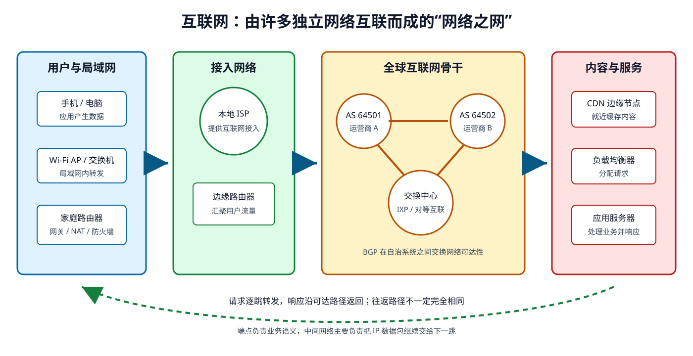
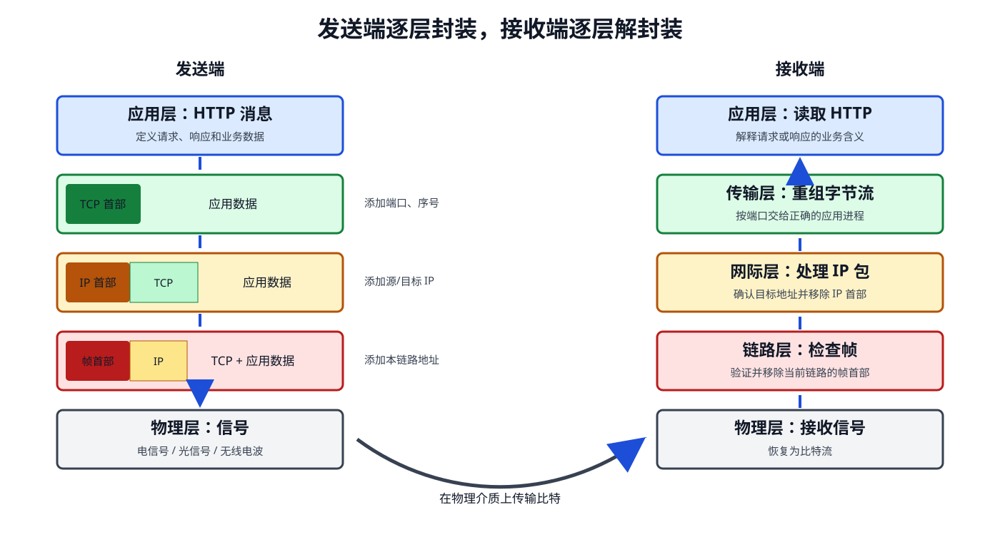
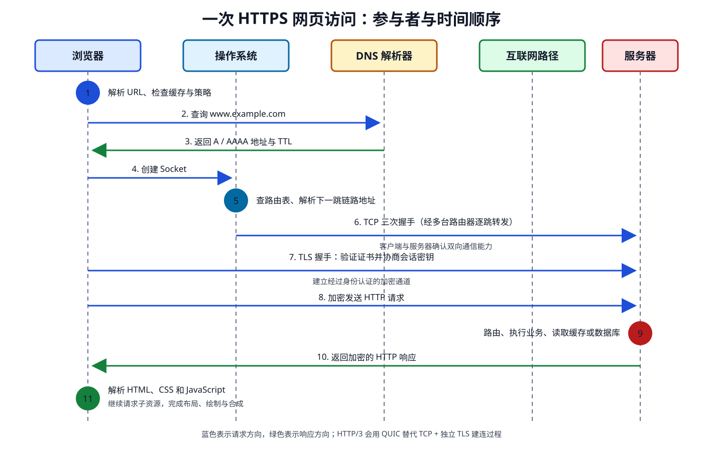
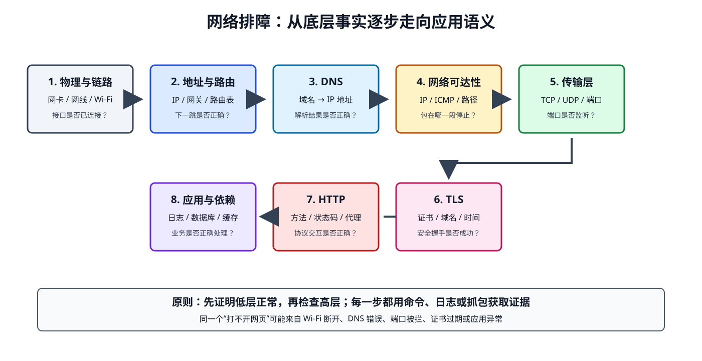

# 互联网是如何工作的

> 互联网不是一台巨大的计算机，也不只是“许多网线连在一起”。它是由无数独立网络组成的**网络之网**：设备遵守共同协议，把数据拆成包，经由一台台路由器转发，最终交给目标主机中的具体程序。
>
> 本文以“在浏览器输入一个网址”为主线，建立互联网的完整心智模型。读完后，你应该能解释一次网页访问经历了什么，也能对常见网络故障做初步定位。

## 一、先分清 Internet、Web 与网站

这三个概念经常被混用，但它们处于不同层次：

| 概念 | 英文 | 本质 | 例子 |
| --- | --- | --- | --- |
| 互联网 | Internet | 连接全球网络的基础设施与协议体系 | IP、路由器、海底光缆、运营商网络 |
| 万维网 | World Wide Web, Web | 构建在互联网之上的超文本信息系统 | HTTP、HTML、URL、浏览器 |
| 网站 | Website | Web 上由一组资源和服务组成的具体应用 | 搜索引擎、新闻站点、在线商城 |

互联网还承载电子邮件、即时通信、网络游戏、文件传输和视频会议等服务。**Web 是互联网的一种应用，互联网是 Web 运行的基础。**

### 1.1 互联网解决的核心问题

两台计算机要跨越复杂网络通信，至少要解决五个问题：

1. **如何表示数据**：双方必须理解相同的数据格式和协议。
2. **如何找到目标**：需要全球范围可路由的 IP 地址。
3. **如何选择路径**：中间路由器要决定数据的下一跳。
4. **如何应对不可靠链路**：数据可能丢失、重复、乱序或损坏。
5. **如何找到目标程序**：一台服务器同时运行很多服务，需要用端口区分。

这些问题由不同层次的协议协作解决，而不是由某个“互联网中心”统一处理。

## 二、互联网由什么组成

从家里的手机到远端服务器，一条典型路径包括：



### 2.1 终端设备

手机、电脑、服务器和智能设备统称为**主机（Host）**或**端系统（End System）**。真正发送和接收业务数据的是主机中的应用程序。

### 2.2 局域网设备

- **网卡（Network Interface Card, NIC）**：把数据转换为电信号、光信号或无线电波。
- **无线接入点（Access Point, AP）**：让无线终端接入局域网。
- **交换机（Switch）**：在同一局域网内，依据 MAC 地址转发以太网帧。
- **家庭路由器（Home Router）**：通常同时承担路由、NAT、DHCP、防火墙和 Wi-Fi AP 等职责。

### 2.3 互联网服务提供商

**互联网服务提供商（Internet Service Provider, ISP）**向家庭、企业和移动终端提供接入。不同 ISP 和大型内容提供商通过互联、对等连接或购买转接服务交换流量。

### 2.4 路由器与自治系统

互联网由大量**自治系统（Autonomous System, AS）**组成。一个 ISP、云厂商或大型企业可以运营一个或多个自治系统。自治系统内部常使用 OSPF、IS-IS 等协议，自治系统之间主要通过 BGP 交换可达性信息。

路由器并不需要知道完整业务含义。它读取目标 IP 地址，在路由表中执行**最长前缀匹配**，然后把数据包交给下一跳。

### 2.5 物理基础设施

互联网最终仍依赖真实介质：

- 家庭中的双绞线和 Wi-Fi 无线电波；
- 城域和骨干网络中的光纤；
- 连接大陆的海底光缆；
- 偏远地区使用的微波、蜂窝网络或卫星链路；
- 数据中心中的高速以太网和光互连。

“数据在云端”并不意味着它脱离了物理世界。云服务仍运行在具体机房的服务器上，数据仍要经过光纤、交换芯片和路由器。

## 三、四种关键标识

理解互联网，首先要分清四种地址：

| 标识 | 英文 | 回答的问题 | 典型作用范围 | 示例 |
| --- | --- | --- | --- | --- |
| 域名 | Domain Name | 人如何记住服务 | 全球 DNS 命名空间 | `www.example.com` |
| IP 地址 | IP Address | 数据最终送到哪个网络接口 | 跨网络 | `93.184.216.34` |
| MAC 地址 | MAC Address | 当前链路上的帧交给谁 | 一个二层网络 | `00:1A:2B:3C:4D:5E` |
| 端口 | Port | 主机把数据交给哪个程序 | 单台主机 | HTTPS 常用 `443` |

可以用寄快递来类比：

- 域名像收件人的易记名称；
- IP 地址像建筑物地址；
- MAC 地址像当前中转站内的具体传送口；
- 端口像建筑物内的房间号。

类比只能帮助入门，不能替代准确概念。尤其要记住：

- 域名必须先经过 DNS 解析，路由器不会按域名转发普通 IP 数据包。
- MAC 地址通常每经过一台路由器就会改变，它不是全球地址。
- IP 定位网络接口，端口定位该主机中的应用程序。
- 一个 TCP 连接通常由“源 IP、源端口、目标 IP、目标端口、传输层协议”五元组标识。

## 四、为什么互联网采用分层设计

互联网协议栈通常用 TCP/IP 模型描述：

| 层次 | 典型协议 | 数据单位 | 核心职责 |
| --- | --- | --- | --- |
| 应用层 | HTTP、DNS、SMTP、SSH | 消息 | 定义应用怎样交换数据 |
| 传输层 | TCP、UDP、QUIC | TCP 段、UDP 数据报 | 实现进程到进程通信 |
| 网际层 | IPv4、IPv6、ICMP | IP 数据包 | 跨网络寻址和路由 |
| 链路层 | Ethernet、Wi-Fi | 帧 | 在相邻节点间交付数据 |
| 物理层 | 双绞线、光纤、无线电 | 比特、符号 | 把比特转换为可传播信号 |

分层带来的价值是**关注点分离**：

- 浏览器只需按 HTTP 组织请求，不必了解光纤如何传输光信号。
- TCP 可以运行在以太网、Wi-Fi 或蜂窝网络之上。
- 路由器可以转发 IP 数据包，不必理解它承载的是网页还是游戏数据。
- 下层技术变化时，上层应用通常不需要重写。

### 4.1 封装与解封装

发送端会逐层添加控制信息，接收端再反向去除：



以 HTTPS 请求为例：

```text
HTTP 消息
  ↓ TLS 加密
TLS 记录
  ↓ TCP 添加端口、序号等信息
TCP 段
  ↓ IP 添加源地址、目标地址、TTL 等信息
IP 数据包
  ↓ 以太网添加源 MAC、下一跳 MAC 等信息
以太网帧
  ↓ 网卡编码
电信号、光信号或无线电波
```

这种“上层数据成为下层载荷”的过程称为**封装（Encapsulation）**。接收端按相反顺序处理，称为**解封装（Decapsulation）**。

## 五、输入网址后发生了什么

假设用户访问：

```text
https://www.example.com/products?id=42
```

浏览器会经历下面的关键步骤：



### 第 1 步：解析 URL

浏览器把 URL 拆成多个部分：

| 部分 | 内容 | 含义 |
| --- | --- | --- |
| Scheme | `https` | 使用 HTTPS |
| Host | `www.example.com` | 目标主机名 |
| Port | 省略 | HTTPS 默认使用 `443` |
| Path | `/products` | 请求的资源路径 |
| Query | `id=42` | 附加查询参数 |

浏览器还可能执行 HSTS 升级、缓存检查、代理选择和 Service Worker 拦截等操作。

### 第 2 步：通过 DNS 查询 IP 地址

网络传输需要 IP 地址，所以系统会尝试把域名解析为 IPv4 的 `A` 记录或 IPv6 的 `AAAA` 记录。

典型查找顺序如下：

1. 浏览器 DNS 缓存；
2. 操作系统缓存和 `hosts` 文件；
3. 本机配置的递归 DNS 解析器；
4. 递归解析器的缓存；
5. 根 DNS、顶级域 DNS 和权威 DNS。

根 DNS 通常不会直接返回网站地址，而是指引解析器找到顶级域服务器；顶级域服务器再指引它找到权威服务器。查询结果可以按 TTL 缓存，因此 DNS 修改不会瞬间在全球生效。

> 延伸阅读：[DNS](DNS.md)

### 第 3 步：确定下一跳

操作系统根据目标 IP 查询路由表：

- 目标与本机处于同一子网：直接发送给目标主机。
- 目标位于其他网络：先发送给默认网关。

对于 IPv4，主机通常用 ARP 查询下一跳 IP 对应的 MAC 地址；IPv6 使用 NDP。这里查询的是**下一跳**的链路层地址，不是远端服务器的 MAC 地址。

### 第 4 步：建立传输连接

传统 HTTPS 常先建立 TCP 连接。TCP 三次握手可简化为：

```text
客户端  -- SYN -->      服务器
客户端  <-- SYN + ACK -- 服务器
客户端  -- ACK -->      服务器
```

三次握手让双方确认双向通信能力，并协商初始序号和部分连接参数。

TCP 通过序号、确认、校验、重传、接收窗口和拥塞控制，向应用提供有序、可靠的字节流。但“TCP 传输成功”只表示字节到达对方协议栈，不表示业务一定处理成功。

HTTP/3 使用 QUIC。QUIC 构建在 UDP 之上，把可靠传输、拥塞控制和 TLS 1.3 等能力组合在用户态协议中，并减少队头阻塞。

### 第 5 步：建立 TLS 安全通道

HTTPS 中的 TLS 主要解决三个问题：

1. **身份认证**：证书帮助客户端确认服务器身份。
2. **机密性**：加密防止路径上的观察者直接读取内容。
3. **完整性**：验证数据是否被篡改。

在 TLS 握手中，客户端和服务器协商协议参数与密钥，服务器发送证书链。浏览器会检查域名、有效期、签名以及信任链。

HTTPS 不代表网站业务一定可信，也不隐藏所有元数据。通信双方的 IP 地址通常仍然可见。

### 第 6 步：发送 HTTP 请求

连接建立后，浏览器发送类似请求：

```http
GET /products?id=42 HTTP/1.1
Host: www.example.com
Accept: text/html
User-Agent: ...
```

HTTP 定义请求方法、头字段、状态码和消息语义。它不负责决定数据走哪条物理链路。

### 第 7 步：数据逐层封装并离开主机

操作系统把数据交给协议栈，网卡最终把帧编码为信号。数据可能经过：

```text
终端 → Wi-Fi AP/交换机 → 家庭路由器 → ISP → 多个骨干路由器
     → CDN/数据中心边缘 → 负载均衡器 → Web 服务器
```

每台路由器主要执行：

1. 接收并去除入站链路层封装；
2. 读取目标 IP；
3. 将 TTL 或 Hop Limit 减一；
4. 查询路由表选择出接口和下一跳；
5. 重新添加当前链路所需的帧头；
6. 把数据发送给下一跳。

IP 地址在理想端到端路径上通常保持不变，MAC 地址则会随每段链路改变。NAT、代理或隧道可能改写或封装地址。

### 第 8 步：请求到达服务器端系统

真实网站通常不是由一台服务器直接承接全部流量。请求可能依次经过：

- **CDN**：在靠近用户的位置缓存静态资源；
- **防火墙或 WAF**：过滤不符合安全策略的流量；
- **负载均衡器**：把请求分发给健康实例；
- **反向代理**：终止 TLS、路由请求或执行缓存；
- **应用服务器**：运行具体业务逻辑；
- **数据库与缓存**：读取或写入业务数据。

“访问一台服务器”常常只是外部视角。服务器内部可能是一个分布式系统。

### 第 9 步：服务器返回 HTTP 响应

服务器处理完成后返回状态码、响应头和内容：

```http
HTTP/1.1 200 OK
Content-Type: text/html; charset=utf-8
Cache-Control: max-age=300

<!doctype html>
...
```

常见状态码：

| 范围 | 含义 | 示例 |
| --- | --- | --- |
| `1xx` | 信息性响应 | `100 Continue` |
| `2xx` | 请求成功 | `200 OK`、`204 No Content` |
| `3xx` | 重定向或缓存 | `301 Moved Permanently`、`304 Not Modified` |
| `4xx` | 客户端请求问题 | `400 Bad Request`、`404 Not Found` |
| `5xx` | 服务端处理问题 | `500 Internal Server Error`、`503 Service Unavailable` |

### 第 10 步：浏览器解析并渲染页面

浏览器拿到 HTML 后还要：

1. 解析 HTML，构建 DOM；
2. 解析 CSS，构建 CSSOM；
3. 执行 JavaScript；
4. 生成渲染树；
5. 完成布局、绘制和合成；
6. 继续请求 CSS、JavaScript、图片、字体和接口数据。

因此，看到页面不只依赖“下载一个 HTML 文件”。一个页面通常会触发几十甚至数百个资源请求。

## 六、数据为什么要拆成包

如果一段大数据独占链路直到传输完成，其他通信就要长时间等待。互联网采用**分组交换（Packet Switching）**：

1. 大数据被拆成多个较小的数据单元；
2. 每个 IP 包可被路由器独立转发；
3. 多个用户的数据包在同一链路上交错传输；
4. 接收方按协议重新组合和处理数据。

它提高了共享链路的利用率，也带来新的问题：排队、丢包、乱序和抖动。

### 6.1 MTU 与分片

链路层能承载的数据包大小有限。以太网常见 MTU 为 `1500` 字节。TCP 通常依据 MSS 控制单个 TCP 段的数据量，尽量避免 IP 分片。

包并不是越大越好：

- 包太小，首部开销占比增加；
- 包太大，可能超过路径 MTU；
- 发生分片后，任一分片丢失都会影响原数据报重组；
- 错误屏蔽必要的 ICMP 消息可能造成“短请求正常、大请求卡住”。

## 七、TCP、UDP 与 QUIC 怎样选择

| 协议 | 连接模型 | 可靠性 | 典型特点 | 常见场景 |
| --- | --- | --- | --- | --- |
| TCP | 面向连接 | 内置可靠、有序字节流 | 生态成熟，内核实现广泛 | HTTP/1.1、HTTP/2、数据库 |
| UDP | 无连接 | 不保证交付、顺序或去重 | 首部简单，应用可自定义策略 | DNS、音视频、游戏 |
| QUIC | 基于 UDP 建立安全连接 | 内置可靠流与拥塞控制 | 集成 TLS 1.3，支持连接迁移 | HTTP/3 |

UDP 并不等于“低延迟”，TCP 也不等于“一定慢”。真实表现取决于往返时延、丢包率、拥塞算法、应用交互方式和实现质量。

## 八、互联网为什么可能很慢

### 8.1 四类时延

单个数据包经过一条链路时，常见时延包括：

| 时延 | 英文 | 含义 |
| --- | --- | --- |
| 处理时延 | Processing Delay | 设备检查首部并做转发决定 |
| 排队时延 | Queuing Delay | 数据包等待出接口可用 |
| 传输时延 | Transmission Delay | 把所有比特推入链路所需时间 |
| 传播时延 | Propagation Delay | 信号在介质中传播所需时间 |

总体验还会受到 DNS、TCP/QUIC 建连、TLS 握手、服务端计算、资源数量和浏览器渲染影响。

### 8.2 带宽不等于速度体验

- **带宽（Bandwidth）**表示单位时间可传输的数据量上限。
- **时延（Latency）**表示一次传输需要等待多久。
- **吞吐量（Throughput）**表示应用实际获得的传输速率。
- **抖动（Jitter）**表示时延随时间的波动。
- **丢包率（Packet Loss Rate）**表示未成功交付的数据包比例。

高带宽不一定低时延。跨洲链路即使带宽很高，也绕不开传播距离；页面由大量串行请求组成时，往返时延往往比文件大小更影响体验。

## 九、安全与可靠性不是同一件事

互联网底层默认面对一个不完全可信的环境：

- 数据包可能被监听、篡改或伪造；
- 路由可能故障或变化；
- 主机可能被攻击；
- 服务可能过载；
- DNS 结果可能被污染；
- 证书可能配置错误。

不同机制解决不同问题：

| 机制 | 主要解决的问题 | 不能保证什么 |
| --- | --- | --- |
| TCP | 有序、可靠地传输字节 | 数据内容保密、业务处理成功 |
| TLS | 身份、机密性、完整性 | 网站业务诚实、服务器无漏洞 |
| DNSSEC | 验证 DNS 数据来源与完整性 | DNS 查询内容保密 |
| DoH/DoT | 加密客户端到解析器的 DNS 查询 | 权威数据一定正确 |
| 防火墙 | 按策略允许或阻止流量 | 应用逻辑没有漏洞 |
| CDN | 就近服务、缓存和流量吸收 | 源站永不故障 |

理解“每个机制具体保证什么”比记住“它更安全”更重要。

## 十、如何系统定位网络故障

不要从“网络坏了”开始猜。应沿通信链路逐层验证：



### 10.1 推荐排查顺序

1. **物理与链路**：网线、Wi-Fi、网卡状态是否正常？
2. **地址配置**：是否获得正确 IP、前缀、网关和 DNS？
3. **本地路由**：操作系统是否选择了正确出接口和下一跳？
4. **DNS**：域名能否解析，结果是否符合预期？
5. **网络可达性**：目标 IP 和沿途路由是否可达？
6. **传输层**：目标端口是否开放，TCP 是否重传或被重置？
7. **TLS**：证书、域名、时间和协议版本是否正确？
8. **HTTP 与应用**：状态码、代理、日志和依赖服务是否正常？

### 10.2 常用命令

macOS/Linux：

```bash
# 查看地址与接口
ifconfig

# 查看路由表
netstat -rn

# 查询 DNS
dig www.example.com

# 检查基本可达性
ping -c 4 1.1.1.1

# 观察途经路由
traceroute www.example.com

# 查看 HTTPS 建连、证书和响应
curl -v https://www.example.com/

# 查看某个域名的 TLS 证书链
openssl s_client -connect www.example.com:443 -servername www.example.com
```

### 10.3 从现象快速判断层次

| 现象 | 优先检查 |
| --- | --- |
| 没有 IP 地址 | 网卡、Wi-Fi、DHCP、VLAN |
| 能访问 IP，不能访问域名 | DNS |
| `ping` 通但端口不通 | 服务监听、防火墙、ACL |
| TCP 端口通但 HTTPS 报错 | TLS 证书、系统时间、SNI |
| 小请求正常，大请求卡住 | MTU、MSS、ICMP |
| 下载速度慢且有重传 | 丢包、拥塞、无线干扰 |
| 首字节很慢但下载很快 | 服务端处理、连接建立、跨区 RTT |
| 某个 `traceroute` 节点不响应但业务正常 | 节点未返回或限速 ICMP |

> `ping` 不通不等于网站一定不通。对方可能屏蔽 ICMP，但仍允许 TCP `443`。

## 十一、常见误区

1. **“互联网就是 Web。”**  
   Web 只是运行在互联网之上的一种应用。

2. **“DNS 负责把数据送到服务器。”**  
   DNS 主要把名称解析成地址，真正转发数据的是 IP 网络和路由器。

3. **“交换机和路由器是一回事。”**  
   入门模型中，交换机主要在局域网按 MAC 转发，路由器主要在不同 IP 网络间转发。

4. **“数据沿固定路径往返。”**  
   互联网路由会随策略和故障变化，请求与响应甚至可能走不同路径。

5. **“服务器的 MAC 地址会一路传到客户端。”**  
   MAC 地址只服务于当前链路，经过路由器后会重新封装。

6. **“TCP 确认就代表订单已成功。”**  
   TCP 只确认字节交付，业务成功必须由应用层响应或事务状态确认。

7. **“HTTPS 代表网站绝对安全。”**  
   HTTPS 保护传输通道，不保证业务可信，也不能消除应用漏洞。

8. **“带宽越大，所有请求越快。”**  
   小请求和交互式应用经常更受 RTT、排队和服务端耗时影响。

9. **“UDP 一定比 TCP 快。”**  
   UDP 只是不内置可靠传输；应用若需要可靠性，仍要自行承担相应成本。

10. **“互联网由一个中心统一控制。”**  
    互联网是多个独立网络按共同协议互联形成的分布式系统。

## 十二、术语中英文对照

| 中文名称 | 英文名称 | 缩写 | 简要说明 |
| --- | --- | --- | --- |
| 互联网 | Internet | - | 互联网络组成的全球通信系统 |
| 万维网 | World Wide Web | WWW/Web | 基于超文本与 HTTP 的信息系统 |
| 互联网协议 | Internet Protocol | IP | 跨网络寻址与转发数据包 |
| 互联网服务提供商 | Internet Service Provider | ISP | 提供互联网接入和传输服务 |
| 自治系统 | Autonomous System | AS | 由统一路由策略管理的一组网络 |
| 域名系统 | Domain Name System | DNS | 将域名解析为 IP 等资源记录 |
| 动态主机配置协议 | Dynamic Host Configuration Protocol | DHCP | 自动分配网络参数 |
| 地址解析协议 | Address Resolution Protocol | ARP | 在 IPv4 局域网查询 IP 对应的 MAC |
| 网络地址转换 | Network Address Translation | NAT | 转换网络地址，常用于私网访问公网 |
| 传输控制协议 | Transmission Control Protocol | TCP | 提供可靠、有序的字节流 |
| 用户数据报协议 | User Datagram Protocol | UDP | 提供轻量、无连接的数据报传输 |
| 快速 UDP 互联网连接 | Quick UDP Internet Connections | QUIC | 基于 UDP 的安全多路传输协议 |
| 超文本传输协议 | Hypertext Transfer Protocol | HTTP | 定义 Web 请求与响应语义 |
| 传输层安全协议 | Transport Layer Security | TLS | 提供身份认证、加密和完整性保护 |
| 往返时延 | Round-Trip Time | RTT | 数据往返通信双方所需时间 |
| 最大传输单元 | Maximum Transmission Unit | MTU | 链路可承载的最大网络层数据包大小 |
| 内容分发网络 | Content Delivery Network | CDN | 就近缓存和分发内容的网络 |

## 十三、动手实验：观察一次真实请求

选择一个你能正常访问的网站，按顺序执行：

```bash
# 1. 域名解析到了哪些地址？
dig example.com

# 2. 操作系统准备怎样转发数据？
route -n get 93.184.216.34

# 3. 中间大致经过哪些路由节点？
traceroute example.com

# 4. HTTPS 请求各阶段发生了什么？
curl -v https://example.com/

# 5. 分别统计 DNS、建连、TLS、首字节和总耗时
curl -o /dev/null -s \
  -w 'DNS: %{time_namelookup}s\nTCP: %{time_connect}s\nTLS: %{time_appconnect}s\nTTFB: %{time_starttransfer}s\nTotal: %{time_total}s\n' \
  https://example.com/
```

观察时回答：

1. DNS 返回了 IPv4、IPv6，还是两者都有？
2. 默认网关是谁？目标是否在本地子网？
3. 哪些阶段需要一个或多个 RTT？
4. 首字节时间与总下载时间哪个更长？这意味着什么？
5. 若更换网络，路由和各阶段耗时是否变化？

## 十四、复习题

1. 为什么知道域名还不能直接发送 IP 数据包？
2. 为什么访问远端服务器时，客户端通常只需要知道默认网关的 MAC 地址？
3. TCP 的可靠性与业务操作成功有什么区别？
4. HTTPS 分别提供了哪三类核心保护？
5. 为什么增加带宽不一定显著降低网页首屏时间？
6. 数据包每经过一台路由器时，哪些信息可能改变？
7. 为什么 `ping` 失败不能证明 HTTPS 服务不可用？

<details>
<summary>参考答案</summary>

1. 网络层转发需要目标 IP，域名必须先经 DNS 转换为相应资源记录。
2. 以太网帧只负责当前链路的交付；路由器会为下一段链路重新封装。
3. TCP 保证字节流交付，不保证应用已经完成事务、持久化或业务校验。
4. 身份认证、机密性和完整性。
5. 首屏可能主要受 DNS、握手 RTT、服务端处理和串行资源依赖影响。
6. 链路层地址会改变，TTL/Hop Limit 会递减；NAT、代理或隧道还可能改变或封装网络层信息。
7. ICMP 可能被屏蔽或限速，而目标仍允许 TCP `443`。

</details>

## 十五、总结

一次网页访问可以压缩成一条清晰主线：

```text
URL 解析
→ DNS 得到 IP
→ 路由表确定下一跳
→ ARP/NDP 得到链路地址
→ TCP 或 QUIC 建立传输通道
→ TLS 建立安全通道
→ HTTP 交换请求与响应
→ 路由器逐跳转发数据包
→ 服务器处理业务
→ 浏览器解析并渲染页面
```

面对任何网络问题，都可以追问五件事：

1. 当前处理发生在哪一层？
2. 当前设备依据哪个标识做决定？
3. 下一跳是谁，最终目标又是谁？
4. 这一跳会修改哪些信息？
5. 失败能够通过什么现象、日志或数据包观察到？

掌握这五个问题，就不再需要把互联网当成不可理解的“黑盒”。

## 参考资料与延伸阅读

- [MDN：互联网是如何工作的](https://developer.mozilla.org/zh-CN/docs/Learn_web_development/Howto/Web_mechanics/How_does_the_Internet_work)
- [MDN：Web 如何工作](https://developer.mozilla.org/en-US/docs/Learn_web_development/Getting_started/Web_standards/How_the_web_works)
- [ICANN：域名系统](https://www.icann.org/resources/pages/dns-2022-09-13-en)
- [RFC 8200：Internet Protocol, Version 6](https://www.rfc-editor.org/rfc/rfc8200)
- [RFC 8446：TLS 1.3](https://www.rfc-editor.org/rfc/rfc8446)
- [RFC 9000：QUIC](https://www.rfc-editor.org/rfc/rfc9000)
- [RFC 9110：HTTP Semantics](https://www.rfc-editor.org/rfc/rfc9110)
- [RFC 9293：Transmission Control Protocol](https://www.rfc-editor.org/rfc/rfc9293)
- [深入阅读：计算机网络工作原理](../计算机网络/计算机网络工作原理.md)
- [深入阅读：OSI 模型](../计算机网络/计算机网络%20-%20OSI.md)
