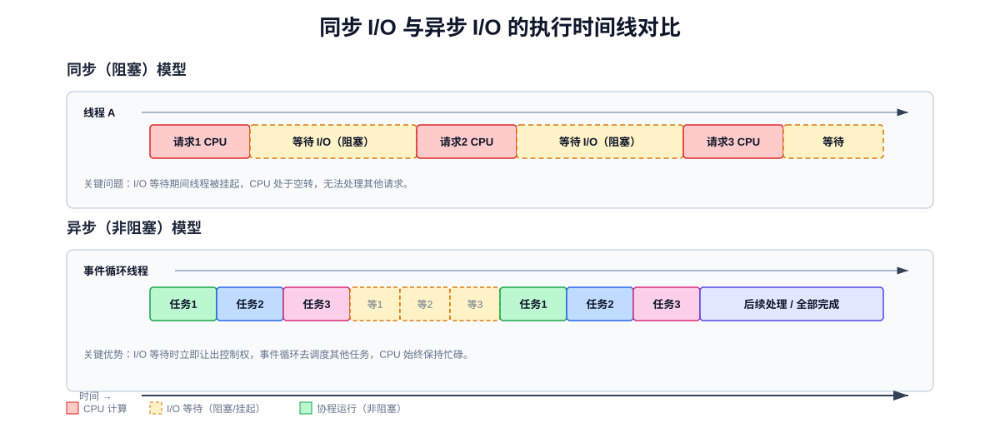
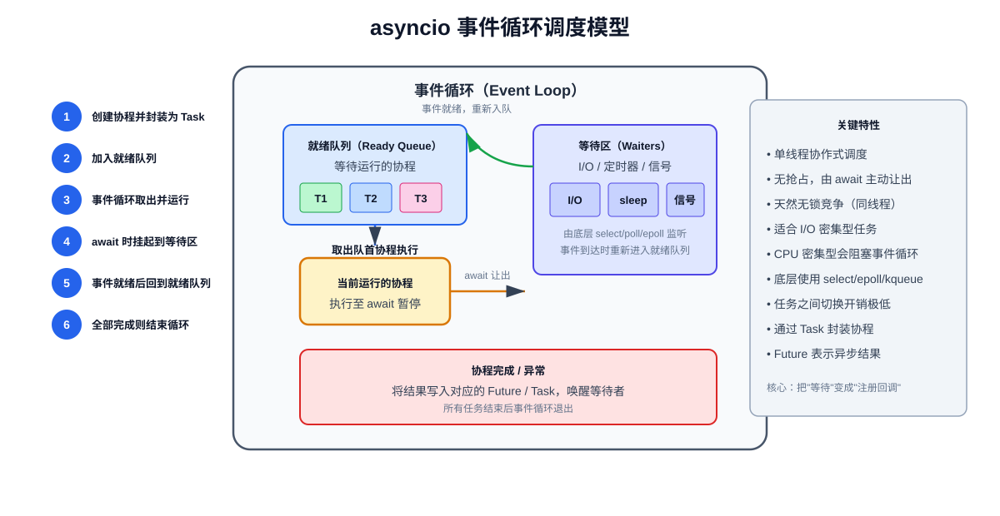
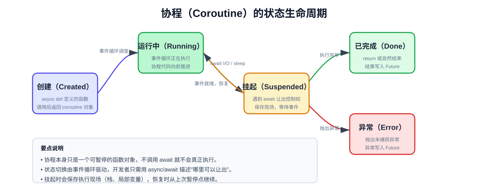
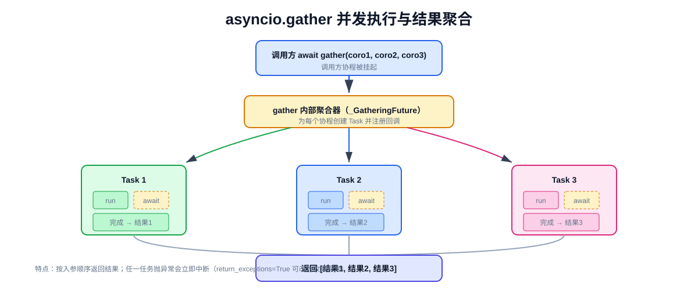

# Python 异步编程：从原理到实战

> Python 的 `asyncio` 提供了一套基于事件循环的**协作式并发**框架。它用单线程 + `async/await` 语法实现对 I/O 密集型任务的高效调度，是现代 Python 网络服务、爬虫、微服务的核心能力之一。

## 一、为什么需要异步编程

### 1.1 同步 I/O 的痛点

传统同步代码中，一次网络请求或文件读取会让当前线程**阻塞挂起**：CPU 无法执行其他任务，只能干等 I/O 完成。当并发量上来时，只能靠开更多线程弥补，但线程本身有内存开销（每个线程栈约几 MB），且线程切换需要内核介入，存在上下文切换成本。

```python
import requests
import time

def fetch(url):
    return requests.get(url)  # 阻塞：直到 HTTP 响应返回

start = time.perf_counter()
for url in ["https://example.com"] * 5:
    fetch(url)
print(f"串行耗时: {time.perf_counter() - start:.2f}s")  # 约 5 个请求时间之和
```

### 1.2 三种并发模型对比

| 模型 | 实现方式 | 调度者 | 适用场景 | 主要开销 |
|------|---------|--------|---------|---------|
| 多进程 | `multiprocessing` | 操作系统（抢占式） | CPU 密集、需绕过 GIL | 进程创建、IPC、内存占用大 |
| 多线程 | `threading` | 操作系统（抢占式） | I/O 密集、需共享内存 | GIL 限制 CPU 并行、锁竞争 |
| 异步（协程） | `asyncio` | 事件循环（协作式） | 高并发 I/O 密集 | 任务切换极轻，无锁竞争 |

> 关键点：**异步不是为了让单个任务变快，而是为了在等待 I/O 时去做别的事，从而提高整体吞吐量。**

### 1.3 同步 vs 异步执行时间线



上图中，同步模型在 I/O 等待期间线程被挂起；异步模型则在等待时把控制权交还给事件循环，让其他任务继续运行。

---

## 二、核心概念

| 概念 | 英文 | 一句话解释 |
|------|------|-----------|
| 协程 | Coroutine | 可暂停、可恢复的函数，由 `async def` 定义 |
| 事件循环 | Event Loop | 驱动协程调度的核心引擎，单线程循环运行 |
| 任务 | Task | 对协程的封装，让它进入事件循环被调度 |
| Future | Future | 表示"尚未完成的异步结果"的容器 |
| 可等待对象 | Awaitable | 能被 `await` 的对象（协程、Task、Future） |

### 2.1 协程（Coroutine）

用 `async def` 定义的函数，调用它**不会立即执行函数体**，而是返回一个协程对象：

```python
import asyncio

async def hello():
    print("hello")
    await asyncio.sleep(1)
    print("world")

coro = hello()      # <coroutine object hello at 0x...>，函数体尚未执行
print(type(coro))   # <class 'coroutine'>
```

直接调用协程对象而不 `await` 会触发 `RuntimeWarning: coroutine 'hello' was never awaited`。

### 2.2 事件循环（Event Loop）

事件循环是 asyncio 的心脏。它负责：
- 从就绪队列取出协程执行
- 在协程 `await` 时把它挂起，注册到底层 I/O 监听
- 当 I/O 事件就绪后把协程重新放回就绪队列
- 所有任务完成后退出



### 2.3 Task 与 Future 的关系

- `Future` 是底层抽象，表示"一个将来会有结果的对象"，有 `done()`、`result()`、`set_result()` 等方法。
- `Task` 是 `Future` 的子类，专门用来**包装协程**并驱动它执行。
- 通常开发者直接用 `Task`，很少直接操作 `Future`。

```python
import asyncio

async def main():
    task = asyncio.create_task(asyncio.sleep(1))
    print(isinstance(task, asyncio.Future))  # True
    await task

asyncio.run(main())
```

---

## 三、asyncio 运行原理

### 3.1 协作式调度

asyncio 采用**协作式（cooperative）**而非抢占式调度：任务不会被操作系统强制中断，只有当任务执行到 `await` 时才主动让出控制权。

这意味着：**如果一个协程里写了长时间的 CPU 计算（没有 await），它会阻塞整个事件循环**，其他任务都无法运行。

```python
async def bad_task():
    # 危险：CPU 密集型计算，没有 await，会阻塞事件循环
    total = 0
    for i in range(10_000_000):
        total += i
    return total
```

### 3.2 底层 I/O 多路复用

事件循环底层使用操作系统的 I/O 多路复用机制：
- Linux: `epoll`
- macOS / BSD: `kqueue`
- Windows: `IOCP`（ProactorEventLoop）或 `select`

这些机制让单个线程可以同时监听成百上千个 socket，当其中任何一个就绪时再通知事件循环恢复对应的协程。

### 3.3 协程的状态生命周期



协程在 `创建 → 运行中 → 挂起 → 运行中 → 完成/异常` 之间切换，挂起时保存执行现场，恢复时继续。

---

## 四、基础语法

### 4.1 `async def` 与 `await`

```python
import asyncio

async def greet(name: str) -> str:
    await asyncio.sleep(0.5)          # 模拟异步 I/O
    return f"Hello, {name}"

async def main():
    result = await greet("World")     # 等待协程完成并拿到返回值
    print(result)

asyncio.run(main())
```

### 4.2 `asyncio.run`

`asyncio.run(coro)` 是 Python 3.7+ 推荐的入口，它会：
1. 创建一个新的事件循环
2. 运行传入的协程直到完成
3. 关闭循环

```python
import asyncio

async def main():
    print("hello asyncio")

asyncio.run(main())
```

> 注意：`asyncio.run` 不能在已经有事件循环运行的环境中调用（如 Jupyter、FastAPI 内部），此时要用 `await main()` 或 `asyncio.get_running_loop()`。

### 4.3 串行 await

多个 `await` 会**串行执行**，总耗时是各任务耗时之和：

```python
import asyncio
import time

async def task(name, seconds):
    await asyncio.sleep(seconds)
    return f"{name} done"

async def main():
    start = time.perf_counter()
    a = await task("A", 1)
    b = await task("B", 2)
    print(a, b)
    print(f"耗时: {time.perf_counter() - start:.2f}s")  # 约 3s

asyncio.run(main())
```

---

## 五、并发执行

要让多个协程**真正并发**，必须先把它们调度起来（封装为 Task），再一起等待。

### 5.1 `asyncio.gather`

`gather` 是最常用的并发原语。它接收多个可等待对象，并发执行并按入参顺序返回结果列表：

```python
import asyncio
import time

async def task(name, seconds):
    await asyncio.sleep(seconds)
    return f"{name} done"

async def main():
    start = time.perf_counter()
    results = await asyncio.gather(
        task("A", 1),
        task("B", 2),
        task("C", 1),
    )
    print(results)  # ['A done', 'B done', 'C done']
    print(f"耗时: {time.perf_counter() - start:.2f}s")  # 约 2s（取最大值）

asyncio.run(main())
```



**异常处理**：默认情况下，任一协程抛异常会导致 `gather` 立即抛出该异常。可通过 `return_exceptions=True` 把异常作为结果收集：

```python
results = await asyncio.gather(coro1, coro2, return_exceptions=True)
# results 中可能包含 Exception 对象
```

### 5.2 `asyncio.create_task`

`create_task` 立即把协程封装成 Task 并调度执行，返回 Task 对象，之后可 `await` 它拿结果：

```python
import asyncio

async def task(name, seconds):
    await asyncio.sleep(seconds)
    return f"{name} done"

async def main():
    t1 = asyncio.create_task(task("A", 1))
    t2 = asyncio.create_task(task("B", 2))
    
    # 此时 t1、t2 已经在并发运行
    print(await t1)
    print(await t2)

asyncio.run(main())
```

> **重要**：`create_task` 返回的 Task 如果没有被持有引用，可能被 GC 回收导致任务中断。务必保存引用（放进列表或字典）。

### 5.3 `asyncio.as_completed`

当你希望"哪个先完成就先处理哪个"时，用 `as_completed`：

```python
import asyncio

async def task(name, seconds):
    await asyncio.sleep(seconds)
    return f"{name} done after {seconds}s"

async def main():
    coros = [task("A", 3), task("B", 1), task("C", 2)]
    for coro in asyncio.as_completed(coros):
        result = await coro
        print(result)  # 输出顺序：B、C、A

asyncio.run(main())
```

### 5.4 `asyncio.wait`

`wait` 提供更细粒度的控制，可指定等待条件：

```python
import asyncio

async def main():
    tasks = [asyncio.create_task(asyncio.sleep(i)) for i in range(1, 4)]
    
    # 等所有任务完成
    done, pending = await asyncio.wait(tasks, return_when=asyncio.ALL_COMPLETED)
    
    # 或等待任一完成
    # done, pending = await asyncio.wait(tasks, return_when=asyncio.FIRST_COMPLETED)

asyncio.run(main())
```

### 5.5 四种并发方式对比

| 方式 | 结果顺序 | 异常行为 | 适用场景 |
|------|---------|---------|---------|
| `gather` | 按入参顺序 | 默认立即抛出 | 需要批量结果 |
| `create_task` | 自行控制 | 需 await 时捕获 | 灵活调度、后台任务 |
| `as_completed` | 完成顺序 | 需 await 时捕获 | 先到先处理 |
| `wait` | 分 done/pending | 需从 Future 取 | 需要精细控制等待条件 |

---

## 六、异步 I/O 实战

### 6.1 `asyncio.sleep` 是异步的，但 `time.sleep` 不是

```python
import asyncio
import time

async def main():
    # asyncio.sleep 是非阻塞的，await 时事件循环去做别的事
    await asyncio.sleep(1)
    
    # time.sleep 会阻塞整个事件循环，绝不要在协程里用！
    # time.sleep(1)

asyncio.run(main())
```

### 6.2 异步 HTTP：aiohttp

`requests` 是同步库，在协程中调用会阻塞事件循环。应使用 `aiohttp`：

```python
import asyncio
import aiohttp

async def fetch(session, url):
    async with session.get(url) as resp:
        return await resp.text()

async def main():
    urls = [
        "https://example.com",
        "https://httpbin.org/get",
        "https://httpbin.org/status/200",
    ]
    async with aiohttp.ClientSession() as session:
        tasks = [fetch(session, url) for url in urls]
        results = await asyncio.gather(*tasks)
        for url, html in zip(urls, results):
            print(f"{url}: {len(html)} bytes")

asyncio.run(main())
```

### 6.3 异步文件读写

Python 标准库的文件 I/O 是同步的。可使用 `aiofiles` 或把同步调用丢到线程池：

```python
import asyncio
import aiofiles

async def main():
    async with aiofiles.open("data.txt", mode="r") as f:
        content = await f.read()
    print(content)

asyncio.run(main())
```

### 6.4 把阻塞调用变成异步

对于无法改造的同步阻塞函数，用 `asyncio.to_thread`（Python 3.9+）或 `loop.run_in_executor` 丢到线程池：

```python
import asyncio
import time

def blocking_io():
    time.sleep(2)  # 模拟阻塞 I/O
    return "done"

async def main():
    result = await asyncio.to_thread(blocking_io)
    print(result)

asyncio.run(main())
```

---

## 七、同步原语

asyncio 提供了与 `threading` 类似的同步原语，但它们是**协程级**的，不会阻塞线程。

### 7.1 Lock：互斥锁

```python
import asyncio

lock = asyncio.Lock()

async def critical_section(name):
    async with lock:
        print(f"{name} 进入临界区")
        await asyncio.sleep(1)
        print(f"{name} 离开临界区")

async def main():
    await asyncio.gather(critical_section("A"), critical_section("B"))

asyncio.run(main())
```

### 7.2 Semaphore：信号量

控制并发数量，常用于限速（如爬虫并发数限制）：

```python
import asyncio

sem = asyncio.Semaphore(3)  # 最多 3 个并发

async def limited_task(name):
    async with sem:
        print(f"{name} 开始")
        await asyncio.sleep(1)
        print(f"{name} 结束")

async def main():
    await asyncio.gather(*[limited_task(f"task-{i}") for i in range(10)])

asyncio.run(main())
```

### 7.3 Event：事件通知

```python
import asyncio

async def waiter(event):
    print("等待事件...")
    await event.wait()
    print("事件已触发！")

async def setter(event):
    await asyncio.sleep(1)
    event.set()

async def main():
    event = asyncio.Event()
    await asyncio.gather(waiter(event), setter(event))

asyncio.run(main())
```

### 7.4 Queue：生产者-消费者

```python
import asyncio

async def producer(queue, n):
    for i in range(n):
        await queue.put(i)
        print(f"生产: {i}")
    await queue.put(None)  # 哨兵值表示结束

async def consumer(queue):
    while True:
        item = await queue.get()
        if item is None:
            break
        print(f"消费: {item}")
        queue.task_done()

async def main():
    queue = asyncio.Queue(maxsize=5)
    await asyncio.gather(producer(queue, 10), consumer(queue))

asyncio.run(main())
```

---

## 八、完整案例：异步网页爬虫

### 8.1 需求

并发抓取多个网页，限制并发数，收集失败的 URL，最后输出统计。

### 8.2 实现

```python
import asyncio
import aiohttp
from typing import List, Tuple

async def fetch(
    session: aiohttp.ClientSession,
    url: str,
    sem: asyncio.Semaphore,
) -> Tuple[str, int, str]:
    """抓取单个 URL，返回 (url, 状态码, 内容长度或错误信息)"""
    async with sem:
        try:
            async with session.get(url, timeout=aiohttp.ClientTimeout(total=10)) as resp:
                text = await resp.text()
                return url, resp.status, str(len(text))
        except Exception as e:
            return url, 0, str(e)

async def crawl(urls: List[str], max_concurrent: int = 5):
    sem = asyncio.Semaphore(max_concurrent)
    async with aiohttp.ClientSession() as session:
        tasks = [fetch(session, url, sem) for url in urls]
        results = await asyncio.gather(*tasks)
    
    success = [(u, s, l) for u, s, l in results if s == 200]
    failed = [(u, s, l) for u, s, l in results if s != 200]
    print(f"成功: {len(success)}, 失败: {len(failed)}")
    for u, s, l in failed:
        print(f"  失败 URL: {u} (status={s}, error={l})")
    return results

async def main():
    urls = [
        "https://example.com",
        "https://httpbin.org/get",
        "https://httpbin.org/status/404",
        "https://httpbin.org/delay/2",
        "https://nonexistent.invalid",
    ]
    await crawl(urls, max_concurrent=3)

asyncio.run(main())
```

### 8.3 关键设计点

| 设计点 | 说明 |
|--------|------|
| `Semaphore` 限制并发 | 避免对目标服务器造成过大压力 |
| `gather` 收集结果 | 一次性拿到所有抓取结果 |
| 异常捕获而非抛出 | 单个 URL 失败不影响整体 |
| `ClientSession` 复用 | 复用 TCP 连接池，提升性能 |

---

## 九、常见陷阱

### 9.1 在协程中调用同步阻塞函数

```python
import requests

async def bad():
    # 错误：requests.get 会阻塞事件循环
    resp = requests.get("https://example.com")
```

**解决**：用 `aiohttp`，或 `asyncio.to_thread(requests.get, url)`。

### 9.2 创建了 Task 但不 await，也不保存引用

```python
async def bad():
    asyncio.create_task(asyncio.sleep(1))  # 可能被 GC 回收
    # 没有保存引用，任务可能在完成前被回收
```

**解决**：用列表保存所有 Task 引用。

### 9.3 忘记 await 协程

```python
async def bad():
    asyncio.sleep(1)  # 返回协程对象但未 await，不会执行
```

**解决**：始终 `await` 协程，或用 `create_task` 调度。

### 9.4 在事件循环外调用异步函数

```python
async def foo(): ...

foo()  # 只创建协程对象，不执行
```

**解决**：用 `asyncio.run(foo())` 启动。

### 9.5 混用同步 I/O 与异步代码

标准库的 `open`、`requests.get`、`time.sleep` 等都是同步的。在协程中使用它们会阻塞事件循环。

### 9.6 异常处理不当

Task 中的异常如果没有被 `await` 捕获，会在 Task 被 GC 时打印 `Task exception was never retrieved` 警告。务必 `await` 或调用 `task.add_done_callback` 处理。

---

## 十、面试高频问答

### Q1：asyncio 是单线程还是多线程？

asyncio 本身是**单线程**的。事件循环在一个线程中运行，通过协作式调度在多个协程间切换。但可以通过 `asyncio.to_thread` 或 `run_in_executor` 把阻塞操作放到线程池/进程池执行。

### Q2：asyncio 适合什么场景？不适合什么场景？

- **适合**：I/O 密集型任务（网络请求、数据库查询、文件读写）、高并发连接（Web 服务器、爬虫、消息队列消费者）。
- **不适合**：CPU 密集型任务（大量计算、图像处理），此时协程无法并行，应使用多进程。

### Q3：`asyncio.sleep` 和 `time.sleep` 有什么区别？

- `asyncio.sleep` 是异步的，`await` 时把控制权还给事件循环，不阻塞线程。
- `time.sleep` 是同步的，会阻塞当前线程（即整个事件循环线程），绝不能在协程中使用。

### Q4：Task 和 Future 的关系？

`Task` 继承自 `Future`。`Future` 表示"未来会有结果"的抽象容器；`Task` 专门用于包装协程并调度它运行。日常开发用 `Task`，很少直接用 `Future`。

### Q5：如何处理异步中的异常？

- 协程内部 `try/except` 捕获。
- `gather` 默认任一异常会向外抛，可用 `return_exceptions=True` 收集。
- `Task` 的异常需在 `await task` 时捕获，否则用 `add_done_callback` 检查。

### Q6：如何限制并发数？

用 `asyncio.Semaphore(n)` 作为异步上下文管理器，或用 `asyncio.Queue` + 固定数量消费者协程。

### Q7：asyncio 中的锁和 threading.Lock 有什么区别？

asyncio 的 `Lock` 是协程级的，`await lock.acquire()` 时不会阻塞线程，而是挂起当前协程。`threading.Lock` 会阻塞线程，不能在协程中使用。

### Q8：为什么 asyncio 是协作式而非抢占式？

协作式调度由协程主动通过 `await` 让出控制权，切换开销极低且无需锁。代价是如果协程不主动让出（CPU 密集），会阻塞整个循环。抢占式由操作系统调度，可并行利用多核但有上下文切换开销和锁竞争。

---

## 附录 A：常用 API 速查表

| API | 作用 |
|-----|------|
| `asyncio.run(coro)` | 创建并运行事件循环，执行协程 |
| `asyncio.create_task(coro)` | 创建 Task 并调度 |
| `asyncio.gather(*aws)` | 并发执行，按序返回结果 |
| `asyncio.as_completed(aws)` | 按完成顺序迭代 |
| `asyncio.wait(aws)` | 精细控制等待条件 |
| `asyncio.sleep(delay)` | 异步休眠 |
| `asyncio.wait_for(aw, timeout)` | 带超时等待 |
| `asyncio.shield(aw)` | 保护协程不被取消 |
| `asyncio.to_thread(func, *args)` | 在线程池中执行同步函数 |
| `asyncio.Lock()` | 互斥锁 |
| `asyncio.Semaphore(n)` | 信号量（限并发） |
| `asyncio.Event()` | 事件通知 |
| `asyncio.Condition()` | 条件变量 |
| `asyncio.Queue()` | 协程安全队列 |
| `asyncio.run_coroutine_threadsafe(coro, loop)` | 跨线程提交协程 |

## 附录 B：关键概念术语对照表

| 中文 | 英文 | 说明 |
|------|------|------|
| 协程 | Coroutine | 可暂停恢复的函数 |
| 事件循环 | Event Loop | 驱动协程调度的引擎 |
| 任务 | Task | 协程的调度封装 |
| 未来对象 | Future | 异步结果的容器 |
| 可等待对象 | Awaitable | 可被 await 的对象 |
| 协作式调度 | Cooperative Scheduling | 任务主动让出控制权 |
| 抢占式调度 | Preemptive Scheduling | 操作系统强制中断切换 |
| I/O 多路复用 | I/O Multiplexing | 单线程监听多个 I/O 事件 |
| 挂起 | Suspend | 协程暂停执行并保存现场 |
| 恢复 | Resume | 协程从挂起点继续执行 |
