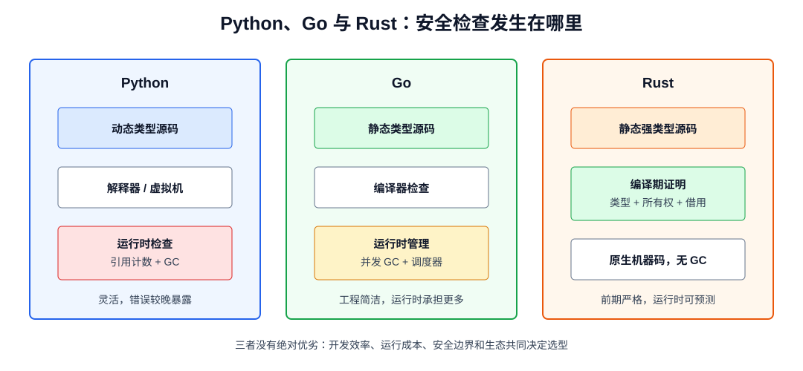
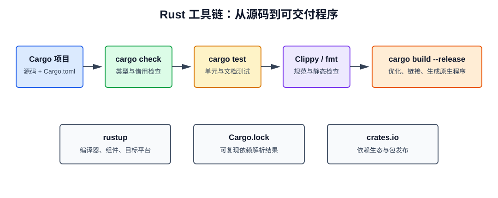
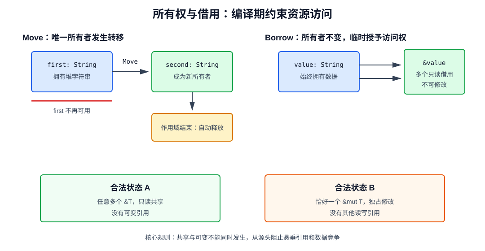
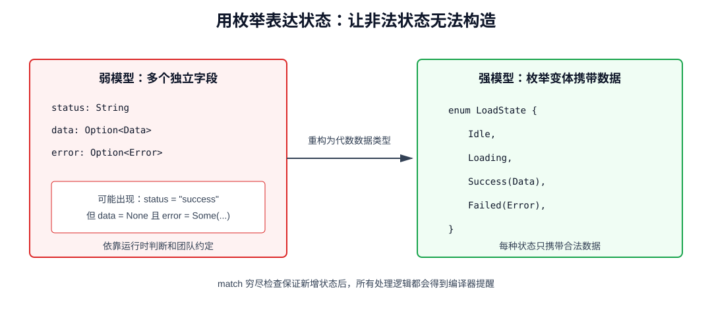
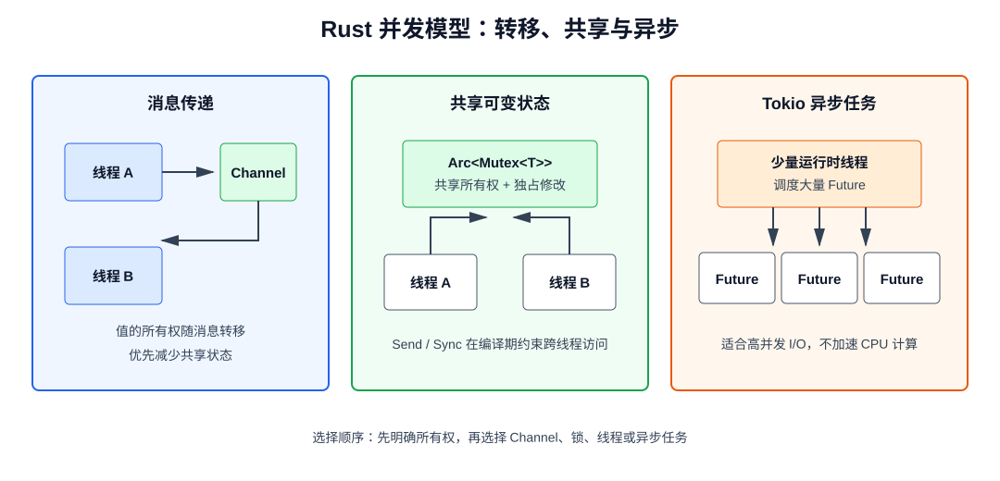

# Rust 入门手册：面向 Go 与 Python 开发者

> 本文面向已经掌握 Go 和 Python 的开发者，使用现代 Rust 2024 Edition。目标不是罗列语法，而是建立所有权、类型系统和零成本抽象的正确认知，并能独立创建、测试和维护一个 Rust 项目。

## 1. 为什么学习 Rust

Rust 是一门强调内存安全、并发安全和可预测性能的系统编程语言。它没有垃圾回收器，却能在编译期阻止悬垂引用、数据竞争和大量内存错误。

Rust 适合：

- 操作系统、数据库、浏览器和编译器等基础设施；
- 高性能网络服务、代理、网关和 CLI；
- WebAssembly；
- 嵌入式系统；
- Python/Go 的高性能扩展；
- 对延迟、内存占用和可靠性要求较高的服务。

Rust 不一定适合：

- 生命周期很短、性能要求低的一次性脚本；
- 团队尚未准备承担较高学习成本的普通 CRUD；
- 强依赖某个只有 Python/Go 生态成熟实现的领域；
- 需求变化极快、验证速度远重要于运行效率的原型。

### 1.1 与 Go、Python 的核心差异

| 维度 | Python | Go | Rust |
| --- | --- | --- | --- |
| 类型 | 动态类型 | 静态类型 | 静态类型，表达能力更强 |
| 内存管理 | 引用计数 + GC | 并发 GC | 所有权 + 借用，无 GC |
| 空值 | `None` | `nil` | `Option<T>` |
| 错误 | 异常 | `(value, error)` | `Result<T, E>` |
| 并发安全 | 主要靠运行时和约定 | Race Detector 辅助 | 大量错误在编译期拒绝 |
| 泛型抽象 | 鸭子类型 | 接口 + 泛型 | Trait + 泛型 + 关联类型 |
| 构建工具 | pip/uv/poetry | `go` 命令 | Cargo |
| 运行性能 | 通常较低 | 高 | 接近 C/C++ |
| 学习曲线 | 平缓 | 平缓 | 前期较陡 |

对 Go/Python 开发者最重要的转变是：

> Rust 不允许先制造一个可能无效的运行时状态，再靠约定避免使用；它倾向于让类型系统只允许构造合法状态。



---

## 2. 安装工具链

### 2.1 使用 rustup 安装

`rustup` 管理 Rust 编译器、标准库、目标平台和工具链版本；`cargo` 管理项目、依赖、构建、测试和发布。

Windows 推荐先安装 Visual Studio Build Tools，并勾选“使用 C++ 的桌面开发”，然后安装 Rust：

```powershell
winget install Rustlang.Rustup
```

也可以使用官方安装器：

```text
https://rustup.rs/
```

安装后重新打开终端：

```powershell
rustc --version
cargo --version
rustup --version
```

Linux/macOS：

```bash
curl --proto '=https' --tlsv1.2 -sSf https://sh.rustup.rs | sh
source "$HOME/.cargo/env"
```

### 2.2 常用组件

```powershell
# 更新稳定工具链
rustup update stable

# 设置默认工具链
rustup default stable

# 安装格式化和静态检查组件
rustup component add rustfmt clippy

# 查看已安装工具链
rustup show
```

编辑器推荐 VS Code + `rust-analyzer`。不要同时启用旧版 Rust 扩展，以免语言服务冲突。

### 2.3 第一个项目

```powershell
cargo new hello-rust
cd hello-rust
cargo run
```

目录结构：

```text
hello-rust/
├── Cargo.toml
└── src/
    └── main.rs
```

`src/main.rs`：

```rust
fn main() {
    println!("Hello, Rust!");
}
```

常用 Cargo 命令：

```powershell
cargo check          # 只检查，不生成最终二进制，开发时最快
cargo build          # Debug 构建
cargo build --release
cargo run
cargo test
cargo fmt
cargo clippy -- -D warnings
cargo doc --open
```



---

## 3. 变量、类型与表达式

### 3.1 变量默认不可变

```rust
fn main() {
    let count = 1;
    // count += 1; // 编译错误

    let mut total = 10;
    total += 5;

    println!("{count}, {total}");
}
```

Go 的变量默认可变，Python 变量名可随时重新绑定。Rust 要求共享和修改都显式表达，默认不可变可以降低状态复杂度。

### 3.2 类型推断与显式标注

```rust
let age: u8 = 18;
let score = 98.5_f64;
let retries = 3; // 根据上下文推断，通常为 i32
```

常见标量类型：

| 类型 | 含义 |
| --- | --- |
| `i8`～`i128`、`isize` | 有符号整数 |
| `u8`～`u128`、`usize` | 无符号整数 |
| `f32`、`f64` | 浮点数 |
| `bool` | 布尔值 |
| `char` | Unicode 标量值，4 字节 |

数组和索引通常使用 `usize`。整数类型不会隐式转换：

```rust
let a: u32 = 10;
let b: u64 = 20;
let sum = u64::from(a) + b;
```

### 3.3 Shadowing

同名 `let` 会创建新绑定，可以改变类型：

```rust
let input = " 42 ";
let input = input.trim();
let input: i32 = input.parse().expect("必须是整数");
```

这不是可变赋值，而是旧绑定被新绑定遮蔽。它适合表达数据清洗阶段。

### 3.4 元组与数组

```rust
let user = ("alice", 30, true);
let (name, age, active) = user;
println!("{name} {age} {active}");

let numbers = [1, 2, 3, 4];
let zeros = [0; 8];
println!("{}", numbers[0]);
```

数组长度是类型的一部分，`[i32; 4]` 与 `[i32; 8]` 是不同类型。动态长度集合使用 `Vec<T>`。

### 3.5 语句与表达式

Rust 中代码块可以产生值，末尾表达式没有分号：

```rust
let status = if age >= 18 {
    "adult"
} else {
    "minor"
};

let area = {
    let width = 10;
    let height = 20;
    width * height
};
```

加分号会把表达式变成返回 `()` 的语句。这是初学者常见错误。

---

## 4. 函数与控制流

### 4.1 函数

参数类型和返回类型必须显式声明：

```rust
fn add(left: i32, right: i32) -> i32 {
    left + right
}

fn log_message(message: &str) {
    println!("{message}");
}
```

`()` 是单元类型，类似 Go 中无返回值函数的语义，也类似 Python 的隐式 `None`，但它是普通类型。

### 4.2 条件与循环

```rust
for number in 0..5 {
    println!("{number}");
}

let mut remaining = 3;
while remaining > 0 {
    remaining -= 1;
}

let result = loop {
    if remaining == 0 {
        break "done";
    }
};
```

范围：

- `0..5`：包含 0，不包含 5；
- `0..=5`：包含 0 和 5。

### 4.3 `match`

`match` 必须穷尽所有可能：

```rust
fn describe(code: u16) -> &'static str {
    match code {
        200 => "ok",
        400..=499 => "client error",
        500..=599 => "server error",
        _ => "other",
    }
}
```

它比 Go 的 `switch` 更强，因为分支可解构数据且编译器检查穷尽性。

---

## 5. 所有权：Rust 的核心

Python 和 Go 通过运行时管理大部分内存。Rust 把对象何时释放、谁可以访问等约束放到编译期。

### 5.1 三条所有权规则

1. 每个值都有一个所有者；
2. 同一时刻只有一个所有者；
3. 所有者离开作用域时，值被自动释放。

```rust
{
    let message = String::from("hello");
    println!("{message}");
} // message 离开作用域，堆内存自动释放
```

这类似 C++ 的 RAII，但由借用检查器进一步保证引用安全。

### 5.2 Move

```rust
let first = String::from("hello");
let second = first;

println!("{second}");
// println!("{first}"); // 编译错误：first 已被移动
```

`String` 在栈上保存指针、长度和容量，字符数据在堆上。如果简单复制这三个字段，两个变量会在离开作用域时重复释放同一内存。Rust 选择转移所有权，并让旧绑定失效。

Go 赋值结构体通常复制值，Python 赋值通常复制引用；Rust 是否 Move 取决于类型是否实现 `Copy`。

### 5.3 Copy 与 Clone

整数、布尔、浮点和仅包含 `Copy` 字段的简单类型可按位复制：

```rust
let first = 10;
let second = first;
println!("{first} {second}");
```

堆数据需要显式深拷贝：

```rust
let first = String::from("hello");
let second = first.clone();
println!("{first} {second}");
```

不要为了绕过借用错误到处 `clone()`。克隆有运行时成本，也可能掩盖所有权设计问题。

### 5.4 函数会取得所有权

```rust
fn consume(value: String) {
    println!("{value}");
}

fn main() {
    let message = String::from("hello");
    consume(message);
    // message 已不可用
}
```

可以返回所有权，但多数只读函数应接受借用。



---

## 6. 借用与引用

引用允许函数临时访问值，而不取得所有权。

### 6.1 不可变借用

```rust
fn length(value: &str) -> usize {
    value.len()
}

fn main() {
    let message = String::from("hello");
    let size = length(&message);
    println!("{message}: {size}");
}
```

优先接受 `&str` 而不是 `&String`，这样函数同时支持 `String` 和字符串字面量。

### 6.2 可变借用

```rust
fn append_suffix(value: &mut String) {
    value.push_str("-done");
}

fn main() {
    let mut task = String::from("build");
    append_suffix(&mut task);
    println!("{task}");
}
```

同一时刻：

- 可以有任意多个不可变引用 `&T`；
- 或只能有一个可变引用 `&mut T`；
- 两者不能在重叠的使用范围内并存。

```rust
let mut value = String::from("hello");
let first = &value;
let second = &value;
println!("{first} {second}");

let third = &mut value;
third.push('!');
```

不可变引用最后一次使用后，其借用即可结束，不必等到大括号末尾。这称为非词法生命周期。

### 6.3 借用规则解决什么

它在编译期阻止：

- 迭代集合时修改导致迭代器失效；
- 一个线程写、另一个线程无同步读取；
- 返回局部变量引用；
- 多个位置同时修改共享对象。

借用检查器不是“阻止你写代码”，而是在要求你明确数据的所有者、共享方式和修改边界。

---

## 7. `String`、`str` 与切片

### 7.1 两种常见字符串

| 类型 | 所有权 | 存储 | 常见用途 |
| --- | --- | --- | --- |
| `String` | 拥有 | 堆，可增长 | 保存和修改文本 |
| `&str` | 借用 | 指向 UTF-8 字节序列 | 参数、切片、字面量 |

```rust
let owned = String::from("你好 Rust");
let borrowed: &str = &owned;
let literal: &'static str = "hello";
```

### 7.2 不能按整数索引字符串

```rust
let text = String::from("你好");
// let first = text[0]; // 编译错误
```

Rust 字符串是 UTF-8：

- 字节：`text.bytes()`；
- Unicode 标量值：`text.chars()`；
- 用户感知字符：需要 `unicode-segmentation` 等库。

```rust
for character in "你好".chars() {
    println!("{character}");
}
```

### 7.3 切片

```rust
fn first_word(text: &str) -> &str {
    match text.find(' ') {
        Some(index) => &text[..index],
        None => text,
    }
}
```

通用数组切片：

```rust
fn sum(values: &[i32]) -> i32 {
    values.iter().sum()
}
```

优先使用 `&[T]` 作为只读集合参数，而不是 `&Vec<T>`。

---

## 8. 结构体与方法

```rust
#[derive(Debug, Clone)]
struct User {
    id: u64,
    name: String,
    active: bool,
}

impl User {
    fn new(id: u64, name: impl Into<String>) -> Self {
        Self {
            id,
            name: name.into(),
            active: true,
        }
    }

    fn deactivate(&mut self) {
        self.active = false;
    }

    fn display_name(&self) -> &str {
        &self.name
    }
}

fn main() {
    let mut user = User::new(1, "Alice");
    user.deactivate();
    println!("{user:?}");
}
```

方法第一个参数：

- `self`：取得所有权；
- `&self`：只读借用；
- `&mut self`：可变借用。

Rust 没有类继承。数据放在结构体中，共同行为由 Trait 表达。

### 8.1 更新语法也可能 Move

```rust
let first = User::new(1, "Alice");
let second = User {
    id: 2,
    ..first
};
```

`first.name` 会移动给 `second`，因此 `first` 不能再作为完整值使用。Go 开发者尤其容易忽略这一点。

---

## 9. 枚举与模式匹配

Rust 枚举的每个变体可以携带不同数据，是代数数据类型。

```rust
enum Command {
    Start,
    Stop { force: bool },
    Write(String),
    Move { x: i32, y: i32 },
}

fn execute(command: Command) {
    match command {
        Command::Start => println!("start"),
        Command::Stop { force: true } => println!("force stop"),
        Command::Stop { force: false } => println!("graceful stop"),
        Command::Write(content) => println!("write: {content}"),
        Command::Move { x, y } => println!("move to {x}, {y}"),
    }
}
```

在 Python 中常用类层次或字符串标签，在 Go 中常用接口或 `type + payload` 结构体。Rust 枚举能让编译器检查每种状态是否都被处理。



### 9.1 `Option<T>` 代替空值

```rust
fn find_user(id: u64) -> Option<String> {
    if id == 1 {
        Some(String::from("Alice"))
    } else {
        None
    }
}

match find_user(1) {
    Some(name) => println!("found {name}"),
    None => println!("not found"),
}
```

常用组合方法：

```rust
let length = find_user(1)
    .map(|name| name.len())
    .unwrap_or(0);
```

不要在业务代码中无节制使用 `unwrap()`。它在 `None` 时会 Panic。

### 9.2 `if let` 与 `let else`

只关心一个模式：

```rust
if let Some(name) = find_user(1) {
    println!("{name}");
}
```

不匹配时提前退出：

```rust
fn print_name(id: u64) {
    let Some(name) = find_user(id) else {
        println!("not found");
        return;
    };
    println!("{name}");
}
```

---

## 10. 错误处理

Rust 将错误分为：

- 可恢复错误：`Result<T, E>`；
- 程序不变量被破坏：`panic!`。

### 10.1 `Result<T, E>`

```rust
use std::fs;
use std::io;

fn read_config(path: &str) -> Result<String, io::Error> {
    let content = fs::read_to_string(path)?;
    Ok(content)
}
```

`?` 的行为：

1. `Ok(value)`：取出 value 继续执行；
2. `Err(error)`：转换错误并提前返回。

它类似 Go 中反复出现的：

```go
value, err := operation()
if err != nil {
    return err
}
```

但 Rust 将成功值和错误绑定在同一个枚举中，无法忘记检查错误后仍误用无效结果。

### 10.2 组合多个错误

应用程序可使用 `anyhow` 提供上下文：

```powershell
cargo add anyhow
```

```rust
use anyhow::{Context, Result};
use std::fs;

fn load_config(path: &str) -> Result<String> {
    fs::read_to_string(path)
        .with_context(|| format!("读取配置文件失败：{path}"))
}
```

库应优先使用 `thiserror` 定义稳定错误类型：

```powershell
cargo add thiserror
```

```rust
use thiserror::Error;

#[derive(Debug, Error)]
enum ConfigError {
    #[error("配置文件不存在：{0}")]
    NotFound(String),

    #[error("读取配置失败")]
    Io(#[from] std::io::Error),
}
```

经验：

- 二进制应用：`anyhow` 方便聚合上下文；
- 公共库：`thiserror` 提供可匹配的错误 API；
- `panic!` 不用于普通输入错误和网络错误；
- 在边界添加上下文，不要重复打印并返回同一个错误。

---

## 11. 集合

### 11.1 `Vec<T>`

```rust
let mut numbers = vec![1, 2, 3];
numbers.push(4);

for number in &numbers {
    println!("{number}");
}

if let Some(first) = numbers.first() {
    println!("first: {first}");
}
```

`numbers[100]` 越界会 Panic；`numbers.get(100)` 返回 `Option<&T>`。

### 11.2 `HashMap<K, V>`

```rust
use std::collections::HashMap;

let mut scores = HashMap::new();
scores.insert(String::from("Alice"), 90);
scores.insert(String::from("Bob"), 80);

scores
    .entry(String::from("Alice"))
    .and_modify(|score| *score += 5)
    .or_insert(60);
```

把拥有所有权的 `String` 插入 Map 会发生 Move：

```rust
let name = String::from("Alice");
scores.insert(name, 100);
// name 已经移动
```

### 11.3 选择集合

| 需求 | 类型 |
| --- | --- |
| 动态连续数组 | `Vec<T>` |
| 双端队列 | `VecDeque<T>` |
| 键值映射 | `HashMap<K, V>` |
| 有序映射 | `BTreeMap<K, V>` |
| 唯一集合 | `HashSet<T>` |
| 有序唯一集合 | `BTreeSet<T>` |

---

## 12. 泛型与 Trait

Trait 类似 Go 接口，但支持默认实现、关联类型、泛型约束和静态分发。

```rust
trait Summary {
    fn summary(&self) -> String;

    fn category(&self) -> &'static str {
        "general"
    }
}

struct Article {
    title: String,
}

impl Summary for Article {
    fn summary(&self) -> String {
        self.title.clone()
    }
}
```

### 12.1 泛型约束

```rust
fn print_summary(item: &impl Summary) {
    println!("{}", item.summary());
}

fn print_two<T>(left: &T, right: &T)
where
    T: Summary,
{
    println!("{}", left.summary());
    println!("{}", right.summary());
}
```

`impl Trait` 和泛型通常使用静态分发，编译器会为具体类型生成代码，没有虚调用开销。

### 12.2 Trait Object

运行时需要存放不同具体类型时：

```rust
fn print_all(items: &[Box<dyn Summary>]) {
    for item in items {
        println!("{}", item.summary());
    }
}
```

`dyn Trait` 使用动态分发，类似 Go 接口值，但 Rust 需要显式写 `dyn`。

### 12.3 Derive

```rust
#[derive(Debug, Clone, PartialEq, Eq, Hash)]
struct UserId(u64);
```

Derive 宏可自动实现常见 Trait。只有语义正确时才派生，例如包含浮点数的类型通常不能直接实现 `Eq`。

---

## 13. 生命周期

生命周期描述引用之间的有效范围关系，不会延长对象寿命，也不是运行时计时器。

### 13.1 为什么需要标注

```rust
fn longest<'a>(left: &'a str, right: &'a str) -> &'a str {
    if left.len() >= right.len() {
        left
    } else {
        right
    }
}
```

`'a` 表示返回引用不会比两个输入引用中较短的那个活得更久。

错误示例：

```rust
// fn invalid() -> &str {
//     let value = String::from("temporary");
//     &value
// } // value 被释放，引用将悬垂
```

可行方案是返回所有权：

```rust
fn valid() -> String {
    String::from("owned")
}
```

### 13.2 生命周期省略

多数常见函数无需手写生命周期：

```rust
fn first_word(text: &str) -> &str {
    text.split_whitespace().next().unwrap_or("")
}
```

先理解“返回值借用了谁”，编译器要求时再添加标注，不要一开始给所有引用都写生命周期。

### 13.3 结构体持有引用

```rust
struct Excerpt<'a> {
    content: &'a str,
}
```

这表示 `Excerpt` 不能比 `content` 指向的数据活得更久。初学阶段若生命周期关系复杂，可以考虑让结构体拥有 `String`，用少量复制换取简单边界。

---

## 14. 迭代器与闭包

### 14.1 三种迭代方式

| 调用 | 元素类型 | 所有权 |
| --- | --- | --- |
| `iter()` | `&T` | 只读借用 |
| `iter_mut()` | `&mut T` | 可变借用 |
| `into_iter()` | `T` | 消费集合 |

```rust
let numbers = vec![1, 2, 3, 4, 5];

let squares: Vec<i32> = numbers
    .iter()
    .filter(|number| **number % 2 == 1)
    .map(|number| number * number)
    .collect();

println!("{squares:?}");
println!("{numbers:?}"); // iter() 未消费 numbers
```

Rust 迭代器是惰性的，只有 `collect`、`sum`、`for_each` 等消费者才驱动计算。

### 14.2 闭包捕获

```rust
let prefix = String::from("user");
let format_name = |name: &str| format!("{prefix}:{name}");
println!("{}", format_name("alice"));
```

闭包会根据使用方式自动实现：

- `Fn`：只读借用捕获值；
- `FnMut`：可变借用；
- `FnOnce`：消费捕获值。

`move` 强制把捕获值移入闭包，在线程和异步任务中很常见。

---

## 15. 模块、Crate 与工作空间

术语：

- Package：包含 `Cargo.toml` 的发布和构建单元；
- Crate：一个库或二进制编译单元；
- Module：Crate 内的命名空间；
- Workspace：管理多个 Package 的仓库。

结构示例：

```text
src/
├── main.rs
├── config.rs
└── service/
    ├── mod.rs
    └── user.rs
```

`src/main.rs`：

```rust
mod config;
mod service;

use service::user::UserService;

fn main() {
    let service = UserService::new();
    println!("{}", service.count());
}
```

`src/service/mod.rs`：

```rust
pub mod user;
```

`src/service/user.rs`：

```rust
pub struct UserService {
    count: usize,
}

impl UserService {
    pub fn new() -> Self {
        Self { count: 0 }
    }

    pub fn count(&self) -> usize {
        self.count
    }
}
```

Rust 默认私有，`pub` 必须显式开放。不要为了消除可见性错误把所有内容都改成 `pub`。

### 15.1 添加依赖

```powershell
cargo add serde --features derive
cargo add serde_json
cargo add tokio --features full
cargo remove serde_json
cargo tree
```

`Cargo.lock`：

- 二进制应用应提交；
- 库项目通常也可以提交用于 CI 可复现，但发布依赖仍由版本范围决定。

---

## 16. 智能指针与内部可变性

### 16.1 常见类型

| 类型 | 用途 | 线程安全 |
| --- | --- | --- |
| `Box<T>` | 堆分配、递归类型、Trait Object | 取决于 `T` |
| `Rc<T>` | 单线程共享所有权 | 否 |
| `Arc<T>` | 多线程原子引用计数 | 是 |
| `RefCell<T>` | 单线程运行时借用检查 | 否 |
| `Mutex<T>` | 互斥可变访问 | 是 |
| `RwLock<T>` | 多读单写 | 是 |
| `Weak<T>` | 不增加强引用，打破循环 | 对应 Rc/Arc |

### 16.2 `Rc<RefCell<T>>`

```rust
use std::cell::RefCell;
use std::rc::Rc;

let shared = Rc::new(RefCell::new(vec![1, 2, 3]));

let first = Rc::clone(&shared);
let second = Rc::clone(&shared);

first.borrow_mut().push(4);
println!("{:?}", second.borrow());
```

它把借用检查从编译期移动到运行时。违反规则会 Panic，因此不是逃避所有权设计的默认工具。

### 16.3 `Arc<Mutex<T>>`

```rust
use std::sync::{Arc, Mutex};
use std::thread;

let counter = Arc::new(Mutex::new(0_u64));
let mut handles = Vec::new();

for _ in 0..4 {
    let counter = Arc::clone(&counter);
    handles.push(thread::spawn(move || {
        let mut value = counter.lock().expect("锁已中毒");
        *value += 1;
    }));
}

for handle in handles {
    handle.join().expect("线程执行失败");
}

println!("{}", *counter.lock().expect("锁已中毒"));
```

与 Go 一样，不应通过共享内存组织所有并发；消息传递常能形成更清晰的所有权边界。

---

## 17. 并发与异步

Rust 的 `Send` 和 `Sync` Trait让编译器阻止不安全的跨线程共享：

- `Send`：值可以安全转移到另一个线程；
- `Sync`：`&T` 可以安全地在线程间共享。

### 17.1 线程与 Channel

```rust
use std::sync::mpsc;
use std::thread;

let (sender, receiver) = mpsc::channel();

thread::spawn(move || {
    sender.send(String::from("done")).expect("接收端已关闭");
});

let message = receiver.recv().expect("发送端已关闭");
println!("{message}");
```

发送 `String` 后，所有权转移到接收方，发送方不能继续使用它。这从类型层面减少了共享状态竞争。

### 17.2 Tokio 异步运行时

Rust 标准库定义 `Future`，但不自带完整异步运行时。服务端常用 Tokio：

```powershell
cargo add tokio --features full
```

```rust
use std::time::Duration;
use tokio::time::sleep;

async fn fetch_data(id: u64) -> String {
    sleep(Duration::from_millis(100)).await;
    format!("data-{id}")
}

#[tokio::main]
async fn main() {
    let first = fetch_data(1);
    let second = fetch_data(2);
    let (first, second) = tokio::join!(first, second);
    println!("{first}, {second}");
}
```

与 Python `asyncio` 类似，调用 `async fn` 只创建 Future，必须 `.await` 或交给运行时执行。与 Go 不同，Rust 不会隐式为每个异步函数创建 goroutine。

### 17.3 不要在异步任务中阻塞

错误：

```rust
async fn bad() {
    std::thread::sleep(std::time::Duration::from_secs(1));
}
```

正确：

```rust
async fn good() {
    tokio::time::sleep(std::time::Duration::from_secs(1)).await;
}
```

CPU 密集或阻塞库调用使用 `tokio::task::spawn_blocking`，并设置并发与超时。



---

## 18. 实战：构建待办事项 CLI

这个项目综合使用结构体、枚举、`Result`、Serde、文件 I/O、迭代器和测试。

### 18.1 创建项目

```powershell
cargo new todo-cli
cd todo-cli
cargo add serde --features derive
cargo add serde_json
cargo add anyhow
```

### 18.2 数据模型

`src/main.rs`：

```rust
use anyhow::{Context, Result};
use serde::{Deserialize, Serialize};
use std::env;
use std::fs;
use std::path::Path;

const DATA_FILE: &str = "todos.json";

#[derive(Debug, Clone, Serialize, Deserialize, PartialEq, Eq)]
struct Todo {
    id: u64,
    title: String,
    completed: bool,
}

#[derive(Debug, Default, Serialize, Deserialize)]
struct TodoList {
    items: Vec<Todo>,
}

impl TodoList {
    fn load(path: impl AsRef<Path>) -> Result<Self> {
        let path = path.as_ref();
        if !path.exists() {
            return Ok(Self::default());
        }

        let content = fs::read_to_string(path)
            .with_context(|| format!("读取 {} 失败", path.display()))?;
        serde_json::from_str(&content)
            .with_context(|| format!("解析 {} 失败", path.display()))
    }

    fn save(&self, path: impl AsRef<Path>) -> Result<()> {
        let content = serde_json::to_string_pretty(self)?;
        fs::write(path.as_ref(), content)
            .with_context(|| format!("写入 {} 失败", path.as_ref().display()))
    }

    fn add(&mut self, title: impl Into<String>) -> &Todo {
        let next_id = self.items.iter().map(|item| item.id).max().unwrap_or(0) + 1;
        self.items.push(Todo {
            id: next_id,
            title: title.into(),
            completed: false,
        });
        self.items.last().expect("刚刚插入的元素必然存在")
    }

    fn complete(&mut self, id: u64) -> bool {
        let Some(todo) = self.items.iter_mut().find(|item| item.id == id) else {
            return false;
        };
        todo.completed = true;
        true
    }

    fn list(&self) -> impl Iterator<Item = &Todo> {
        self.items.iter()
    }
}
```

### 18.3 命令解析

继续添加：

```rust
enum Command {
    Add(String),
    Complete(u64),
    List,
}

fn parse_command(args: &[String]) -> Result<Command> {
    match args {
        [command, title @ ..] if command == "add" && !title.is_empty() => {
            Ok(Command::Add(title.join(" ")))
        }
        [command, id] if command == "done" => {
            Ok(Command::Complete(id.parse().context("ID 必须是整数")?))
        }
        [command] if command == "list" => Ok(Command::List),
        _ => anyhow::bail!("用法：todo-cli add <内容> | done <ID> | list"),
    }
}

fn run() -> Result<()> {
    let args: Vec<String> = env::args().skip(1).collect();
    let command = parse_command(&args)?;
    let mut todos = TodoList::load(DATA_FILE)?;

    match command {
        Command::Add(title) => {
            let todo = todos.add(title);
            println!("已添加 #{}：{}", todo.id, todo.title);
            todos.save(DATA_FILE)?;
        }
        Command::Complete(id) => {
            if !todos.complete(id) {
                anyhow::bail!("不存在 ID 为 {id} 的任务");
            }
            todos.save(DATA_FILE)?;
            println!("已完成 #{id}");
        }
        Command::List => {
            for todo in todos.list() {
                let mark = if todo.completed { "x" } else { " " };
                println!("[{mark}] #{} {}", todo.id, todo.title);
            }
        }
    }
    Ok(())
}

fn main() {
    if let Err(error) = run() {
        eprintln!("错误：{error:#}");
        std::process::exit(1);
    }
}
```

运行：

```powershell
cargo run -- add 学习所有权
cargo run -- add 编写单元测试
cargo run -- list
cargo run -- done 1
cargo run -- list
```

### 18.4 单元测试

继续在同一文件末尾添加：

```rust
#[cfg(test)]
mod tests {
    use super::*;

    #[test]
    fn add_assigns_incrementing_ids() {
        let mut todos = TodoList::default();

        assert_eq!(todos.add("first").id, 1);
        assert_eq!(todos.add("second").id, 2);
    }

    #[test]
    fn complete_updates_existing_item() {
        let mut todos = TodoList::default();
        let id = todos.add("learn rust").id;

        assert!(todos.complete(id));
        assert!(todos.items[0].completed);
        assert!(!todos.complete(999));
    }

    #[test]
    fn parse_rejects_invalid_id() {
        let args = vec![String::from("done"), String::from("abc")];
        assert!(parse_command(&args).is_err());
    }
}
```

```powershell
cargo test
cargo fmt --check
cargo clippy --all-targets --all-features -- -D warnings
```

---

## 19. 测试、文档与基准

### 19.1 测试类型

单元测试通常与源码放在同一文件的 `tests` 模块中。集成测试放在项目根目录 `tests/`：

```text
tests/
└── cli.rs
```

文档测试：

```rust
/// 返回两个整数之和。
///
/// # Examples
///
/// ```
/// assert_eq!(my_crate::add(2, 3), 5);
/// ```
pub fn add(left: i32, right: i32) -> i32 {
    left + right
}
```

`cargo test` 会同时运行普通测试和文档测试。

### 19.2 Property Testing

复杂边界可使用 `proptest`：

```powershell
cargo add --dev proptest
```

它生成大量输入验证不变量，类似 Python 的 Hypothesis。

### 19.3 Benchmark

稳定工具链通常使用 Criterion：

```powershell
cargo add --dev criterion
```

性能结论必须在 `--release` 优化构建下测量。Debug 构建的 Rust 性能可能非常差，不代表生产表现。

---

## 20. 格式化、Lint 与 CI

本地提交前：

```powershell
cargo fmt --check
cargo clippy --workspace --all-targets --all-features -- -D warnings
cargo test --workspace --all-features
cargo build --release
```

建议在 `Cargo.toml` 设置最低 Rust 版本和 Edition：

```toml
[package]
name = "example"
version = "0.1.0"
edition = "2024"
rust-version = "1.85"
```

`rust-version` 应设置为项目实际测试的最低版本，不应盲目追随本机最新版。

### 20.1 常用工具

```powershell
cargo install cargo-audit       # 检查已知漏洞
cargo install cargo-deny        # 许可证、来源和依赖策略
cargo install cargo-bloat       # 分析二进制体积
cargo install cargo-expand      # 展开宏
```

第三方 Cargo 工具应在团队中锁定版本，避免 CI 随最新版变化。

---

## 21. `unsafe` 的正确认识

`unsafe` 不会关闭借用检查器，只允许执行少数额外操作：

- 解引用裸指针；
- 调用不安全函数；
- 访问或修改可变静态变量；
- 实现不安全 Trait；
- 访问 Union 字段。

```rust
unsafe fn read_pointer(pointer: *const i32) -> i32 {
    // SAFETY: 调用者必须保证 pointer 非空、对齐且指向有效 i32。
    unsafe { *pointer }
}
```

原则：

1. 将 `unsafe` 限制在小模块；
2. 用安全 API 包装；
3. 为每个不安全块写清不变量；
4. 使用 Miri、Sanitizer 和测试验证；
5. “通过编译”不代表 `unsafe` 正确。

绝大多数业务 Rust 不需要手写 `unsafe`。

---

## 22. Go/Python 开发者常见误区

### 22.1 把 `clone()` 当作解决借用问题的万能方法

先回答谁应该拥有数据、函数是否只需借用，再决定是否克隆。

### 22.2 参数都写成 `String` 和 `Vec<T>`

只读参数优先写成：

```rust
fn process_text(text: &str) {}
fn process_items(items: &[i32]) {}
```

只有需要保存或消费数据时才取得所有权。

### 22.3 期待 GC 帮助处理引用环

`Rc`/`Arc` 是引用计数，强引用环不会自动回收。父子双向关系使用 `Weak` 打破环。

### 22.4 像 Python 一样用异常控制流程

Rust 没有普通异常机制。预期内失败用 `Result`/`Option`，Panic 表示不可继续的不变量破坏。

### 22.5 像 Go 一样假设零值总是可用

Rust 不自动为任意变量提供零值，声明后必须初始化才能读取。合理默认值通过 `Default` 显式定义。

### 22.6 将 `async` 等同于更快

异步主要提高 I/O 并发和资源利用率，不会让 CPU 计算更快。CPU 密集任务需要并行计算、算法优化或专用线程池。

### 22.7 与借用检查器对抗

频繁出现复杂生命周期错误通常提示：

- 一个结构体承担了过多职责；
- 共享可变状态过多；
- 数据所有权边界不清；
- 自引用设计不合适；
- 应通过 ID、索引或消息传递解耦。

---

## 23. 阅读编译错误的方法

Rust 错误信息通常包含：

1. 错误代码，如 `E0382`；
2. 值在何处移动或借用；
3. 冲突发生位置；
4. 可能的修改建议。

建议流程：

```powershell
cargo check
rustc --explain E0382
```

面对所有权错误时依次问：

1. 这个值的所有者是谁？
2. 当前操作需要拥有、只读借用还是可变借用？
3. 借用持续到哪里？
4. 是否同时存在写者和读者？
5. 返回值是否引用了即将释放的数据？
6. API 是否应该接受 `&str`/`&[T]` 而不是拥有类型？

一次只修复最前面的错误，后续错误可能是级联结果。

---

## 24. 学习路线

### 第一阶段：语言与所有权

1. Cargo、变量、函数、控制流；
2. `String`、`Vec`、结构体；
3. Move、Copy、Borrow；
4. 枚举、`Option`、`Result`、`match`；
5. 完成一个文件型 CLI。

验收标准：能解释每个函数参数为什么是 `T`、`&T` 或 `&mut T`。

### 第二阶段：抽象与工程化

1. 泛型、Trait、Trait Object；
2. 生命周期；
3. 迭代器和闭包；
4. 模块、Workspace、Serde；
5. 测试、Clippy、文档和错误设计。

验收标准：能设计一个无 `unwrap()` 滥用、错误边界清晰的库。

### 第三阶段：并发与服务端

1. `Send`、`Sync`、线程和 Channel；
2. `Arc<Mutex<T>>`；
3. Future、Tokio、异步取消；
4. Axum、SQLx、Tracing；
5. 性能剖析和生产部署。

验收标准：能解释何时用任务、线程、消息传递或共享锁。

### 推荐练习

1. 带持久化的 Todo CLI；
2. 多线程文件哈希工具；
3. 基于 Axum 的 REST API；
4. 使用 PyO3 编写 Python 扩展；
5. 实现一个简化线程池；
6. 为 Go 服务编写一个 Rust 性能敏感组件。

---

## 25. 高频问题

### Rust 完全没有 GC 吗？

语言运行时没有追踪式 GC。栈值按作用域释放，堆值由所有权和 RAII 管理；`Rc`/`Arc` 使用引用计数。

### 所有权是否意味着不能共享数据？

可以。不可变借用、`Rc`、`Arc`、Channel、锁都能共享，但共享方式必须显式且满足安全约束。

### Rust 引用和 C 指针一样吗？

不一样。安全引用必须非空、对齐、指向有效值并遵守别名规则。裸指针 `*const T`/`*mut T` 才更接近 C 指针。

### 为什么 `String` 不能实现 `Copy`？

它拥有堆内存。按位复制会产生两个所有者并导致重复释放，深拷贝又不应是隐式成本，因此只能显式 `clone()`。

### `&str` 的数据一定在栈上吗？

不是。`&str` 只是一个字符串切片，可指向静态区、堆中的 `String` 或其他 UTF-8 存储区域。

### Rust 是否比 Go 更适合所有后端服务？

不是。Rust 在性能、资源控制和内存安全上有优势；Go 在团队上手、编译速度和普通网络服务开发效率上通常更有优势。应根据瓶颈、团队和生态选型。

---

## 26. 速查表

| 需求 | Rust |
| --- | --- |
| 创建项目 | `cargo new app` |
| 快速检查 | `cargo check` |
| 格式化 | `cargo fmt` |
| 静态检查 | `cargo clippy` |
| 添加依赖 | `cargo add crate_name` |
| 可变变量 | `let mut value` |
| 可空值 | `Option<T>` |
| 可恢复错误 | `Result<T, E>` |
| 提前传播错误 | `?` |
| 动态数组 | `Vec<T>` |
| 键值映射 | `HashMap<K, V>` |
| 字符串所有权 | `String` |
| 字符串借用 | `&str` |
| 只读引用 | `&T` |
| 可变引用 | `&mut T` |
| 堆分配 | `Box<T>` |
| 多线程共享 | `Arc<T>` |
| 互斥修改 | `Mutex<T>` |
| 接口抽象 | `trait` |
| 模式匹配 | `match` |
| 异步运行时 | Tokio |

---

## 27. 总结

Rust 的难点不在语法，而在重新理解资源和状态：

- 所有权确定谁负责释放；
- 借用确定谁能临时访问；
- 生命周期证明引用始终有效；
- `Option` 和 `Result` 把缺失与错误放入类型；
- Trait 提供零成本抽象；
- `Send` 和 `Sync` 将大量并发错误提前到编译期。

对于有 Go 和 Python 基础的开发者，最有效的学习方式不是记住所有生命周期语法，而是反复编写小项目，并在每个 API 边界主动判断“拥有、只读借用还是可变借用”。当这个判断变成习惯后，借用检查器会从阻力变成设计反馈工具。

## 28. 延伸资料

- [The Rust Programming Language](https://doc.rust-lang.org/book/)
- [Rust By Example](https://doc.rust-lang.org/rust-by-example/)
- [Standard Library](https://doc.rust-lang.org/std/)
- [The Cargo Book](https://doc.rust-lang.org/cargo/)
- [Rust Reference](https://doc.rust-lang.org/reference/)
- [Rustonomicon](https://doc.rust-lang.org/nomicon/)
- [Async Book](https://rust-lang.github.io/async-book/)
- [Rustlings](https://github.com/rust-lang/rustlings)
