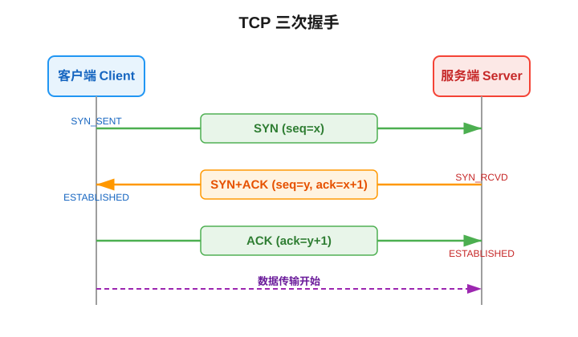
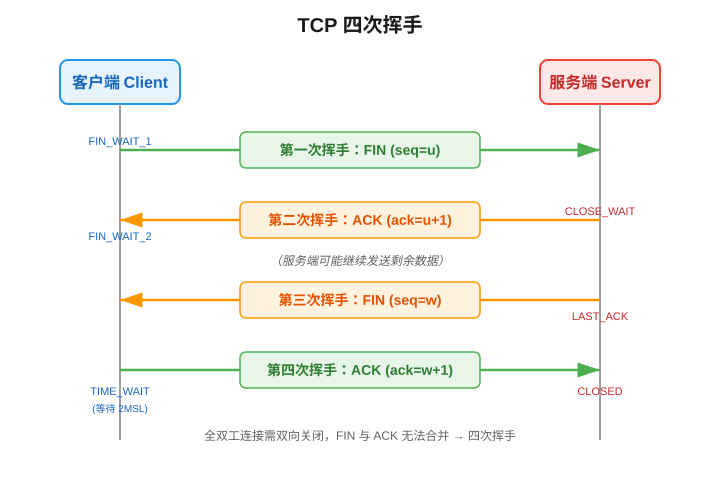
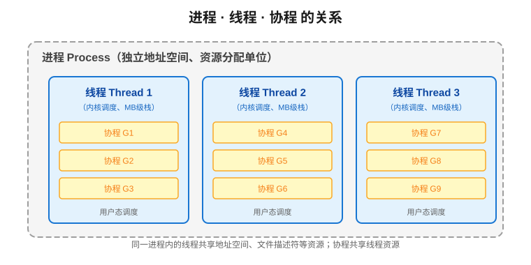
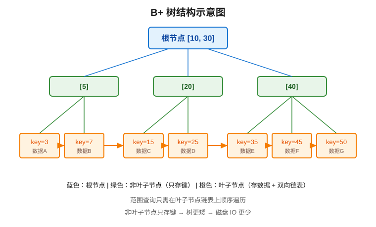

# 计算机科学与编程十万个为什么

> 本文系统整理计算机领域各方向的常见问题，从问题产生的由来、具体细节、底层执行原理，到解决方式与后续发展，由浅至深，力求吃透底层原理。
>
> 阅读建议：先浏览下方汇总表格建立全局认知，再按分类深入阅读每个问题的完整解析。

---

## 汇总：全问题索引

### 一、计算机网络

| 分类 | 问题 |
|------|------|
| TCP | 为什么 TCP 需要三次握手而不是两次或四次？ |
| TCP | 为什么 TCP 断开连接需要四次挥手？ |
| TCP | 为什么 TIME_WAIT 状态需要等待 2MSL？ |
| TCP | 什么是粘包/拆包？如何解决？ |
| TCP | TCP 滑动窗口是如何工作的？ |
| TCP | TCP 拥塞控制的四个阶段是什么？ |
| TCP | 为什么 TCP 是可靠的而 UDP 不是？ |
| UDP | UDP 如何实现可靠传输（如 KCP、QUIC）？ |
| HTTP | GET 和 POST 的本质区别是什么？ |
| HTTP | HTTP 长连接和短连接的区别？ |
| HTTP | HTTP 缓存机制（强缓存与协商缓存）是如何工作的？ |
| HTTP | 什么是幂等性？哪些 HTTP 方法是幂等的？ |
| HTTPS | HTTPS 的握手过程是怎样的？ |
| HTTPS | 为什么 HTTPS 同时使用对称加密和非对称加密？ |
| HTTPS | 数字证书是如何验证身份的？ |
| DNS | DNS 解析的完整过程是怎样的？ |
| DNS | 为什么 DNS 同时使用 UDP 和 TCP？ |
| 网络安全 | 什么是跨域？如何解决 CORS？ |
| 网络安全 | CSRF 与 XSS 的区别与防御 |
| 网络安全 | SQL 注入的原理与防御 |

### 二、操作系统

| 分类 | 问题 |
|------|------|
| 进程线程 | 进程、线程、协程的区别是什么？ |
| 进程线程 | 进程间通信（IPC）有哪些方式？ |
| 进程线程 | 什么是死锁？如何预防和避免？ |
| 内存管理 | 什么是虚拟内存？为什么需要它？ |
| 内存管理 | 页面置换算法有哪些？ |
| 内存管理 | 什么是内存碎片？如何解决？ |
| 调度 | 进程调度算法有哪些？ |
| 系统调用 | 用户态和内核态的区别？为什么需要切换？ |
| IO | 什么是零拷贝？ |
| IO | IO 多路复用（select/poll/epoll）的区别？ |
| 文件系统 | inode 是什么？文件是如何存储的？ |

### 三、数据库

| 分类 | 问题 |
|------|------|
| 索引 | 为什么数据库索引用 B+ 树而不是 B 树或红黑树？ |
| 索引 | 什么是聚簇索引和非聚簇索引？ |
| 索引 | 什么是覆盖索引、最左前缀原则？ |
| 事务 | 事务的 ACID 特性是什么？ |
| 事务 | 数据库的四种隔离级别是什么？ |
| 事务 | MVCC（多版本并发控制）是如何实现的？ |
| 锁 | MySQL 的行锁、表锁、间隙锁是什么？ |
| 锁 | 什么是幻读？如何解决？ |
| Redis | Redis 为什么这么快？ |
| Redis | Redis 的五种基本数据结构底层实现 |
| Redis | Redis 持久化 RDB 和 AOF 的区别？ |
| Redis | 缓存穿透、缓存击穿、缓存雪崩是什么？ |
| 分布式 | 分布式事务的解决方案（2PC/3PC/TCC/Saga） |

### 四、数据结构与算法

| 分类 | 问题 |
|------|------|
| 线性结构 | 数组和链表的区别？ |
| 哈希 | 哈希冲突如何解决？为什么用链地址法？ |
| 树 | 红黑树的性质和应用场景 |
| 树 | B 树和 B+ 树的区别 |
| 排序 | 快速排序和归并排序的优劣对比 |
| 跳表 | 跳表的原理与 Redis 为什么用跳表 |

### 五、编程语言与编译原理

| 分类 | 问题 |
|------|------|
| 编译 | 编译型语言和解释型语言的区别？ |
| 编译 | JIT 编译是什么？为什么比纯解释快？ |
| 内存 | 垃圾回收（GC）的算法有哪些？ |
| 内存 | 什么是分代收集？ |
| 并发 | 什么是协程？与线程的区别？ |
| 语言特性 | 什么是闭包？ |
| 语言特性 | 值传递和引用传递的区别？ |

### 六、分布式系统

| 分类 | 问题 |
|------|------|
| 理论 | CAP 定理是什么？为什么不能同时满足？ |
| 一致性 | 一致性哈希的原理是什么？ |
| 一致性 | Raft 算法的核心流程 |
| 锁 | 分布式锁的实现方案（Redis/Zookeeper） |
| 消息队列 | 消息队列如何保证消息不丢失？ |
| 消息队列 | 如何保证消息的顺序消费？ |

---

# 一、计算机网络

## 网络协议

### TCP

#### 为什么 TCP 需要三次握手而不是两次或四次？

**上下文知识**

TCP（Transmission Control Protocol，传输控制协议）是一种面向连接的、可靠的、基于字节流的传输层协议。在通信双方开始传输数据之前，必须先建立连接，这个过程就是"握手"。握手的核心目标是：双方确认彼此的发送能力和接收能力都正常，并协商初始序列号（ISN, Initial Sequence Number）。

**问题的由来**

为什么需要握手？因为 IP 网络层是不可靠的（只管尽力转发，不保证到达），而 TCP 要在不可靠的网络之上提供可靠的字节流服务。为了实现可靠传输，TCP 必须在通信前确认双方都"在线"且收发能力正常，否则可能出现"对端已关闭但本端还在发数据"的资源浪费问题。

**两次握手为什么不行**

假设只有两次握手（客户端发 SYN，服务端回 SYN+ACK 就算建立连接），会出现以下问题：

考虑一种经典场景：客户端发送的第一个 SYN 数据包因为网络拥堵迟迟未到，客户端超时重传了第二个 SYN。第二个 SYN 正常到达并完成握手、传输数据、释放连接。此时第一个延迟的 SYN 才姗姗来迟到达服务端。

在两次握手下，服务端收到这个迟到的 SYN 会认为是新的连接请求，立即分配资源、建立连接，并向客户端回 SYN+ACK。但客户端此时并不想建立连接，会忽略这个 ACK，导致服务端的连接一直挂着，资源被白白浪费——这就是**历史失效连接请求导致的资源浪费**。

三次握手时，服务端收到迟到的 SYN 后回 SYN+ACK，但客户端不会回第三次 ACK，服务端收不到 ACK 就不会真正建立连接，从而避免了资源浪费。

**四次握手为什么没必要**

三次握手已经能确认双方的收发能力：

- 第一次：服务端收到客户端的 SYN → 服务端确认客户端的发送能力、自己的接收能力正常。
- 第二次：客户端收到服务端的 SYN+ACK → 客户端确认服务端的发送、接收能力，自己的发送、接收能力都正常。
- 第三次：服务端收到客户端的 ACK → 服务端确认自己的发送能力、客户端的接收能力正常。

四次握手在功能上是冗余的。服务端的 SYN 和 ACK 可以合并在一个报文里发送，因此三次足够。

**底层执行原理**

```
客户端（Client）                          服务端（Server）
    |                                         |
    | ----- SYN (seq=x) --------------------> |  第一次握手：客户端请求连接
    | 状态：SYN_SENT                          |
    |                                         |
    | <---- SYN+ACK (seq=y, ack=x+1) -------- |  第二次握手：服务端确认并请求
    | 状态：ESTABLISHED                       | 状态：SYN_RCVD
    |                                         |
    | ----- ACK (ack=y+1) ------------------> |  第三次握手：客户端确认
    |                                         | 状态：ESTABLISHED
    |                                         |
    | <========= 数据传输开始 =========>     |
```



关键点：
- 双方各自维护一个**序列号（sequence number）**，用于标识字节流中的位置。
- 初始序列号 ISN 不是固定的 0，而是随时间动态生成，防止旧报文被误认为新连接的有效数据。
- 第三次握手的 ACK 报文可以携带数据，这也是为什么三次握手不能省略——如果省掉，客户端无法确认服务端的接收能力。

**解决方式与设计原因**

三次握手是**最少次数**能够满足"双向确认收发能力 + 协商序列号 + 防止旧连接"的方案。这是 TCP 可靠性的基石。

**后续发展**

随着网络环境变化，TCP 也在演进：
- **TCP Fast Open (TFO)**：允许在握手阶段就携带数据，减少一次 RTT。
- **TCP 快速打开与 SYN Cookie**：应对 SYN Flood 攻击，服务端不必为每个 SYN 分配资源。
- **QUIC**：基于 UDP 的新一代传输协议，将握手和加密合并，0-RTT 建立连接。

---

#### 为什么 TCP 断开连接需要四次挥手？

**上下文知识**

TCP 是全双工（full-duplex）协议，通信双方都可以独立地发送和接收数据。因此，关闭连接时，每个方向都需要单独关闭——这就是四次挥手（FIN, ACK, FIN, ACK）的根本原因。

**问题的由来**

建立连接时三次握手是因为服务端的 SYN 和 ACK 可以合并。但断开时，服务端收到客户端的 FIN 后，可能还有数据没发完，不能立即回 FIN，所以 FIN 和 ACK 必须分开发送，就多了一次。

**具体原因**

- 客户端发送 FIN 表示"我没有数据要发了"，但客户端可能还要接收服务端的数据。
- 服务端收到 FIN 后先回 ACK，表示"知道了你不发了"，但服务端自己可能还有数据要发。
- 服务端数据发完后，再发 FIN 表示"我也发完了"。
- 客户端回 ACK，连接彻底关闭。

如果合并（三次挥手），意味着服务端收到 FIN 后必须立即停止发送，这在全双工场景下不现实。

**底层执行原理**

```
客户端（Client）                          服务端（Server）
    |                                         |
    | ----- FIN (seq=u) --------------------> |  第一次挥手：客户端请求关闭
    | 状态：FIN_WAIT_1                        |
    |                                         |
    | <---- ACK (ack=u+1) ------------------- |  第二次挥手：服务端确认
    | 状态：FIN_WAIT_2                        | 状态：CLOSE_WAIT
    |                                         |
    |         （服务端可能继续发送剩余数据）        |
    |                                         |
    | <---- FIN (seq=w) --------------------- |  第三次挥手：服务端请求关闭
    |                                         | 状态：LAST_ACK
    |                                         |
    | ----- ACK (ack=w+1) ------------------> |  第四次挥手：客户端确认
    | 状态：TIME_WAIT                         | 状态：CLOSED
    | （等待 2MSL 后关闭）                       |
```



**解决方式与设计原因**

四次挥手保证了全双工连接的双向优雅关闭，任何一方都可以在自己发送完数据后才关闭发送通道。

---

#### 为什么 TIME_WAIT 状态需要等待 2MSL？

**上下文知识**

MSL（Maximum Segment Lifetime，报文最大生存时间）是 TCP 报文在网络中能存在的最长时间，RFC 793 建议为 2 分钟，实际系统中常设为 30 秒或 60 秒。TIME_WAIT 是主动关闭方（客户端）在发送最后一个 ACK 后进入的状态。

**问题的由来**

主动关闭方发送最后一个 ACK 后，不能立即关闭连接，需要等待 2MSL 时间。为什么？

**具体原因与原理**

1. **保证最后一个 ACK 能到达对端**：如果客户端发的 ACK 丢失了，服务端会超时重传 FIN。客户端必须在 TIME_WAIT 状态下才能重发 ACK。如果客户端立即关闭，服务端收不到 ACK 会一直重传 FIN，浪费资源。等待 2MSL 足以覆盖"ACK 丢失 + FIN 重传到达"的时间。

2. **让旧连接的报文在网络中消失**：如果新连接复用了和旧连接相同的四元组（源IP、源端口、目的IP、目的端口），旧连接的延迟报文可能被误认为新连接的数据。等待 2MSL 确保网络中所有旧连接的报文都已过期消失。

**为什么是 2MSL**

- 一个 MSL 是报文在单向网络中的最大存活时间。
- 最后一个 ACK 从客户端到服务端最多需要 1 MSL。
- 如果 ACK 丢失，服务端重传的 FIN 回到客户端最多需要 1 MSL。
- 两者相加就是 2MSL。

**优化**

TIME_WAIT 会导致端口资源占用，高并发短连接场景下可能耗尽端口。常见优化：
- 打开 `net.ipv4.tcp_tw_reuse`（需配合 `tcp_timestamps`）。
- 调整 `net.ipv4.ip_local_port_range` 扩大端口范围。
- 让服务端主动关闭连接（TIME_WAIT 落在服务端，服务端端口更充足）。

---

#### 什么是粘包/拆包？如何解决？

**上下文知识**

TCP 是面向**字节流**的协议，没有消息边界的概念。应用层交给 TCP 的数据会被当作连续的字节流，TCP 只负责按序、可靠地传输字节，不保证一次 `send` 对应一次 `recv`。

**问题的由来**

当应用层基于 TCP 传输有明确边界的消息时（比如一个完整的 JSON 对象、一个定长的协议包），就可能出现粘包或拆包。

**具体原因**

1. **发送方**：TCP 有 Nagle 算法，会将多个小包合并成一个大包发送，导致多个消息粘在一起（粘包）。
2. **接收方**：接收方的缓冲区可能一次读取了多个消息的数据（粘包），也可能一个消息太大被分成多次读取（拆包）。
3. **MSS/MTU 限制**：当消息长度超过 MSS 时，TCP 会分片传输，接收方需要多次读取才能拼出完整消息（拆包）。

**底层原理**

```
应用层消息 A | 消息 B | 消息 C
         ↓ TCP 字节流视角
[A 的字节][B 的字节][C 的字节]  ← 无边界
         ↓ 接收方读取
可能读到：[A 的一部分]  → 拆包
可能读到：[A 全部 + B 全部]  → 粘包
```

**解决方式**

1. **固定长度**：每条消息固定长度，不足补齐。简单但浪费带宽。
2. **特殊分隔符**：用 `\n` 或 `\r\n` 等分隔符划分消息边界（如 HTTP 头部、Redis RESP 协议的简单类型）。
3. **长度前缀**：在消息头部加一个固定长度的字段表示消息体长度（最常用，如 Protobuf、自定义协议）。
4. **关闭 Nagle 算法**：设置 `TCP_NODELAY` 选项，小包立即发送，但仍无法解决接收方粘包。

**最佳实践**

工业界最常用的是**长度前缀 + 协议头**的方式，典型结构：

```
+----------------+----------------+
|  固定长度头部    |  消息体         |
|  (含消息体长度)  |  (变长)         |
+----------------+----------------+
```

接收方先读取固定长度的头部，解析出消息体长度，再按长度读取完整消息体。

---

#### TCP 滑动窗口是如何工作的？

**上下文知识**

如果每发一个包都等对端 ACK 再发下一个，网络利用率极低（停等协议）。滑动窗口（Sliding Window）允许发送方在收到 ACK 之前连续发送多个包，从而提升吞吐量。

**核心原理**

滑动窗口本质上是一个**缓冲区 + 指针**的机制，分为发送窗口和接收窗口。

**发送方窗口**：

```
已发送并确认 | 已发送未确认 | 可发送未发送 | 不可发送
[1][2][3]   | [4][5][6]   | [7][8]      | [9][10]...
            ↑             ↑
        左边界         右边界
```

- 左边界：已确认的最后一个字节的下一个位置。
- 右边界：左边界 + 窗口大小。
- 窗口内的数据可以连续发送，无需等待 ACK。
- 当收到 ACK 时，左边界右移，窗口滑动，新的字节可以发送。

**接收方窗口**：

接收方维护一个接收缓冲区，告知发送方自己还能接收多少数据（通过 TCP 头部的 Window Size 字段）。

**流量控制**

接收方通过通告窗口大小（rwnd）告诉发送方自己的接收能力。如果接收方处理不过来，会通告窗口为 0，发送方停止发送（但会定时发送窗口探测包）。

**与拥塞窗口的关系**

发送方实际窗口大小 = min(rwnd, cwnd)：
- rwnd（receiver window）：接收方通告的流量控制窗口。
- cwnd（congestion window）：拥塞控制窗口，根据网络拥塞程度动态调整。

---

#### TCP 拥塞控制的四个阶段是什么？

**上下文知识**

流量控制解决的是接收方处理能力的问题，而拥塞控制解决的是**网络中间链路**承受能力的问题。如果发送方发得太快，网络中的路由器队列溢出、丢包，反而降低整体吞吐。TCP 拥塞控制就是通过动态调整 cwnd（拥塞窗口）来适配网络承载能力。

**四个阶段**

1. **慢启动（Slow Start）**：cwnd 从 1 个 MSS 开始，每收到一个 ACK，cwnd 翻倍（指数增长）。虽然叫"慢启动"，但其实增长很快。慢启动的目的是快速探测网络容量。

2. **拥塞避免（Congestion Avoidance）**：当 cwnd 达到慢启动阈值（ssthresh）后，进入拥塞避免阶段。此时每收到一个 ACK，cwnd 只增加 1/cwnd 个 MSS（即一个 RTT 内 cwnd 增加 1 个 MSS），呈线性增长。目的是在接近网络容量时缓慢增加，避免立即过载。

3. **快重传（Fast Retransmit）**：当发送方收到 3 个重复 ACK（duplicate ACK）时，说明某个包丢失了，但后续包都到达了。此时不必等超时定时器，立即重传丢失的包。

4. **快恢复（Fast Recovery）**：快重传后，不直接回到慢启动（那样太慢），而是将 ssthresh 设为当前 cwnd 的一半，cwnd 设为 ssthresh + 3，然后执行拥塞避免（线性增长）。

**状态转换**

```
慢启动 (指数增长)
    ↓ cwnd 达到 ssthresh
拥塞避免 (线性增长)
    ↓ 收到 3 个重复 ACK
快重传 + 快恢复 (ssthresh=cwnd/2, cwnd=ssthresh)
    ↓ 拥塞避免
    ↓ 超时（RTO）
慢启动 (ssthresh=cwnd/2, cwnd=1)
```

**后续发展**

经典的 Reno 算法之后，出现了 CUBIC（Linux 默认）、BBR 等更先进的拥塞控制算法。BBR 不依赖丢包信号，而是基于带宽和延迟的估计来控制发送速率，在高带宽时延积网络中表现更好。

---

#### 为什么 TCP 是可靠的而 UDP 不是？

**上下文知识**

TCP 和 UDP 都是传输层协议，但设计目标完全不同：TCP 追求可靠性，UDP 追求低延迟和高效率。

**TCP 如何保证可靠**

1. **序列号与确认应答（ACK）**：每个字节都有编号，接收方收到后回 ACK 确认。如果发送方超时未收到 ACK，会重传。
2. **超时重传**：发送方维护一个定时器，超过 RTO（Retransmission Timeout）未收到 ACK 就重传。
3. **校验和（Checksum）**：检测传输过程中的数据损坏。
4. **滑动窗口 + 流量控制**：防止接收方被淹没。
5. **拥塞控制**：适应网络承载能力。
6. **面向连接**：三次握手建立连接，四次挥手优雅断开。

**UDP 为什么不可靠**

UDP 只提供：
- 复用/分用（通过端口）
- 差错检测（校验和，可选）

UDP 不保证：
- 不丢包（没有重传）
- 有序到达（没有序列号重排）
- 不重复
- 流量控制和拥塞控制

**为什么 UDP 还存在**

- **开销小**：UDP 头部只有 8 字节，TCP 头部最少 20 字节。
- **无连接**：不需要握手，延迟低。
- **支持广播和多播**：TCP 只能一对一。

适用场景：DNS 查询、实时音视频（WebRTC）、游戏、QUIC（在 UDP 之上自己实现可靠机制）。

---

### UDP

#### UDP 如何实现可靠传输（如 KCP、QUIC）？

**上下文知识**

UDP 本身不可靠，但某些场景既需要 UDP 的低延迟，又需要一定的可靠性。这时就需要在应用层或 UDP 之上实现可靠机制。

**常见方案**

1. **KCP**：一个快速可靠协议，在 UDP 之上实现 ARQ（自动重传请求）。相比 TCP，KCP 牺牲部分带宽换取更低的延迟。
   - 特性：选择性重传（只重传丢失的包）、非延迟 ACK、可调节的发送窗口。
   - 常用场景：游戏、实时通信。

2. **QUIC**：Google 提出的基于 UDP 的传输协议，已被 HTTP/3 采用。
   - 特性：0-RTT/1-RTT 握手、内置 TLS 1.3 加密、多路复用（无队头阻塞）、连接迁移（网络切换不断连）。
   - QUIC 在用户态实现可靠传输、拥塞控制、流量控制，不依赖操作系统内核的 TCP 栈。

3. **RUDP（Reliable UDP）**：在 UDP 上增加 ACK、序列号、重传等机制。

**核心机制**

无论哪种方案，实现可靠传输都需要：
- **序列号**：标识每个包，用于排序和去重。
- **ACK 确认**：接收方告知发送方已收到哪些包。
- **超时重传**：未收到 ACK 的包超时重传。
- **滑动窗口**：控制在途包数量。
- **校验和**：检测数据损坏。

---

### HTTP

#### GET 和 POST 的本质区别是什么？

**上下文知识**

HTTP 定义了多种请求方法（Method），GET 和 POST 是最常用的两个。很多人以为区别只是"参数在 URL 还是 body"，但这是实现细节，不是本质。

**本质区别：语义不同**

- **GET**：幂等的、安全的、用于**获取资源**的方法。
- **POST**：非幂等的、用于**提交数据/修改资源**的方法。

这里的"安全"指不修改服务器资源状态；"幂等"指多次执行结果相同。

**常见误解的澄清**

| 误解 | 真相 |
|------|------|
| GET 参数只能放 URL | GET 也可以带 body，但不规范，部分服务器/客户端不支持 |
| POST 参数只能放 body | POST 也可以在 URL 带参数 |
| GET 有长度限制 | 长度限制是浏览器或服务器的实现限制，不是 HTTP 协议规定 |
| POST 比 GET 安全 | 两者在 HTTP 明文传输下都不安全，HTTPS 下都安全 |
| GET 会被缓存 POST 不会 | 是否缓存由 Cache-Control 等头决定，不是方法本身 |

**为什么浏览器对 GET 有长度限制**

URL 太长会影响服务器解析性能和日志记录，因此浏览器（通常 2048~8192 字符）和服务器（如 Apache 默认 8190 字节）对 URL 长度有限制。

---

#### HTTP 长连接和短连接的区别？

**上下文知识**

HTTP 基于 TCP，每次 HTTP 请求都需要 TCP 连接。短连接是每次请求都新建 TCP 连接，长连接是复用同一个 TCP 连接发送多个请求。

**短连接的问题**

每次请求都要经历三次握手 + 四次挥手，开销大。特别是 HTTPS 还要加 TLS 握手，延迟更高。

**长连接（Keep-Alive）**

- HTTP/1.0 默认短连接，需显式设置 `Connection: keep-alive` 开启长连接。
- HTTP/1.1 默认长连接（`Connection: keep-alive`），需设置 `Connection: close` 才关闭。
- 复用 TCP 连接，减少握手开销。

**长连接的问题：队头阻塞**

HTTP/1.1 的长连接虽然复用 TCP，但同一个连接上的请求必须串行处理（一个请求响应完才能发下一个），如果前面的请求慢，后面的请求被阻塞——这就是队头阻塞（Head-of-Line Blocking）。

**HTTP/2 的多路复用**

HTTP/2 引入二进制分帧层，在一个 TCP 连接上可以并行发送多个请求和响应，解决了 HTTP/1.1 的队头阻塞问题。但 TCP 层的丢包重传仍会导致所有流阻塞。

**HTTP/3（QUIC）**

基于 UDP，彻底解决 TCP 层的队头阻塞。

---

#### HTTP 缓存机制（强缓存与协商缓存）是如何工作的？

**上下文知识**

浏览器缓存是性能优化的重要手段。HTTP 缓存分为强缓存和协商缓存两级。

**强缓存（不发请求）**

浏览器判断本地缓存是否过期，未过期直接使用，不发送请求。

控制字段：
- `Expires`：HTTP/1.0，绝对时间，受客户端时间影响，不可靠。
- `Cache-Control: max-age=3600`：HTTP/1.1，相对秒数，优先级高于 Expires。

**协商缓存（发请求验证）**

强缓存过期后，浏览器发请求到服务器，服务器判断资源是否修改。

控制字段：
- `Last-Modified` / `If-Modified-Since`：基于修改时间，精度秒级，可能存在"一秒内修改但时间未变"的问题。
- `ETag` / `If-None-Match`：基于内容哈希，精度更高，优先级高于 Last-Modified。

服务器返回 304 Not Modified 表示未修改，浏览器使用本地缓存；返回 200 并带新内容表示已修改。

**整体流程**

```
浏览器请求资源
    ↓
是否有本地缓存？──否──> 发请求，服务器返回资源
    ↓ 是
强缓存是否有效？──是──> 直接使用缓存
    ↓ 否
发协商请求（带 If-Modified-Since / If-None-Match）
    ↓
服务器返回 304？──是──> 使用缓存
    ↓ 否
返回 200 + 新资源，更新缓存
```

---

#### 什么是幂等性？哪些 HTTP 方法是幂等的？

**上下文知识**

幂等（Idempotent）是数学概念，指多次执行同一个操作结果与执行一次相同。在 HTTP 中，幂等性关系到重试和缓存的安全性。

**HTTP 方法的幂等性**

| 方法 | 幂等 | 安全 | 说明 |
|------|------|------|------|
| GET | 是 | 是 | 获取资源，不修改 |
| HEAD | 是 | 是 | 获取头部，不修改 |
| OPTIONS | 是 | 是 | 获取支持的方法 |
| PUT | 是 | 否 | 全量替换资源，多次执行结果相同 |
| DELETE | 是 | 否 | 删除资源，多次删除结果相同（都没了） |
| POST | 否 | 否 | 创建资源，多次执行会创建多个 |
| PATCH | 否 | 否 | 部分更新，可能非幂等（如自增操作） |

**幂等性的实际意义**

- 网络超时后，客户端可以安全地重试幂等请求。
- 网关、代理可以对幂等请求做缓存或自动重试。
- 支付场景下，幂等性至关重要：必须保证重复调用支付接口不会重复扣款。

**实现幂等的常见方式**

- 唯一请求 ID（Request ID）：服务端记录已处理的请求 ID，重复请求直接返回上次结果。
- 数据库唯一约束：如订单号唯一索引。
- 乐观锁：版本号匹配才更新。
- 状态机：只有特定状态才能执行某个操作。

---

### HTTPS

#### HTTPS 的握手过程是怎样的？

**上下文知识**

HTTPS = HTTP + TLS/SSL。TLS（Transport Layer Security）是 SSL 的继任者，在 TCP 之上、HTTP 之下提供加密、认证和完整性保护。当前主流版本是 TLS 1.2 和 TLS 1.3。

**TLS 1.2 握手过程（RSA 密钥交换）**

```
客户端                                       服务端
  |                                            |
  | -- ClientHello (支持的加密套件、随机数1) --> |  1. 客户端发起握手
  |                                            |
  | <- ServerHello (选定加密套件、随机数2) ----- |  2. 服务端回应
  | <- Certificate (证书) ---------------------- |  3. 服务端发证书
  | <- ServerHelloDone ------------------------- |
  |                                            |
  | -- ClientKeyExchange (预主密钥，用服务端公钥加密) -> |  4. 客户端加密预主密钥
  | -- ChangeCipherSpec ----------------------> |  5. 通知后续加密
  | -- Finished (加密) -----------------------> |
  |                                            |
  | <- ChangeCipherSpec ---------------------- |  6. 服务端通知
  | <- Finished (加密) ------------------------ |
  |                                            |
  | <====== 加密数据传输 ======>               |
```

核心要点：
- 客户端和服务端各自生成一个随机数，加上客户端用服务端公钥加密的预主密钥，三者共同生成**会话密钥**。
- 后续通信使用会话密钥进行**对称加密**。

**TLS 1.3 的改进**

- 握手从 2-RTT 降到 1-RTT（甚至 0-RTT）。
- 移除了不安全的加密算法（如 RSA 密钥交换、静态 DH），只保留前向安全的 ECDHE。
- 握手消息全部加密。

---

#### 为什么 HTTPS 同时使用对称加密和非对称加密？

**上下文知识**

- **对称加密**：加解密用同一密钥，速度快（如 AES）。问题是如何安全地交换密钥。
- **非对称加密**：公钥加密、私钥解密（如 RSA），无需交换密钥，但速度慢（比对称慢 1000 倍左右）。

**为什么不能只用非对称加密**

非对称加密太慢，如果所有通信数据都用非对称加密，性能无法接受。

**为什么不能只用对称加密**

对称加密需要双方共享密钥，但在不安全的网络上无法安全地传输密钥（直接传会被窃听）。

**结合方案**

1. 用非对称加密**安全地交换对称密钥**（密钥小，一次加密即可）。
2. 用对称加密**加密实际通信数据**（速度快）。

这就是 TLS 的核心思路：非对称加密用于密钥协商，对称加密用于数据加密。

**前向安全（Forward Secrecy）**

如果仅用 RSA 做密钥交换，一旦服务端私钥泄露，所有历史会话的密钥都能被破解（因为预主密钥是用服务端公钥加密的）。

TLS 1.3 强制使用 ECDHE（椭圆曲线 Diffie-Hellman 临时密钥交换），每次会话生成临时密钥对，即使长期私钥泄露也无法解密历史会话——这就是前向安全。

---

#### 数字证书是如何验证身份的？

**上下文知识**

非对称加密解决了密钥交换问题，但引入了新问题：如何确认你拿到的公钥确实属于对方，而不是中间人伪造的？这就是数字证书要解决的问题。

**数字证书的结构**

证书由 CA（Certificate Authority，证书颁发机构）签发，包含：
- 证书持有者信息（域名、组织等）
- 持有者公钥
- 证书有效期
- 证书签名算法
- CA 的数字签名

**验证过程**

1. 浏览器拿到服务端的证书。
2. 浏览器读取证书中的签发者信息，找到对应的 CA 根证书（内置在操作系统/浏览器中）。
3. 用 CA 根证书的公钥验证证书上的数字签名。
4. 验证通过，说明证书确实由该 CA 签发，未被篡改。
5. 再检查证书的域名是否匹配、是否在有效期内、是否被吊销（CRL/OCSP）。

**数字签名原理**

CA 签发证书时：
1. 对证书内容做哈希（如 SHA-256）。
2. 用 CA 的私钥对哈希值加密，得到数字签名。

验证时：
1. 用 CA 公钥解密数字签名，得到哈希值 H1。
2. 对证书内容做同样的哈希，得到 H2。
3. 如果 H1 == H2，说明证书未被篡改。

**信任链**

服务端证书可能由中间 CA 签发，中间 CA 由根 CA 签发。验证时沿着证书链一路验证到根证书，根证书是内置受信任的。

---

### DNS

#### DNS 解析的完整过程是怎样的？

**上下文知识**

DNS（Domain Name System，域名系统）将人类可读的域名（如 `www.example.com`）转换为 IP 地址。DNS 是互联网的"电话簿"。

**完整解析过程**

以访问 `www.example.com` 为例：

1. **浏览器缓存**：浏览器先查自己的 DNS 缓存，有则直接返回。
2. **操作系统缓存**：浏览器没有则查操作系统缓存（如 macOS 的 lookupd，Windows 的 DNS Client 服务）。
3. **hosts 文件**：操作系统缓存没有则查本地 hosts 文件。
4. **本地 DNS 服务器（LDNS）**：都没有则向本地 DNS 服务器（通常是 ISP 提供或如 8.8.8.8 的公共 DNS）发起递归查询。
5. **根域名服务器**：LDNS 没有缓存，则向根域名服务器（13 组根）查询，根服务器返回顶级域（.com）的权威服务器地址。
6. **顶级域服务器**：LDNS 向 .com 顶级域服务器查询，返回 example.com 的权威服务器地址。
7. **权威服务器**：LDNS 向 example.com 权威服务器查询，返回 www.example.com 的 IP 地址。
8. LDNS 缓存结果并返回给客户端。

```
客户端 ──> LDNS ──> 根服务器 ──> .com服务器 ──> example.com权威服务器
  ↑          ↓
  └── 返回 IP ──┘
```

**递归查询 vs 迭代查询**

- 客户端 → LDNS：递归查询（LDNS 负责到底，返回最终结果）。
- LDNS → 根/顶级/权威服务器：迭代查询（每步返回下一步的地址，LDNS 自己继续查）。

---

#### 为什么 DNS 同时使用 UDP 和 TCP？

**上下文知识**

DNS 默认使用 UDP 53 端口，但在某些情况下会使用 TCP 53 端口。

**为什么主要用 UDP**

- DNS 查询通常很小（请求几十字节，响应几百字节），UDP 开销小、速度快。
- DNS 对实时性要求高，不希望因为握手和重传增加延迟。
- DNS 查询可以容忍丢失（客户端会超时重试）。

**什么时候用 TCP**

1. **响应超过 512 字节**：UDP 报文超过 512 字节（启用 EDNS0 后可更大）时，DNS 服务器会在响应中设置 TC（Truncated）标志位，客户端收到后改用 TCP 重新查询。
2. **区域传输（Zone Transfer）**：主 DNS 服务器向从 DNS 服务器同步整个区域数据时，数据量大，使用 TCP。

**注意**

TCP 的 DNS 查询也有头部（2 字节长度字段），因为 TCP 是字节流，需要标识 DNS 报文边界。

---

### 网络安全

#### 什么是跨域？如何解决 CORS？

**上下文知识**

跨域是浏览器的**同源策略**（Same-Origin Policy）导致的。同源指协议、域名、端口三者完全相同。非同源的脚本不能读取对方的 DOM、Cookie、LocalStorage，也不能发起 AJAX 请求（默认）。

**CORS（Cross-Origin Resource Sharing）**

CORS 是 W3C 标准，通过 HTTP 头允许服务器声明哪些源可以访问自己的资源。

**简单请求**

满足以下条件的是简单请求：
- 方法：GET、HEAD、POST
- Content-Type：text/plain、multipart/form-data、application/x-www-form-urlencoded
- 没有自定义头

简单请求直接发送，服务器响应头中包含 `Access-Control-Allow-Origin` 即可。

**预检请求（Preflight）**

不满足简单请求条件的（如 PUT、DELETE、自定义头、application/json），浏览器会先发一个 OPTIONS 请求询问服务器是否允许。

服务器需要返回：
- `Access-Control-Allow-Origin`：允许的源。
- `Access-Control-Allow-Methods`：允许的方法。
- `Access-Control-Allow-Headers`：允许的头。
- `Access-Control-Allow-Credentials`：是否允许携带 Cookie。
- `Access-Control-Max-Age`：预检结果缓存时间。

**携带 Cookie 的跨域**

- 客户端：`xhr.withCredentials = true`。
- 服务端：`Access-Control-Allow-Origin` 不能是 `*`，必须指定具体域名；`Access-Control-Allow-Credentials: true`。

**其他跨域解决方案**

- **JSONP**：利用 `<script>` 标签不受同源策略限制，只支持 GET。
- **Nginx 反向代理**：服务端代理请求，无跨域问题。
- **postMessage**：窗口间通信。
- **WebSocket**：不受同源策略限制。

---

#### CSRF 与 XSS 的区别与防御

**上下文知识**

CSRF 和 XSS 是两种常见的 Web 安全漏洞，都涉及跨站，但原理完全不同。

**XSS（Cross-Site Scripting，跨站脚本攻击）**

原理：攻击者在页面中注入恶意脚本，脚本在用户浏览器中执行，窃取 Cookie 或执行操作。

类型：
- **存储型 XSS**：恶意脚本存入数据库，其他用户访问时执行。
- **反射型 XSS**：恶意脚本在 URL 参数中，服务端反射回页面执行。
- **DOM 型 XSS**：纯前端操作 DOM 时引入恶意脚本。

防御：
- 输出转义（HTML 转义、JS 转义、URL 转义）。
- CSP（Content Security Policy）限制脚本来源。
- HttpOnly Cookie 防止 JS 读取 Cookie。

**CSRF（Cross-Site Request Forgery，跨站请求伪造）**

原理：攻击者诱导已登录用户访问恶意页面，恶意页面利用用户的登录态（Cookie 自动携带）向目标网站发起请求。

```
用户已登录 bank.com（Cookie 存在）
    ↓
用户访问 evil.com
    ↓
evil.com 中的 
    ↓
浏览器自动带上 bank.com 的 Cookie 发起请求
    ↓
银行服务器认为是用户本人操作
```

防御：
- **CSRF Token**：服务端生成随机 Token，要求请求携带，攻击者无法获取。
- **SameSite Cookie**：设置 `SameSite=Strict` 或 `Lax`，阻止跨站请求携带 Cookie。
- **验证 Referer**：检查请求来源。
- **二次验证**：敏感操作要求输入密码或验证码。

**核心区别**

| | XSS | CSRF |
|---|---|---|
| 攻击方式 | 注入脚本在受害者站点执行 | 利用受害者身份发起请求 |
| 是否需要登录态 | 不一定 | 必须 |
| 防御核心 | 输出转义/CSP | Token/SameSite Cookie |

---

#### SQL 注入的原理与防御

**上下文知识**

SQL 注入是最古老也最危险的 Web 漏洞之一。当应用程序将用户输入直接拼接到 SQL 语句中时，攻击者可以构造恶意输入改变 SQL 语义。

**原理示例**

假设有登录逻辑：

```java
String sql = "SELECT * FROM users WHERE name='" + username + "' AND password='" + password + "'";
```

攻击者输入用户名 `' OR '1'='1`，密码任意，SQL 变成：

```sql
SELECT * FROM users WHERE name='' OR '1'='1' AND password='xxx'
```

由于 `'1'='1'` 为真，查询返回所有用户，绕过登录。

**防御方式**

1. **参数化查询（预编译语句）**：使用 `PreparedStatement`，SQL 模板和参数分离，数据库只把参数当值，不当语法。
   ```java
   String sql = "SELECT * FROM users WHERE name=? AND password=?";
   PreparedStatement ps = conn.prepareStatement(sql);
   ps.setString(1, username);
   ps.setString(2, password);
   ```
2. **ORM 框架**：如 MyBatis 的 `#{}`（预编译），避免 `${}`（字符串拼接）。
3. **输入校验**：白名单校验，拒绝非法字符。
4. **最小权限**：数据库账户只授予必要权限，避免 DROP、ALTER 等危险操作。
5. **WAF**：Web 应用防火墙检测并拦截 SQL 注入特征。

**核心原则**：永远不要信任用户输入，永远不要拼接 SQL。

---

# 二、操作系统

## 进程与线程

#### 进程、线程、协程的区别是什么？

**上下文知识**

操作系统需要同时运行多个程序，这就需要"执行单元"的抽象。从粗到细，依次是进程、线程、协程。

**进程（Process）**

进程是**资源分配的基本单位**。每个进程拥有独立的地址空间、文件描述符、内存映射等资源。进程之间相互隔离，一个进程崩溃不影响其他进程。

- 创建开销大：需要分配独立地址空间、复制父进程资源（fork）。
- 切换开销大：需要切换页表、刷新 TLB、保存/恢复寄存器。
- 通信需要 IPC（管道、消息队列、共享内存等）。

**线程（Thread）**

线程是**CPU 调度的基本单位**。同一进程内的线程共享进程的地址空间和资源，但有各自独立的栈和寄存器。

- 创建开销小：只分配栈和寄存器。
- 切换开销小：同进程内切换不需要切换页表。
- 通信方便：直接读写共享内存，但需要同步机制（锁、信号量）。

**协程（Coroutine）**

协程是**用户态的轻量级线程**，由程序自己调度，不依赖操作系统。协程切换在用户态完成，不需要陷入内核。

- 创建开销极小：只需几 KB 栈空间。
- 切换开销极小：只保存少量寄存器。
- 适合 IO 密集型场景：遇到 IO 自动让出 CPU。

**对比表**

| | 进程 | 线程 | 协程 |
|---|---|---|---|
| 调度者 | 操作系统 | 操作系统 | 用户程序 |
| 资源 | 独立地址空间 | 共享进程资源 | 共享线程资源 |
| 创建开销 | 大 | 中 | 极小 |
| 切换开销 | 大 | 中 | 极小 |
| 通信方式 | IPC | 共享内存+同步 | 直接读写 |
| 崩溃影响 | 不影响其他进程 | 同进程线程受影响 | 同线程协程受影响 |



**为什么需要这么多层抽象**

- 进程解决"隔离"问题：程序之间互不干扰。
- 线程解决"并发"问题：一个程序内同时做多件事。
- 协程解决"效率"问题：高并发 IO 场景下，线程切换成本太高。

---

#### 进程间通信（IPC）有哪些方式？

**上下文知识**

进程有独立的地址空间，无法直接访问对方的内存。当进程需要协作时，必须通过 IPC（Inter-Process Communication）机制交换数据。

**常见 IPC 方式**

1. **管道（Pipe）**
   - 半双工，数据只能单向流动。
   - 只能在有亲缘关系的进程间使用（父子进程）。
   - 命名管道（FIFO）：可以在无亲缘关系的进程间使用。
   - 本质是内核缓冲区，读写操作。

2. **消息队列（Message Queue）**
   - 消息的链表，存放在内核中。
   - 消息有类型，可以按类型读取，不必按顺序。
   - 独立于读写进程，进程结束消息仍在。
   - 有大小限制。

3. **共享内存（Shared Memory）**
   - 将同一块物理内存映射到多个进程的地址空间。
   - 速度最快（直接读写内存，无需拷贝）。
   - 需要配合同步机制（信号量、互斥锁）。

4. **信号量（Semaphore）**
   - 计数器，用于控制多个进程对共享资源的访问。
   - P 操作（等待）：计数减 1，为 0 则阻塞。
   - V 操作（释放）：计数加 1，唤醒等待进程。
   - 二元信号量（互斥锁）用于互斥访问。

5. **套接字（Socket）**
   - 可用于不同机器的进程通信。
   - 支持 TCP/UDP。
   - 也可用于本机进程间通信（Unix Domain Socket）。

6. **信号（Signal）**
   - 用于通知进程发生了某个事件。
   - 如 SIGKILL、SIGTERM、SIGCHLD。
   - 只能传递信号编号，不能携带数据。

**对比与选择**

| 方式 | 适用场景 | 性能 | 复杂度 |
|------|---------|------|--------|
| 管道 | 简单数据流 | 中 | 低 |
| 消息队列 | 结构化消息 | 中 | 中 |
| 共享内存 | 大数据量、高频 | 最高 | 高（需同步） |
| 信号量 | 同步/互斥 | - | 中 |
| Socket | 跨机器/通用 | 低 | 中 |
| 信号 | 事件通知 | - | 低 |

---

#### 什么是死锁？如何预防和避免？

**上下文知识**

当多个进程互相等待对方持有的资源，且都不释放自己的资源时，就会陷入永久等待——这就是死锁（Deadlock）。

**死锁的四个必要条件（Coffee 条件）**

1. **互斥（Mutual Exclusion）**：资源一次只能被一个进程使用。
2. **请求并保持（Hold and Wait）**：进程持有资源的同时又请求其他资源。
3. **不可剥夺（No Preemption）**：已获得的资源不能被强制剥夺。
4. **循环等待（Circular Wait）**：存在进程资源的循环等待链。

四个条件同时满足才会发生死锁，破坏其中任意一个即可预防死锁。

**经典问题：哲学家进餐**

5 个哲学家围坐圆桌，每人左右各一根筷子。哲学家要么思考，要么进餐（需要同时拿到左右两根筷子）。如果每人都拿了左边的筷子等右边的，就会死锁。

**死锁的处理策略**

1. **预防死锁**：破坏四个必要条件之一。
   - 破坏请求并保持：一次性申请所有资源。
   - 破坏不可剥夺：申请不到时释放已持有资源。
   - 破坏循环等待：对资源编号，按序申请。

2. **避免死锁**：在分配资源前判断是否会导致死锁（银行家算法）。

3. **检测与解除**：允许死锁发生，定期检测，发现后解除（杀死进程或剥夺资源）。

**银行家算法**

核心思想：在分配资源前，检查系统是否处于安全状态。安全状态指存在一个安全序列，按此序列分配资源，所有进程都能完成。如果分配后系统不安全，则拒绝分配。

---

## 内存管理

#### 什么是虚拟内存？为什么需要它？

**上下文知识**

早期计算机中，程序直接操作物理内存。随着多任务操作系统出现，多个程序共享物理内存带来了一系列问题：地址冲突、内存不够用、安全隔离。虚拟内存（Virtual Memory）就是为了解决这些问题。

**虚拟内存是什么**

虚拟内存为每个进程提供一个连续的、私有的地址空间。进程看到的是虚拟地址，由操作系统和硬件（MMU）翻译成物理地址。

**为什么需要虚拟内存**

1. **进程隔离**：每个进程有独立的地址空间，一个进程不能读写其他进程的内存，保证安全。
2. **简化编程**：程序员不需要关心物理内存的实际位置，只需要操作虚拟地址。
3. **内存超售**：通过页面置换，进程可以使用比物理内存更大的地址空间（部分数据放在磁盘上）。
4. **内存共享**：多个进程可以映射同一块物理内存（如共享库、共享内存）。

**地址翻译过程**

```
虚拟地址 → [MMU + 页表] → 物理地址
                ↓
            TLB 缓存
```

- 页表（Page Table）：记录虚拟页号到物理页号的映射。
- MMU（Memory Management Unit）：硬件负责地址翻译。
- TLB（Translation Lookaside Buffer）：页表项的缓存，加速翻译。

**分页与分段**

- **分页（Paging）**：将内存分成固定大小的页（通常 4KB），以页为单位分配。无外部碎片，有内部碎片。
- **分段（Segmentation）**：按逻辑段（代码段、数据段、栈段）划分，段长可变。有外部碎片。
- **段页式**：先分段，段内再分页，结合两者优点。

---

#### 页面置换算法有哪些？

**上下文知识**

当物理内存满了，又有新页面需要载入时，必须选择一个旧页面换出到磁盘。选择哪个页面换出的算法就是页面置换算法。目标是减少缺页中断次数。

**常见算法**

1. **最佳置换算法（OPT, Optimal）**
   - 选择未来最长时间不会被访问的页面置换。
   - 理论最优，但无法实现（不知道未来访问情况）。
   - 作为衡量其他算法的基准。

2. **先进先出（FIFO）**
   - 选择最早进入内存的页面置换。
   - 实现简单，但性能差，可能出现 Belady 异常（增加物理页反而缺页更多）。

3. **最近最久未使用（LRU, Least Recently Used）**
   - 选择最长时间没有被访问的页面置换。
   - 性能好，接近 OPT。
   - 实现需要记录访问时间，开销较大。

4. **时钟算法（Clock）**
   - LRU 的近似实现，用环形链表 + 访问位。
   - 指针循环扫描，遇到访问位为 1 的置 0，遇到 0 的置换。
   - 性能接近 LRU，开销小。

5. **最不经常使用（LFU, Least Frequently Used）**
   - 选择访问次数最少的页面置换。
   - 需要计数器，开销大。

**Belady 异常**

FIFO 算法在某些访问序列下，增加物理页数反而导致缺页率上升。LRU 和 Clock 不会出现 Belady 异常，因为它们属于栈算法。

---

#### 什么是内存碎片？如何解决？

**上下文知识**

内存分配过程中，由于频繁地申请和释放，会产生无法利用的小内存块，称为内存碎片。

**两种碎片**

1. **内部碎片**：分配给进程的内存大于实际需要，多出来的部分无法被其他进程使用。
   - 例如：请求 100 字节，分配 128 字节，多出 28 字节是内部碎片。
   - 固定大小分配（分页）会产生内部碎片。

2. **外部碎片**：空闲内存总量足够，但不连续，无法满足大的分配请求。
   - 例如：有 3 块 100MB 的空闲，但请求 250MB 无法满足。
   - 可变大小分配（分段）会产生外部碎片。

**解决方式**

- **内部碎片**：无法完全消除，通过调整分配粒度减少。
- **外部碎片**：
  - **紧凑（Compaction）**：移动进程，将空闲内存合并成连续块。开销大，需要暂停所有进程。
  - **分页机制**：将内存分成固定页，通过页表映射，逻辑上连续物理上可不连续，从根本上消除外部碎片。
  - **内存池**：预分配一大块内存，自行管理分配，避免向系统频繁申请。

---

## 调度

#### 进程调度算法有哪些？

**上下文知识**

单 CPU 情况下，多个进程需要轮流占用 CPU。调度器（Scheduler）决定哪个进程获得 CPU。调度算法的目标包括：公平性、吞吐量、响应时间、周转时间。

**常见算法**

1. **先来先服务（FCFS, First Come First Served）**
   - 按到达顺序执行，非抢占。
   - 简单公平，但短作业可能被长作业阻塞（护航效应）。

2. **短作业优先（SJF, Shortest Job First）**
   - 优先执行预计运行时间最短的作业。
   - 平均周转时间最优，但可能导致长作业饥饿。
   - 需要预知作业运行时间。

3. **优先级调度（Priority Scheduling）**
   - 按优先级分配 CPU。
   - 优先级高的先执行，低的可能饥饿。
   - 解决饥饿：老化（Aging），随时间提升等待进程的优先级。

4. **时间片轮转（Round Robin）**
   - 每个进程分配一个时间片，用完后切换。
   - 公平，响应快，适合交互式系统。
   - 时间片太长退化为 FCFS，太短切换开销大。

5. **多级反馈队列（MLFQ, Multilevel Feedback Queue）**
   - 多个队列，优先级从高到低，时间片从小到大。
   - 新进程进入最高优先级队列；时间片用完降级；在时间片内完成则保持。
   - 结合了 SJF 和 RR 的优点，既能响应短作业/IO 密集型，又能处理长作业。

**Linux CFS 调度器**

Linux 内核使用完全公平调度器（CFS, Completely Fair Scheduler），基于红黑树管理进程，按虚拟运行时间（vruntime）调度，vruntime 最小的先运行，实现 CPU 时间的公平分配。

---

## 系统调用与 IO

#### 用户态和内核态的区别？为什么需要切换？

**上下文知识**

操作系统为了保护内核和硬件，将 CPU 运行状态分为用户态（User Mode）和内核态（Kernel Mode）。

**区别**

| | 用户态 | 内核态 |
|---|---|---|
| 权限 | 低，只能访问受限资源 | 高，可访问所有资源 |
| 可执行指令 | 非特权指令 | 全部指令 |
| 可访问内存 | 用户空间 | 用户空间 + 内核空间 |
| 运行代码 | 应用程序 | 操作系统内核 |

**为什么需要切换**

应用程序要完成某些操作（如读写文件、分配内存、发送网络数据），必须由内核代劳，因为这些操作涉及硬件和特权指令。这个过程就是**系统调用（System Call）**，会触发用户态到内核态的切换。

**切换的开销**

- 保存用户态寄存器状态。
- 切换页表、刷新 TLB。
- 内核执行系统调用。
- 恢复用户态状态。

一次系统调用的开销约几百纳秒到几微秒，频繁的系统调用会影响性能（如高频小数据 IO）。

**如何减少切换开销**

- **批量操作**：减少系统调用次数（如批量读写）。
- **内存映射**：通过 mmap 将文件映射到用户空间，直接读写，避免 read/write 系统调用。
- **用户态协议栈**：如 DPDK，将网络协议栈移到用户态。

---

#### 什么是零拷贝？

**上下文知识**

传统的 IO 操作（如读取文件再发送到网络）需要多次数据拷贝和上下文切换，效率低下。零拷贝（Zero Copy）通过减少拷贝次数和上下文切换来提升 IO 性能。

**传统 IO 的过程**

以 `read(file) → write(socket)` 为例：

```
磁盘 → 内核缓冲区 → 用户缓冲区 → 内核 Socket 缓冲区 → 网卡
        ① DMA        ② CPU        ③ CPU         ④ DMA
```

涉及 4 次数据拷贝（2 次 DMA，2 次 CPU）和 4 次上下文切换（用户→内核→用户→内核→用户）。

**零拷贝方案**

1. **mmap + write**
   - 用 mmap 将文件映射到用户空间，write 时内核直接从内核缓冲区拷贝到 Socket 缓冲区。
   - 减少 1 次 CPU 拷贝，共 3 次拷贝。
   - 上下文切换：3 次。

2. **sendfile**
   - 直接从内核缓冲区拷贝到 Socket 缓冲区，不经过用户空间。
   - 共 3 次拷贝（2 DMA + 1 CPU），2 次上下文切换。
   - Linux 2.4 后，sendfile 支持 DMA 直接从内核缓冲区到网卡，实现真正的零拷贝（2 次 DMA，0 次 CPU 拷贝）。

3. **splice**
   - 在两个文件描述符之间移动数据，不经过用户空间。

**零拷贝的应用**

- Nginx、Kafka、Netty 等高性能组件大量使用 sendfile。
- Kafka 消费数据时用 sendfile 直接将磁盘数据发送到网络。

---

#### IO 多路复用（select/poll/epoll）的区别？

**上下文知识**

当需要同时监听大量连接时，如果每个连接开一个线程或阻塞 read，资源消耗巨大。IO 多路复用允许一个线程同时监听多个文件描述符，有事件时才处理。

**select**

- 使用一个 `fd_set` 位图（最多 1024 个 fd）。
- 每次调用都要将 `fd_set` 从用户态拷贝到内核态。
- 内核遍历所有 fd 检查是否就绪。
- 返回后用户态也需要遍历所有 fd 找出就绪的。
- 缺点：fd 数量限制、全量拷贝、全量遍历。

**poll**

- 使用链表存储 fd，没有 1024 数量限制。
- 仍然需要全量拷贝和全量遍历。
- 相比 select 只是去掉了数量限制，性能本质相同。

**epoll**

- 内核维护一个事件表（红黑树），通过 `epoll_ctl` 增删 fd，不需要每次全量拷贝。
- 使用回调机制：fd 就绪时，内核将其放入就绪链表（双向链表）。
- `epoll_wait` 只返回就绪的 fd，不需要遍历所有。
- 支持水平触发（LT）和边缘触发（ET）。

**对比**

| | select | poll | epoll |
|---|---|---|---|
| fd 数量限制 | 1024 | 无 | 无 |
| 数据拷贝 | 每次全量拷贝 | 每次全量拷贝 | 只拷贝一次 |
| 查找就绪 fd | 全量遍历 O(n) | 全量遍历 O(n) | 直接返回 O(1) |
| 触发模式 | 水平触发 | 水平触发 | 水平/边缘触发 |

**epoll 为什么快**

- 红黑树管理 fd，增删查都是 O(log n)。
- 就绪链表，返回就绪 fd 是 O(1)。
- 回调机制避免了轮询。

**适用场景**

- 连接数少且都活跃：select/poll 与 epoll 差距不大。
- 连接数多但活跃少：epoll 优势明显（C10K/C100K 问题）。

---

## 文件系统

#### inode 是什么？文件是如何存储的？

**上下文知识**

文件系统需要将文件存储到磁盘上。磁盘按扇区（通常 512 字节）组织，文件系统按块（通常 4KB）分配。文件系统需要一种方式来记录文件的元数据和数据块位置——这就是 inode。

**inode（索引节点）**

每个文件对应一个 inode，存储文件的元数据：
- 文件大小
- 文件所有者、权限
- 时间戳（创建、修改、访问）
- 数据块的位置（指针）

注意：inode 中**不存储文件名**。文件名存储在目录项（dentry）中，目录项是"文件名 → inode 号"的映射。

**数据块指针**

inode 中用指针指向数据块。为了支持大文件，使用多级索引：

```
inode
├── 直接块指针 ×12  → 直接指向数据块（12 × 4KB = 48KB）
├── 一级间接指针    → 指向一个块，块中存的是数据块指针
├── 二级间接指针    → 指向一个块，块中存一级间接指针
└── 三级间接指针    → 指向一个块，块中存二级间接指针
```

- 直接块：12 × 4KB = 48KB
- 一级间接：1024 × 4KB = 4MB（每块 4KB，每个指针 4 字节，共 1024 个指针）
- 二级间接：1024 × 1024 × 4KB = 4GB
- 三级间接：1024³ × 4KB = 4TB

**目录项（dentry）**

目录本身也是一个文件，它的内容是一系列目录项。每个目录项包含：文件名、inode 号、文件类型等。

通过文件名查找文件的过程：
1. 解析路径，从根目录开始。
2. 查找目录项，找到对应文件名的 inode 号。
3. 读取 inode，获得数据块指针。
4. 读取数据块。

**硬链接 vs 软链接**

- **硬链接**：多个目录项指向同一个 inode，inode 引用计数 +1。删除一个链接不影响文件，只有引用计数为 0 时才真正删除。不能跨文件系统，不能链接目录。
- **软链接（符号链接）**：一个独立的文件，内容是目标文件的路径。删除目标文件后软链接失效。可跨文件系统，可链接目录。

---

# 三、数据库

## 索引

#### 为什么数据库索引用 B+ 树而不是 B 树或红黑树？

**上下文知识**

索引的目的是加速数据查询。数据库存储在磁盘上，磁盘 IO 是性能瓶颈（一次随机 IO 约 10ms，是内存访问的 10 万倍）。因此索引的数据结构设计核心目标是**减少磁盘 IO 次数**。

**为什么不用红黑树**

红黑树是二叉树，每个节点只有两个子节点，树的高度约为 log₂(N)。对于 1000 万条数据，高度约 24。每次查询需要 24 次磁盘 IO，太慢。

**为什么不用 B 树**

B 树是多叉树，每个节点可以有多个子节点，高度比二叉树低得多。但 B 树有一个问题：每个节点都存储数据（不仅是键），导致每个节点能存储的键数量减少，树的高度增加。

**为什么用 B+ 树**

B+ 树是 B 树的变体，有以下优势：

1. **非叶子节点只存键，不存数据**：每个节点能存更多键，树更矮（通常 3~4 层就能存千万级数据），磁盘 IO 更少。
2. **叶子节点形成双向链表**：范围查询只需在叶子节点上顺序遍历，无需中序遍历整棵树。
3. **查询稳定**：所有数据都在叶子节点，每次查询都要走到叶子，IO 次数相同，性能稳定。
4. **叶子节点数据有序**：支持范围查询、排序、分组等操作。

**B 树 vs B+ 树**

| | B 树 | B+ 树 |
|---|---|---|
| 非叶子节点 | 存键 + 数据 | 只存键 |
| 查询效率 | 不稳定（可能在中间找到） | 稳定（必须到叶子） |
| 范围查询 | 需要中序遍历 | 叶子链表顺序遍历 |
| 树高度 | 较高 | 更矮 |
| 磁盘 IO | 较多 | 较少 |



**为什么 B+ 树适合磁盘**

- 磁盘按块（通常 4KB 或 8KB）读取，B+ 树的一个节点大小通常等于一个磁盘块，一次 IO 读一个节点。
- 非叶子节点只存键，4KB 的节点能存上百个键，分叉多，树矮。

---

#### 什么是聚簇索引和非聚簇索引？

**上下文知识**

InnoDB 存储引擎中，索引分为聚簇索引（Clustered Index）和非聚簇索引（Secondary Index，二级索引）。

**聚簇索引**

- 数据行按主键顺序存储在聚簇索引的叶子节点中。
- 叶子节点存储完整的数据行。
- 一个表只能有一个聚簇索引（通常是主键）。
- 如果没有定义主键，InnoDB 会选择第一个唯一非空索引；如果都没有，会隐式创建一个 6 字节的 rowid 作为聚簇索引。

**非聚簇索引（二级索引）**

- 叶子节点存储的是主键值，而不是完整数据。
- 通过二级索引查询时，先找到主键值，再通过聚簇索引查找完整数据行——这个过程叫**回表**。
- 一个表可以有多个二级索引。

**回表示例**

假设有表 `user(id PK, name, age)`，在 `name` 上建了索引。

```sql
SELECT * FROM user WHERE name = '张三';
```

查询过程：
1. 在 name 的二级索引中找到 name='张三' 的记录，得到主键 id=5。
2. 用 id=5 在聚簇索引中找到完整数据行（回表）。

如果查询的列都在索引中（覆盖索引），就不需要回表。

**覆盖索引（Covering Index）**

查询的列全部包含在索引中，不需要回表。例如：

```sql
SELECT id, name FROM user WHERE name = '张三';
```

因为 id（主键）和 name（索引列）都在二级索引的叶子节点中，直接返回即可。

---

#### 什么是覆盖索引、最左前缀原则？

**上下文知识**

联合索引（Composite Index）是在多个列上建立的索引。理解联合索引的查询规则对性能优化至关重要。

**最左前缀原则（Leftmost Prefix Rule）**

联合索引 `(a, b, c)` 实际上建立了三个索引：`(a)`、`(a, b)`、`(a, b, c)`。查询时必须从最左列开始，且不能跳过中间列。

```
索引 (a, b, c)

WHERE a = 1              ✅ 用到 a
WHERE a = 1 AND b = 2    ✅ 用到 a, b
WHERE a = 1 AND b = 2 AND c = 3  ✅ 用到 a, b, c
WHERE b = 2              ❌ 没用到索引（跳过了 a）
WHERE a = 1 AND c = 3    ✅ 只用到 a（b 被跳过，c 用不到）
WHERE a > 1 AND b = 2    ✅ 只用到 a（范围查询后列用不到）
```

注意：范围查询（>、<、BETWEEN、LIKE 左匹配）会导致后面的列无法使用索引。

**覆盖索引（Covering Index）**

如果查询的所有列都在索引中，数据库可以直接从索引中获取数据，不需要回表。

例如索引 `(name, age)`：

```sql
-- 覆盖索引，无需回表
SELECT name, age FROM user WHERE name = '张三';

-- 需要回表，因为 id 不在二级索引叶子节点（其实主键 id 在）
-- 实际上二级索引叶子节点存的是主键，所以 SELECT id, name, age 也覆盖
SELECT id, name, age FROM user WHERE name = '张三';

-- 需要回表，因为 email 不在索引中
SELECT email FROM user WHERE name = '张三';
```

**如何判断是否用了覆盖索引**

EXPLAIN 结果中，如果 Extra 列出现 `Using index`，表示使用了覆盖索引。

---

## 事务

#### 事务的 ACID 特性是什么？

**上下文知识**

事务（Transaction）是一组要么全部成功、要么全部失败的数据库操作。ACID 是事务的四个基本特性。

**ACID**

1. **原子性（Atomicity）**
   - 事务中的操作要么全部执行，要么全部不执行。
   - 实现：Undo Log（回滚日志）。事务执行失败时，通过 Undo Log 回滚已执行的操作。

2. **一致性（Consistency）**
   - 事务执行前后，数据库从一个一致状态转变到另一个一致状态。
   - 一致性是事务的最终目标，由原子性、隔离性、持久性共同保证，同时也需要应用层保证（如约束、触发器）。

3. **隔离性（Isolation）**
   - 多个事务并发执行时，互不干扰。
   - 实现：锁机制 + MVCC。
   - 不同的隔离级别提供不同程度的隔离。

4. **持久性（Durability）**
   - 事务一旦提交，其修改就永久保存在数据库中，即使系统崩溃也不会丢失。
   - 实现：Redo Log（重做日志）。提交时先写 Redo Log，即使数据页未落盘，崩溃后也能通过 Redo Log 恢复。

**Undo Log 与 Redo Log**

- **Undo Log**：记录数据修改前的状态，用于回滚和 MVCC 的快照读。
- **Redo Log**：记录数据修改后的状态，用于崩溃恢复。是物理日志（记录哪个数据页做了什么修改）。
- **Binlog**：MySQL Server 层的日志，记录所有修改操作，用于主从复制和数据恢复。是逻辑日志（记录 SQL 语句或行变更）。

---

#### 数据库的四种隔离级别是什么？

**上下文知识**

多个事务并发执行时，如果没有隔离，会出现脏读、不可重复读、幻读等问题。SQL 标准定义了四种隔离级别，级别越高，隔离性越强，但并发性能越低。

**并发问题**

1. **脏读（Dirty Read）**：一个事务读到了另一个未提交事务的修改。如果那个事务回滚，读到的就是无效数据。
2. **不可重复读（Non-Repeatable Read）**：一个事务内两次读取同一行数据，结果不同（因为另一个事务修改并提交了）。
3. **幻读（Phantom Read）**：一个事务内两次范围查询，结果集行数不同（因为另一个事务插入/删除了行）。

**四种隔离级别**

| 隔离级别 | 脏读 | 不可重复读 | 幻读 |
|---------|------|-----------|------|
| 读未提交（Read Uncommitted） | 可能 | 可能 | 可能 |
| 读已提交（Read Committed, RC） | 避免 | 可能 | 可能 |
| 可重复读（Repeatable Read, RR） | 避免 | 避免 | 可能（InnoDB 用间隙锁避免） |
| 串行化（Serializable） | 避免 | 避免 | 避免 |

**各数据库的默认隔离级别**

- MySQL InnoDB：可重复读（RR）
- Oracle、PostgreSQL、SQL Server：读已提交（RC）

**InnoDB 为什么在 RR 级别能避免幻读**

InnoDB 在 RR 级别下，通过**间隙锁（Gap Lock）** + **临键锁（Next-Key Lock）** 防止其他事务在范围内插入数据，从而避免幻读。

---

#### MVCC（多版本并发控制）是如何实现的？

**上下文知识**

MVCC（Multi-Version Concurrency Control）通过维护数据的多个版本，让读写操作不互相阻塞，从而提高并发性能。InnoDB 在 RC 和 RR 隔离级别下使用 MVCC。

**核心组件**

1. **隐藏字段**：每行数据有两个隐藏字段：
   - `trx_id`：最后修改该行的事务 ID。
   - `roll_pointer`：指向 Undo Log 中该行的上一个版本。

2. **Undo Log 版本链**：每次修改数据，都会将旧版本写入 Undo Log，并通过 `roll_pointer` 形成一条版本链。

3. **ReadView（一致性视图）**：事务开始时生成的快照，包含：
   - `m_ids`：当前活跃的（未提交的）事务 ID 列表。
   - `min_trx_id`：m_ids 中的最小事务 ID。
   - `max_trx_id`：下一个要分配的事务 ID。
   - `creator_trx_id`：创建该 ReadView 的事务 ID。

**可见性判断规则**

从版本链的最新版本开始，逐个判断每个版本的 `trx_id` 是否对当前事务可见：

1. 如果 `trx_id == creator_trx_id`：可见（自己修改的）。
2. 如果 `trx_id < min_trx_id`：可见（该事务在 ReadView 创建前已提交）。
3. 如果 `trx_id >= max_trx_id`：不可见（该事务在 ReadView 创建后才启动）。
4. 如果 `min_trx_id <= trx_id < max_trx_id`：
   - 如果 `trx_id` 在 `m_ids` 中：不可见（该事务还未提交）。
   - 如果不在 `m_ids` 中：可见（该事务已提交）。

如果当前版本不可见，就沿版本链找下一个版本，直到找到可见版本或版本链结束。

**RC 与 RR 的区别**

- **RC**：每次 SELECT 都生成新的 ReadView。因此每次读可能看到不同的数据（不可重复读）。
- **RR**：事务的第一次 SELECT 生成 ReadView，后续 SELECT 复用。因此整个事务内读到的是一致的数据（可重复读）。

**快照读与当前读**

- **快照读**：普通 SELECT，基于 MVCC 读历史版本，不加锁。
- **当前读**：`SELECT ... FOR UPDATE`、`SELECT ... LOCK IN SHARE MODE`、`INSERT`、`UPDATE`、`DELETE`，读取最新版本并加锁。

---

## 锁

#### MySQL 的行锁、表锁、间隙锁是什么？

**上下文知识**

InnoDB 支持多种粒度的锁，用于保证并发操作的数据一致性。

**表锁（Table Lock）**

- 锁定整张表。
- 开销小，加锁快，但并发度低。
- 类型：表读锁（共享锁）、表写锁（排他锁）。
- 使用场景：全表操作（如 ALTER TABLE）。

**行锁（Row Lock）**

- 锁定单行数据。
- 开销大，加锁慢，但并发度高。
- 类型：共享锁（S Lock）、排他锁（X Lock）。
  - S Lock：读锁，多个事务可同时持有。
  - X Lock：写锁，只能一个事务持有，会阻塞其他 S 和 X 锁。

InnoDB 的行锁是基于索引实现的，如果查询没有用到索引，会升级为表锁（实际上是锁定所有扫描的行，效果等同表锁）。

**间隙锁（Gap Lock）**

- 锁定索引记录之间的间隙，防止其他事务在间隙中插入数据。
- 用于解决幻读问题。
- 只在 RR 隔离级别下存在。

**临键锁（Next-Key Lock）**

- 行锁 + 间隙锁的组合，锁定一个左开右闭的区间。
- InnoDB 默认的行锁算法。
- 例如索引有值 10、20、30，临键锁区间为：(-∞, 10]、(10, 20]、(20, 30]、(30, +∞)。

**意向锁（Intention Lock）**

- 表级锁，用于快速判断表中是否有行锁。
- 意向共享锁（IS）：事务打算给表中行加 S 锁。
- 意向排他锁（IX）：事务打算给表中行加 X 锁。
- 意向锁之间互不冲突，但与表级 S/X 锁有冲突规则。

**锁的兼容性**

| | S | X | IS | IX |
|---|---|---|---|---|
| S | ✅ | ❌ | ✅ | ❌ |
| X | ❌ | ❌ | ❌ | ❌ |
| IS | ✅ | ❌ | ✅ | ✅ |
| IX | ❌ | ❌ | ✅ | ✅ |

---

#### 什么是幻读？如何解决？

**上下文知识**

幻读是事务并发的三大问题之一，指一个事务内两次相同的范围查询返回的行数不同。

**幻读示例**

```
事务 A：SELECT * FROM user WHERE age > 20;  -- 返回 5 行
事务 B：INSERT INTO user VALUES (..., 25); COMMIT;
事务 A：SELECT * FROM user WHERE age > 20;  -- 返回 6 行（幻读）
```

**为什么 MVCC 不能完全解决幻读**

MVCC 的快照读确实能保证一个事务内看到的数据一致（RR 级别）。但如果事务中使用了当前读（`SELECT ... FOR UPDATE`），就会读到最新数据，此时其他事务插入的行就会被读到，产生幻读。

**InnoDB 的解决方案：间隙锁 + 临键锁**

在 RR 隔离级别下，InnoDB 对范围查询的当前读使用临键锁（Next-Key Lock），锁定查询范围内的所有间隙，防止其他事务插入新行。

```sql
-- 事务 A
SELECT * FROM user WHERE age > 20 FOR UPDATE;
-- 锁定 age > 20 的所有行和间隙

-- 事务 B
INSERT INTO user VALUES (..., 25);  -- 被阻塞，等待事务 A 提交
```

**InnoDB 幻读问题总结**

- 快照读：MVCC 保证可重复读，不会出现幻读。
- 当前读：间隙锁 + 临键锁防止幻读。

因此 InnoDB 在 RR 级别下实际上避免了幻读（这也是 InnoDB 不需要 Serializable 就能避免幻读的原因）。

---

## Redis

#### Redis 为什么这么快？

**上下文知识**

Redis 是基于内存的键值数据库，性能极高，单机可达 10 万+ QPS。它的高性能来自多个方面的设计。

**快的原因**

1. **纯内存操作**
   - 数据存储在内存中，读写速度是磁盘的 10 万倍。
   - 这是 Redis 快的根本原因。

2. **单线程模型**
   - Redis 用单线程处理命令，避免了多线程的上下文切换和锁竞争。
   - 注意：Redis 6.0 引入了多线程 IO，但命令执行仍是单线程。

3. **IO 多路复用**
   - 使用 epoll（Linux）/kqueue（macOS）实现 IO 多路复用。
   - 一个线程处理大量并发连接，避免阻塞。

4. **高效的数据结构**
   - Redis 的数据结构经过精心设计，针对不同场景优化。
   - 如 ziplist、quicklist、skiplist 等。

5. **简单的协议**
   - RESP（REdis Serialization Protocol）协议简单高效，解析快。

**单线程为什么还能这么快**

- CPU 不是 Redis 的瓶颈，内存和网络才是。
- 单线程避免了锁竞争和上下文切换开销。
- 大部分命令的时间复杂度是 O(1)。
- IO 多路复用让单线程能处理大量并发连接。

**Redis 6.0 多线程**

- 多线程只用于网络 IO 的读写（解析命令、写回响应）。
- 命令执行仍然是单线程，保证了数据一致性。
- 提升了大流量场景下的网络吞吐。

---

#### Redis 的五种基本数据结构底层实现

**上下文知识**

Redis 提供五种基本数据类型：String、List、Hash、Set、ZSet。每种类型在不同数据量和场景下使用不同的底层编码。

**String**

- 底层：SDS（Simple Dynamic String，简单动态字符串）。
- SDS 相比 C 字符串的优势：
  - O(1) 获取长度（C 字符串是 O(n)）。
  - 二进制安全（不以 \0 结尾判断）。
  - 预分配空间，减少内存重分配。
  - 惰性释放，避免频繁分配。
- 编码：int（小整数）、embstr（短字符串，≤44 字节）、raw（长字符串）。

**List**

- Redis 3.2 之前：ziplist（元素少且小）或 linkedlist。
- Redis 3.2 之后：quicklist（ziplist + linkedlist 的结合）。
  - quicklist 是一个双向链表，每个节点是一个 ziplist。
  - 结合了 ziplist 的紧凑内存和 linkedlist 的灵活插入。

**Hash**

- 编码：ziplist（键值对少且值小）或 hashtable。
- ziplist：键和值连续存储，内存紧凑。
- hashtable：哈希表，O(1) 查找。

**Set**

- 编码：intset（全是整数且数量少）或 hashtable。
- intset：有序整数数组，二分查找，内存紧凑。

**ZSet（Sorted Set）**

- 编码：ziplist（元素少且成员小）或 skiplist + hashtable。
- skiplist（跳表）：O(log n) 查找、插入、删除，支持范围查询。
- hashtable：存储 member → score 的映射，O(1) 查找 score。
- 为什么用跳表而不是红黑树：
  - 跳表实现简单。
  - 范围查询更高效（跳表底层是有序链表）。
  - 内存更灵活（跳表节点层级随机生成）。

**编码转换的触发条件**

每种数据类型在数据量小或值小时用紧凑编码（ziplist/intset/embstr），超过阈值后转为标准编码（hashtable/skiplist/quicklist/raw）。阈值可通过配置调整。

---

#### Redis 持久化 RDB 和 AOF 的区别？

**上下文知识**

Redis 数据在内存中，一旦进程退出数据丢失。为了持久化，Redis 提供了 RDB 和 AOF 两种方式。

**RDB（Redis Database）**

- 原理：在某个时间点将内存中的数据快照写入磁盘。
- 触发方式：
  - 手动：`SAVE`（阻塞）、`BGSAVE`（fork 子进程，不阻塞）。
  - 自动：配置 `save 900 1`（900 秒内至少 1 次修改）。
- 优点：
  - 文件紧凑，适合备份和恢复。
  - 恢复速度快（直接加载二进制数据）。
  - 对性能影响小（fork 子进程，主进程继续服务）。
- 缺点：
  - 可能丢失最后一次快照后的数据。
  - fork 时如果数据量大，耗时较长，可能阻塞。

**AOF（Append Only File）**

- 原理：将每个写命令追加到日志文件中，恢复时重新执行所有命令。
- 刷盘策略（appendfsync）：
  - `always`：每次写都刷盘，最安全，性能差。
  - `everysec`（默认）：每秒刷盘，最多丢 1 秒数据。
  - `no`：由操作系统决定刷盘时机，性能好，丢数据风险大。
- AOF 重写（BGREWRITEAOF）：
  - AOF 文件会越来越大，重写可以压缩。
  - 原理：fork 子进程，读取当前内存数据，生成最小命令集写入新 AOF。
- 优点：
  - 数据安全性高（最多丢 1 秒）。
  - AOF 文件可读性好。
- 缺点：
  - 文件比 RDB 大。
  - 恢复速度慢（需要重新执行命令）。

**混合持久化（Redis 4.0+）**

- AOF 重写时，先将当前数据以 RDB 格式写入 AOF 文件开头，后续的写命令以 AOF 格式追加。
- 结合了 RDB 的快速恢复和 AOF 的高安全性。
- 恢复时先加载 RDB 部分，再执行 AOF 命令。

**如何选择**

| | RDB | AOF | 混合 |
|---|---|---|---|
| 数据安全 | 可能丢较多 | 最多丢 1 秒 | 最多丢 1 秒 |
| 恢复速度 | 快 | 慢 | 快 |
| 文件大小 | 小 | 大 | 中 |
| 性能影响 | 小 | 较大 | 中 |

生产环境通常开启混合持久化。

---

#### 缓存穿透、缓存击穿、缓存雪崩是什么？

**上下文知识**

在使用 Redis 作为数据库缓存时，有三种典型的缓存问题需要防范。

**缓存穿透（Cache Penetration）**

- 现象：查询一个**不存在**的数据，缓存和数据库都没有，每次请求都打到数据库。
- 攻击场景：恶意构造大量不存在的 key 查询，压垮数据库。
- 解决方案：
  1. **缓存空值**：查询不到也缓存一个空值（短 TTL），避免频繁查库。
  2. **布隆过滤器（Bloom Filter）**：在缓存前加一层布隆过滤器，不存在的 key 直接过滤。
  3. **接口校验**：对请求参数做合法性校验，拦截明显非法的请求。

**缓存击穿（Cache Breakdown）**

- 现象：一个**热点 key** 过期的瞬间，大量并发请求打到数据库。
- 与穿透的区别：数据存在，只是缓存过期。
- 解决方案：
  1. **互斥锁（Mutex）**：缓存失效时，只让一个请求去查库并重建缓存，其他请求等待。
  2. **热点 key 永不过期**：逻辑过期（在 value 中存过期时间，由后台异步更新）。
  3. **提前续期**：在 key 过期前异步刷新。

**缓存雪崩（Cache Avalanche）**

- 现象：大量 key**同时过期**或 Redis 宕机，所有请求打到数据库。
- 解决方案：
  1. **过期时间加随机值**：避免大量 key 同时过期。
  2. **集群部署**：Redis 集群，避免单点故障。
  3. **多级缓存**：本地缓存 + Redis 缓存。
  4. **限流降级**：数据库过载时限流，返回降级数据。
  5. **缓存预热**：启动时提前加载热点数据。

**三者对比**

| | 缓存穿透 | 缓存击穿 | 缓存雪崩 |
|---|---|---|---|
| 原因 | 查询不存在的数据 | 热点 key 过期 | 大量 key 同时过期/Redis 宕机 |
| 影响 | 少量请求打库 | 大量请求打库 | 海量请求打库 |
| 核心方案 | 布隆过滤器/缓存空值 | 互斥锁/逻辑过期 | 随机过期/集群/限流 |

---

## 分布式数据库

#### 分布式事务的解决方案（2PC/3PC/TCC/Saga）

**上下文知识**

单数据库事务由本地数据库保证 ACID。但在分布式系统中，一个业务操作可能涉及多个数据库（或多个服务），需要分布式事务来保证数据一致性。

**2PC（Two-Phase Commit，两阶段提交）**

- 角色：协调者（Coordinator）+ 参与者（Participants）。
- 阶段一（准备）：协调者向所有参与者发送 prepare 请求，参与者执行事务但不提交，返回 Yes/No。
- 阶段二（提交/回滚）：如果所有参与者返回 Yes，协调者发送 commit；否则发送 rollback。
- 问题：
  - 同步阻塞：参与者在等待协调者指令时锁定资源。
  - 单点故障：协调者挂了，参与者一直阻塞。
  - 数据不一致：网络分区时可能部分提交部分回滚。

**3PC（Three-Phase Commit，三阶段提交）**

- 在 2PC 基础上增加了一个 CanCommit 阶段，并引入超时机制。
- 三个阶段：CanCommit → PreCommit → DoCommit。
- 改进：参与者有超时机制，减少阻塞；降低了数据不一致的概率。
- 问题：仍可能数据不一致，实现复杂，实际很少用。

**TCC（Try-Confirm-Cancel）**

- 业务层面的两阶段提交，将事务分为三个操作：
  - Try：预留资源（如冻结库存、冻结余额）。
  - Confirm：确认执行（如扣减库存、扣减余额）。
  - Cancel：回滚执行（如解冻库存、解冻余额）。
- 优点：不锁资源太久，性能好。
- 缺点：需要业务实现三个接口，侵入性强。
- 需要保证 Confirm 和 Cancel 的幂等性。

**Saga 模式**

- 将长事务拆分为一系列本地事务，每个本地事务有对应的补偿操作。
- 执行流程：T1 → T2 → T3 → ...，如果某个 Ti 失败，执行反向补偿：Ci → ... → C2 → C1。
- 优点：长事务不需要一直锁资源，适合微服务场景。
- 缺点：不保证隔离性（中间状态对外可见），补偿逻辑复杂。
- 实现方式：
  - 编排式（Orchestration）：中心协调者控制流程。
  - 协同式（Choreography）：各服务通过事件通信，自行决定下一步。

**本地消息表 + 消息队列（最终一致性）**

- 业务操作和消息写入放在同一个本地事务中。
- 后台定时任务扫描消息表，将未发送的消息投递给 MQ。
- 消费者消费消息，保证幂等。
- 优点：实现简单，性能好。
- 缺点：有延迟，最终一致。

**如何选择**

- 强一致性要求高：2PC（如 XA 协议），但性能差。
- 性能要求高、可业务改造：TCC。
- 微服务长事务：Saga。
- 允许最终一致：本地消息表 + MQ。

---

# 四、数据结构与算法

## 线性结构

#### 数组和链表的区别？

**上下文知识**

数组和链表是最基础的两种线性数据结构，理解它们的区别是理解更复杂数据结构的基础。

**数组（Array）**

- 在内存中**连续存储**。
- 通过下标直接访问，时间复杂度 O(1)。
- 插入和删除需要移动元素，平均 O(n)。
- 内存连续，缓存命中率高。

**链表（Linked List）**

- 节点通过指针连接，**内存不连续**。
- 访问某个元素需要遍历，O(n)。
- 插入和删除只需修改指针，O(1)（已知节点位置时）。
- 内存不连续，缓存命中率低。

**对比**

| | 数组 | 链表 |
|---|---|---|
| 内存 | 连续 | 不连续 |
| 随机访问 | O(1) | O(n) |
| 插入/删除 | O(n) | O(1)（已知位置） |
| 缓存友好 | 是 | 否 |
| 扩容 | 需重新分配 | 动态扩展 |
| 内存开销 | 小（只存数据） | 大（额外指针） |

**如何选择**

- 频繁访问、数据量固定：数组。
- 频繁插入删除、数据量变化大：链表。
- 实际工程中，由于缓存的存在，数组的性能通常优于链表（即使有频繁插入），除非链表的优势特别明显。

**为什么数组下标从 0 开始**

- 计算地址：`a[i]` 的地址 = 首地址 + i × 元素大小。从 0 开始时，i 就是偏移量，计算最简单。
- 从 1 开始则需要 `首地址 + (i-1) × 元素大小`，多一次减法。

---

## 哈希

#### 哈希冲突如何解决？为什么用链地址法？

**上下文知识**

哈希表通过哈希函数将 key 映射到数组下标。但不同的 key 可能映射到同一个下标，这就是哈希冲突。

**解决哈希冲突的方法**

1. **链地址法（Separate Chaining）**
   - 每个数组位置是一个链表，冲突的元素挂在同一个链表上。
   - Java HashMap、Go map 采用。
   - 优点：简单，删除方便，装载因子可超过 1。
   - 缺点：链表过长时查询退化到 O(n)，可转为红黑树优化（Java HashMap 链表长度 > 8 转红黑树）。

2. **开放寻址法（Open Addressing）**
   - 冲突时在数组中找下一个空位。
   - 线性探测：依次找下一个位置（容易聚集）。
   - 二次探测：按二次方偏移。
   - 双重哈希：用第二个哈希函数计算步长。
   - Python dict、Redis dict 采用。
   - 优点：内存紧凑，缓存友好。
   - 缺点：装载因子不能太高（通常 < 0.7），删除复杂。

3. **再哈希法**：用多个哈希函数，冲突时换下一个。

4. **公共溢出区**：建立一个溢出区，冲突的元素放进去。

**为什么 Java HashMap 用链地址法**

- 装载因子可以超过 1，空间利用率高。
- 链表可转为红黑树，避免极端情况下 O(n) 的查询。
- 删除操作简单。

**为什么 Redis dict 用开放寻址法**

- 内存紧凑，适合内存数据库。
- 缓存友好，性能好。
- Redis 控制装载因子不超过 1（默认 1，rehash 阈值 1:1）。

---

## 树

#### 红黑树的性质和应用场景

**上下文知识**

红黑树是一种自平衡的二叉搜索树，通过颜色和旋转操作保持树的平衡，保证插入、删除、查找的时间复杂度为 O(log n)。

**红黑树的五条性质**

1. 节点是红色或黑色。
2. 根节点是黑色。
3. 叶子节点（NIL）是黑色。
4. 红色节点的两个子节点都是黑色（不能有连续的红色）。
5. 从任意节点到其所有叶子节点的路径上，黑色节点数量相同（黑高相同）。

**为什么这些性质能保证平衡**

性质 4 和 5 保证了最长路径不超过最短路径的 2 倍。最短路径全是黑色节点，最长路径是红黑交替，因此黑高相同意味着最长路径 ≤ 2 × 最短路径，树的高度是 O(log n)。

**插入与删除**

- 插入新节点默认为红色（不违反性质 5），可能违反性质 4（父节点也是红色），需要通过变色和旋转修复。
- 删除更复杂，可能违反性质 5，需要更多的旋转和变色操作。

**红黑树 vs AVL 树**

- AVL 树是严格平衡（左右子树高度差 ≤ 1），查询更快，但插入删除旋转更多。
- 红黑树是近似平衡，插入删除旋转更少，整体性能更稳定。
- 工程中红黑树更常用（如 Java HashMap、Linux CFS、epoll）。

**应用场景**

- Java HashMap：链表过长（> 8）时转为红黑树。
- Java TreeMap：底层红黑树。
- Linux 内核：CFS 调度器用红黑树管理进程。
- epoll：用红黑树管理文件描述符。
- Nginx：用红黑树管理定时器。

---

#### B 树和 B+ 树的区别

**上下文知识**

B 树（B-Tree）和 B+ 树都是多叉平衡搜索树，主要用于数据库和文件系统的索引。

**B 树**

- 每个节点存储键和数据。
- 所有节点都可能包含数据。
- 查询可能在中间节点就找到数据（不稳定）。
- 范围查询需要中序遍历。

**B+ 树**

- 非叶子节点只存键，不存数据。
- 所有数据都在叶子节点。
- 叶子节点通过双向链表连接。
- 查询必须走到叶子（稳定）。
- 范围查询在叶子链表上顺序遍历。

**核心区别总结**

| | B 树 | B+ 树 |
|---|---|---|
| 数据存储 | 所有节点 | 只在叶子节点 |
| 非叶子节点 | 键 + 数据 | 只存键 |
| 查询效率 | 不稳定 | 稳定 |
| 范围查询 | 中序遍历 | 叶子链表遍历 |
| 树高度 | 较高 | 更矮 |

**为什么数据库用 B+ 树**

B+ 树的非叶子节点只存键，一个磁盘块能存更多键，树更矮，磁盘 IO 更少。叶子链表便于范围查询。详细分析见数据库章节。

---

## 排序

#### 快速排序和归并排序的优劣对比

**上下文知识**

快速排序（Quick Sort）和归并排序（Merge Sort）都是分治思想的排序算法，平均时间复杂度都是 O(n log n)，但在实际表现和适用场景上有差异。

**快速排序**

- 思想：选一个基准（pivot），将数组分为小于和大于基准的两部分，递归排序。
- 平均时间复杂度：O(n log n)。
- 最坏时间复杂度：O(n²)（基准选得不好，如已排序数组选第一个元素）。
- 空间复杂度：O(log n)（递归栈）。
- 不稳定排序。
- 原地排序。

**归并排序**

- 思想：将数组分成两半，分别排序后合并。
- 时间复杂度：O(n log n)（稳定，无最坏情况）。
- 空间复杂度：O(n)（需要额外数组合并）。
- 稳定排序。
- 非原地排序。

**对比**

| | 快速排序 | 归并排序 |
|---|---|---|
| 平均时间 | O(n log n) | O(n log n) |
| 最坏时间 | O(n²) | O(n log n) |
| 空间 | O(log n) | O(n) |
| 稳定性 | 不稳定 | 稳定 |
| 原地 | 是 | 否 |
| 缓存友好 | 好 | 一般 |
| 最坏情况优化 | 三数取中、随机基准 | - |

**为什么快速排序通常更快**

- 原地排序，空间局部性好，缓存命中率高。
- 常数因子小。
- 实际中 O(n²) 极少见（通过随机化或三数取中避免）。

**什么时候用归并排序**

- 需要稳定排序时。
- 数据量大且内存足够时。
- 链表排序（归并排序适合链表，不需要额外空间）。
- 外部排序（数据在磁盘上，归并排序可以分批处理）。

**其他常见排序**

| 算法 | 平均时间 | 最坏时间 | 空间 | 稳定 | 适用场景 |
|------|---------|---------|------|------|---------|
| 冒泡 | O(n²) | O(n²) | O(1) | 是 | 教学 |
| 选择 | O(n²) | O(n²) | O(1) | 否 | 教学 |
| 插入 | O(n²) | O(n²) | O(1) | 是 | 小数据/基本有序 |
| 希尔 | O(n^1.3) | O(n²) | O(1) | 否 | 中等数据 |
| 堆排序 | O(n log n) | O(n log n) | O(1) | 否 | 前 K 大 |
| 计数 | O(n+k) | O(n+k) | O(k) | 是 | 数据范围小的整数 |
| 桶排序 | O(n+k) | O(n²) | O(n+k) | 是 | 数据分布均匀 |
| 基数 | O(d(n+k)) | O(d(n+k)) | O(n+k) | 是 | 定长数字/字符串 |

---

#### 跳表的原理与 Redis 为什么用跳表

**上下文知识**

跳表（Skip List）是一种基于有序链表的概率性数据结构，通过建立多级索引实现 O(log n) 的查找、插入、删除。

**原理**

跳表在有序链表的基础上，为部分节点建立多级索引：

```
Level 3:  1 ─────────────────────────────────> 10
Level 2:  1 ───────────> 5 ─────────────> 9 ─> 10
Level 1:  1 ──> 3 ──> 5 ──> 7 ──> 9 ──> 10
```

查找时从最高层开始，如果下一个节点大于目标值，则下降一层，直到找到目标或到达底层。

**时间复杂度**

- 查找：O(log n)。
- 插入：O(log n)（先查找位置，再插入，随机决定是否建立索引）。
- 删除：O(log n)。

**空间复杂度**：O(n)。

**为什么 Redis ZSet 用跳表而不是红黑树**

1. **范围查询更高效**：跳表底层是有序链表，范围查询只需在底层链表上顺序遍历；红黑树需要中序遍历，实现复杂。
2. **实现简单**：跳表的插入删除逻辑比红黑树简单得多，不需要复杂的旋转和变色。
3. **内存灵活**：跳表的节点层级随机生成，可以根据数据量自动调整；红黑树是严格平衡的。
4. **并发友好**：跳表的局部修改对其他部分影响小，更容易实现并发（虽然 Redis 是单线程）。

**跳表的索引层级如何决定**

- 每个新节点插入时，通过随机算法决定它的最高层级。
- 概率公式：`P(level >= k) = p^(k-1)`，Redis 中 p = 0.25。
- 这意味着大约 25% 的节点有第二层索引，6.25% 有第三层，以此类推。

---

# 五、编程语言与编译原理

## 编译原理

#### 编译型语言和解释型语言的区别？

**上下文知识**

高级语言需要转换为机器码才能被 CPU 执行。根据转换方式的不同，分为编译型和解释型。

**编译型语言（Compiled）**

- 源代码通过编译器（Compiler）一次性翻译成机器码，生成可执行文件。
- 运行时直接执行机器码，不需要翻译。
- 代表语言：C、C++、Go、Rust。

**解释型语言（Interpreted）**

- 源代码由解释器（Interpreter）逐行翻译执行，不生成独立的可执行文件。
- 每次运行都需要解释器参与。
- 代表语言：Python、JavaScript、PHP、Ruby。

**对比**

| | 编译型 | 解释型 |
|---|---|---|
| 执行效率 | 高（直接运行机器码） | 低（逐行翻译） |
| 开发效率 | 低（需编译） | 高（改完即运行） |
| 跨平台 | 差（不同平台需重新编译） | 好（同一代码在不同解释器上运行） |
| 错误检查 | 编译期检查 | 运行期检查 |
| 部署 | 可执行文件 | 需安装解释器 |

**为什么不是非黑即白**

现代语言的界限越来越模糊：

- **Java**：先编译成字节码（.class），运行时由 JVM 解释执行或 JIT 编译为机器码。属于"半编译半解释"。
- **C#**：类似 Java，编译为 IL，运行时由 CLR 处理。
- **Python**：先编译为字节码（.pyc），再由解释器执行，也算半编译。
- **V8（JavaScript）**：使用 JIT 技术，热点代码编译为机器码执行。

**JIT 编译**

JIT（Just-In-Time）编译器结合了编译和解释的优点：
- 启动时用解释器执行，启动快。
- 运行时收集热点信息，将频繁执行的代码编译为机器码。
- 可以基于运行时信息做优化（如内联缓存、分支预测）。

---

#### JIT 编译是什么？为什么比纯解释快？

**上下文知识**

纯解释器逐行翻译执行，效率低。JIT 编译在运行时将热点代码编译为机器码，大幅提升性能。

**JIT 的工作原理**

1. **解释执行**：程序启动时，解释器逐行执行字节码。
2. **热点探测**：运行时统计各代码块的执行次数，超过阈值的标记为"热点"。
3. **编译优化**：将热点代码编译为本地机器码，并进行优化（内联、循环展开、逃逸分析等）。
4. **替换执行**：后续调用直接执行机器码。

**为什么比纯解释快**

1. **减少翻译开销**：热点代码只编译一次，之后直接执行机器码。
2. **运行时优化**：JIT 可以基于实际运行数据做优化，这是 AOT（Ahead-Of-Time）编译做不到的：
   - **类型反馈**：动态语言如 JS，JIT 可以假设类型稳定，生成优化的机器码（假设失败则去优化）。
   - **内联缓存**：记录方法调用的实际类型，直接跳转。
   - **分支预测**：根据运行时的分支概率优化。
3. **逃逸分析**：判断对象是否逃逸出方法，未逃逸的可以在栈上分配，减少 GC。

**JIT 的代价**

- 启动慢（需要预热）。
- 占用更多内存（存编译后的代码）。
- 编译本身消耗 CPU。

**经典 JIT 实现**

- **Java HotSpot VM**：Client Compiler（C1，快速编译）+ Server Compiler（C2，深度优化），分层编译。
- **V8（Chrome/Node.js）**：Ignition 解释器 + Turbofan 编译器。
- **PyPy**：Python 的 JIT 实现，比 CPython 快得多。

---

## 内存管理

#### 垃圾回收（GC）的算法有哪些？

**上下文知识**

垃圾回收（Garbage Collection）是自动内存管理机制，回收不再使用的内存。C/C++ 手动管理内存容易出错（内存泄漏、悬空指针），Java、Go、Python 等语言提供 GC。

**判断对象是否存活**

1. **引用计数法（Reference Counting）**
   - 每个对象维护一个引用计数器，被引用时 +1，引用失效时 -1。
   - 计数器为 0 时回收。
   - 缺点：无法解决循环引用（A 引用 B，B 引用 A，都不为 0）。
   - Python 使用引用计数 + 分代 GC 解决循环引用。

2. **可达性分析（Reachability Analysis）**
   - 从 GC Roots 出发，遍历引用链，不可达的对象回收。
   - GC Roots：栈中引用的对象、静态变量、常量、JNI 引用等。
   - Java、Go、C# 使用此方法。
   - 可以解决循环引用。

**GC 算法**

1. **标记-清除（Mark-Sweep）**
   - 标记：从 GC Roots 遍历，标记可达对象。
   - 清除：回收未标记的对象。
   - 缺点：产生内存碎片。

2. **标记-整理（Mark-Compact）**
   - 标记后，将存活对象向一端移动，清理边界外的内存。
   - 优点：无碎片。
   - 缺点：移动对象开销大。

3. **复制算法（Copying）**
   - 将内存分为两块，每次只用一块。
   - GC 时将存活对象复制到另一块，清空当前块。
   - 优点：无碎片，复制时不需要标记清除。
   - 缺点：内存利用率低（只用一半）。
   - 适用于存活率低的场景（年轻代）。

4. **分代收集（Generational Collection）**
   - 将对象按存活时间分为年轻代和老年代。
   - 年轻代：大部分对象朝生夕灭，用复制算法。
   - 老年代：对象存活率高，用标记-清除或标记-整理。
   - 这是 JVM 的核心 GC 策略。

**现代 GC**

- **JVM G1**：将堆分成多个 Region，可预测停顿时间。
- **JVM ZGC/Shenandoah**：低延迟 GC，停顿时间 < 10ms。
- **Go GC**：三色标记 + 写屏障，并发标记，低停顿。
- **Python GC**：引用计数 + 分代回收。

---

#### 什么是分代收集？

**上下文知识**

分代收集基于一个观察：**大部分对象的生命周期很短**（朝生夕灭），少部分对象会长期存活。针对不同生命周期的对象采用不同的回收策略，可以提高 GC 效率。

**JVM 的分代模型**

```
堆内存
├── 年轻代（Young Generation）
│   ├── Eden 区
│   ├── Survivor From
│   └── Survivor To
└── 老年代（Old Generation）
```

**年轻代**

- 新创建的对象放在 Eden 区。
- Eden 满了触发 Minor GC，将存活对象复制到 Survivor 区。
- 使用复制算法（因为存活率低）。
- 对象在 Survivor 区每经历一次 GC，年龄 +1，达到阈值（默认 15）晋升到老年代。

**老年代**

- 存放长期存活的对象和大对象。
- 老年代满了触发 Major GC/Full GC。
- 使用标记-清除或标记-整理（因为存活率高，复制算法浪费空间）。

**为什么分代有效**

- 年轻代对象存活率低，复制算法效率高，Minor GC 频率高但速度快。
- 老年代对象存活率高，标记-整理避免碎片，Major GC 频率低但耗时长。
- 两者结合，整体 GC 效率最优。

**对象晋升条件**

1. 年龄达到阈值（-XX:MaxTenuringThreshold，默认 15）。
2. Survivor 区中相同年龄的对象大小总和超过 Survivor 区一半，则年龄 ≥ 该年龄的对象晋升。
3. 大对象直接进入老年代（-XX:PretenureSizeThreshold）。

---

## 并发与语言特性

#### 什么是协程？与线程的区别？

**上下文知识**

协程（Coroutine）是一种用户态的轻量级线程，由程序自身调度，不依赖操作系统。Go 的 goroutine、Python 的 asyncio、Kotlin 的 coroutine 都是协程的实现。

**协程的核心特性**

1. **用户态调度**：协程的切换在用户态完成，不需要陷入内核，切换开销极小。
2. **协作式调度**：协程主动让出 CPU（yield），而不是被操作系统抢占。
3. **轻量**：一个协程只需几 KB 栈空间，一个进程可以创建上百万个协程。
4. **适合 IO 密集型**：遇到 IO 时自动让出 CPU，不阻塞线程。

**协程 vs 线程**

| | 线程 | 协程 |
|---|---|---|
| 调度者 | 操作系统（抢占式） | 用户程序（协作式） |
| 切换开销 | 大（内核态） | 小（用户态） |
| 创建开销 | 大（MB 级栈） | 小（KB 级栈） |
| 数量上限 | 几千个 | 上百万个 |
| 同步 | 需要锁 | 不需要锁（单线程内顺序执行） |
| 多核利用 | 天然支持 | 需配合多线程 |

**协程的调度模型：GMP（Go 为例）**

- **G（Goroutine）**：协程。
- **M（Machine）**：操作系统线程。
- **P（Processor）**：逻辑处理器，持有 G 的队列。
- M 绑定 P 后，从 P 的队列中取出 G 执行。G 遇到 IO 阻塞时，M 与 P 解绑，P 绑定其他 M 继续执行队列中的 G。

**协程的优势场景**

- 高并发 IO：如 Web 服务器、爬虫、网关。
- 大量并发任务：如定时任务、消息处理。

**协程的局限**

- CPU 密集型任务无法发挥优势（协程不会被抢占，一个协程占满 CPU 会阻塞其他协程）。
- 需要语言/运行时支持（C/C++ 需要库如 libco、Boost.Coroutine）。

---

#### 什么是闭包？

**上下文知识**

闭包（Closure）是函数式编程的重要概念，指一个函数捕获了其定义环境中的变量，即使在定义环境之外执行，也能访问这些变量。

**闭包的定义**

闭包 = 函数 + 其引用的自由变量（非参数、非局部变量）。

```javascript
function makeCounter() {
  let count = 0;
  return function() {
    return ++count;
  };
}

const counter = makeCounter();
console.log(counter()); // 1
console.log(counter()); // 2
console.log(counter()); // 3
```

`makeCounter` 返回的匿名函数捕获了 `count` 变量，形成闭包。每次调用 `counter()`，`count` 都在闭包中保持状态。

**闭包的底层实现**

- 编译器将闭包捕获的变量从栈上移到堆上（逃逸）。
- 闭包函数持有一个指向捕获变量的指针。
- 多个闭包可以共享同一个捕获变量。

**闭包的用途**

1. **数据封装/私有变量**：如上例，`count` 只能通过闭包访问。
2. **回调函数**：异步编程中捕获上下文。
3. **函数工厂**：生成定制化的函数。
4. **装饰器**：Python 装饰器基于闭包实现。

**闭包的注意事项**

- **内存泄漏**：闭包持有变量引用，可能导致变量无法被 GC。
- **循环捕获**：循环中创建闭包时，注意捕获的是循环变量本身（可能所有闭包共享同一个变量）。

```javascript
// 错误示例：所有 setTimeout 都打印 5
for (var i = 0; i < 5; i++) {
  setTimeout(() => console.log(i), 0);
}

// 正确示例：用 let 或 IIFE 隔离
for (let i = 0; i < 5; i++) {
  setTimeout(() => console.log(i), 0);
}
```

---

#### 值传递和引用传递的区别？

**上下文知识**

函数参数传递方式决定了实参和形参之间的关系。理解这个区别对避免 bug 至关重要。

**值传递（Pass by Value）**

- 形参是实参的副本，修改形参不影响实参。
- C、C++（基本类型）、Java（基本类型）、Go 都是值传递。

```c
void swap(int a, int b) {
  int temp = a;
  a = b;
  b = temp;
}
// 调用后实参不变，因为只是副本交换
```

**引用传递（Pass by Reference）**

- 形参是实参的别名，修改形参会影响实参。
- C++ 的引用（&）、PHP 的 & 是引用传递。

```cpp
void swap(int& a, int& b) {
  int temp = a;
  a = b;
  b = temp;
}
// 调用后实参交换
```

**Java 的情况：只有值传递**

很多人误以为 Java 对象是引用传递，实际上 Java 只有值传递：
- 基本类型：传递值的副本。
- 对象类型：传递引用的副本（即地址值的副本）。

```java
void modify(User user) {
  user.setName("new");  // 通过引用副本修改对象，实参看到变化
  user = new User();    // 修改引用副本指向新对象，实参不变化
}
```

**Python 的情况：对象引用传递**

- 传递的是对象的引用。
- 不可变对象（int、str、tuple）：修改会创建新对象，不影响实参。
- 可变对象（list、dict）：原地修改会影响实参。

```python
def modify(lst):
  lst.append(1)  # 原地修改，实参变化

def reassign(lst):
  lst = [1, 2]   # 重新绑定，实参不变化
```

**总结**

| 语言 | 基本类型 | 对象类型 |
|------|---------|---------|
| C/C++ | 值传递 | 值传递（指针）/引用传递（&） |
| Java | 值传递 | 值传递（引用的副本） |
| Go | 值传递 | 值传递 |
| Python | 对象引用传递 | 对象引用传递 |
| JavaScript | 值传递（原始类型） | 共享传递（对象引用的副本） |

---

# 六、分布式系统

## 理论基础

#### CAP 定理是什么？为什么不能同时满足？

**上下文知识**

CAP 定理是分布式系统的基础理论，由 Eric Brewer 在 2000 年提出。它指出一个分布式系统不可能同时满足一致性、可用性和分区容错性。

**CAP 三要素**

1. **一致性（Consistency, C）**：所有节点在同一时刻看到相同的数据。这里指强一致性。
2. **可用性（Availability, A）**：每个请求都能收到非错误的响应（不保证是最新数据）。
3. **分区容错性（Partition Tolerance, P）**：网络分区（节点间无法通信）时，系统仍能正常运行。

**为什么不能同时满足**

在分布式系统中，网络分区是不可避免的（P 是必须满足的前提）。当发生网络分区时：

- 选择 **CP**：为了保证一致性，当节点间无法通信时，拒绝部分请求（牺牲可用性）。如 ZooKeeper、etcd、HBase。
- 选择 **AP**：为了保证可用性，即使节点间无法通信，也继续响应请求，但可能返回不一致的数据（牺牲一致性）。如 Cassandra、DynamoDB、Eureka。

**CAP 的注意事项**

- CAP 不是"三选二"那么简单，而是在网络分区时在 C 和 A 之间权衡。
- 没有网络分区时（正常情况），可以同时满足 C 和 A。
- CAP 中的一致性是强一致性，最终一致性不属于 C。

**BASE 理论**

BASE 是对 CAP 的延伸，适用于大规模分布式系统：

- **Basically Available（基本可用）**：允许部分功能不可用，核心功能可用。
- **Soft state（软状态）**：允许系统存在中间状态。
- **Eventually consistent（最终一致性）**：数据在一段时间后最终一致。

大部分互联网系统采用 BASE，追求高可用和最终一致性。

---

#### 一致性哈希的原理是什么？

**上下文知识**

在分布式缓存中，需要将 key 映射到不同的节点。简单的取模哈希（`hash(key) % N`）在节点增减时，大量 key 需要重新映射，导致缓存雪崩。一致性哈希（Consistent Hashing）解决了这个问题。

**原理**

1. **哈希环**：将哈希空间（0 ~ 2^32-1）组织成一个环。
2. **节点映射**：将每个服务器节点通过哈希映射到环上的某个位置。
3. **数据映射**：将每个 key 通过哈希映射到环上，顺时针找到的第一个节点就是存储节点。

```
        节点 A
       /      \
  key1        节点 B
     |          |
  节点 D ---- 节点 C
```

**节点增减的影响**

- 增加节点：只有新节点和它逆时针方向的前一个节点之间的 key 需要重新映射，其他 key 不受影响。
- 删除节点：只有被删除节点上的 key 需要重新映射到下一个节点。

因此，一致性哈希在节点增减时，只影响少量 key 的映射，避免了大规模缓存失效。

**虚拟节点**

- 问题：如果节点数量少，可能分布不均匀，导致负载倾斜。
- 解决：为每个物理节点创建多个虚拟节点（如 100 个），分散在环上。
- 好处：分布更均匀，节点增减时负载迁移更平滑。

**应用场景**

- 分布式缓存：Memcached、Redis Cluster。
- 负载均衡：Nginx 的一致性哈希模块。
- 分布式存储：Dynamo、Cassandra。

---

#### Raft 算法的核心流程

**上下文知识**

Raft 是一种易于理解的分布式一致性算法，用于管理复制日志（Replicated Log）。它是 Paxos 的替代品，目标是在保证正确性的前提下更易理解和实现。etcd、Consul、TiKV 等都使用 Raft。

**Raft 的三个角色**

1. **Leader（领导者）**：处理客户端请求，复制日志到跟随者。
2. **Follower（跟随者）**：被动接收 Leader 的日志复制。
3. **Candidate（候选人）**：选举过程中的临时角色。

**核心流程**

**1. Leader 选举（Leader Election）**

- 系统启动时所有节点都是 Follower。
- 如果 Follower 在选举超时时间（election timeout，随机 150~300ms）内没收到 Leader 的心跳，就变为 Candidate。
- Candidate 给自己投票，向其他节点请求投票（RequestVote）。
- 获得多数派（超过半数）投票的 Candidate 成为 Leader。
- Leader 定期向 Follower 发送心跳（AppendEntries）维持地位。
- 随机超时避免多个 Candidate 同时竞选导致票数分散。

**2. 日志复制（Log Replication）**

- 客户端请求到达 Leader，Leader 将命令追加到本地日志。
- Leader 通过 AppendEntries RPC 将日志复制到所有 Follower。
- Follower 收到后追加到本地日志，返回确认。
- Leader 收到多数派确认后，提交该日志（committed），并应用到状态机。
- Leader 在下一次 AppendEntries 中通知 Follower 提交。

**3. 安全性（Safety）**

- 只允许 Leader 提交日志。
- Leader 只能提交当前任期的日志，不能直接提交旧任期的日志。
- 选举时，Candidate 必须拥有所有已提交的日志（通过日志的 term 和 index 比较）才能当选。

**任期（Term）**

- 每个 Leader 有一个任期号，单调递增。
- 任期号用于识别过期的 Leader（旧 Leader 网络恢复后，发现任期号落后，自动降级为 Follower）。

**Raft vs Paxos**

- Raft 强调可理解性，将问题分解为选举、复制、安全性三个子问题。
- Paxos 更简洁但难以理解和实现。
- 工程中 Raft 更流行。

---

## 分布式锁

#### 分布式锁的实现方案（Redis/Zookeeper）

**上下文知识**

在分布式系统中，多个进程/节点需要协调访问共享资源，需要分布式锁。分布式锁需要满足：互斥性、防死锁、可重入、高可用。

**Redis 实现分布式锁**

**基本实现：SETNX**

```
SET lock_key unique_value NX EX 30
```

- `NX`：只在 key 不存在时设置（互斥）。
- `EX 30`：30 秒后自动过期（防死锁）。
- `unique_value`：唯一标识，释放锁时校验，防止误删别人的锁。

释放锁（用 Lua 脚本保证原子性）：

```lua
if redis.call("get", KEYS[1]) == ARGV[1] then
  return redis.call("del", KEYS[1])
else
  return 0
end
```

**RedLock（红锁）**

- 为了解决 Redis 单点故障问题，部署 N 个（通常 5 个）独立的 Redis 实例。
- 客户端向所有实例请求锁，获得超过半数（N/2 + 1）的锁才算成功。
- 实现复杂，且存在争议（Martin Kleppmann 与 Redis 作者 antirez 的争论）。

**Redis 锁的问题**

- 锁过期时间不好设置：太长影响可用性，太短业务没执行完就释放。
- 续期问题：可以用看门狗（watchdog）机制自动续期（如 Redisson）。
- Redis 主从切换时可能丢失锁（主节点写入但未同步到从节点就宕机）。

**Zookeeper 实现分布式锁**

- 创建临时有序节点（EPHEMERAL_SEQUENTIAL）。
- 判断自己的节点是否是序号最小的，如果是则获得锁。
- 否则监听前一个节点的删除事件，当前一个节点删除时，再次判断自己是否是最小的。
- 锁释放：删除自己的节点（会话断开也会自动删除临时节点）。

**对比**

| | Redis | Zookeeper |
|---|---|---|
| 性能 | 高（内存） | 中 |
| 可靠性 | 一般（主从可能丢锁） | 高（ZAB 协议强一致） |
| 实现复杂度 | 低 | 中 |
| 自动释放 | 需设置过期时间 | 会话断开自动释放 |
| 锁续期 | 需自己实现 | 无需（心跳维持会话） |

**如何选择**

- 对性能要求高、可容忍偶尔锁失效：Redis。
- 对可靠性要求高：Zookeeper 或 etcd（Raft）。

---

## 消息队列

#### 消息队列如何保证消息不丢失？

**上下文知识**

消息队列（MQ）用于系统间异步通信、解耦、削峰。但消息在传输过程中可能丢失，需要从生产端、MQ 本身、消费端三个环节保证不丢失。

**三个环节**

**1. 生产端：消息可靠投递到 MQ**

- **生产者确认（Producer ACK）**：生产者发送消息后，MQ 返回确认。如果未收到确认，生产者重试。
  - Kafka：`acks=all`（ISR 所有副本都确认），`retries` 设置重试次数。
  - RabbitMQ：开启 Publisher Confirm 机制。
- **事务消息**：本地事务和消息发送的原子性。如 RocketMQ 的事务消息、Kafka 的事务 API。
- **本地消息表**：将消息写入本地数据库，和业务操作在同一个事务中，后台定时扫描未发送的消息投递到 MQ。

**2. MQ 本身：消息持久化**

- **持久化存储**：消息写入磁盘，MQ 宕机后可恢复。
  - Kafka：消息写入磁盘（顺序写，性能高），多副本复制。
  - RabbitMQ：队列和消息都设置持久化。
- **多副本**：消息复制到多个 Broker，一个宕机不丢失。
  - Kafka：ISR（In-Sync Replicas）机制，Leader 写入后同步到 Follower。
  - RabbitMQ：镜像队列（Mirrored Queue）。

**3. 消费端：消息成功处理**

- **手动 ACK**：消费者处理完消息后手动确认，MQ 才删除消息。如果消费者宕机，MQ 会重新投递。
  - Kafka：关闭自动提交 offset，处理完后手动提交。
  - RabbitMQ：关闭 auto_ack，处理完后手动 ack。
- **幂等消费**：消息可能重复投递（如消费者处理完但 ACK 丢失），消费者需要保证幂等。
  - 唯一消息 ID + 去重表。
  - 业务唯一键（如订单号）。

**总结：消息不丢失的方案**

| 环节 | 方案 |
|------|------|
| 生产端 | 生产者确认、事务消息、本地消息表 |
| MQ | 持久化、多副本 |
| 消费端 | 手动 ACK、幂等消费 |

---

#### 如何保证消息的顺序消费？

**上下文知识**

某些业务场景要求消息严格按顺序消费（如订单状态变更：创建 → 支付 → 发货 → 完成）。但 MQ 的并发消费可能破坏顺序。

**顺序消费的难点**

- 生产者发送顺序：消息可能乱序到达 Broker（网络延迟）。
- Broker 存储顺序：多分区/多队列导致消息分散。
- 消费者消费顺序：多线程并发消费导致乱序。

**保证顺序的方案**

**1. 单队列 + 单消费者**

- 将同一业务 key 的消息发到同一个队列，只有一个消费者消费。
- 优点：简单，严格有序。
- 缺点：吞吐量低，无法水平扩展。

**2. 按业务 key 分区 + 单线程消费**

- 生产者按业务 key（如订单 ID）做哈希，同一 key 的消息发到同一个分区/队列。
- 每个分区只有一个消费者线程消费。
- Kafka：同一 key 的消息发往同一 partition，每个 partition 只能被一个消费者消费。
- RabbitMQ：用不同的 Queue 区分，每个 Queue 一个消费者。

**3. 消费者端排序**

- 消息带序列号，消费者端缓存乱序消息，按序处理。
- 适用于对延迟不敏感的场景。

**Kafka 的顺序消费**

- 生产端：用订单 ID 作为 key，`producer.send(record, key=orderId)`，同一订单的消息发往同一 partition。
- 消费端：每个 partition 只用一个线程消费。
- 注意：不能跨 partition 保证顺序，因此同一业务的消息必须在同一 partition。

**RocketMQ 的顺序消费**

- MessageQueueSelector：选择指定的队列。
- 消费端：`MessageListenerOrderly`，每个队列单线程消费。
- 支持分布式顺序（同一队列全局有序）。

**顺序消费的代价**

- 吞吐量下降（单线程消费）。
- 一个消息处理失败会阻塞后续消息（需要重试策略）。

---

> 本文持续更新中，后续将补充更多领域的问题与解析。

