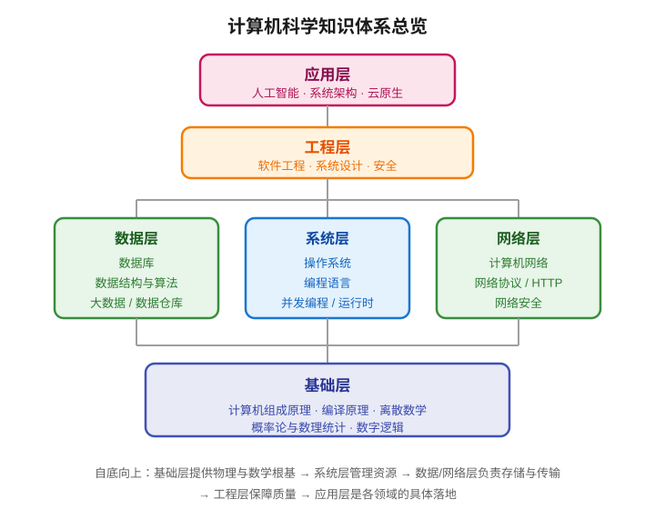
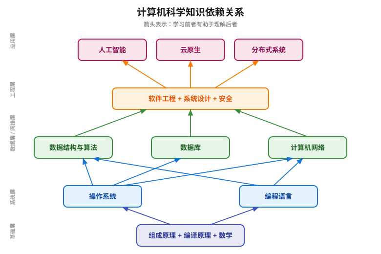

# 计算机科学知识大纲

> 本文是计算机科学（Computer Science, CS）的**知识体系全景图**与**初学者学习路径指南**。
>
> - 上半部分：梳理 CS 的核心知识领域，帮你建立全局认知。
> - 下半部分：给出面向初学者的学习顺序，说明每个领域的依赖关系、学习目标和仓库内对应的笔记。
>
> 与本目录下的 [计算机知识学习先后顺序大纲](计算机知识学习先后顺序大纲.md) 互补：那份文档按 13 阶段展开详细学习路径，本文侧重知识全景与领域关系。

---

## 一、计算机科学知识体系总览

计算机科学研究的是**"如何用计算系统表达、存储、处理和传输信息"**。它不是单一学科，而是一个由数学、工程、逻辑交叉形成的知识树。

从底层到上层，CS 的知识可以归纳为六大核心领域：



六大领域之间的关系：**基础层**提供物理与数学根基，**系统层**管理计算资源，**数据层**与**网络层**负责数据的存储和传输，**工程层**保障大规模开发的质量，**应用层**是各领域的具体落地。

---

## 二、六大核心领域详解

### 2.1 基础层：计算机组成原理与数学基础

这一层回答"计算机是怎么跑起来的"，是所有上层知识的物理根基。

| 子领域 | 核心问题 | 关键概念 |
|--------|---------|---------|
| 计算机组成原理 | CPU 如何执行指令？内存如何存储？ | 冯·诺依曼结构、指令周期、CPU 流水线、存储层次、Cache、总线 |
| 数字逻辑 | 如何用电路表达 0 和 1？ | 晶体管、逻辑门、加法器、触发器、寄存器 |
| 编译原理 | 源代码如何变成机器码？ | 词法分析、语法分析、AST、IR、代码生成、链接 |
| 离散数学 | CS 的数学语言是什么？ | 集合、逻辑、图论、组合数学、递归 |
| 概率论与数理统计 | 如何处理不确定性？ | 概率分布、期望、方差、假设检验、贝叶斯 |

**为什么要先学这一层**：不理解硬件如何执行指令，就学不懂操作系统的调度；不理解编译过程，就学不懂编程语言的运行时。

### 2.2 系统层：操作系统与编程语言

这一层回答"如何让硬件高效、安全地为程序服务"。

| 子领域 | 核心问题 | 关键概念 |
|--------|---------|---------|
| 操作系统 | 如何管理 CPU、内存、IO？ | 进程、线程、协程、虚拟内存、文件系统、系统调用、调度 |
| 编程语言 | 如何用代码表达计算？ | 变量、控制流、函数、面向对象、泛型、闭包、内存管理 |
| 并发编程 | 如何同时做多件事？ | 线程、锁、信号量、原子操作、内存模型、死锁 |
| 运行时与虚拟机 | 高级语言如何跨平台运行？ | JVM、GC、JIT、解释器 |

**操作系统是系统层的核心**：它向下管理硬件，向上为应用提供抽象（进程、文件、Socket）。编程语言则是人与计算机沟通的桥梁。

### 2.3 数据层：数据结构、算法与数据库

这一层回答"如何高效地组织、存储和查询数据"。

| 子领域 | 核心问题 | 关键概念 |
|--------|---------|---------|
| 数据结构 | 如何组织数据？ | 数组、链表、栈、队列、哈希表、树、图、堆 |
| 算法 | 如何高效解决问题？ | 排序、查找、动态规划、贪心、分治、回溯、图算法 |
| 关系型数据库 | 如何可靠存储结构化数据？ | SQL、索引（B+树）、事务、ACID、隔离级别、MVCC、锁 |
| 非关系型数据库 | 如何应对海量数据？ | Redis、MongoDB、列存、文档、键值、时序 |
| 数据仓库与大数据 | 如何分析海量数据？ | OLAP、Hadoop、Spark、列式存储、数据湖 |

### 2.4 网络层：计算机网络

这一层回答"不同计算机之间如何通信"。

| 子领域 | 核心问题 | 关键概念 |
|--------|---------|---------|
| 网络协议 | 数据如何可靠传输？ | OSI 七层、TCP/IP、TCP、UDP、IP、DNS |
| HTTP 与 Web | Web 应用如何通信？ | HTTP/1.1、HTTP/2、HTTP/3、HTTPS、TLS、REST、WebSocket |
| 网络编程 | 如何写网络程序？ | Socket、IO 多路复用、epoll、Reactor |
| 网络安全 | 如何保护通信？ | 加密、签名、证书、XSS、CSRF、SQL 注入 |

### 2.5 工程层：软件工程与系统设计

这一层回答"如何构建可维护、可扩展的真实系统"。

| 子领域 | 核心问题 | 关键概念 |
|--------|---------|---------|
| 软件工程 | 如何团队协作开发？ | 版本控制（Git）、敏捷、CI/CD、代码评审、设计模式 |
| 系统设计 | 如何设计大规模系统？ | 分层、缓存、消息队列、负载均衡、微服务、分布式事务 |
| 安全 | 如何保护系统？ | 认证、授权、加密、漏洞防护、渗透测试 |
| DevOps | 如何高效交付？ | Docker、Kubernetes、监控、日志、可观测性 |

### 2.6 应用层：人工智能与前沿方向

这一层是 CS 知识在具体领域的应用，通常需要前面各层的基础。

| 子领域 | 核心问题 | 关键概念 |
|--------|---------|---------|
| 机器学习 | 如何让机器从数据中学习？ | 线性回归、决策树、SVM、梯度下降、过拟合 |
| 深度学习 | 如何用神经网络处理复杂数据？ | CNN、RNN、Transformer、反向传播 |
| 自然语言处理 | 如何让机器理解语言？ | 词向量、BERT、大语言模型、RAG、Agent |
| 计算机视觉 | 如何让机器看懂图像？ | 图像分类、目标检测、生成模型 |
| 云原生 | 如何在云上构建应用？ | 容器、Serverless、服务网格、可观测性 |

---

## 三、初学者学习顺序

学习顺序的核心原则：**先打地基，再盖楼**。上层知识依赖下层基础，顺序错了会事倍功半。

### 3.1 总学习路径（依赖链）

```text
阶段 0：工具基础（命令行、Git、编辑器）
   ↓
阶段 1：一门编程语言入门（选 Python 或 C）
   ↓
阶段 2：计算机组成原理（理解硬件如何工作）
   ↓
阶段 3：数据结构与算法（用代码高效处理数据）
   ↓
阶段 4：操作系统（理解硬件如何被管理）
   ↓
阶段 5：计算机网络（理解计算机如何通信）
   ↓
阶段 6：数据库（理解数据如何存储查询）
   ↓
阶段 7：软件工程 + 系统设计（构建真实系统）
   ↓
阶段 8：专项深入（AI / 安全 / 分布式 / 云原生）
```

### 3.2 各阶段学习目标

#### 阶段 0：工具基础（1~2 周）

**目标**：建立基本的开发环境操作能力。

| 技能 | 要达到的程度 |
|------|------------|
| 命令行 | 能在终端中浏览目录、创建/删除文件、运行程序 |
| Git | 能 commit、push、pull、解决简单冲突 |
| 编辑器 | 熟练使用 VS Code 或其他编辑器 |
| Markdown | 能写基本的 Markdown 文档 |

#### 阶段 1：编程语言入门（2~4 周）

**目标**：能用代码表达基本逻辑。

- 推荐入门语言：**Python**（语法简单，上手快）或 **C**（贴近底层，理解内存）。
- 核心内容：变量、数据类型、控制流、函数、数组/列表、字符串、文件 IO。
- 练习目标：能独立写 100 行左右的小程序（如计算器、待办清单）。

#### 阶段 2：计算机组成原理（3~4 周）

**目标**：理解程序在硬件上是如何执行的。

- 核心内容：二进制、CPU 结构、指令执行流程、内存层次、Cache 原理。
- 关键认知：理解"程序 = 指令 + 数据"，CPU 按取指-译码-执行循环工作。

#### 阶段 3：数据结构与算法（4~8 周，持续精进）

**目标**：能选择合适的数据结构，写出高效的代码。

- 核心内容：
  - 线性结构：数组、链表、栈、队列、哈希表
  - 树：二叉树、二叉搜索树、红黑树、堆、B 树/B+ 树
  - 图：邻接表/矩阵、BFS、DFS、最短路径
  - 算法：排序、查找、动态规划、贪心、分治
- 练习方法：在 LeetCode 上按题型刷题，先易后难。

#### 阶段 4：操作系统（4~6 周）

**目标**：理解操作系统如何管理硬件和运行程序。

- 核心内容：
  - 进程与线程：创建、切换、通信
  - 内存管理：虚拟内存、分页、置换算法
  - 文件系统：inode、目录、权限
  - 系统调用：用户态与内核态
  - IO：阻塞、非阻塞、IO 多路复用
- 关键认知：操作系统是硬件和应用之间的"管家"。

#### 阶段 5：计算机网络（4~6 周）

**目标**：理解数据如何在网络中传输。

- 核心内容：
  - OSI 七层模型与 TCP/IP 四层模型
  - 传输层：TCP（握手、挥手、拥塞控制）、UDP
  - 网络层：IP、路由、ICMP
  - 应用层：HTTP、HTTPS、DNS
  - 网络编程：Socket、epoll
- 关键认知：网络是分层的，每一层封装下层的服务。

#### 阶段 6：数据库（4~6 周）

**目标**：能设计和优化数据库。

- 核心内容：
  - SQL 语法：增删改查、聚合、连接、子查询
  - 索引：B+ 树、聚簇索引、覆盖索引、最左前缀
  - 事务：ACID、隔离级别、MVCC、锁
  - Redis：数据结构、持久化、缓存策略
  - 分库分表、读写分离

#### 阶段 7：软件工程与系统设计（持续学习）

**目标**：能构建可维护的真实系统。

- 软件工程：Git 高级用法、设计模式、代码规范、CI/CD、测试
- 系统设计：缓存、消息队列、负载均衡、微服务、分布式事务、限流降级
- 项目实战：做一个完整的后端项目（如博客系统、短链服务）

#### 阶段 8：专项深入（根据兴趣选择）

- **AI 方向**：机器学习基础 → 深度学习 → NLP/CV → 大模型应用
- **安全方向**：Web 安全 → 渗透测试 → 密码学 → 安全架构
- **分布式方向**：分布式一致性 → 分布式存储 → 分布式计算
- **云原生方向**：Docker → Kubernetes → 服务网格 → 可观测性

---

## 四、学习方法建议

### 4.1 核心原则

1. **理解优先于记忆**：搞清楚"为什么"比记住"是什么"更重要。
2. **动手实践**：每个概念都要写代码验证，不要只看不练。
3. **自底向上**：先理解底层原理，再学上层抽象，避免空中楼阁。
4. **以项目驱动**：用真实项目串联知识点，比孤立学习更有效。
5. **教是最好的学**：尝试把学到的东西讲给别人听（或写笔记）。

### 4.2 不同阶段的学习策略

| 阶段 | 学习策略 | 输出物 |
|------|---------|--------|
| 入门 | 跟教程敲代码，模仿为主 | 小程序、笔记 |
| 基础 | 理解原理，画图辅助 | 原理笔记、代码实验 |
| 进阶 | 读源码，做项目 | 开源项目、技术博客 |
| 专家 | 深入特定领域，参与社区 | 技术分享、开源贡献 |

### 4.3 常见误区

- ❌ 只看视频不动手 → 看时都会，写时全忘。
- ❌ 追求速成跳过基础 → 基础不牢，后面学不动。
- ❌ 同时学太多东西 → 贪多嚼不烂。
- ❌ 死磕难题不放 → 先跳过，回头再看。
- ❌ 收藏从不看 → 收藏不等于学会。

---

## 五、仓库内对应笔记索引

本仓库已有大量学习笔记，按领域归类如下，可作为学习路径的参考资料：

### 基础层

- [计算机组成原理.md](计算机组成原理/计算机组成原理.md)
- [程序是如何执行的.md](计算机组成原理/程序是如何执行的.md)
- [晶体管.md](计算机组成原理/晶体管.md)
- [编码.md](计算机组成原理/编码.md)

### 系统层

- [操作系统的原理.md](操作系统/操作系统的原理.md)
- [深入理解计算机系统.md](操作系统/深入理解计算机系统.md)
- [程序底层执行原理.md](编程语言/程序底层执行原理.md)
- [Go 语言设计与实现.md](编程语言/Go/Go%20语言设计与实现.md)
- [Rust 入门手册.md](编程语言/Rust/Rust%20入门手册.md)

### 数据层

- [数据结构](数据结构与算法/数据结构/)
- [算法](数据结构与算法/算法/)
- [MySQL数据库知识大纲.md](数据库/MySQL/MySQL数据库知识大纲.md)
- [索引.md](数据库/MySQL/索引.md)
- [redis 缓存实战.md](编程笔记/缓存/redis%20缓存实战.md)

### 网络层

- [深入浅出TCP-IP协议.md](计算机网络/深入浅出TCP-IP协议.md)
- [计算机网络 - OSI.md](计算机网络/计算机网络%20-%20OSI.md)
- [计算机网络工作原理.md](计算机网络/计算机网络工作原理.md)

### 工程层

- [Git 的使用技巧.md](编程笔记/Git%20的使用技巧.md)
- [docker 入门手册.md](编程笔记/Docker/docker%20入门手册.md)
- [K8s从入门到实战学习大纲.md](编程笔记/kubernetes/从入门到实战/K8s从入门到实战学习大纲.md)
- [高性能服务架构可行性方案.md](高性能服务设计与实现/高性能服务架构可行性方案.md)

### 应用层

- [人工智能介绍.md](人工智能/人工智能介绍.md)
- [机器学习基础.md](人工智能/机器学习基础.md)
- [深度学习基础.md](人工智能/深度学习基础.md)
- [大模型应用实战知识总纲.md](人工智能/大模型应用实战知识总纲.md)
- [Agent开发核心知识点.md](Agent%20开发/Agent开发核心知识点.md)

### 综合参考

- [十万个为什么.md](编程语言/十万个为什么.md) — 计算机各领域常见问题详解
- [计算机知识学习先后顺序大纲.md](计算机知识学习先后顺序大纲.md) — 13 阶段详细学习路径

---

## 六、知识依赖关系图

下图展示了各领域之间的依赖关系，箭头表示"学习前者有助于理解后者"：



---

> 本文为知识大纲，具体学习时建议结合 [计算机知识学习先后顺序大纲](计算机知识学习先后顺序大纲.md) 的 13 阶段详细路径展开。学习是一个长期过程，不必急于求成，扎实的基础比速成更重要。
