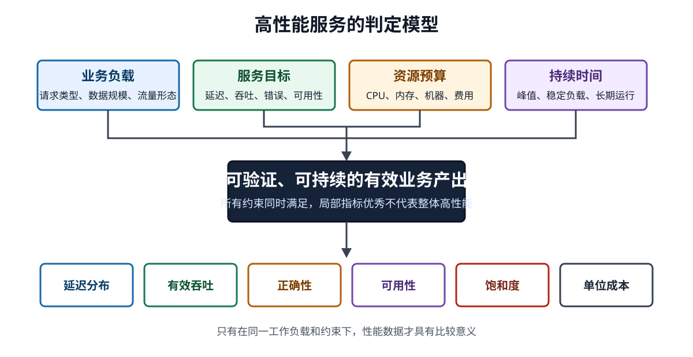
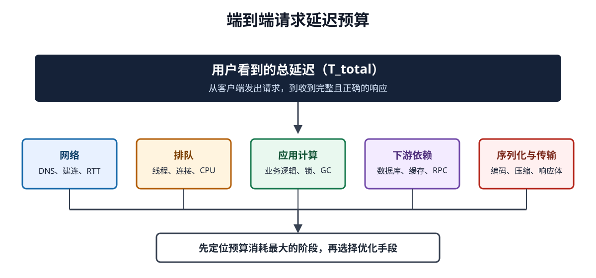
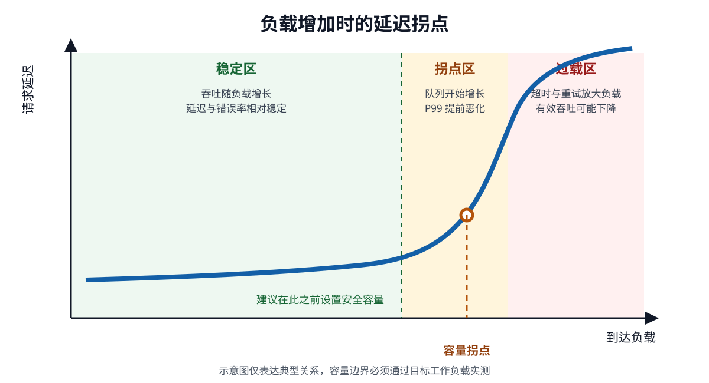

# 什么是高性能服务

高性能服务，是在明确的业务负载和资源预算下，持续满足响应时间、吞吐量、正确性与可用性目标的服务。它强调的是一组可验证的结果，而不是某个孤立数字。

一个服务即使能达到很高的峰值 RPS，只要高分位延迟失控、错误率上升、扩容成本过高，或者流量回落后仍无法恢复，就不能称为高性能服务。反过来，一个吞吐量不高但始终满足业务时限、资源开销合理的内部结算服务，也可能已经达到了它所需要的高性能。



> 高性能必须带有上下文：处理什么请求、在多大负载下、使用多少资源、达到什么服务目标、能够持续多长时间。

## 一、高性能是多目标约束

Google SRE 使用延迟、流量、错误和饱和度四个信号观察面向用户的服务，这四个方向也适合作为高性能的基础判定框架。[cite:1] 在工程实践中，还需要补充成本、正确性和恢复能力，防止局部指标很好而整体服务不可用。

| 维度 | 核心问题 | 常用指标 | 只看单一指标的风险 |
|---|---|---|---|
| 延迟 | 用户需要等待多久 | P50、P95、P99、超时率 | 平均值会掩盖慢请求 |
| 吞吐 | 单位时间完成多少有效工作 | RPS、TPS、消息数/秒、字节/秒 | 请求复杂度不同，数字不可直接比较 |
| 正确性 | 返回结果是否符合业务语义 | 业务成功率、重复率、数据一致性 | HTTP 200 不等于业务成功 |
| 可用性 | 服务能否持续接受并完成请求 | SLI、SLO、错误预算 | 短时压测无法证明长期可用 |
| 饱和度 | 离容量上限还有多远 | 队列长度、等待时间、连接池占用 | CPU 不高也可能已经排队 |
| 弹性 | 负载变化时能否稳定扩缩 | 扩容时延、恢复时间、负载偏斜 | 平均负载会掩盖瞬时热点 |
| 效率 | 达到目标消耗多少资源 | 每万请求成本、CPU 时间、内存/请求 | 堆机器可以暂时掩盖低效设计 |

因此，“接口 P99 小于 100 ms”仍然不是完整目标。可测量的描述应同时给出工作负载和约束，例如：

> 在读写比例 8:2、请求体 P95 小于 8 KiB、下游依赖正常的条件下，单集群持续处理 20,000 RPS；成功请求 P99 延迟不超过 120 ms，业务错误率低于 0.1%，任一节点故障时仍保留 30% 容量余量。

这里的数值只是目标表达方式的示例，不代表通用行业标准。实际目标应由业务时限、历史流量、依赖能力和成本预算共同决定。

## 二、延迟比平均值更接近真实体验

平均延迟只描述了请求耗时的算术中心，无法回答最慢的那部分用户等待了多久。在线服务通常更关心延迟分布：

- **P50** 表示一半请求在该时间内完成，适合观察典型体验。
- **P95** 表示 95% 的请求在该时间内完成，适合观察主要用户群。
- **P99** 表示 99% 的请求在该时间内完成，适合暴露排队、锁竞争、GC 和慢依赖。
- **最大值** 容易受极少量异常样本影响，通常用于排障，不宜单独作为稳定目标。

在扇出调用中，尾延迟会被放大。一个请求如果并行访问许多分片，只要最终结果必须等待全部分片，最慢的那个分片就决定了整体完成时间。Dean 和 Barroso 的研究展示了这种规模放大效应：单个组件中少量的慢请求，在大规模并行调用后会影响相当多的用户请求。[cite:2]

端到端延迟可以拆成多个预算：

```text
总延迟（T_total）
  = 网络延迟（T_network）
  + 排队时间（T_queue）
  + 应用处理时间（T_compute）
  + 下游等待时间（T_dependency）
  + 序列化与传输时间（T_io）
```

其中：

- 总延迟（`T_total`）是用户观察到的完整请求耗时。
- 排队时间（`T_queue`）是请求已经到达，但尚未获得线程、连接或 CPU 的等待时间。
- 应用处理时间（`T_compute`）是业务代码实际执行的时间。
- 下游等待时间（`T_dependency`）是数据库、缓存、消息系统和远程服务消耗的时间。



优化时应先找到预算消耗最大的环节。若 120 ms 中有 90 ms 用在数据库等待，把 JSON 序列化从 3 ms 优化到 1 ms 对整体体验影响有限。

## 三、吞吐、并发和延迟相互约束

吞吐量描述单位时间完成的工作，并发量描述同一时刻系统中正在处理或等待的工作。二者可以通过 Little 定律建立近似关系：

```text
平均并发量（L） = 平均到达速率（λ） × 平均停留时间（W）
```

- 平均并发量（`L`）表示系统中的平均在途请求数。
- 平均到达速率（`λ`）表示单位时间进入系统的请求数。
- 平均停留时间（`W`）表示请求从进入到离开的平均耗时。

例如，服务稳定处理 2,000 RPS，平均响应时间为 50 ms：

```text
平均并发量 = 2,000 请求/秒 × 0.05 秒 = 100 个请求
```

这个关系可以用于估算线程池、连接池和在途请求上限，但不能直接证明系统能稳定承载该负载。突发流量、长尾请求、请求复杂度差异和下游限额都会使瞬时并发远高于平均值。

吞吐量也必须说明统计口径：

| 指标 | 合适的含义 | 容易产生的误解 |
|---|---|---|
| RPS | 每秒处理的 HTTP/RPC 请求数 | 把收到请求当成成功完成请求 |
| QPS | 每秒完成的查询数 | 与 HTTP RPS 混用 |
| TPS | 每秒完成的业务事务数 | 忽略一次事务包含多次调用 |
| 字节吞吐 | 每秒处理的数据量 | 忽略小包和大包的 CPU 成本差异 |
| 并发连接数 | 同时保持的连接数量 | 等同于同时执行的请求数 |

比较两个系统时，应使用相同的数据集、请求比例、响应大小、正确性要求和测试持续时间。脱离工作负载的 QPS 排名没有工程意义。

## 四、性能拐点决定安全容量

服务负载较低时，请求通常可以立即获得资源，延迟相对平稳。随着 CPU、线程池、连接池、磁盘或下游配额接近上限，请求开始排队；负载再增加一点，排队时间可能快速增长，形成性能拐点。



图中的曲线表达典型关系，不代表任何具体系统的实测数据。关键区域有三类：

1. **稳定区**：吞吐随负载增加，延迟和错误率保持在目标内。
2. **拐点区**：吞吐增长开始放缓，P99 延迟、队列长度或超时率明显上升。
3. **过载区**：新增请求主要变成排队、超时、重试和资源争用，实际有效吞吐可能下降。

安全容量不应取压测中的最大吞吐，而应取满足全部服务目标时的最大持续吞吐，并预留故障、发布、流量突增和负载偏斜所需的余量。

Google SRE 指出，许多系统在资源达到 100% 利用率之前就会退化，P99 延迟上升往往是接近饱和的早期信号。[cite:1] Brendan Gregg 的 USE 方法进一步建议，对每类资源同时检查利用率、饱和度和错误；较长时间窗口的平均利用率可能掩盖短时的 100% 忙碌与排队。[cite:3]

## 五、高性能服务的基本能力

### 5.1 快速路径足够短

一次同步请求经过的网络跳数、序列化次数、锁、远程调用和持久化操作越多，延迟预算越难控制。高频读路径通常需要减少跨进程调用、合并 I/O、复用连接，并避免在请求线程中执行无关工作。

减少步骤不能牺牲正确性。缓存命中很快，但失效策略错误会返回旧数据；异步写入很快，但必须定义消息丢失、重复消费和最终一致性的处理方式。

### 5.2 有界队列和背压

无界队列不会消除过载，只会把失败推迟为更长的延迟、更高的内存占用和更慢的恢复。线程池队列、消息积压、连接等待队列都应有容量边界，并在边界处采用明确策略：

- 拒绝低优先级请求；
- 降级非核心功能；
- 限制单租户或单调用方流量；
- 向上游传播背压；
- 对异步任务设置过期时间，丢弃已经失去业务价值的工作。

负载保护的目标是让系统在过载时保住有效吞吐和核心链路，而不是让所有请求一起缓慢超时。

### 5.3 超时贯穿整条调用链

每个跨进程调用都应受截止时间约束。上游有 500 ms 总预算时，下游调用不能各自等待 500 ms；预算需要扣除网络、排队、重试和响应处理时间后逐级传递。

超时值过长会长期占用线程、连接、内存和临时端口；超时值过短又会制造误超时和额外重试。AWS 建议根据下游延迟分布选择超时，并谨慎处理 DNS、TLS 建连等是否包含在计时范围内的问题。[cite:4]

### 5.4 重试有预算且保持幂等

重试适合处理短暂故障，但它会产生额外负载。五层调用链若每层独立重试三次，最下游最坏可能收到 \(3^5 = 243\) 次尝试。AWS 建议把重试集中在调用链中的有限位置，并配合次数上限、指数退避和随机抖动，避免大量客户端在同一时刻再次冲击下游。[cite:4]

带副作用的操作还需要幂等键、唯一约束或状态机，防止超时后重试造成重复扣款、重复下单等业务错误。

### 5.5 能水平扩展且负载均匀

无状态计算节点更容易扩缩和故障转移，但整个系统的容量仍由最窄的依赖决定。应用节点翻倍并不意味着数据库写入、热点分片或第三方接口配额也会翻倍。

扩展能力至少要验证：

- 扩容后流量是否均匀落到新节点；
- 连接预热、缓存预热和 JIT 是否引起延迟尖峰；
- 分片是否出现热点；
- 配置中心、注册中心和监控系统能否承受节点增长；
- 缩容时在途请求能否排空。

### 5.6 可观测且可以归因

只知道“接口慢了”不足以支持优化。请求指标应能关联路由、状态码、错误类型、依赖和资源状态。OpenTelemetry 的 HTTP 语义约定将服务端请求时长定义为直方图，并提供活动请求数等指标，便于统一采集延迟分布和并发状态。[cite:5]

高性能服务通常同时使用两种视角：

- **请求视角**：速率、错误、延迟分布，对应用户看到的结果。
- **资源视角**：利用率、饱和度、错误，对应结果背后的容量原因。

请求指标异常用于发现症状，资源指标、追踪、日志和性能剖析用于定位原因。更完整的指标定义见[《后端服务性能指标体系》](性能指标说明.md)。

## 六、常见设计手段及其代价

性能优化没有免费的技术选项。每种手段都把成本或复杂度转移到了其他位置。

| 手段 | 主要收益 | 主要代价或风险 | 适合解决的问题 |
|---|---|---|---|
| 本地缓存 | 极低读取延迟，减少远程访问 | 多副本一致性、内存占用、冷启动 | 高频热点读 |
| 分布式缓存 | 分担数据库压力，可共享数据 | 网络跳转、热点 Key、穿透与雪崩 | 读多写少的数据 |
| 批处理 | 摊薄网络和系统调用成本 | 增加等待时间、失败处理复杂 | 吞吐优先的写入 |
| 异步化 | 缩短同步链路、削峰 | 最终一致、积压、重复消费 | 无需即时完成的工作 |
| 并行化 | 降低可并行任务的完成时间 | 扇出放大、尾延迟、资源竞争 | 独立子任务 |
| 连接复用 | 减少握手和建连成本 | 长连接治理、连接失效 | 高频远程调用 |
| 分片 | 分散存储和计算压力 | 跨分片查询、迁移、热点 | 单节点容量不足 |
| 预计算 | 把在线计算移到离线 | 数据新鲜度、存储放大 | 复杂且重复的查询 |
| 限流和负载丢弃 | 防止过载扩散 | 部分请求被拒绝或降级 | 容量边界保护 |

选择手段时应先确认瓶颈。CPU 密集型服务增加缓存可能没有帮助，锁竞争严重的程序增加线程可能让上下文切换更频繁，数据库已经饱和时增加应用副本还可能制造更多连接和查询。

## 七、如何证明一个服务具备高性能

单次压测只能说明某个版本在某种环境和负载下的表现。可信的结论需要完整的验证闭环。

### 7.1 定义工作负载

先记录请求模型，而不是先设定压测线程数：

- 各接口与业务类型的流量比例；
- 请求体、响应体和数据集大小分布；
- 读写比例、缓存命中率和热点程度；
- 平稳流量、阶跃流量和突发流量；
- 下游依赖的延迟与错误注入；
- 测试时长、预热时间和数据增长。

### 7.2 定义通过条件

通过条件应同时约束延迟、吞吐、错误、资源和恢复：

| 类别 | 示例表达 |
|---|---|
| 延迟 | 成功请求 P99 不超过业务时限 |
| 吞吐 | 持续负载下完成吞吐达到目标，而非仅统计到达量 |
| 错误 | 技术错误与业务失败分别统计，并保持在 SLO 内 |
| 饱和 | 队列、连接池和关键资源仍有明确余量 |
| 稳定 | 长时间运行后无持续内存增长、积压或性能衰减 |
| 恢复 | 流量回落或依赖恢复后，在目标时间内清理积压并恢复延迟 |
| 成本 | 单位有效请求的资源或费用不超过预算 |

### 7.3 逐步寻找边界

测试负载应逐级增加，并在每一级保持足够时间，让缓存、GC、连接池和后台任务进入稳定状态。记录吞吐、P99、错误率、队列和资源曲线，找到第一个违反目标的指标。这个指标对应当前容量边界，而最后崩溃的组件未必是最先需要优化的组件。

### 7.4 验证异常场景

正常依赖下的高吞吐无法证明过载行为可靠。还应验证：

- 单节点退出和可用区故障；
- 数据库、缓存和消息系统变慢；
- 热点 Key 或热点租户；
- 网络延迟、丢包和连接重置；
- 发布、扩容、缩容和缓存冷启动；
- 重试流量与定时任务同时到达；
- 限流、降级、熔断和恢复是否符合预期。

详细测试类型与指标可继续阅读[《后端服务性能指标体系》](性能指标说明.md)，入口层设计见[《如何设计一个支持百万级 QPS 的 API 网关》](百万级QPS%20API网关设计.md)，过载保护见[《限流方案设计》](限流方案设计.md)。

## 八、容易误判为高性能的现象

### 8.1 峰值 QPS 很高

如果错误响应、缓存空结果或被限流请求也计入吞吐，峰值数字会虚高。有效吞吐应只统计满足正确性和延迟目标的已完成工作。

### 8.2 平均延迟很低

平均值可能被大量快速请求拉低，同时少量用户持续超时。至少同时观察 P50、P95、P99、超时率和慢请求样本。

### 8.3 CPU 利用率不高

服务可能受锁、连接池、磁盘、网络、内存带宽或下游配额限制。CPU 的长时间平均值还可能隐藏短时打满。判断瓶颈需要同时检查利用率、饱和度和错误。

### 8.4 增加机器后吞吐线性增长

短期线性扩展可能来自测试数据没有触发共享瓶颈。随着节点增加，数据库、注册中心、配置分发、日志采集和负载均衡都可能变成新的上限。

### 8.5 压测不报错

压测脚本可能没有校验响应内容，测试环境也可能省略鉴权、日志、数据持久化等生产路径。没有技术错误不等于结果正确，更不等于生产稳定。

## 九、最终判断标准

判断一个服务是否高性能，可以归结为一句话：

> 在真实且明确的工作负载下，服务以可接受的资源成本，持续完成正确的业务工作，并在接近容量边界、局部故障和流量波动时保持可预测的延迟、错误率与恢复能力。

这一定义包含五个不可省略的条件：

1. **工作负载明确**：请求类型、数据规模和流量形态可复现。
2. **目标可以测量**：延迟分位、有效吞吐、错误率和资源预算有清晰口径。
3. **性能可以持续**：结果来自稳定负载和长时间测试，而非瞬时峰值。
4. **过载行为可预测**：系统会限流、背压或降级，不会无限排队并放大故障。
5. **结果具有经济性**：性能提升没有依赖不可接受的资源浪费和维护复杂度。

高性能设计的起点不是选择缓存、消息队列或某种高性能语言，而是定义业务需要完成的工作和允许消耗的时间。目标明确后，测量才能指出瓶颈，架构手段才有取舍依据。

## 资料来源

1. [cite:1] Google, [Monitoring Distributed Systems](https://sre.google/sre-book/monitoring-distributed-systems/)
2. [cite:2] Jeffrey Dean and Luiz André Barroso, [The Tail at Scale](https://research.google/pubs/the-tail-at-scale/)
3. [cite:3] Brendan Gregg, [The USE Method](https://www.brendangregg.com/usemethod.html)
4. [cite:4] AWS Builders' Library, [Timeouts, retries, and backoff with jitter](https://aws.amazon.com/builders-library/timeouts-retries-and-backoff-with-jitter/)
5. [cite:5] OpenTelemetry, [Semantic conventions for HTTP metrics](https://opentelemetry.io/docs/specs/semconv/http/http-metrics/)
