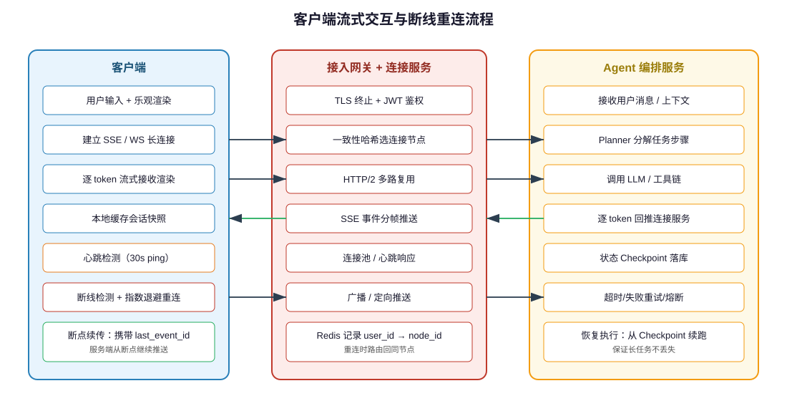
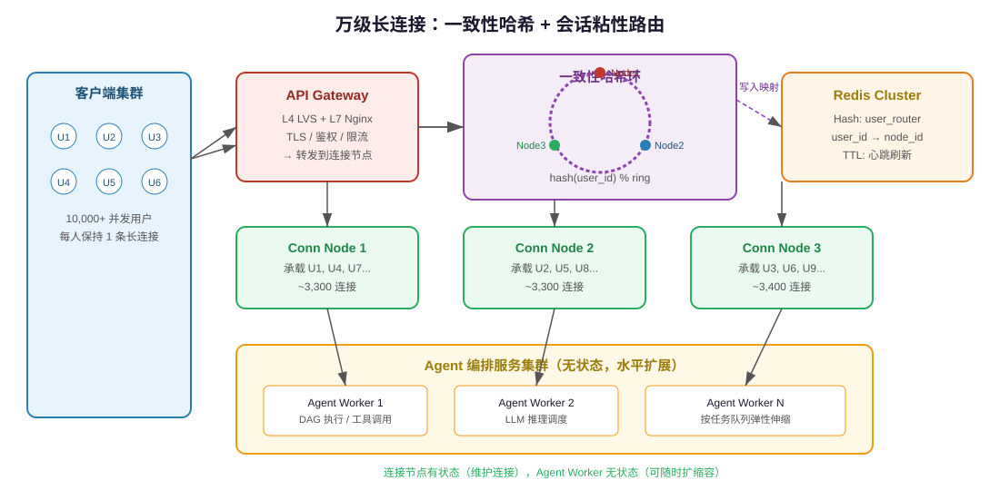
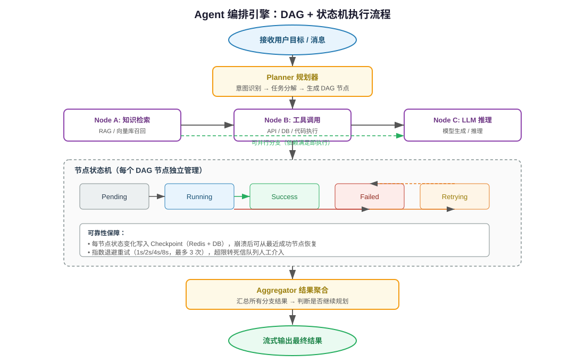
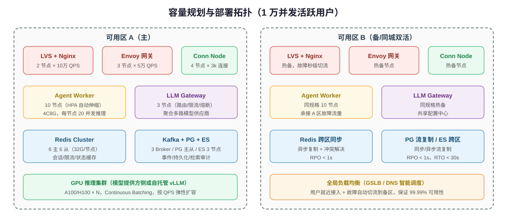

# 高性能 Agent 服务架构设计与实现

> 目标：构建一套支持 **上万用户同时活跃** 的 AI Agent 服务架构，覆盖客户端、服务端与 Agent 编排全链路，并给出可落地的高并发、高可用与成本控制方案。

---

## 目录

- [一、背景与目标](#一背景与目标)
- [二、核心挑战分析](#二核心挑战分析)
- [三、整体架构设计](#三整体架构设计)
- [四、客户端设计](#四客户端设计)
- [五、接入网关与连接会话层](#五接入网关与连接会话层)
- [六、Agent 编排引擎](#六agent-编排引擎)
- [七、LLM Gateway 模型网关](#七llm-gateway-模型网关)
- [八、高并发与可靠性设计](#八高并发与可靠性设计)
- [九、容量规划与部署拓扑](#九容量规划与部署拓扑)
- [十、关键术语对照表](#十关键术语对照表)

---

## 一、背景与目标

### 1.1 业务场景

AI Agent 服务与传统 HTTP API 服务有本质区别：它不是一次性请求-响应，而是**长连接 + 流式输出 + 多步工具调用**的长时任务。一个用户的一次提问可能触发：

1. 多轮 LLM 推理（每轮数秒级延迟）；
2. 若干外部工具调用（搜索、数据库、代码执行等）；
3. 持续的 token 流式推送；
4. 跨请求的会话状态与记忆管理。

当这类服务需要承载 **10,000+ 并发活跃用户** 时，系统会同时面临**连接数、吞吐、延迟、成本、状态一致性**五大挑战。

### 1.2 设计目标

| 指标维度 | 目标值 | 说明 |
|---------|--------|------|
| 并发活跃用户数 | ≥ 10,000 | 同时在线并保持长连接 |
| 首 token 延迟（TTFB） | P95 ≤ 1.5s | 用户发送消息到看到第一个字 |
| 流式输出速率 | ≥ 30 token/s | 打字机效果流畅 |
| 服务可用性 | ≥ 99.99% | 年停机 < 52 分钟 |
| 单用户成本 | 可预算、可限流 | 避免单用户耗尽模型配额 |

---

## 二、核心挑战分析

Agent 服务在高并发下的挑战与普通 Web 服务显著不同：

| 挑战 | 普通 Web 服务 | Agent 服务 | 影响 |
|------|-------------|-----------|------|
| **连接模型** | 短连接，请求结束即释放 | 长连接（SSE/WS），一次会话持续数分钟 | 单机连接数上限成为瓶颈 |
| **响应时长** | 毫秒级 | 单次推理数秒，多步任务可达数十秒 | 线程/协程被长时间占用 |
| **输出方式** | 一次性返回 | token 级流式推送 | 需频繁写入连接，放大 IO |
| **依赖深度** | 1~2 层调用 | LLM + 多工具 + 向量库 + 记忆 | 长尾延迟叠加，易雪崩 |
| **状态管理** | 无状态或简单 Session | 多轮上下文、记忆、Checkpoint | 状态存储与一致性复杂 |
| **成本模型** | 按机器资源计费 | 按 Token 计费，昂贵且不可控 | 需精细化预算与限流 |

> **关键认知**：Agent 服务的瓶颈往往不在 CPU，而在**长连接占用、LLM 推理延迟与 Token 成本**。架构设计必须围绕这三点展开。

---

## 三、整体架构设计

整体采用**六层分层架构**，从下到上职责清晰、可独立扩展：


### 3.1 各层职责

| 层级 | 核心组件 | 关键职责 | 扩展性 |
|------|---------|---------|--------|
| **客户端层** | Web/App/CLI | 流式渲染、断线重连、本地缓存 | N/A |
| **接入网关层** | LVS + Nginx + Envoy | TLS、鉴权、限流、路由 | L4 无状态水平扩展 |
| **连接会话层** | Connection Manager | 长连接池、粘性路由、心跳广播 | 有状态，一致性哈希分片 |
| **Agent 编排层** | Planner + DAG Engine + Tool Executor | 任务分解、工具调用、状态机 | 无状态，按队列水平扩展 |
| **模型网关层** | LLM Gateway | 模型路由、熔断降级、成本控制 | 无状态水平扩展 |
| **基础设施层** | Redis / Kafka / PG / 向量库 / ES | 状态、事件、持久化、检索 | 集群化部署 |

### 3.2 核心设计原则

1. **连接与计算分离**：连接节点有状态（维护长连接），Agent Worker 无状态（可随意扩缩容）；
2. **流式全链路**：从 LLM 推理到客户端渲染，全程流式（Streaming），避免大对象缓冲；
3. **状态外部化**：会话状态、任务 Checkpoint 统一存入 Redis/DB，进程不持有硬状态；
4. **异步解耦**：工具调用、记忆写入、日志审计走 Kafka 异步化，削峰填谷；
5. **多层熔断**：网关、LLM Gateway、工具调用各层独立熔断，防止故障级联。

---

## 四、客户端设计

客户端是用户体验的第一触点，核心目标是**让用户感觉响应快、不断线、不丢消息**。



### 4.1 连接协议选择

| 协议 | 适用场景 | 优缺点 |
|------|---------|--------|
| **SSE（Server-Sent Events）** | 单向流式输出（推荐） | 基于 HTTP，天然穿透代理；服务端推客户端；实现简单 |
| **WebSocket** | 双向实时通信 | 全双工；需额外处理心跳与重连；部分代理不友好 |
| **HTTP/2 + gRPC Stream** | 内部服务间 | 高效多路复用；客户端接入需 SDK 支持 |

> **推荐策略**：对外暴露 **SSE**（兼容性最好、调试方便），内部服务间用 **gRPC Stream**。

### 4.2 关键能力

#### 4.2.1 流式渲染（打字机效果）

- 客户端建立 SSE 连接后，逐 `data:` 帧接收 token；
- 每收到一个 token 立即追加到 UI，无需等完整响应；
- 对工具调用等非文本事件，渲染为"正在调用搜索…"等状态卡片。

#### 4.2.2 乐观渲染

用户发送消息时，立即在 UI 上展示用户气泡与"AI 思考中…"占位，再等服务端 token 流覆盖。这能将**感知延迟**降到最低。

#### 4.2.3 心跳保活

- 客户端每 30s 发送一次 ping（SSE 场景由服务端发 `: heartbeat` 注释行）；
- 超过 90s 未收到任何数据，判定连接断开。

#### 4.2.4 断线重连与断点续传

```text
断线检测 → 指数退避重连（1s / 2s / 4s / 8s，上限 30s）
  ↓
重连时携带 last_event_id（SSE 原生支持）
  ↓
服务端根据 last_event_id 从断点继续推送，避免重复或丢失
```

#### 4.2.5 本地会话缓存

- 用 IndexedDB / LocalStorage 缓存会话消息与最后一条事件 ID；
- 刷新页面后可恢复对话上下文，无需重新拉取历史。

### 4.3 客户端状态机

```
Idle → Connecting → Connected → Streaming → Connected ...
                  ↓              ↓
            Disconnected ← 心跳超时
                  ↓
            Reconnecting（指数退避）
```

---

## 五、接入网关与连接会话层

这一层是支撑万级长连接的关键，核心是**连接管理 + 粘性路由**。

### 5.1 分层接入

```
DNS / GSLB（跨区调度）
  ↓
L4 LVS（四层转发，1000万+ PPS）
  ↓
L7 Nginx / Envoy（TLS 终止、鉴权、限流）
  ↓
Connection Node（长连接承载节点）
```

### 5.2 万级长连接的一致性哈希路由



**核心思路**：用 Redis Hash（`user_router`）记录 `user_id → connection_node_id` 的映射，让同一用户的所有请求始终落到同一个连接节点。

#### 5.2.1 路由流程

1. 用户首次连接，网关根据 `user_id` 做一致性哈希，选定一个 Connection Node；
2. Connection Node 在 Redis 中写入 `user_router[user_id] = node_id`，TTL 60s；
3. 后续该用户的请求（包括重连），网关先查 Redis，若命中则直接路由到记录的节点；
4. 心跳定期刷新 TTL，用户下线则删除映射。

#### 5.2.2 为什么需要粘性

- SSE/WS 连接是有状态的，流式数据只能从持有连接的节点发出；
- Agent Worker 处理完一步后，需要把 token 推回用户连接，必须知道用户在哪个节点；
- 通过 `user_router` 映射，Worker 可精准定位连接节点，无需广播。

#### 5.2.3 节点扩缩容

- 新增节点：一致性哈希只迁移部分用户，影响面小；
- 节点下线：Redis 中映射过期后，用户重连会被哈希到新节点；
- 关键：**连接节点要做优雅下线**，先停止接受新连接，等已有连接迁移或结束。

### 5.3 连接节点的资源控制

单机承载长连接的瓶颈在**文件描述符与内存**，需做以下调优：

| 调优项 | 建议值 | 说明 |
|--------|--------|------|
| `ulimit -n` | ≥ 1,000,000 | 单进程最大文件描述符 |
| `net.core.somaxconn` | 65535 | TCP 全连接队列 |
| `tcp_tw_reuse` | 1 | 复用 TIME_WAIT 连接 |
| 内核缓冲区 | 适当调大 | `rmem`/`wmem` |
| Go GOMAXPROCS | = CPU 核数 | 充分利用多核 |

> **经验值**：一台 8C16G 的 Go 连接节点，优化后可承载 **3~5 万条**空闲长连接（心跳流量小）。1 万并发只需 2~3 个节点即可，留足余量。

### 5.4 分布式限流

在网关层实现**多级限流**，防止单用户或异常流量打垮后端：

| 限流维度 | 算法 | 作用 |
|---------|------|------|
| 全局限流 | 令牌桶（Redis + Lua） | 保护整体后端容量 |
| 用户级限流 | 滑动窗口 | 防止单用户刷屏 |
| IP 级限流 | 固定窗口 | 防爬虫/攻击 |
| 模型级限流 | 令牌桶 | 保护 LLM API 配额 |

```go
// Redis + Lua 实现分布式令牌桶（简化示例）
func allow(ctx context.Context, key string, rate, burst int) bool {
    script := `
        local tokens = tonumber(redis.call("get", KEYS[1]))
        if tokens == nil then tokens = tonumber(ARGV[2]) end
        if tokens > 0 then
            redis.call("decr", KEYS[1])
            return 1
        end
        return 0
    `
    // 后台 goroutine 按 rate 速率补充令牌
}
```

---

## 六、Agent 编排引擎

编排引擎是 Agent 服务的大脑，负责把用户目标拆解为可执行步骤，并可靠地执行。



### 6.1 核心组件

| 组件 | 职责 |
|------|------|
| **Planner（规划器）** | 理解用户意图，将目标分解为 DAG 节点 |
| **DAG Engine** | 按依赖关系调度节点执行，支持并行分支 |
| **Tool Executor** | 调用外部工具（API/DB/代码），处理参数与超时 |
| **Memory** | 工作记忆（当前任务）+ 长期记忆（向量库检索） |
| **Guard** | 权限校验、内容安全、Token 预算控制 |
| **Checkpoint** | 节点状态持久化，支持崩溃恢复 |

### 6.2 DAG 执行模型

Planner 生成的是一个**有向无环图（DAG）**，每个节点是一个原子步骤（LLM 推理、工具调用、条件判断等）。

```text
用户目标："帮我查一下北京今天的天气并写封邮件提醒同事带伞"

DAG：
  [知识检索: 北京天气] ──→ [LLM: 生成邮件正文] ──→ [工具: 发送邮件]
         │                                        ↑
         └────────── [工具: 查询天气API] ──────────┘
              （依赖天气数据）
```

**调度规则**：
- 节点的所有前驱完成后，即可执行（支持并行）；
- 每个节点独立维护状态机（见 6.3）；
- 某个节点失败，按策略重试或终止整个 DAG。

### 6.3 节点状态机

每个 DAG 节点有独立的状态机，保证执行可观测、可恢复：

```
Pending → Running → Success
                ↘ Failed → Retrying → Running（重试）
                              ↓（超限）
                           DeadLetter（人工介入）
```

| 状态 | 含义 | 持久化 |
|------|------|--------|
| Pending | 等待前驱完成 | 是 |
| Running | 正在执行 | 是（带超时） |
| Success | 执行成功，结果已写入 | 是 |
| Failed | 执行失败 | 是（带错误原因） |
| Retrying | 正在重试 | 是（重试次数） |
| DeadLetter | 超过重试上限 | 是（通知人工） |

### 6.4 Checkpoint 与崩溃恢复

- 每完成一个节点，立即将状态与结果写入 Redis（热）+ PostgreSQL（冷）；
- Agent Worker 崩溃后，新 Worker 接管任务时，从最近一个 Success 节点继续执行；
- 避免重复执行已成功的工具调用（尤其有副作用的操作，如发邮件、扣款）。

### 6.5 超时、重试与熔断

| 机制 | 策略 |
|------|------|
| **节点超时** | LLM 推理 30s，工具调用 10s（可配置） |
| **重试** | 指数退避 1s/2s/4s，最多 3 次 |
| **熔断** | 某工具连续失败率 > 50% 时熔断 30s，直接降级 |
| **降级** | 主模型失败切备模型；工具不可用时返回提示而非崩溃 |

### 6.6 记忆管理

| 记忆类型 | 存储 | 用途 |
|---------|------|------|
| 工作记忆 | 进程内 + Redis | 当前对话上下文，随会话过期 |
| 长期记忆 | 向量数据库（Milvus/Qdrant） | 用户偏好、历史事实，语义检索 |
| 程序记忆 | PostgreSQL | 可复用工作流/技能模板 |

> **关键**：不能把所有历史塞进 LLM 上下文。需做**记忆检索（RAG）**，只把相关片段注入 prompt，控制 Token 成本。

---

## 七、LLM Gateway 模型网关

LLM Gateway 是 Agent 与模型提供方之间的抽象层，解决**路由、限流、熔断、成本**四大问题。


### 7.1 核心职责

| 职责 | 说明 |
|------|------|
| **模型路由** | 根据任务类型、优先级、成本选择合适模型 |
| **限流** | 按账号/模型/用户维度做 Token 速率限制 |
| **熔断降级** | 主模型故障时自动切到备模型 |
| **成本统计** | 实时统计 Token 消耗，超预算拒绝 |
| **内容安全** | 输入输出敏感词过滤、合规校验 |
| **Prompt 缓存** | 相同前缀命中则复用计算，降低成本与延迟 |

### 7.2 模型路由策略

```text
简单意图（问候、闲聊）  → 低成本模型（GPT-3.5 / 国产小模型）
复杂推理（代码、分析）  → 高质量模型（GPT-4 / Claude 3.5）
敏感数据（企业内部）    → 私有部署模型（数据不出域）
向量化任务              → Embedding 模型（批量异步）
```

### 7.3 推理加速

对于自托管模型，使用 **vLLM / SGLang** 等推理框架：

| 技术 | 效果 |
|------|------|
| **Continuous Batching** | 新请求可插入正在执行的 batch，提升 GPU 利用率 2~3 倍 |
| **PagedAttention** | 类似虚拟内存管理 KV Cache，减少显存碎片 |
| **Prefix Cache** | 相同系统提示词只计算一次，大幅降低首 token 延迟 |

### 7.4 成本控制

- **单用户配额**：每日 Token 上限，超限返回"今日额度已用完"；
- **任务级预算**：Planner 在分解任务时预估 Token 消耗，超预算拒绝；
- **缓存优先**：Prompt 前缀缓存命中则不消耗推理 Token；
- **降级策略**：高峰期自动将非关键请求路由到低成本模型。

---

## 八、高并发与可靠性设计

### 8.1 连接与计算分离

```
Connection Node（有状态，少而稳）  ←→  Agent Worker（无状态，多而弹性）
```

- 连接节点只负责 IO（收发数据），不做业务计算；
- Agent Worker 从任务队列取活，处理完把结果推回连接节点；
- Worker 可根据队列长度 HPA 自动伸缩，连接节点相对固定。

### 8.2 异步解耦

| 场景 | 异步方式 | 好处 |
|------|---------|------|
| 工具调用结果写库 | Kafka | 不阻塞主流程 |
| 记忆向量写入 | Kafka + 批量 | 合并写入向量库 |
| 日志与审计 | Kafka → ES | 异步落盘 |
| 非实时通知 | Kafka → 推送服务 | 削峰填谷 |

### 8.3 多级缓存

```
客户端缓存（会话快照）
  ↓
进程内 LRU 缓存（用户信息、工具定义）
  ↓
Redis 分布式缓存（会话状态、Checkpoint、限流计数）
  ↓
PostgreSQL（持久化）
```

### 8.4 熔断与降级

| 层级 | 熔断条件 | 降级策略 |
|------|---------|---------|
| 网关 | 后端错误率 > 50% | 返回缓存或友好提示 |
| LLM Gateway | 主模型超时/错误 | 切备模型 |
| 工具调用 | 连续失败 | 返回"工具暂不可用" |
| 向量库 | 查询超时 | 跳过记忆增强，仅用上下文 |

### 8.5 可观测性

| 维度 | 工具 | 关键指标 |
|------|------|---------|
| 指标 | Prometheus + Grafana | QPS、延迟 P99、错误率、连接数、GPU 利用率 |
| 日志 | ELK / Loki | 结构化日志，含 trace_id |
| 链路追踪 | OpenTelemetry | 一次请求跨网关→Worker→LLM→工具的全链路 |
| 告警 | Alertmanager | 错误率突增、队列积压、Token 超预算 |

---

## 九、容量规划与部署拓扑

### 9.1 容量估算（1 万并发活跃用户）

假设：平均每用户每 30 秒发起一次对话，单次对话平均 5 轮，每轮 LLM 推理 3s。

| 资源 | 估算 | 说明 |
|------|------|------|
| 并发长连接 | 10,000 | 每用户 1 条 SSE |
| 峰值 QPS | ~3,000 | 10000 / 30s × 峰值系数 10 |
| 并发推理数 | ~2,000 | 10000 × (3s / 15s 平均思考间隔) |
| 连接节点 | 3~4 个（8C16G） | 每节点承载 3~5k 连接 |
| Agent Worker | 10~20 个（4C8G） | 按推理并发弹性伸缩 |
| LLM Gateway | 3 个 | 无状态，高可用 |
| Redis | 6 主 6 从（32G/节点） | 会话+限流+缓存 |
| GPU 推理 | 按模型 QPS 估算 | A100/H100 集群或调用商用 API |

### 9.2 部署拓扑



采用**同城双可用区**部署：

- **可用区 A（主）**：承载全量流量；
- **可用区 B（备）**：热备规格，故障时 GSLB 秒级切流；
- **数据层**：Redis 跨区异步复制，PostgreSQL 流复制，ES 跨区索引；
- **目标**：RPO < 1s，RTO < 30s，可用性 99.99%。

### 9.3 弹性伸缩策略

| 组件 | 伸缩指标 | 策略 |
|------|---------|------|
| Agent Worker | 任务队列长度 / CPU | HPA，队列积压时扩容 |
| LLM Gateway | QPS / P99 延迟 | HPA |
| 连接节点 | 连接数 | 手动+定时（连接节点有状态，谨慎自动扩缩） |
| GPU 推理 | 排队请求数 | 按模型 QPS 预留 + 自动扩容 |

---

## 十、关键术语对照表

| 中文术语 | 英文术语 | 说明 |
|---------|---------|------|
| 智能体 | Agent | 能感知、规划、调用工具并根据反馈调整的 AI 系统 |
| 服务端推送事件 | SSE（Server-Sent Events） | 基于 HTTP 的服务端单向流式推送协议 |
| 有向无环图 | DAG（Directed Acyclic Graph） | Agent 任务分解后的执行依赖图 |
| 一致性哈希 | Consistent Hashing | 分布式系统中实现负载均衡与节点平滑扩缩的哈希算法 |
| 粘性会话 | Sticky Session | 同一用户的请求始终路由到同一后端节点 |
| 检查点 | Checkpoint | 任务执行状态的持久化快照，用于崩溃恢复 |
| 检索增强生成 | RAG（Retrieval-Augmented Generation） | 从外部知识库检索相关内容注入 LLM 上下文 |
| 熔断 | Circuit Breaker | 下游故障时快速失败，防止级联崩溃 |
| 降级 | Degradation | 非核心功能不可用时用简化方案替代 |
| 令牌桶 | Token Bucket | 一种限流算法，按固定速率生成令牌，请求需消耗令牌 |
| 首字节时间 | TTFB（Time To First Byte） | 从请求发起到收到第一个响应字节的时间 |
| 恢复点目标 | RPO（Recovery Point Objective） | 故障后允许丢失的数据量上限 |
| 恢复时间目标 | RTO（Recovery Time Objective） | 故障后到服务恢复的最大允许时间 |
| 连续批处理 | Continuous Batching | 推理框架动态插入新请求到正在执行的 batch，提升 GPU 利用率 |

---

## 小结

支撑上万并发活跃用户的 Agent 服务，关键在于**连接与计算分离、全链路流式、状态外部化、多级熔断与精细成本控制**：

1. **客户端**：SSE 流式渲染 + 心跳 + 指数退避重连 + 断点续传；
2. **接入层**：L4+L7 分层网关 + 一致性哈希粘性路由 + 分布式限流；
3. **编排层**：DAG 执行引擎 + 节点状态机 + Checkpoint 崩溃恢复；
4. **模型层**：LLM Gateway 路由/熔断/降级 + 推理加速 + 成本预算；
5. **基础设施**：Redis 状态缓存 + Kafka 异步解耦 + PG/ES 持久化检索 + 向量库记忆。

通过这套架构，可在控制 Token 成本的前提下，实现万级用户的流畅、稳定、可观测的 Agent 服务。
